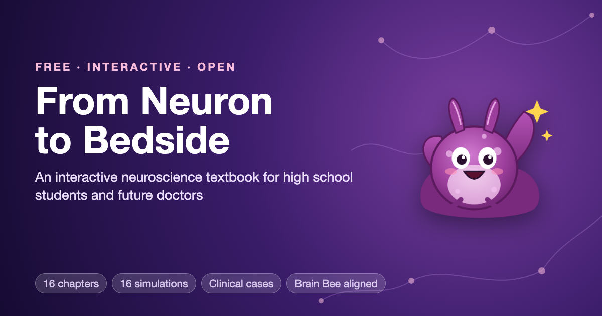

# From Neuron to Bedside

[](https://www.mkdocs.org/)
[](https://squidfunk.github.io/mkdocs-material/)
[](https://aaryavvatts-lab.github.io/neuroscience-textbook/)
[](https://dmccreary.github.io/intelligent-textbooks/)
[](https://p5js.org/)
[](https://creativecommons.org/licenses/by-nc-sa/4.0/)

**A free, interactive neuroscience textbook for high school students and future doctors.**



## View the live site

**https://aaryavvatts-lab.github.io/neuroscience-textbook/**

## Overview

Neurological conditions are the leading cause of illness and disability in the world, but many high schools teach little or no neuroscience. *From Neuron to Bedside* takes a reader from a single neuron all the way to the hospital bedside. The only prerequisites are one year of high school biology and basic algebra.

Every chapter follows the same pattern:

- a real-world hook, often through Maya, a 16-year-old soccer player studying for the Brain Bee
- the science, explained with an everyday comparison before the technical words
- an interactive **MicroSim** (a p5.js simulation you control in the browser)
- an **At the Bedside** clinical case, where you follow a doctor from symptoms to the part of the nervous system that's affected
- common misconceptions, Brain Bee-style practice questions, 12 exercises across Bloom's Taxonomy, and a 10-question quiz

The book covers the topics that high school neuroscience competitions like the Brain Bee ask about. It also teaches the patient-diagnosis and neuroanatomy skills that some higher-level rounds include. It is an independent student project and is not affiliated with or endorsed by the International Brain Bee or the Society for Neuroscience.

## Site status and metrics

| Metric | Count |
|---|---|
| Chapters | 16 (plus 2 appendices) |
| Concepts in the learning graph | 253 (639 prerequisite links) |
| Interactive MicroSims | 16, plus an interactive learning graph viewer |
| Clinical (Bedside) cases | At least one in every chapter |
| Quiz questions | 160 (10 per chapter) |
| Mock exam questions | 50 (Appendix A) |
| Curated references | 160 (10 per chapter) |
| Glossary terms | 253 |
| FAQ questions | 75 |
| Total words | about 204,000 |
| Printable PDFs | Every chapter, plus a 454-page full book |
| Teacher and club resources | Teacher guide, 10-session club kit, pilot study kit |

The full, automatically generated numbers are on the site's [Book Metrics](https://aaryavvatts-lab.github.io/neuroscience-textbook/learning-graph/book-metrics/) page.

### Chapters

1. Neurons, Glia, and the Nervous System
2. The Action Potential
3. Synapses and Neurotransmitters
4. A Tour of the Brain: Neuroanatomy
5. Vision
6. Hearing, Touch, Taste, Smell, and Pain
7. Movement: Muscles, Reflexes, and Motor Control
8. The Developing and Teenage Brain
9. Learning, Memory, and Neuroplasticity
10. Sleep and Brain States
11. Emotion, Stress, and the Body
12. Language, Attention, and Decision-Making
13. The Aging Brain and Neurodegeneration
14. Brain Injury, Stroke, and Epilepsy
15. Psychiatric Disorders, Developmental Disorders, and Addiction
16. How Doctors Examine the Brain

Appendix A: Brain Bee Strategy and Mock Exam. Appendix B: Careers in Neuroscience and Medicine.

## For teachers, clubs, and researchers

- **[For Teachers](https://aaryavvatts-lab.github.io/neuroscience-textbook/teachers/):** pacing plans, standards connections (NGSS HS-LS1-2 and HS-LS1-3, AP Psychology Unit 1), and classroom routines for the simulations and clinical cases.
- **[Club and Study Group Kit](https://aaryavvatts-lab.github.io/neuroscience-textbook/club-kit/):** a 10-session plan any student club can run, including a mock Brain Bee.
- **[Downloads](https://aaryavvatts-lab.github.io/neuroscience-textbook/downloads/):** free printable PDFs for offline reading.
- **[Pilot study kit](Materials/pilot-study/):** a ready-to-use, ethics-first protocol, pre/post test, and analysis guide for measuring whether the book helps students learn.
- **[Accuracy and Corrections](https://aaryavvatts-lab.github.io/neuroscience-textbook/accuracy/):** how the book is checked, and a public corrections log.

Used the book with students? Please tell us with the [I used this book](https://github.com/aaryavvatts-lab/neuroscience-textbook/issues/new?template=2-classroom-use.yml) form. Experts can [volunteer to review a chapter](https://github.com/aaryavvatts-lab/neuroscience-textbook/issues/new?template=4-expert-review.yml).

## Getting started

### Prerequisites

- Python 3.8 or newer
- Git

### Clone and run locally

```bash
git clone https://github.com/aaryavvatts-lab/neuroscience-textbook.git
cd neuroscience-textbook
pip install -r requirements.txt
mkdocs serve
```

Then open http://127.0.0.1:8000/neuroscience-textbook/ in your browser.

The versions in `requirements.txt` are pinned on purpose. MkDocs 2.0 is not compatible with Material for MkDocs, so don't upgrade past MkDocs 1.6.

### Build and deploy

```bash
mkdocs build --strict
mkdocs gh-deploy
```

`gh-deploy` builds the site and pushes it to the `gh-pages` branch, which GitHub Pages serves.

## Repository structure

```
neuroscience-textbook/
├── docs/                         # Everything here becomes the website
│   ├── index.md                  # Home page
│   ├── chapters/NN-name/         # index.md (chapter), quiz.md, references.md
│   ├── appendices/               # Brain Bee strategy + mock exam, careers
│   ├── sims/<sim-name>/          # p5.js MicroSims: main.html, sketch .js, index.md, metadata.json, screenshot
│   ├── learning-graph/           # 253-concept learning graph (CSV, JSON), quality and metrics reports
│   ├── glossary.md  faq.md  about.md  how-to-use.md  how-to-cite.md
│   ├── teachers.md  club-kit.md  downloads.md  accuracy.md  roadmap.md
│   ├── downloads/                # Printable PDFs (each chapter + full book)
│   ├── img/                      # Cover, favicon, Ply the sea slug mascot (7 poses)
│   └── css/  javascripts/        # Custom styles (mascot admonitions) and MathJax config
├── Materials/                    # Source materials used to build the book
│   ├── course-description.md     # Audience, prerequisites, Bloom's Taxonomy learning objectives
│   ├── textbook-design-principles.md
│   ├── concept-list.md  chapter-plan.md  sources.md
│   ├── pilot-study/              # Protocol, pre/post test, survey, consent templates, analysis guide
│   └── mascot-svg/               # Vector source art for the mascot
├── plugins/social_override.py    # Adds social media preview tags to every page
├── scripts/book-metrics.py       # Book metrics generator (adapted from Dan McCreary's)
├── .github/ISSUE_TEMPLATE/       # Forms: report a mistake, I used this book, suggest an idea, review a chapter
├── CLAUDE.md                     # Project rules: audience, accuracy, mascot, taxonomy
├── EDITOR_DOMAIN.md              # Editorial brief for science reviewers
├── CONTRIBUTING.md  CHANGELOG.md
├── mkdocs.yml                    # Site settings and navigation
├── requirements.txt              # Pinned Python dependencies
├── CITATION.cff                  # "Cite this repository" metadata
└── LICENSE.md
```

## How this book was made

This is an *intelligent textbook*, created by Aaryav Sharma using [Dan McCreary's open-source intelligent-textbook framework](https://github.com/dmccreary/ibook-skills):

1. A course description and a design contract (in `Materials/`) set the audience, learning goals, and accuracy rules.
2. A learning graph of 253 concepts and their prerequisites set the chapter order.
3. Chapters, quizzes, simulations, the glossary, and the FAQ were built following that design contract.
4. Every chapter then went through separate fact-checking passes. Each statistic, date, drug approval, and reference link was checked against sources like the NIH, the CDC, the FDA, and peer-reviewed research.
5. A copy-editing pass made the writing plain and readable for high school students.
6. A science edit, guided by [EDITOR_DOMAIN.md](EDITOR_DOMAIN.md), re-checked every claim and updated time-sensitive facts to October 2026.

## Important notes

- **Not medical advice.** This book is for education only. The patients in the Bedside cases are fictional composites unless clearly identified as historical. Talk to a doctor about any health concern.
- **Not affiliated.** This is an independent student project. It is not affiliated with or endorsed by the International Brain Bee, the Society for Neuroscience, or any university or school.

## Reporting issues

Found a mistake, a broken link, or a simulation that doesn't work? Please [open an issue](https://github.com/aaryavvatts-lab/neuroscience-textbook/issues). Include the chapter and section (or the simulation name), what's wrong, and a source for the correction if you have one.

## License

This work is licensed under the [Creative Commons Attribution-NonCommercial-ShareAlike 4.0 International License](https://creativecommons.org/licenses/by-nc-sa/4.0/). You may share and adapt it for non-commercial use, with credit, under the same license.

## Acknowledgements

- [Dan McCreary](https://dmccreary.github.io/intelligent-textbooks/) and the open-source [intelligent-textbook skills](https://github.com/dmccreary/ibook-skills)
- [MkDocs](https://www.mkdocs.org/) and [Material for MkDocs](https://squidfunk.github.io/mkdocs-material/)
- [p5.js](https://p5js.org/) for the MicroSims and [vis-network](https://visjs.github.io/vis-network/docs/network/) for the learning graph viewer
- The NIH, CDC, FDA, and [OpenStax](https://openstax.org/) for freely available science information
- Eric Kandel's research on *Aplysia*, which inspired the mascot, Ply

## Contact

**Aaryav Sharma**, GitHub: [@aaryavvatts-lab](https://github.com/aaryavvatts-lab)
