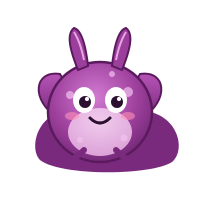

# About This Book

!!! mascot-neutral "Why does this book exist?"
    { class="mascot-admonition-img" }
    Because a curious high school student shouldn't need hundreds of dollars or a college course to understand their own brain.

## The problem

**Neuroscience is rarely taught in high school.** Students learn about cells, DNA, and evolution, but most never learn how their own brain works. Dr. Norbert Myslinski, who founded the Brain Bee in 1998,[^ibb] has written that "neuroscience is absent from our high schools" and has called for more chances for teenagers to learn it.[^myslinski]

**The resources that do exist have gaps.** Most English-language Brain Bee competitions use a free booklet as their study source, and it is a good reference. But it's a static document, so there are no simulations, no practice questions, and no feedback. A few free prep programs exist, but many of the interactive ones are paid courses.

**Future doctors rarely see how basic science connects to real patients.** That link, from a neuron's ion channels to a patient's symptoms, is the part of neuroscience that matters most in medicine, and it is usually left out of beginner books.

## What this book does

- **Starts from zero.** It begins with one neuron and ends with how doctors examine the brain.
- **Explains the idea before the vocabulary.** Every new idea starts with an everyday comparison, then the technical words come after.
- **Lets you try things.** Every chapter has an interactive simulation.
- **Connects the science to medicine.** Every chapter ends with a fictional patient case.
- **Gives you practice.** There are quizzes, Brain Bee-style questions, and exercises at every level of Bloom's Taxonomy.
- **Stays free.** It's licensed CC BY-NC-SA 4.0 and hosted on GitHub Pages.

## Who it's for

- High school students (grades 9 to 12) who are curious about the brain
- Students preparing for the Brain Bee or other neuroscience competitions
- Students considering medicine, nursing, psychology, or research
- Teachers who want free materials for a neuroscience unit, elective, or club

The only prerequisites are one year of high school biology and basic algebra.

## How this book was built

This book is an *intelligent textbook*. It was built with an AI-assisted workflow, and every step is described here:

1. A detailed **course description** and **design contract** set the audience, learning goals, and quality rules (see [Course Description](course-description.md)).
2. A **learning graph** of 253 concepts maps which ideas depend on which, so chapters always teach prerequisites first (see [Learning Graph](learning-graph/index.md)).
3. Chapters, quizzes, simulations, and the glossary were drafted using **Claude Code** and **Dan McCreary's open-source intelligent-textbook skills**. Every chapter then went through separate fact-checking, copy-editing, and senior science-editing passes, where each statistic, date, drug approval, and reference link was checked against sources like the NIH, the CDC, the FDA, and peer-reviewed research. The full process and a public list of corrections are on the [Accuracy and Corrections](accuracy.md) page.
4. The author reviewed, edited, and is responsible for the final content.

**AI disclosure:** generative AI (Anthropic's Claude) was used to help draft and check this book. The author directed the project, set the design and accuracy rules, and reviewed the content. Mistakes are still possible. If you find one, please [report it](contact.md).

## About the author

**Aaryav Sharma** is a high school student in Minnesota who plans to study neuroscience and medicine. He made this book so that any student, anywhere, can learn how the brain works and how doctors care for it, for free.

## Acknowledgements

- **[Dan McCreary](https://dmccreary.github.io/intelligent-textbooks/)** and the open-source [intelligent-textbook skills](https://github.com/dmccreary/claude-skills), which made this workflow possible
- **[MkDocs](https://www.mkdocs.org/)** and **[Material for MkDocs](https://squidfunk.github.io/mkdocs-material/)** for the website framework
- **[p5.js](https://p5js.org/)** for the simulations and **[vis-network](https://visjs.github.io/vis-network/docs/network/)** for the learning graph viewer
- The **NIH**, **CDC**, and **OpenStax** for freely available, trustworthy science information
- **Eric Kandel's** research on *Aplysia*, which inspired the mascot, Ply

## Disclaimers

- **Not medical advice.** This book is educational. Bedside cases are fictional composites unless clearly identified as historical. Talk to a doctor about any health concern.
- **Not affiliated.** This is an independent student project. It is not affiliated with or endorsed by the International Brain Bee, the Society for Neuroscience, or any university or school.

[^ibb]: International Brain Bee. [About the Brain Bee](https://www.thebrainbee.org/about/).

[^myslinski]: Myslinski, N. (2022). "Why Wait? Neuroscience Is for Everyone!" *eNeuro*. [PMC9224164](https://pmc.ncbi.nlm.nih.gov/articles/PMC9224164/)
