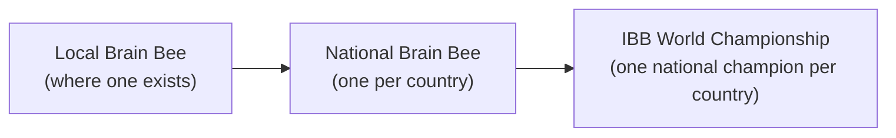

# Appendix A: Brain Bee Strategy and Mock Exam

!!! warning "Please read first: this book is independent"
    *From Neuron to Bedside* is an independent, free textbook. It is **not affiliated with, sponsored by, or endorsed by** the International Brain Bee (IBB), the Society for Neuroscience (SfN), or any local or national Brain Bee. The mock exam below is original and is **not** made from real Brain Bee questions.

    Rules, formats, age limits, eligibility, and official study materials **vary by chapter, by country, and by year**. Always check two places before you plan your studying: your **local or national Brain Bee chapter** and the **official IBB website**, [thebrainbee.org](https://www.thebrainbee.org/). If anything in this appendix disagrees with them, they are right and we are wrong.

!!! mascot-welcome "Welcome, competitor!"
    { class="mascot-admonition-img" }
    I'm a sea slug with about 20,000 neurons, and even I can learn with practice. You have tens of billions of neurons, so you're starting with a big advantage! This appendix turns everything in the book into a plan you can follow, then lets you test yourself with a full mock exam.

## A.1 What Is the Brain Bee?

The **Brain Bee** is a neuroscience competition for high school students. The idea is a little like a spelling bee, except the questions are about the brain: how neurons signal, where structures sit, how we sense and move, and what goes wrong in brain disorders. Its stated goals are to get students excited about the brain and to inspire them toward careers in neuroscience or medicine ([IBB FAQ](https://www.thebrainbee.org/faq/)).

### A short history

The Brain Bee was founded by **Dr. Norbert Myslinski**, a neuroscientist at the University of Maryland. The IBB's own history page dates the founding to **1998** ([IBB: About](https://www.thebrainbee.org/about/)), and the Society for Neuroscience reports that the first Brain Bee was held at the University of Maryland that same year ([SfN, 2014](https://www.sfn.org/publications/latest-news/2014/05/19/brain-bee-inspires-next-generations-neuroscientists)). You may see a different year (such as 1999) in other places, but this book follows the IBB's own history and the SfN report, which both give 1998.

### Three levels

The competition is organized as a ladder ([IBB home page](https://www.thebrainbee.org/)):

1. **Local (or regional) Brain Bee.** Many students start here, often at a nearby university.
2. **National Brain Bee.** Local winners advance to their country's national competition.
3. **IBB World Championship.** Each national champion can represent their country at the world level.

If your country has no national Brain Bee, the IBB says students can enter the **IYNA Virtual Brain Bee**, whose winner qualifies for the World Championship ([IBB FAQ](https://www.thebrainbee.org/faq/)).

### Who can compete?

According to the IBB, Brain Bees are **typically open to students aged 13 to 19**, and national champions **may not be older than 19** to compete at the World Championship. Some competitions also require you to be enrolled in high school. The IBB also says students may enter only one local and one national Brain Bee per year ([IBB FAQ](https://www.thebrainbee.org/faq/)). Your chapter may have its own rules on top of these, so check them.

### What the rounds look like

There is no single Brain Bee format. Here is what official sources describe, as examples only.

**At a local or regional level**, formats are often simpler. For example, the Boston University regional Brain Bee has described three rounds: a written exam of open-ended questions, an **oral round** where students answer aloud and are eliminated after two wrong answers, and a final elimination round answered on whiteboards. It also notes that details may vary ([BU Brain Bee](https://www.bu.edu/upn/resources-for-students/bu-brain-bee-competition)). Other chapters run different mixes of written and oral questions.

**At the IBB World Championship**, the IBB lists several sections ([IBB: Competition](https://www.thebrainbee.org/competition/)):

| Section | What students do (as described by the IBB) |
|---|---|
| **Neuroanatomy** | Identify structures on real whole or sectioned human brains, or on detailed illustrations, and know their positions, connections, and functions. |
| **Neurohistology** | Identify structures in human tissue shown under microscopes, and/or describe what the tissue does. |
| **Written test** | Multiple-choice and short-answer questions. |
| **Patient diagnosis** | Watch videos of patients with a written history, choose three diagnostic tests (from groups such as neuroimaging, EEG and nerve conduction studies, cognitive measures, and blood or spinal fluid biomarkers), then name the diagnosis. |
| **Live judging** | An elimination round for top scorers. Students write short answers within a time limit, and two wrong answers mean elimination. |

The IBB notes that aspects of the competition may vary from year to year ([IBB: Competition](https://www.thebrainbee.org/competition/)). Treat the table as a picture of the *kinds* of skills that get tested, not a promise of this year's format.

### Official study materials

Every Brain Bee chooses its own official study source, and **the questions usually come from that source**. According to the IBB, most local Brain Bees are based on either the Society for Neuroscience's free book ***Brain Facts*** or the book *Neuroscience: The Science of the Brain* ([IBB: Competition](https://www.thebrainbee.org/competition/)). You can download *Brain Facts* from [The Brain Facts Book page on BrainFacts.org](https://www.brainfacts.org/the-brain-facts-book). The current edition there is from 2018, and the BU regional Brain Bee, for example, says all three of its rounds draw from that edition ([BU Brain Bee](https://www.bu.edu/upn/resources-for-students/bu-brain-bee-competition)). Some chapters add other books, and students who reach the World Championship receive extended study materials from their national coordinators ([IBB: Competition](https://www.thebrainbee.org/competition/)).

The most important advice in this appendix is simple: **find out exactly which source your chapter uses, and read it closely.** This book is a *complement*, not a replacement. It gives you the "why," the pictures in your head, the MicroSims, and the clinical reasoning that make facts stick. Your official source tells you which facts and wording the judges expect. If the two ever describe something differently (for example, rounding a number differently), learn your official source's version for the competition.

!!! note "Why we never copy Brain Facts"
    *Brain Facts* is copyrighted by the Society for Neuroscience. This book used it only as a general map of which topics high school neuroscience covers. None of its text, figures, or questions appear here, and the mock exam was written from scratch.

## A.2 How This Book Lines Up With Brain Bee Topics

Brain Bee questions usually come from a broad set of topics. The table below shows where each kind of topic lives in this book. Use it when your official source covers something and you want a deeper, more visual explanation.

| Topic area | Chapters in this book |
|---|---|
| Neurons, glia, and electrical signals | [1: Neurons and Glia](../chapters/01-neurons-and-glia/index.md), [2: The Action Potential](../chapters/02-action-potential/index.md) |
| Synapses, neurotransmitters, and drugs | [3: Synapses and Neurotransmitters](../chapters/03-synapses-and-neurotransmitters/index.md) |
| Neuroanatomy | [4: A Tour of the Brain](../chapters/04-neuroanatomy/index.md) |
| Senses and pain | [5: Vision](../chapters/05-vision/index.md), [6: Hearing, Touch, Taste, Smell, and Pain](../chapters/06-hearing-touch-taste-smell-pain/index.md) |
| Movement | [7: Movement](../chapters/07-movement/index.md) |
| Development across life | [8: The Developing and Teenage Brain](../chapters/08-developing-teenage-brain/index.md), [13: The Aging Brain](../chapters/13-aging-and-neurodegeneration/index.md) |
| Learning, memory, sleep, emotion, and thinking | [9](../chapters/09-learning-memory-plasticity/index.md), [10](../chapters/10-sleep-and-brain-states/index.md), [11](../chapters/11-emotion-and-stress/index.md), [12](../chapters/12-language-attention-decisions/index.md) |
| Brain disorders | [13](../chapters/13-aging-and-neurodegeneration/index.md), [14](../chapters/14-injury-stroke-epilepsy/index.md), [15](../chapters/15-psychiatric-disorders-and-addiction/index.md), plus every chapter's Bedside case |
| Diagnosis and tools | [16: How Doctors Examine the Brain](../chapters/16-how-doctors-examine-the-brain/index.md) |

Each chapter also ends with a **Brain Bee Practice** section of five short-answer questions, a ten-question quiz, and a list of key terms you can look up in the [Glossary](../glossary.md).

## A.3 A 4-Week Study Plan

This plan is for the **final four weeks** before your competition. It assumes you have already read the chapters at least once, or are reading them alongside the plan. If you are starting from zero, give yourself more time: reading one chapter every two or three days, with its quiz, takes about five to seven weeks before you begin this plan.

The plan follows two research-backed rules you will meet in Section A.4: **space your studying out**, and **test yourself instead of rereading**. Notice that every week mixes in a little review of earlier weeks. That is on purpose.

| Week | Main focus | What to do | Self-test checkpoint |
|---|---|---|---|
| **1** | Foundations: Chapters 1 to 8 | Two chapters per day for four days. For each one, reread the Key Takeaways, redo the MicroSim, and answer the Brain Bee Practice questions **out loud before** opening the answers. Spend days 5 and 6 reading the matching parts of your official study source. Day 7: rest or light review. | Each chapter's quiz, closed book. Write every missed term on a flashcard. |
| **2** | Brain systems and disorders: Chapters 9 to 16 | Same routine as Week 1. Each day, start with 10 minutes of flashcards from Week 1 (spacing!). Read your official source alongside. | **End of Week 2: take the full mock exam in Section A.6**, timed, closed book, about two weeks before the competition. Score it with Section A.7. |
| **3** | Fix weak spots and practice the rounds | Use the "What to review next" table (Section A.7) to pick your two or three weakest chapters and restudy them. Practice the oral round with a partner every other day (Section A.5). Start neuroanatomy ID practice: 15 minutes a day labeling brain views (Section A.5). | Redo every mock exam question you missed, *without* looking at the old answer, and explain why each wrong option is wrong. |
| **4** | Diagnosis, mixed review, and rest | Work through all 16 Bedside cases with the method in Section A.5. Mix flashcards from all chapters every day. Two days before: light review only. The night before: sleep. | Two days in a row of mixed flashcards from all chapters with almost no misses. Re-take only the mock questions you missed in Week 2. |

!!! tip "If you only have one or two weeks"
    Skip straight to the mock exam. Use your score to choose the chapters that need the most work, then study those with self-testing. A focused plan beats trying to reread the whole book.

## A.4 Study Techniques That Actually Work

How you study matters as much as how long. Brain science has a lot to say about this, and you learned the biology behind it in [Chapter 9](../chapters/09-learning-memory-plasticity/index.md).

### Retrieval practice: test yourself

**Retrieval practice** means pulling information *out* of your memory, for example by answering a question or explaining an idea without looking. It feels harder than rereading, and that effort is the point. In a classic experiment, students who took practice tests on a passage remembered more of it a week later than students who spent the same time restudying it ([Roediger & Karpicke, 2006](https://doi.org/10.1111/j.1467-9280.2006.01693.x)).

How to use it:

- Cover the answers and **say your answer out loud** before checking. This also trains you for oral rounds.
- Make flashcards with a question on the front, not just a word. "What does the hippocampus do?" is better than "hippocampus."
- After each chapter, do the Brain Bee Practice and the quiz *before* you reread anything.

### Spacing: spread it out

**Spaced practice** means studying the same material in several shorter sessions spread over days, instead of in one long cram session. A large review of hundreds of experiments found that spacing study sessions apart reliably improves long-term memory ([Cepeda et al., 2006](https://doi.org/10.1037/0033-2909.132.3.354)). [Chapter 9, Section 9.11](../chapters/09-learning-memory-plasticity/index.md#911-back-to-maya-why-spacing-beats-cramming) explains why at the level of synapses. Even in the sea slug *Aplysia*, spaced training builds long-term memory better than massed training, because long-term memory needs new proteins and new connections that take time to build.

### What the evidence says about popular habits

In 2013, a team of learning scientists rated ten common study techniques. **Practice testing** and **distributed (spaced) practice** were the only two given the highest rating for usefulness. Some of students' favorite habits, including **highlighting, rereading, and summarizing**, were rated low ([Association for Psychological Science, 2013](https://www.psychologicalscience.org/news/releases/which-study-strategies-make-the-grade.html); full review: [Dunlosky et al., 2013](https://doi.org/10.1177/1529100612453266)).

That doesn't mean rereading is useless. It just means it should not be your main tool. A good rule: **for every minute you spend reading, spend at least a minute testing yourself.**

### Make it mean something

Facts stick better when they connect to things you already know. When you learn that the hippocampus helps form new memories, link it to Patient H.M.'s story. When you learn about dopamine, connect it to Parkinson's disease, the reward pathway, and reward prediction error. This book's chapters are built around those links on purpose, so use the "Prerequisites" lists and the [Learning Graph](../learning-graph/index.md) to see them.

!!! mascot-tip "Study like a sea slug"
    { class="mascot-admonition-img" }
    Short, spaced sessions where you quiz yourself beat one long night of rereading. My synapses need time between lessons to build long-term memories, and so do yours!

### Sleep is part of studying

Sleep helps your brain **consolidate** (stabilize) what you learned during the day ([Chapter 10](../chapters/10-sleep-and-brain-states/index.md)). The American Academy of Sleep Medicine recommends **8 to 10 hours** a night for teens aged 13 to 18, as Chapter 10 explains. Staying up late to cram trades away the very sleep that would have locked in your studying.

## A.5 Strategy for Each Kind of Round

### Written rounds

- **Read every option.** In multiple choice, the first option that "sounds right" is often a near-miss. Look for the *best* answer.
- **Use the clues in the question.** Words like "most likely," "first," and "best explains" matter.
- **Eliminate.** Cross out options you know are wrong. Even narrowing four choices to two doubles your odds.
- **Watch the clock.** Skip a hard question, mark it, and come back. Don't let one question eat five minutes.
- **Spelling may count.** For short-answer questions, practice writing terms correctly: *hippocampus*, *cerebellum*, *oligodendrocyte*, *acetylcholine*. Ask your chapter whether spelling is graded.

### Oral rounds

In competitions that have one, the oral round can decide the winner. Often you hear a question, have a short time to think, and answer aloud. Common rules include elimination after a set number of misses, so check yours.

- **Practice out loud, early.** Knowing something silently is different from saying it under pressure. Have a friend, parent, or teacher read you questions from each chapter's Brain Bee Practice section.
- **Answer short and exact.** Most oral questions want a word or short phrase. "The cerebellum" is better than a long explanation that might include a mistake.
- **Learn to pronounce terms.** Say tricky words out loud until they feel normal: *amygdala* (uh-MIG-duh-luh), *suprachiasmatic*, *oligodendrocyte*. A judge needs to understand you.
- **Pause before answering.** A two-second pause to think is fine. Rushing leads to careless misses.
- **Recover fast.** If you miss one, let it go. The next question is a fresh start.

### Neuroanatomy identification

At higher levels, you may need to identify structures on real brains, brain slices, or detailed drawings. This is a visual skill, so you have to practice it visually.

- **Learn the directions and planes first.** Sagittal, coronal, and horizontal views look very different. [Chapter 4, Section 4.2](../chapters/04-neuroanatomy/index.md#42-reading-the-map-directions-planes-and-sections) explains them.
- **Use the Clickable Brain Atlas.** The [Chapter 4 MicroSim](../sims/ch04-brain-atlas/index.md) lets you click structures and see their names and jobs.
- **Learn landmarks, then fill in.** Find the central sulcus, lateral sulcus, corpus callosum, ventricles, and brainstem first. Most other structures are easy to locate once you know these.
- **Pair every structure with a function and a disorder.** For example: *substantia nigra, dopamine, Parkinson's disease*. Judges often ask "what does this do?" right after "what is this?"
- **Draw it.** Sketching a midsagittal brain from memory, then checking it, is retrieval practice for your eyes.
- **Neurohistology** (tissue under a microscope) is only touched on in this book, mainly in [Chapter 1](../chapters/01-neurons-and-glia/index.md) on neurons and glia. If your competition includes it, use the official materials your chapter provides.

### Patient diagnosis rounds

In a diagnosis round, you see a patient (in a video, a description, or an actor) and must name the condition, and sometimes choose the right tests. This is exactly what the **At the Bedside** sections of this book train you to do.

Use the doctor's method from [Chapter 16](../chapters/16-how-doctors-examine-the-brain/index.md):

1. **Where before what.** First ask *where* in the nervous system the problem is, then *what* the disease is.
2. **Look at the timing.** Sudden onset (seconds to minutes) suggests stroke or seizure. Hours to days suggests infection or inflammation. Months to years suggests a degenerative disease or a slowly growing tumor.
3. **Upper or lower motor neuron?** Stiffness, brisk reflexes, and a Babinski sign point to the brain or spinal cord. Floppy weakness, wasting, and twitching point to the motor neurons that leave the spinal cord or to the nerves.
4. **Which side? Which level?** A brain problem usually affects the opposite side of the body. A face droop that spares the forehead points to the brain, not the facial nerve.
5. **Pick tests that answer your question.** CT to look for bleeding fast, MRI for detail, EEG for seizures, a lumbar puncture for infection or inflammation, and nerve conduction studies for nerve problems. [Chapter 16, Section 16.6](../chapters/16-how-doctors-examine-the-brain/index.md#166-looking-inside-brain-imaging-and-recording) compares the imaging and recording tests, and Section 16.7 covers the lumbar puncture.

Then practice on every case in the book. Read only the "Meet the patient" box first, decide where and what, then read on to check:

| Chapter | Bedside case |
|---|---|
| 1 | [Blurry Vision and Tingling Legs](../chapters/01-neurons-and-glia/index.md#at-the-bedside-blurry-vision-and-tingling-legs) |
| 2 | [A Numb Lip at the Dentist](../chapters/02-action-potential/index.md#at-the-bedside-a-numb-lip-at-the-dentist) |
| 3 | [Eyelids That Droop by Evening](../chapters/03-synapses-and-neurotransmitters/index.md#at-the-bedside-eyelids-that-droop-by-evening) |
| 4 | [Two Frontal Lobes, Nearly 180 Years Apart](../chapters/04-neuroanatomy/index.md#at-the-bedside-two-frontal-lobes-nearly-180-years-apart) |
| 5 | [The Driver Who Kept Bumping Door Frames](../chapters/05-vision/index.md#at-the-bedside-the-driver-who-kept-bumping-door-frames) |
| 6 | [Pain in a Hand That Is No Longer There](../chapters/06-hearing-touch-taste-smell-pain/index.md#at-the-bedside-pain-in-a-hand-that-is-no-longer-there) |
| 7 | [The Slowing Teacher](../chapters/07-movement/index.md#at-the-bedside-the-slowing-teacher) |
| 8 | [A Second Grader Who Can't Keep Up](../chapters/08-developing-teenage-brain/index.md#at-the-bedside-a-second-grader-who-cant-keep-up) |
| 9 | [Patient H.M. and Anterograde Amnesia](../chapters/09-learning-memory-plasticity/index.md#at-the-bedside-patient-hm-and-anterograde-amnesia) |
| 10 | [The Student Who Collapsed When She Laughed](../chapters/10-sleep-and-brain-states/index.md#at-the-bedside-the-student-who-collapsed-when-she-laughed) |
| 11 | [Nightmares After the Crash](../chapters/11-emotion-and-stress/index.md#at-the-bedside-nightmares-after-the-crash) |
| 12 | [Two Strokes, Two Kinds of Silence](../chapters/12-language-attention-decisions/index.md#at-the-bedside-two-strokes-two-kinds-of-silence) |
| 13 | [Two Patients, Two Misfolded Proteins](../chapters/13-aging-and-neurodegeneration/index.md#at-the-bedside-two-patients-two-misfolded-proteins) |
| 14 | [Three Emergencies, Three Brains](../chapters/14-injury-stroke-epilepsy/index.md#at-the-bedside-three-emergencies-three-brains) |
| 15 | [An Overdose at a Dorm Party](../chapters/15-psychiatric-disorders-and-addiction/index.md#at-the-bedside-an-overdose-at-a-dorm-party) |
| 16 | [Sudden Weakness on One Side](../chapters/16-how-doctors-examine-the-brain/index.md#at-the-bedside-sudden-weakness-on-one-side) |

Also try each case's **"Your turn: diagnose a variation"** question. Changing one detail and asking "what would that change?" is how real diagnosticians think, and it prepares you for patients you have never seen before.

### Test-day tips

- **Sleep well for the two nights before**, not just the last one. Nerves often cost people one night of good sleep, and that's fine if you slept well before it.
- **Eat a normal breakfast** and bring water and a snack if allowed.
- **Know the logistics:** the address, the start time, what to bring (ID, pencils, registration confirmation), and whether phones are allowed.
- **Arrive early** so you are not rushed. Rushing triggers the fast stress response you read about in [Chapter 11](../chapters/11-emotion-and-stress/index.md).
- **Reframe the nerves.** A racing heart is your body getting ready to perform. Telling yourself "this energy will help me focus" is a form of reappraisal, a strategy described in Chapter 11.
- **Do not cram new material that morning.** Skim your flashcards of the most-missed terms, then stop.
- **Follow the rules exactly.** Recording or sharing questions is commonly forbidden. Your answers must be your own.
- **Enjoy it.** You will meet students who love the brain as much as you do, which the IBB describes as one of the rewards of competing ([IBB FAQ](https://www.thebrainbee.org/faq/)).

## A.6 The Mock Exam

**Instructions.** This is a 50-question multiple-choice exam that covers all 16 chapters. Set a timer for **60 minutes**, close the book, and put your phone away. Write your answers on paper first. Don't open any answer until you are done with all 50. Then check them and score yourself with Section A.7.

The questions mix **recall** (remembering a fact), **understanding** (explaining why), and **clinical reasoning** (applying ideas to a patient). They are grouped by chapter so you can find your weak spots. Real competitions usually mix topics together and may use different question styles.

!!! mascot-encourage "You don't need a perfect score"
    { class="mascot-admonition-img" }
    This exam is a map, not a verdict. Every question you miss now shows you exactly where to study, and that is a win before the real competition!

---

#### Question 1

Which glial cells act as the central nervous system's resident immune cells, patrolling the brain and swallowing microbes and dead or damaged cells?

1. Astrocytes
2. Oligodendrocytes
3. Microglia
4. Schwann cells

??? question "Show Answer"
    The correct answer is **C**. Microglia are the brain's small immune cells: they patrol, detect trouble, and engulf invaders and debris. Astrocytes support neurons and help maintain the blood-brain barrier, while oligodendrocytes and Schwann cells make myelin.

    **Type:** Recall
    **Chapter:** [Chapter 1: Neurons, Glia, and the Nervous System](../chapters/01-neurons-and-glia/index.md)

---

#### Question 2

A classmate says, "Glial cells outnumber neurons ten to one." Which statement is best supported by modern cell counts?

1. The classmate is right: glia outnumber neurons about 10 to 1.
2. Overall, glia and neurons are roughly equal in number in the human brain.
3. Glia make up less than 1% of the cells in the brain.
4. Neurons outnumber glia about 10 to 1.

??? question "Show Answer"
    The correct answer is **B**. Careful counting studies have found that the human brain has roughly as many glia as neurons overall, so the "ten to one" figure is an old myth. Glia still do important work: they make myelin, support neurons, and defend the brain.

    **Type:** Understanding
    **Chapter:** [Chapter 1: Neurons, Glia, and the Nervous System](../chapters/01-neurons-and-glia/index.md)

---

#### Question 3

An antibiotic easily clears a bacterial infection from a patient's bloodstream, but it works poorly against the same bacteria inside the brain. Which explanation fits best?

1. The blood-brain barrier keeps many drugs from passing from the blood into brain tissue.
2. Myelin coats every brain cell and blocks drugs from reaching them.
3. Microglia destroy every drug that enters the brain.
4. The brain has no blood vessels, so drugs carried in the blood cannot reach it.

??? question "Show Answer"
    The correct answer is **A**. The tightly sealed capillaries of the blood-brain barrier, supported by astrocytes, block many substances, including many medicines. In fact, the brain has a dense blood supply (D is wrong), and myelin wraps axons, not every cell.

    **Type:** Clinical reasoning
    **Chapter:** [Chapter 1: Neurons, Glia, and the Nervous System](../chapters/01-neurons-and-glia/index.md)

---

#### Question 4

During the rising phase of an action potential, which ion movement mainly drives the membrane potential upward toward a positive value?

1. Potassium (K⁺) flowing out of the cell
2. Chloride (Cl⁻) flowing into the cell
3. Calcium (Ca²⁺) being pumped out of the cell
4. Sodium (Na⁺) flowing into the cell

??? question "Show Answer"
    The correct answer is **D**. When threshold is reached, voltage-gated sodium channels open and Na⁺ rushes in, making the inside of the cell positive. Potassium flowing out (A) is what brings the voltage back down during the falling phase.

    **Type:** Recall
    **Chapter:** [Chapter 2: The Action Potential](../chapters/02-action-potential/index.md)

---

#### Question 5

Right after an action potential, the membrane briefly dips to about −80 mV, more negative than the resting potential. What causes this undershoot?

1. Sodium channels stay open longer than usual.
2. Voltage-gated potassium channels are slow to close, so extra K⁺ keeps leaving the cell.
3. Sodium channels reopen and let Na⁺ flow back out.
4. The neuron's chloride ions all rush out at once.

??? question "Show Answer"
    The correct answer is **B**. Voltage-gated K⁺ channels close slowly, so for a few milliseconds extra positive charge leaves the cell and the voltage overshoots below rest. Open sodium channels (A) would push the voltage up, not down.

    **Type:** Understanding
    **Chapter:** [Chapter 2: The Action Potential](../chapters/02-action-potential/index.md)

---

#### Question 6

A signal travels along a myelinated motor axon at 100 meters per second. About how long does it take to travel 1 meter, roughly the distance from the lower spinal cord to the foot?

1. About 10 milliseconds (0.01 second)
2. About 1 millisecond (0.001 second)
3. About 100 milliseconds (0.1 second)
4. About 1 second

??? question "Show Answer"
    The correct answer is **A**. Time equals distance divided by speed: 1 m ÷ 100 m/s = 0.01 s, which is 10 milliseconds. A thin unmyelinated axon conducting at about 1 m/s would take a full second (D), which shows why myelin matters.

    **Type:** Clinical reasoning (apply)
    **Chapter:** [Chapter 2: The Action Potential](../chapters/02-action-potential/index.md)

---

#### Question 7

Botulinum toxin causes muscle weakness and can cause paralysis. How does it act?

1. It blocks acetylcholine receptors on the muscle fiber.
2. It prevents motor nerve terminals from releasing acetylcholine.
3. It speeds up the enzyme that breaks down acetylcholine.
4. It blocks voltage-gated sodium channels in the muscle.

??? question "Show Answer"
    The correct answer is **B**. Botulinum toxin stops the release of acetylcholine from vesicles at the neuromuscular junction, so the muscle never receives the signal. Blocking the receptors (A) is how a different poison, curare, works.

    **Type:** Recall
    **Chapter:** [Chapter 3: Synapses and Neurotransmitters](../chapters/03-synapses-and-neurotransmitters/index.md)

---

#### Question 8

Acetylcholine makes skeletal muscles contract, but it slows the heartbeat. What best explains how one neurotransmitter can have opposite effects?

1. The heart uses a chemically different form of acetylcholine.
2. Acetylcholine is excitatory only in the brain and inhibitory everywhere else.
3. The heart breaks down acetylcholine before it can bind to anything.
4. The two tissues have different receptors: fast nicotinic channels on skeletal muscle and slower muscarinic (metabotropic) receptors on heart cells.

??? question "Show Answer"
    The correct answer is **D**. The receptor, not just the transmitter, decides the effect. The same acetylcholine molecule opens fast ion channels on skeletal muscle but acts through G proteins on heart cells, which slows the heart.

    **Type:** Understanding
    **Chapter:** [Chapter 3: Synapses and Neurotransmitters](../chapters/03-synapses-and-neurotransmitters/index.md)

---

#### Question 9

Maya drinks a cup of coffee and feels more alert. How does caffeine mainly produce this effect?

1. It makes neurons release more adenosine.
2. It activates adenosine receptors more strongly than adenosine does.
3. It fits into adenosine receptors without activating them, blocking adenosine's sleepiness signal.
4. It blocks dopamine reuptake, the same way cocaine does.

??? question "Show Answer"
    The correct answer is **C**. Caffeine is an adenosine receptor antagonist: it occupies the receptor but doesn't switch it on, so the adenosine that builds up while you're awake can't push neurons toward sleepiness. Option B describes an agonist, which would have the opposite effect.

    **Type:** Understanding
    **Chapter:** [Chapter 3: Synapses and Neurotransmitters](../chapters/03-synapses-and-neurotransmitters/index.md)

---

#### Question 10

Which tissue makes most of the cerebrospinal fluid (CSF)?

1. The dura mater
2. The pineal gland
3. The choroid plexus inside the ventricles
4. The gray matter of the cerebral cortex

??? question "Show Answer"
    The correct answer is **C**. The choroid plexus, a tissue rich in blood vessels inside the ventricles, makes most of the CSF. The dura mater (A) is the tough outer layer of the meninges, which protects the brain but does not produce CSF.

    **Type:** Recall
    **Chapter:** [Chapter 4: A Tour of the Brain: Neuroanatomy](../chapters/04-neuroanatomy/index.md)

---

#### Question 11

A brain slice that separates the front of the brain from the back is called a:

1. Coronal section
2. Sagittal section
3. Horizontal section
4. Midsagittal section

??? question "Show Answer"
    The correct answer is **A**. A coronal (frontal) section divides front from back, like slicing a loaf of bread. Sagittal and midsagittal sections divide left from right, and horizontal sections divide top from bottom.

    **Type:** Recall
    **Chapter:** [Chapter 4: A Tour of the Brain: Neuroanatomy](../chapters/04-neuroanatomy/index.md)

---

#### Question 12

Which structure helps keep body temperature, hunger, and thirst in balance and controls hormone release from the pituitary gland?

1. Thalamus
2. Hypothalamus
3. Cerebellum
4. Medulla

??? question "Show Answer"
    The correct answer is **B**. The hypothalamus maintains homeostasis and commands the pituitary, linking the nervous system to the hormone system. The thalamus (A) sits just above it but mainly relays sensory signals to the cortex.

    **Type:** Recall
    **Chapter:** [Chapter 4: A Tour of the Brain: Neuroanatomy](../chapters/04-neuroanatomy/index.md)

---

#### Question 13

A small stroke damages only the hand area of the **left postcentral gyrus**. Which problem is most likely?

1. Weakness of the left hand
2. Loss of vision in the right half of the visual field
3. Poor balance and clumsiness on the left side
4. Reduced touch sensation in the right hand

??? question "Show Answer"
    The correct answer is **D**. The postcentral gyrus is the primary somatosensory cortex ("feeling behind" the central sulcus), and each hemisphere receives sensation from the opposite side of the body. Weakness (A) would come from the precentral (motor) gyrus, and on the opposite side.

    **Type:** Clinical reasoning
    **Chapter:** [Chapter 4: A Tour of the Brain: Neuroanatomy](../chapters/04-neuroanatomy/index.md)

---

#### Question 14

The fovea gives you your sharpest vision. Which cells is it packed with?

1. Cones
2. Rods
3. Ganglion cells stacked in thick layers
4. Blood vessels that nourish the photoreceptors

??? question "Show Answer"
    The correct answer is **A**. The fovea is a small pit in the center of the retina packed with cones, with the other retinal layers pushed aside so light reaches them directly. Rods (B) are far more common elsewhere in the retina and work best in dim light.

    **Type:** Recall
    **Chapter:** [Chapter 5: Vision](../chapters/05-vision/index.md)

---

#### Question 15

Each eye has a blind spot where the optic nerve leaves. Why don't you notice it in daily life?

1. The blind spot has extra rods that make up for the missing cones.
2. The other eye covers that part of the scene, and the brain fills in the gap.
3. The blind spot only exists in dim light.
4. The lens bends light so that none of it ever lands on the optic disc.

??? question "Show Answer"
    The correct answer is **B**. The optic disc has no photoreceptors at all, but the two eyes' blind spots fall on different parts of the scene, and the brain fills in what's missing. Option A is wrong because the optic disc contains no rods or cones.

    **Type:** Understanding
    **Chapter:** [Chapter 5: Vision](../chapters/05-vision/index.md)

---

#### Question 16

A tumor presses on the **left optic tract**, just behind the optic chiasm. Which visual problem is most likely?

1. Complete blindness in the left eye only
2. Loss of the outer (temporal) half of the visual field in both eyes
3. Loss of the right half of the visual field in both eyes
4. Loss of the left half of the visual field in both eyes

??? question "Show Answer"
    The correct answer is **C**. Behind the chiasm, the left optic tract carries fibers from both eyes about the right visual field, so damage causes right homonymous hemianopia. Option B (bitemporal hemianopia) comes from pressure on the chiasm itself, and option A from damage to one optic nerve.

    **Type:** Clinical reasoning
    **Chapter:** [Chapter 5: Vision](../chapters/05-vision/index.md)

---

#### Question 17

Which receptors tell your brain how much a muscle is being stretched, helping you sense where your limbs are without looking?

1. Nociceptors
2. Pacinian corpuscles
3. Cochlear hair cells
4. Muscle spindles

??? question "Show Answer"
    The correct answer is **D**. Muscle spindles sense muscle stretch and are main receptors for proprioception, along with Golgi tendon organs. Nociceptors (A) detect damage or the threat of damage, and Pacinian corpuscles (B) are skin receptors best at sensing vibration.

    **Type:** Recall
    **Chapter:** [Chapter 6: Hearing, Touch, Taste, Smell, and Pain](../chapters/06-hearing-touch-taste-smell-pain/index.md)

---

#### Question 18

Why is hearing loss from years of very loud music usually permanent?

1. Loud noise kills cochlear hair cells, and humans cannot regrow them.
2. Loud noise tears the eardrum, and eardrums can never heal.
3. Loud noise destroys the auditory cortex.
4. It isn't permanent; noise only ever causes temporary hearing loss.

??? question "Show Answer"
    The correct answer is **A**. Repeated loud noise kills the hair cells that turn sound vibrations into neural signals, and unlike birds and amphibians, humans can't replace them. A short blast of noise can cause temporary loss (D), but once hair cells die, the loss is permanent.

    **Type:** Understanding
    **Chapter:** [Chapter 6: Hearing, Touch, Taste, Smell, and Pain](../chapters/06-hearing-touch-taste-smell-pain/index.md)

---

#### Question 19

Maya spins in a desk chair for 30 seconds, then stops suddenly. For a few seconds the room seems to keep turning. Which sense organs are mainly responsible?

1. The cochlea
2. The otolith organs
3. The semicircular canals
4. The olfactory bulbs

??? question "Show Answer"
    The correct answer is **C**. The semicircular canals sense head rotation through fluid that lags behind the head's motion. When Maya stops, the fluid keeps moving for a moment because of inertia, so her canals send a false "still turning" signal. The otolith organs (B) mainly sense gravity and straight-line acceleration.

    **Type:** Clinical reasoning (apply)
    **Chapter:** [Chapter 6: Hearing, Touch, Taste, Smell, and Pain](../chapters/06-hearing-touch-taste-smell-pain/index.md)

---

#### Question 20

Maya lifts a pencil, then a heavy backpack, with the same arm. How does her nervous system mainly produce the extra force?

1. It makes each action potential in the motor neurons larger.
2. It recruits more motor units, adding larger ones, and fires them faster.
3. It hands control of the arm from the motor cortex to the cerebellum.
4. It grows new muscle fibers within a few seconds.

??? question "Show Answer"
    The correct answer is **B**. Force is graded by recruiting more motor units (small ones first, then larger ones, following the size principle) and by raising their firing rate. Action potentials are all-or-none, so they can't simply get bigger (A).

    **Type:** Understanding
    **Chapter:** [Chapter 7: Movement: Muscles, Reflexes, and Motor Control](../chapters/07-movement/index.md)

---

#### Question 21

A 66-year-old man has a resting tremor in one hand, slow movements, and stiff muscles. His doctor diagnoses Parkinson's disease and starts a common medicine that the brain converts into the missing neurotransmitter. Which medicine is it?

1. Levodopa, which is converted into dopamine
2. Naloxone, which is converted into endorphins
3. Acetylcholine tablets, which replace lost acetylcholine
4. Melatonin, which is converted into serotonin

??? question "Show Answer"
    The correct answer is **A**. Parkinson's disease destroys dopamine neurons in the substantia nigra. Dopamine itself can't cross the blood-brain barrier, but levodopa can, and brain cells convert it into dopamine. Levodopa improves symptoms but doesn't cure the disease.

    **Type:** Clinical reasoning
    **Chapter:** [Chapter 7: Movement: Muscles, Reflexes, and Motor Control](../chapters/07-movement/index.md)

---

#### Question 22

What is the role of ATP in skeletal muscle contraction?

1. It starts the action potential in the motor neuron.
2. It moves tropomyosin to uncover the binding sites on actin.
3. It lets each myosin head let go of actin and reset for the next pull.
4. It is the neurotransmitter released at the neuromuscular junction.

??? question "Show Answer"
    The correct answer is **C**. ATP is needed for myosin to release actin and re-cock. That's why muscles lock stiff after death (rigor mortis) when ATP runs out. Uncovering the binding sites on actin (B) is triggered by calcium, not ATP.

    **Type:** Understanding
    **Chapter:** [Chapter 7: Movement: Muscles, Reflexes, and Motor Control](../chapters/07-movement/index.md)

---

#### Question 23

Spina bifida is a birth defect that happens when:

1. The corpus callosum fails to form.
2. The back (lower) end of the neural tube fails to close.
3. Too many synapses are pruned before birth.
4. Axons in the spinal cord fail to receive myelin.

??? question "Show Answer"
    The correct answer is **B**. The brain and spinal cord form from the neural tube, which closes early in pregnancy. If its lower end fails to close, part of the spinal cord can be left exposed (spina bifida). If the front end fails to close, the result is anencephaly.

    **Type:** Recall
    **Chapter:** [Chapter 8: The Developing and Teenage Brain](../chapters/08-developing-teenage-brain/index.md)

---

#### Question 24

Brain scans show that total white matter volume keeps increasing slowly until about the late twenties. What best explains this?

1. Myelination of axons continues for decades.
2. Large numbers of new neurons are produced every year until age 30.
3. Synapse formation (synaptogenesis) reaches its peak in the late twenties.
4. The skull keeps growing, which pulls the brain larger.

??? question "Show Answer"
    The correct answer is **A**. White matter is made mostly of myelinated axons, and myelination continues region by region well into adulthood. Most neurons are made before birth (B), and synapse numbers peak much earlier in childhood before pruning (C).

    **Type:** Understanding
    **Chapter:** [Chapter 8: The Developing and Teenage Brain](../chapters/08-developing-teenage-brain/index.md)

---

#### Question 25

Which statement about fetal alcohol spectrum disorders (FASD) matches CDC guidance?

1. Only heavy drinking in the last month of pregnancy can cause FASD.
2. Wine and beer are safe during pregnancy; only hard liquor is risky.
3. There is no known safe amount, time, or type of alcohol during pregnancy, and FASD is preventable if the baby is not exposed to alcohol.
4. The effects of FASD disappear by adulthood.

??? question "Show Answer"
    The correct answer is **C**. The CDC states that there is no known safe amount, time, or type of alcohol during pregnancy, and that FASDs are preventable if a developing baby is not exposed to alcohol. FASD effects are lifelong (D is wrong), and the brain develops throughout pregnancy, so no stage is safe (A is wrong).

    **Type:** Understanding
    **Chapter:** [Chapter 8: The Developing and Teenage Brain](../chapters/08-developing-teenage-brain/index.md)

---

#### Question 26

Which structure is most needed to form new declarative memories (facts and events)?

1. Cerebellum
2. Hippocampus
3. Basal ganglia
4. Occipital lobe

??? question "Show Answer"
    The correct answer is **B**. The hippocampus and nearby medial temporal lobe are needed to form new declarative memories, as Patient H.M.'s case showed. The cerebellum and basal ganglia (A, C) matter more for procedural memory, the memory for skills.

    **Type:** Recall
    **Chapter:** [Chapter 9: Learning, Memory, and Neuroplasticity](../chapters/09-learning-memory-plasticity/index.md)

---

#### Question 27

Maya hasn't ridden a bike in three years, yet she hops on and rides smoothly without thinking about how. Which type of memory is she using?

1. Episodic memory
2. Semantic memory
3. Working memory
4. Procedural memory

??? question "Show Answer"
    The correct answer is **D**. Procedural memory stores skills and habits ("how" knowledge) and works without conscious recall. Episodic memory (A) would be remembering a specific event, such as the day she learned to ride.

    **Type:** Clinical reasoning (apply)
    **Chapter:** [Chapter 9: Learning, Memory, and Neuroplasticity](../chapters/09-learning-memory-plasticity/index.md)

---

#### Question 28

After a car crash with a head injury, a man cannot remember the hour before the crash. Since waking up in the hospital, he has formed new memories normally. What is this called?

1. Retrograde amnesia
2. Anterograde amnesia
3. Loss of procedural memory
4. A working memory disorder

??? question "Show Answer"
    The correct answer is **A**. Retrograde ("backward") amnesia is the loss of memories from before an injury. Anterograde amnesia (B), which Patient H.M. had severely, is trouble forming new memories after the injury, and this man forms new memories normally.

    **Type:** Clinical reasoning
    **Chapter:** [Chapter 9: Learning, Memory, and Neuroplasticity](../chapters/09-learning-memory-plasticity/index.md)

---

#### Question 29

Which sleep stage has bursts of rapid eye movements, an EEG that looks a lot like waking, and a near-total loss of muscle tone in the arms and legs?

1. N1
2. N2
3. REM
4. N3

??? question "Show Answer"
    The correct answer is **C**. REM sleep combines rapid eye movements, a wake-like EEG, vivid dreams, and muscle atonia, which keeps you from acting out dreams. N3 (D) is deep slow-wave sleep with large, slow delta waves.

    **Type:** Recall
    **Chapter:** [Chapter 10: Sleep and Brain States](../chapters/10-sleep-and-brain-states/index.md)

---

#### Question 30

Why can bright light late at night, such as from room lights and screens, make it harder to fall asleep?

1. Light speeds up the breakdown of adenosine, so sleep pressure disappears.
2. Light signals reach the suprachiasmatic nucleus, which lowers melatonin release from the pineal gland.
3. Light switches off the orexin neurons that keep you awake.
4. Light makes the brain skip REM sleep for the whole night.

??? question "Show Answer"
    The correct answer is **B**. Special light-sensitive retinal cells (most sensitive to blue light) signal the SCN, the master clock, which then reduces the pineal gland's release of melatonin, the "darkness" signal. Orexin (C) promotes wakefulness, so switching it off would make you sleepier, not more alert.

    **Type:** Understanding
    **Chapter:** [Chapter 10: Sleep and Brain States](../chapters/10-sleep-and-brain-states/index.md)

---

#### Question 31

An EEG recorded from a person who is awake and relaxed with eyes closed shows a rhythm of about 8 to 13 waves per second over the back of the head. What is this rhythm called?

1. Delta
2. Theta
3. Beta
4. Alpha

??? question "Show Answer"
    The correct answer is **D**. The alpha rhythm (about 8 to 13 Hz) appears during relaxed wakefulness with eyes closed. Beta (C) is faster and appears when you are alert with eyes open, while delta (A) is the slow wave of deep N3 sleep.

    **Type:** Recall
    **Chapter:** [Chapter 10: Sleep and Brain States](../chapters/10-sleep-and-brain-states/index.md)

---

#### Question 32

Which part of the nervous system drives the "fight or flight" response within seconds of a scare?

1. The sympathetic nervous system
2. The parasympathetic nervous system
3. The somatic nervous system
4. The HPA axis

??? question "Show Answer"
    The correct answer is **A**. The sympathetic branch of the autonomic nervous system acts in seconds, raising heart rate and triggering adrenaline release from the adrenal medulla. The HPA axis (D) is also part of the stress response, but it works through hormones and takes minutes.

    **Type:** Recall
    **Chapter:** [Chapter 11: Emotion, Stress, and the Body](../chapters/11-emotion-and-stress/index.md)

---

#### Question 33

In a fear conditioning experiment, a rat hears a tone that ends with a mild foot shock. After a few pairings, the tone alone makes the rat freeze. In this experiment, the **foot shock** is the:

1. Neutral stimulus
2. Conditioned stimulus
3. Unconditioned stimulus
4. Conditioned response

??? question "Show Answer"
    The correct answer is **C**. The shock causes fear without any learning, so it is the unconditioned stimulus. The tone starts out neutral (A) and becomes the conditioned stimulus (B) after it is paired with the shock.

    **Type:** Understanding
    **Chapter:** [Chapter 11: Emotion, Stress, and the Body](../chapters/11-emotion-and-stress/index.md)

---

#### Question 34

A 19-year-old has had nightmares, avoidance of reminders, and constant jumpiness for several months after an assault, and is diagnosed with PTSD. Which treatment has the strongest research support?

1. Avoiding every reminder of the event until the symptoms fade on their own
2. Trauma-focused talk therapy, such as cognitive processing therapy or prolonged exposure
3. Sleeping pills alone, to stop the nightmares
4. Waiting, because PTSD always goes away within a year

??? question "Show Answer"
    The correct answer is **B**. Trauma-focused psychotherapies are the most effective treatments for PTSD, and some medicines can also help. Avoidance (A) is one of the symptoms that keeps PTSD going, because it prevents new safety learning.

    **Type:** Clinical reasoning
    **Chapter:** [Chapter 11: Emotion, Stress, and the Body](../chapters/11-emotion-and-stress/index.md)

---

#### Question 35

In most people, where is Wernicke's area located?

1. Left frontal lobe
2. Right parietal lobe
3. Right occipital lobe
4. Left temporal lobe

??? question "Show Answer"
    The correct answer is **D**. Wernicke's area sits in the left temporal lobe and helps link speech sounds to meaning. The left frontal lobe (A) is home to Broca's area, which helps produce speech.

    **Type:** Recall
    **Chapter:** [Chapter 12: Language, Attention, and Decision-Making](../chapters/12-language-attention-decisions/index.md)

---

#### Question 36

A monkey learns that a light always comes one second before a sip of juice. Then, one day, the light turns on but **no juice arrives**. What do its midbrain dopamine neurons most likely do at the moment the juice was expected?

1. Their firing dips below the normal baseline.
2. They fire a strong burst.
3. They keep firing at their normal baseline rate.
4. They stop firing permanently.

??? question "Show Answer"
    The correct answer is **A**. Reward prediction error equals reward received minus reward predicted. Zero juice minus expected juice is negative, and dopamine neurons signal a negative error with a brief dip below baseline. A burst (B) signals a reward that is better than expected.

    **Type:** Clinical reasoning (apply)
    **Chapter:** [Chapter 12: Language, Attention, and Decision-Making](../chapters/12-language-attention-decisions/index.md)

---

#### Question 37

After a stroke, a 70-year-old man eats only the food on the right half of his plate and ignores people standing on his left. When someone points to the left side, he can see things there. His speech is normal. What is the most likely problem?

1. Broca's aphasia from a left frontal stroke
2. Wernicke's aphasia from a left temporal stroke
3. Left-sided neglect from a right parietal stroke
4. Complete blindness in his left eye

??? question "Show Answer"
    The correct answer is **C**. Neglect syndrome is a failure of attention to one side of space, most often the left side after right parietal damage. He can see the left side when cued, which separates neglect from a true loss of vision (D), and his normal speech rules out aphasia.

    **Type:** Clinical reasoning
    **Chapter:** [Chapter 12: Language, Attention, and Decision-Making](../chapters/12-language-attention-decisions/index.md)

---

#### Question 38

A 40-year-old man has jerky, dance-like movements he can't control, along with mood changes. His father had the same disease, and a genetic test shows an expanded CAG repeat in the *HTT* gene. Which brain region is damaged most?

1. Hippocampus
2. Striatum, part of the basal ganglia
3. Cerebellum
4. Occipital lobe

??? question "Show Answer"
    The correct answer is **B**. This is Huntington's disease, and the neurons it hits hardest are in the striatum, which normally helps put the brakes on unwanted movements. Losing that brake allows the involuntary movements. Early damage to the hippocampus (A) is typical of Alzheimer's disease instead.

    **Type:** Clinical reasoning
    **Chapter:** [Chapter 13: The Aging Brain and Neurodegeneration](../chapters/13-aging-and-neurodegeneration/index.md)

---

#### Question 39

Before a patient can start an anti-amyloid antibody such as lecanemab or donanemab, doctors confirm that amyloid is present, for example with an amyloid PET scan or a spinal fluid test. Why?

1. The drugs work by dissolving tau tangles, so tau must be measured first.
2. The test itself removes some amyloid and makes the drug work better.
3. The drugs are approved for any older adult with memory complaints, and the test is optional.
4. The drugs target amyloid and are approved for early Alzheimer's disease with confirmed amyloid, and memory problems can have other causes.

??? question "Show Answer"
    The correct answer is **D**. These antibodies clear amyloid plaques and are approved for mild cognitive impairment or mild dementia due to Alzheimer's with confirmed amyloid. Memory loss can come from many other conditions, and the drugs carry real risks such as ARIA, so treating someone without amyloid would bring risk without benefit.

    **Type:** Understanding
    **Chapter:** [Chapter 13: The Aging Brain and Neurodegeneration](../chapters/13-aging-and-neurodegeneration/index.md)

---

#### Question 40

Nusinersen, approved by the FDA in December 2016, is an antisense drug for which disease?

1. Spinal muscular atrophy (SMA)
2. Huntington's disease
3. Alzheimer's disease
4. Parkinson's disease

??? question "Show Answer"
    The correct answer is **A**. Nusinersen (Spinraza) treats SMA by changing how the mRNA from the backup gene *SMN2* is spliced (cut and joined), so cells make more full-length SMN protein. It is given into the spinal fluid by lumbar puncture.

    **Type:** Recall
    **Chapter:** [Chapter 13: The Aging Brain and Neurodegeneration](../chapters/13-aging-and-neurodegeneration/index.md)

---

#### Question 41

A rider's spinal cord is injured in the lower part of the chest (thoracic) region. Which pattern is most likely?

1. Weakness in all four limbs
2. Weakness of the face on one side
3. Weakness or paralysis of the legs, with normal arm strength
4. Loss of hearing in both ears

??? question "Show Answer"
    The correct answer is **C**. A spinal cord injury affects body parts below its level. Nerves to the arms leave the cord in the neck, above a chest-level injury, so the arms are spared and the legs are affected (paraplegia). Weakness in all four limbs (A) points to a higher, neck-level injury.

    **Type:** Clinical reasoning (apply)
    **Chapter:** [Chapter 14: Brain Injury, Stroke, and Epilepsy](../chapters/14-injury-stroke-epilepsy/index.md)

---

#### Question 42

Why do doctors say "time is brain" when someone may be having a stroke?

1. Most strokes get better on their own if the patient waits a few hours.
2. Brain tissue without blood flow starts dying within minutes, so faster treatment saves more of it.
3. All strokes are bleeds that keep growing until surgery.
4. Clot-busting medicines work best when given several days later.

??? question "Show Answer"
    The correct answer is **B**. Neurons have almost no energy reserve, so brain tissue starts dying quickly when blood flow stops. Treatments to reopen a blocked artery only work within limited time windows, so calling 911 right away matters. Most strokes are ischemic (blocked artery), not bleeds (C).

    **Type:** Understanding
    **Chapter:** [Chapter 14: Brain Injury, Stroke, and Epilepsy](../chapters/14-injury-stroke-epilepsy/index.md)

---

#### Question 43

During a soccer game, a 16-year-old heads the ball hard. Afterward he seems dazed, has a headache, and feels "foggy," but he never lost consciousness. A few minutes later he says he feels fine. What should happen?

1. He can return in 15 minutes if he answers a few memory questions correctly.
2. He can keep playing, because a concussion requires losing consciousness.
3. He should ice his head and return for the second half.
4. He should be removed from play for the rest of the day and not return until a health care provider clears him.

??? question "Show Answer"
    The correct answer is **D**. CDC guidance is to remove anyone with a suspected concussion from play right away and keep them out the same day and until a health care provider clears them. Most concussions happen without loss of consciousness, so option B is a dangerous myth.

    **Type:** Clinical reasoning
    **Chapter:** [Chapter 14: Brain Injury, Stroke, and Epilepsy](../chapters/14-injury-stroke-epilepsy/index.md)

---

#### Question 44

In the United States, what number can you call or text to reach the Suicide & Crisis Lifeline?

1. 988
2. 1-800-662-4357
3. There is no national number; you have to find a local hotline.
4. 911 is the only option.

??? question "Show Answer"
    The correct answer is **A**. The 988 Suicide & Crisis Lifeline is free, confidential, and available 24/7 by call, text, or chat. 1-800-662-4357 (B) is a real line too, but it is SAMHSA's National Helpline for treatment referrals. If someone is in immediate danger, call 911.

    **Type:** Recall
    **Chapter:** [Chapter 15: Psychiatric Disorders, Developmental Disorders, and Addiction](../chapters/15-psychiatric-disorders-and-addiction/index.md)

---

#### Question 45

Stimulant medicines for ADHD, such as methylphenidate, are thought to help mainly by:

1. Blocking dopamine receptors so the brain calms down
2. Raising serotonin while lowering dopamine
3. Increasing dopamine and norepinephrine signaling, especially in the prefrontal cortex, which supports attention and impulse control
4. Shutting down the reward pathway completely

??? question "Show Answer"
    The correct answer is **C**. Stimulants boost dopamine and norepinephrine signaling, especially in the prefrontal cortex. Strengthening this "control center" can make it easier to filter distractions and hold back impulses, which is why a stimulant can help a person who is hyperactive.

    **Type:** Understanding
    **Chapter:** [Chapter 15: Psychiatric Disorders, Developmental Disorders, and Addiction](../chapters/15-psychiatric-disorders-and-addiction/index.md)

---

#### Question 46

For the past three weeks, a 15-year-old has felt sad most of the day, nearly every day. She has lost interest in soccer, sleeps poorly, and her grades are dropping. Which statement fits best?

1. This is normal teenage moodiness, so no one needs to do anything.
2. It can't be depression, because depression requires symptoms for at least a year.
3. Depression is a sign of a weak character, so she should try harder.
4. This matches the pattern of depression, so she should be evaluated by a doctor or mental health professional, because depression is treatable.

??? question "Show Answer"
    The correct answer is **D**. Depression involves a low mood or loss of interest for most of the day, nearly every day, for at least two weeks, with effects on daily life. It is a real, common, and treatable condition, not a weakness (C). A trusted adult can help her get evaluated.

    **Type:** Clinical reasoning
    **Chapter:** [Chapter 15: Psychiatric Disorders, Developmental Disorders, and Addiction](../chapters/15-psychiatric-disorders-and-addiction/index.md)

---

#### Question 47

During a neurological exam, the doctor asks the patient to raise her eyebrows, squeeze her eyes shut, and smile. Which cranial nerve is being tested?

1. Facial nerve (cranial nerve VII)
2. Trigeminal nerve (cranial nerve V)
3. Hypoglossal nerve (cranial nerve XII)
4. Oculomotor nerve (cranial nerve III)

??? question "Show Answer"
    The correct answer is **A**. The facial nerve controls the muscles of facial expression. The trigeminal nerve (B) is the one tested for facial sensation and chewing, and the hypoglossal nerve (C) moves the tongue.

    **Type:** Recall
    **Chapter:** [Chapter 16: How Doctors Examine the Brain](../chapters/16-how-doctors-examine-the-brain/index.md)

---

#### Question 48

Compared with CT, which is an advantage of MRI?

1. MRI is faster and is the usual first test for fresh bleeding in an emergency.
2. MRI is safe with any kind of metal implant.
3. MRI shows brain tissue in finer detail and uses no ionizing radiation.
4. MRI records the brain's electrical activity in real time.

??? question "Show Answer"
    The correct answer is **C**. MRI shows gray and white matter in fine detail without X-rays. CT is usually the faster first test in a suspected stroke because it quickly shows bleeding (A), and recording electrical activity in real time is the job of EEG (D).

    **Type:** Understanding
    **Chapter:** [Chapter 16: How Doctors Examine the Brain](../chapters/16-how-doctors-examine-the-brain/index.md)

---

#### Question 49

A patient suddenly develops weakness of the left arm and leg. Her left-side reflexes are brisk, her left big toe goes up when the sole is stroked, and the lower left side of her face droops, but she can still wrinkle her forehead on both sides. Where is the lesion most likely?

1. Left cerebral hemisphere
2. Right cerebral hemisphere
3. Left facial nerve
4. Left side of the spinal cord in the neck

??? question "Show Answer"
    The correct answer is **B**. Brisk reflexes and a Babinski sign mean an upper motor neuron problem, the forehead-sparing face droop points to the brain rather than the facial nerve, and brain lesions affect the opposite side of the body. A spinal cord lesion (D) would not cause a face droop.

    **Type:** Clinical reasoning
    **Chapter:** [Chapter 16: How Doctors Examine the Brain](../chapters/16-how-doctors-examine-the-brain/index.md)

---

#### Question 50

Over one day, a 19-year-old college student develops a fever, a severe headache, a stiff neck, and confusion. Doctors suspect an infection of the meninges. Which test samples the fluid around the brain and spinal cord to look for germs and white blood cells?

1. EEG
2. Functional MRI
3. Nerve conduction study
4. Lumbar puncture

??? question "Show Answer"
    The correct answer is **D**. A lumbar puncture collects cerebrospinal fluid from the lower back, below the end of the spinal cord, to check for signs of meningitis. Because bacterial meningitis is an emergency, doctors often start antibiotics right away rather than wait for every test result.

    **Type:** Clinical reasoning
    **Chapter:** [Chapter 16: How Doctors Examine the Brain](../chapters/16-how-doctors-examine-the-brain/index.md)

---

## A.7 Scoring Guide and What to Review Next

### Score yourself

Give yourself 1 point for each correct answer, then find your range. These ranges are a rough guide for this mock exam only. They do not predict how you will place in a real competition, where questions, scoring, and the other competitors all vary.

| Score | What it suggests | Next step |
|---|---|---|
| **45 to 50** | Excellent command of the book's content | Shift most of your time to your official study source, oral practice, and neuroanatomy ID. |
| **38 to 44** | Strong, with a few gaps | Restudy the chapters where you missed two or more questions, then retest yourself. |
| **30 to 37** | A solid base with clear weak areas | Use the table below to pick your three weakest chapters. Redo their quizzes and Brain Bee Practice. |
| **Below 30** | Many topics still need work | That's useful to know now. Go back to Chapters 1 to 4 first, since later chapters build on them, then work forward one chapter at a time. |

Also look at the **type** of question you missed. If most misses are **Recall**, make more flashcards and test yourself daily. If most are **Understanding**, practice explaining ideas out loud in your own words. If most are **Clinical reasoning**, work through the Bedside cases with the method in Section A.5.

### What to review next

| Questions | Chapter to review |
|---|---|
| 1 to 3 | [Chapter 1: Neurons, Glia, and the Nervous System](../chapters/01-neurons-and-glia/index.md) |
| 4 to 6 | [Chapter 2: The Action Potential](../chapters/02-action-potential/index.md) |
| 7 to 9 | [Chapter 3: Synapses and Neurotransmitters](../chapters/03-synapses-and-neurotransmitters/index.md) |
| 10 to 13 | [Chapter 4: A Tour of the Brain: Neuroanatomy](../chapters/04-neuroanatomy/index.md) |
| 14 to 16 | [Chapter 5: Vision](../chapters/05-vision/index.md) |
| 17 to 19 | [Chapter 6: Hearing, Touch, Taste, Smell, and Pain](../chapters/06-hearing-touch-taste-smell-pain/index.md) |
| 20 to 22 | [Chapter 7: Movement: Muscles, Reflexes, and Motor Control](../chapters/07-movement/index.md) |
| 23 to 25 | [Chapter 8: The Developing and Teenage Brain](../chapters/08-developing-teenage-brain/index.md) |
| 26 to 28 | [Chapter 9: Learning, Memory, and Neuroplasticity](../chapters/09-learning-memory-plasticity/index.md) |
| 29 to 31 | [Chapter 10: Sleep and Brain States](../chapters/10-sleep-and-brain-states/index.md) |
| 32 to 34 | [Chapter 11: Emotion, Stress, and the Body](../chapters/11-emotion-and-stress/index.md) |
| 35 to 37 | [Chapter 12: Language, Attention, and Decision-Making](../chapters/12-language-attention-decisions/index.md) |
| 38 to 40 | [Chapter 13: The Aging Brain and Neurodegeneration](../chapters/13-aging-and-neurodegeneration/index.md) |
| 41 to 43 | [Chapter 14: Brain Injury, Stroke, and Epilepsy](../chapters/14-injury-stroke-epilepsy/index.md) |
| 44 to 46 | [Chapter 15: Psychiatric Disorders, Developmental Disorders, and Addiction](../chapters/15-psychiatric-disorders-and-addiction/index.md) |
| 47 to 50 | [Chapter 16: How Doctors Examine the Brain](../chapters/16-how-doctors-examine-the-brain/index.md) |

If you missed **two or more** questions from one chapter, put that chapter at the top of your Week 3 list. If you missed one, reread that chapter's Key Takeaways and redo its Brain Bee Practice questions. Then, a few days later, try the questions you missed again without looking at the answers. That second try is retrieval practice too.

## Sources

- International Brain Bee. [About](https://www.thebrainbee.org/about/), [Competition](https://www.thebrainbee.org/competition/), [FAQ](https://www.thebrainbee.org/faq/), and [home page](https://www.thebrainbee.org/). Accessed October 12, 2026.
- Society for Neuroscience (2014). [Brain Bee inspires next generation's neuroscientists](https://www.sfn.org/publications/latest-news/2014/05/19/brain-bee-inspires-next-generations-neuroscientists).
- Boston University Undergraduate Program in Neuroscience. [BU Brain Bee competition](https://www.bu.edu/upn/resources-for-students/bu-brain-bee-competition). Accessed October 12, 2026.
- Society for Neuroscience. [The Brain Facts Book](https://www.brainfacts.org/the-brain-facts-book) (2018 edition; linked only, not used as a text source).
- Roediger, H. L., & Karpicke, J. D. (2006). Test-enhanced learning. *Psychological Science*, 17(3), 249-255. [doi:10.1111/j.1467-9280.2006.01693.x](https://doi.org/10.1111/j.1467-9280.2006.01693.x)
- Cepeda, N. J., Pashler, H., Vul, E., Wixted, J. T., & Rohrer, D. (2006). Distributed practice in verbal recall tasks: A review and quantitative synthesis. *Psychological Bulletin*, 132(3), 354-380. [doi:10.1037/0033-2909.132.3.354](https://doi.org/10.1037/0033-2909.132.3.354)
- Dunlosky, J., Rawson, K. A., Marsh, E. J., Nathan, M. J., & Willingham, D. T. (2013). Improving students' learning with effective learning techniques. *Psychological Science in the Public Interest*, 14(1), 4-58. [doi:10.1177/1529100612453266](https://doi.org/10.1177/1529100612453266). Summary: [Association for Psychological Science press release](https://www.psychologicalscience.org/news/releases/which-study-strategies-make-the-grade.html).
