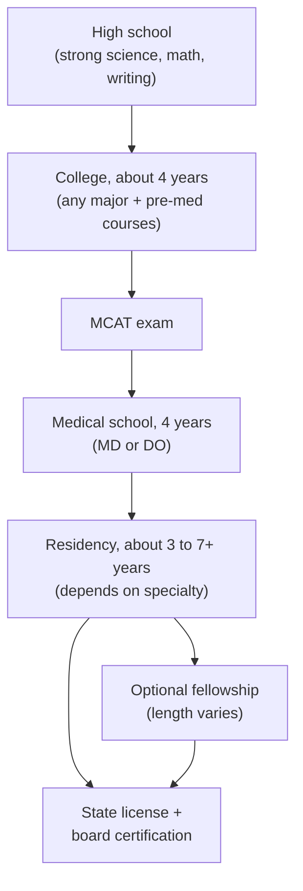

# Appendix B: Careers in Neuroscience and Medicine

!!! mascot-welcome "So, what do you want to be?"
    { class="mascot-admonition-img" }
    I'm a sea slug, so my career options are limited to "helping scientists win Nobel Prizes." Yours are much wider! This appendix maps out the many jobs that use what you learned in this book, and how people actually get there.

## B.1 One Brain, Many Careers

Think about a single patient who has a stroke. A **neurologist** (a doctor who treats diseases of the brain and nerves) figures out where the damage is. A **neuroradiologist** reads the brain scans. A **neurosurgeon** may operate. A **neuroscience nurse** watches the patient around the clock. Then a **physical therapist**, an **occupational therapist**, and a **speech-language pathologist** help the patient walk, get dressed, and talk again. Behind them, **neuroscientists**, **engineers**, and **data scientists** built and tested the drugs, scanners, and tools everyone uses.

That is the big idea of this appendix: neuroscience is not one job. It is a field that connects to medicine, research, rehabilitation, engineering, computing, and teaching. Some take more than a decade of training after high school, and others take far less. Patients need all of them.

A quick note before we start. The training paths below describe the **United States** and are **typical**, not guaranteed. Rules change, and many people take detours. Always check the official sources linked in each section and in the [Sources](#sources) list.

## B.2 Careers at a Glance

Here is a quick key for the table. A **residency** is paid, supervised on-the-job training that every new doctor completes after medical school. A **fellowship** is optional extra training in a narrower area after residency. A **license** is legal permission from a state to practice.

| Career | What they do | Typical U.S. education and training path |
|---|---|---|
| **Neurologist** | Diagnoses and treats disorders of the brain, spinal cord, nerves, and muscles, such as stroke, epilepsy, migraine, multiple sclerosis, and Parkinson's disease. Does not usually operate. | 4-year college degree → 4 years of medical school (MD or DO) → **4-year neurology residency**, which includes a first year of general internal medicine → optional fellowship (for example, stroke or epilepsy). |
| **Neurosurgeon** | Operates on the brain, spine, and nerves, for example to remove tumors, relieve pressure after injuries, or fix problems in the spine. | College → medical school → **7-year neurosurgery residency** (one of the longest in medicine) → optional fellowship. |
| **Psychiatrist** | A medical doctor who diagnoses and treats mental health conditions such as depression, anxiety, schizophrenia, and addiction. Can prescribe medicine and provide therapy. | College → medical school → **4-year psychiatry residency** → optional fellowship (for example, child and adolescent psychiatry). |
| **Child neurologist** | A neurologist for infants, children, and teens. Treats conditions such as childhood epilepsy, cerebral palsy, and genetic disorders of the nervous system. | College → medical school → typically **2 years of pediatrics** (or an approved mix of pediatrics plus another year) → **3 years of child neurology**, about 5 years in all. |
| **Neuroradiologist** | A doctor who specializes in reading images of the brain, spine, head, and neck, such as MRI and CT scans. Some also do image-guided procedures. | College → medical school → **diagnostic radiology residency** (4 years of radiology, usually after a 1-year clinical year, so typically 5 years) → **neuroradiology fellowship**, which lasts 1 year (12 months) in ACGME-accredited programs. |
| **Neuroscientist (PhD researcher)** | Designs and runs experiments to discover how the nervous system works, in labs at universities, government agencies, or companies. | Bachelor's degree (often biology, psychology, neuroscience, chemistry, or engineering) → **PhD**, which averages about 6 years for biomedical fields → usually 1 or more years of postdoctoral research training. |
| **Physician-scientist (MD/PhD)** | Sees patients *and* runs a research lab, often turning lab discoveries into new treatments. | College → combined **MD-PhD program**, most often 7 to 8 years → residency → often a research-focused fellowship. |
| **Clinical psychologist / neuropsychologist** | Clinical psychologists assess and treat mental and behavioral health using therapy and testing (they usually do not prescribe medicine). **Neuropsychologists** study and test how brain damage or disease affects memory, attention, language, and behavior. | Bachelor's degree → **doctoral degree** in psychology (PhD or PsyD), including a 1-year internship → supervised experience for a state license. Neuropsychologists typically add a **2-year postdoctoral residency** in clinical neuropsychology, and many then seek board certification. |
| **Neuroscience nurse** | A registered nurse (RN) who cares for patients with stroke, brain injury, spinal cord injury, seizures, and other neurological conditions, often in intensive care units or stroke units. | Nursing diploma, associate's degree, or bachelor's degree in nursing (BSN; many hospitals prefer a BSN) → pass the **NCLEX** licensing exam → work as an RN. After at least 1 year (2,080 hours) of neuroscience nursing, nurses can seek the **CNRN** (Certified Neuroscience Registered Nurse) credential. |
| **Physical therapist (PT)** | Helps people regain movement, strength, and balance after strokes, spinal cord injuries, or other conditions. | Bachelor's degree with science prerequisites → **Doctor of Physical Therapy (DPT)**, typically about 3 years → state licensing exam. Optional residency later. |
| **Occupational therapist (OT)** | Helps people do everyday activities (dressing, cooking, writing, working) after injury or illness, often by retraining skills or adapting tools and spaces. | Bachelor's degree → **entry-level master's or doctoral degree** in occupational therapy (master's programs typically take 2 to 3 years) with supervised fieldwork → **NBCOT** certification exam → state license. |
| **Speech-language pathologist (SLP)** | Assesses and treats problems with speech, language, voice, fluency (such as stuttering), and swallowing. Many work with stroke survivors or with children in schools. | Bachelor's degree → **master's degree** in speech-language pathology (usually about 2 years) → supervised **clinical fellowship** (at least 36 weeks and 1,260 hours for ASHA certification) and a national exam → state license and the CCC-SLP certificate. |
| **Neural / biomedical engineer** | Designs medical devices and technology, such as brain-computer interfaces, deep brain stimulators, cochlear implants, prosthetic limbs, and imaging machines. | **Bachelor's degree** in biomedical engineering or a related engineering field. Some jobs require a graduate degree, and leading a research team usually does. |
| **Data scientist in neuroscience** | Uses statistics, programming, and machine learning to find patterns in large data sets, such as brain scans, recordings from neurons, or clinical trial results. | **At least a bachelor's degree** (often math, statistics, computer science, or engineering). Some jobs require a master's or doctoral degree, and research roles in neuroscience often do. |
| **Science teacher / science communicator** | Teachers bring neuroscience into classrooms. Communicators explain science to the public as writers, journalists, video makers, museum educators, or podcasters. | **Teacher:** bachelor's degree → state teaching license, which includes student teaching and exams (every state also offers alternative routes). **Communicator:** no single path. Many have a science degree plus strong writing or media experience. |

!!! note "What about salaries?"
    This appendix does not list salaries. Pay changes every year and varies a lot by location and setting. If you want current numbers, the U.S. Bureau of Labor Statistics [Occupational Outlook Handbook](https://www.bls.gov/ooh/) lists median pay for most of these jobs, with the year of the data.

## B.3 The Path to Becoming a Doctor (MD or DO)

In the U.S., there are two kinds of fully licensed physicians:

- **MD** (Doctor of Medicine), the more common degree.
- **DO** (Doctor of Osteopathic Medicine). DO schools teach the same core medicine plus required training in osteopathic manipulative medicine (OMM), which uses the hands to treat problems in the bones, joints, and muscles.

Both MDs and DOs can become neurologists, neurosurgeons, psychiatrists, or any other specialist. Since 2020, residencies for both MD and DO graduates have been accredited by one organization, the Accreditation Council for Graduate Medical Education (ACGME). Here are the steps in plain language.

**Step 1: High school.** Take the strongest science and math classes you can, and learn to write clearly. Explore what you enjoy (see Section B.5).

**Step 2: College, with pre-med courses.** You do **not** have to major in biology. The Association of American Medical Colleges (AAMC) says most medical schools have no preference about your major. You do need to take the courses that medical schools require and that the MCAT covers. At a minimum, the AAMC recommends a year each of biology, general chemistry, organic chemistry, and biochemistry. Many schools also want physics, math or statistics, English, and psychology or sociology. Requirements differ, so check each school.

**Step 3: The MCAT.** The Medical College Admission Test is a long, computer-based exam with four sections: chemistry and physics in living systems; biology and biochemistry; psychology, sociology, and biology of behavior; and critical reading and reasoning.

**Step 4: Medical school (4 years).** The first part is mostly classroom and lab science. The later part is mostly **clinical rotations**, where students work in hospitals and clinics in many specialties. Along the way, students take national licensing exams: the **USMLE** for MD students, and the **COMLEX-USA** for DO students (DO students may also take the USMLE).

**Step 5: Residency (length depends on specialty).** Most residencies last from about 3 to 7 years, depending on the specialty. For brain-related fields:

| Specialty | Typical residency length (ACGME) |
|---|---|
| Neurology | 4 years (48 months), including a first year of internal medicine (sometimes done as a separate preliminary year) |
| Psychiatry | 4 years (48 months) |
| Child neurology | about 5 years (2 years of pediatrics or an approved alternative + 3 years of child neurology) |
| Diagnostic radiology | typically 5 years (1 clinical year + 4 years of radiology), then a 1-year neuroradiology fellowship |
| Neurosurgery | 7 years (84 months) |

**Step 6: Optional fellowship.** Many doctors add a fellowship to specialize further, for example in stroke, epilepsy, movement disorders, or neurocritical care. Fellowship length varies by field.

**Step 7: Licensing and board certification.** Every state requires physicians to be licensed. Most specialists also earn **board certification**, which the American Board of Medical Specialties describes as a higher standard than a license alone. It requires passing specialty exams and keeping skills current over a whole career.

Add it up and a neurologist typically trains for about 12 years after high school (4 + 4 + 4). A neurosurgeon trains for about 15 years, often more with a fellowship. That is a long road, but residents earn a salary (called a stipend), and every year you are learning by caring for real patients.

## B.4 The Research Path: PhD and MD/PhD

Some people love the question "Why?" more than anything else. For them, a research career may be the best fit.

**The PhD path.** A **PhD** (Doctor of Philosophy) is a research degree. In neuroscience, PhD students take a year or two of advanced classes and then spend most of their time doing original experiments in a lab. They finish by writing and defending a **dissertation**, a long report on their new discoveries. The AAMC notes that the average biomedical PhD in the U.S. takes about six years. Many biomedical PhD students receive a **stipend** (a living allowance) and help with tuition, for example through NIH training grants that cover stipends, tuition, and fees. Funding differs from program to program, so ask each one how it supports students.

After the PhD, most researchers do one or more **postdoctoral** positions ("postdocs"). These are temporary research jobs where they build skills and publish their work before applying to lead their own lab, work in industry, teach, or move into science policy or communication.

**The MD/PhD path.** A **physician-scientist** earns both an MD (or DO) and a PhD. Most MD-PhD students finish both degrees in **7 to 8 years**, according to the AAMC. A common pattern is two years of medical school, then several years of PhD research, then a return to clinical rotations. After that comes residency, just like any other doctor.

Many MD-PhD programs are supported by the National Institutes of Health through the **Medical Scientist Training Program (MSTP)**, run by the National Institute of General Medical Sciences (NIGMS). MSTP training grants help pay trainees' tuition, fees, and stipends. Trainees must be U.S. citizens, noncitizen nationals, or permanent residents, and each institution can have only one MSTP. MD-PhD admission is very competitive, and applicants usually need significant research experience in college.

!!! mascot-tip "Research is for doctors, too"
    { class="mascot-admonition-img" }
    You don't need a PhD to do research. Many MDs, nurses, therapists, and engineers help run clinical trials or study better ways to care for patients. If you like both people *and* puzzles, you can have both.

## B.5 What You Can Do in High School, Starting Now

You do not need to pick a career in ninth grade. The goal right now is to **explore**, build strong skills, and find out what you enjoy. Here are some concrete steps.

**1. Take strong classes.**

- **Biology and chemistry** are the base for almost every career in this appendix. Take physics too if you can.
- **AP Psychology** (if your school offers it) introduces brain and behavior topics, many of which also show up on the MCAT.
- **Statistics** matters more than most students expect. Doctors read studies, scientists analyze data, and data scientists live in it.
- **Math and computer science** help with engineering, data science, and research.
- **English and writing** matter for everyone. Doctors write notes, scientists write papers, and teachers explain ideas.

**2. Join or start a neuroscience club.** A club can read articles, invite local scientists or doctors to speak, and study for competitions together. If your school has no club, a teacher sponsor and a few friends are often all you need to start one.

**3. Compete in the Brain Bee.** The **International Brain Bee** is a neuroscience competition for students generally aged 13 to 19. Students compete in a **local** Brain Bee, and local winners advance to their **national** competition. National champions can then compete in the **IBB World Championship**. Formats, dates, and extra rules (such as grade or school requirements) differ by chapter, so **check your chapter's rules**. You can find chapters on the [Brain Bee website](https://www.thebrainbee.org/countries/). This textbook was built to help you prepare.

**4. Take part in Brain Awareness Week.** Every March, the **Dana Foundation** runs [Brain Awareness Week](https://dana.org/brain-awareness-week/), a global campaign to get the public excited about brain science. Schools, universities, hospitals, and labs host events. Your club could run a booth, a brain-themed lesson for younger students, or a display for your school.

**5. Look for research experiences, carefully.** Many universities and hospitals run summer research programs for high school students. One well-known federal option is the **NIH Summer Internship Program (SIP)**, where interns work full time in NIH research labs. It is **not** open to most high school students. In recent years, applicants have had to be U.S. citizens or permanent residents and **18 by September 30 of the internship year**. High school applicants must be **seniors** who will graduate before the internship starts, and a senior who is only 17 on June 1 of that year must live within 40 miles of an NIH campus. Interns should also plan ahead for housing near the lab. Rules can change each year, so always read the [current SIP page](https://www.training.nih.gov/research-training/pb/sip/).

!!! warning "Be careful with pay-to-play programs"
    Some summer programs charge high fees and promise "research experience" or an edge in admissions. A high price does not mean a program is better. Many strong opportunities are free or even pay you. Before applying, ask a teacher or school counselor, find out who runs the program, and look for clear information about what you would actually do.

**6. Read widely.** Read science news, books about the brain, and articles from trustworthy sites. [BrainFacts.org](https://www.brainfacts.org/), from the Society for Neuroscience, is a good place to start.

**7. Volunteer in healthcare settings.** Hospitals, nursing homes, hospice programs, and clinics often have volunteer programs for teens. Most set a minimum age, so check with each one. Volunteering shows you what healthcare is really like: the waiting, the kindness, and the hard moments. It also helps you learn whether you enjoy working with patients.

**8. Shadow professionals.** **Shadowing** means following a doctor, nurse, therapist, or scientist for a day or more to watch what they do. Ask family friends, your own doctor, or a teacher if they know someone. Shadowing different jobs is one of the best ways to compare them.

**9. Take care of yourself.** Sleep, friendships, hobbies, and sports matter. A long career is a marathon, not a sprint.

## B.6 Ply's Advice

!!! mascot-encourage "There is no single right path"
    { class="mascot-admonition-img" }
    Some of the best brain doctors and scientists started out as music majors, engineers, nurses, or late bloomers who found neuroscience in their twenties or thirties. Your path can bend and still get you somewhere great. Every big idea starts at a single synapse, and every big career starts with one small, curious step!

Here are a few last thoughts:

- **Many paths, one goal.** Doctors, nurses, therapists, engineers, scientists, data experts, and teachers all help people with brain conditions. Pick the work that fits *you*: how much time you want to spend with patients, in a lab, at a computer, or in a classroom.
- **Detours are normal.** People switch majors, take gap years, work before graduate school, or change careers. Admissions committees often value real-world experience.
- **Ask for help.** Counselors, teachers, college pre-health advisors, and professionals in the field are usually happy to answer questions.
- **Check the facts yourself.** Training rules and program details change. Use the official sources below to confirm anything before you make big decisions.

## Sources

All links were opened and checked on October 12, 2026.

**Medical training and specialties**

1. Association of American Medical Colleges (AAMC). [Applying to Medical School as a Nonscience Major](https://students-residents.aamc.org/getting-organized/applying-medical-school-nonscience-major).
2. AAMC. [What's on the MCAT Exam?](https://students-residents.aamc.org/whats-mcat-exam/publication-chapters/whats-mcat-exam)
3. AAMC. [Education and Training in MD-PhD Programs](https://students-residents.aamc.org/md-phd-dual-degree-training/education-and-training-md-phd-programs).
4. AAMC. [Is an MD-PhD Right for Me?](https://students-residents.aamc.org/md-phd-dual-degree-training/md-phd-right-me)
5. American Association of Colleges of Osteopathic Medicine (AACOM). [Medical Board Examinations and Licensure](https://www.aacom.org/become-a-doctor/succeed-in-medical-school/board-examinations-and-licensure).
6. AACOM. [Osteopathic Manipulative Medicine Explained](https://www.aacom.org/become-a-doctor/about-osteopathic-medicine/omm-explained).
7. United States Medical Licensing Examination. [USMLE home page](https://www.usmle.org/).
8. ACGME. [Transition to a Single GME Accreditation System: History](https://www.acgme.org/about/transition-to-a-single-gme-accreditation-system-history/).
9. ACGME. [Program Requirements for Graduate Medical Education in Neurology (2026)](https://www.acgme.org/globalassets/pfassets/programrequirements/2026-prs/180_neurology_2026.pdf).
10. ACGME. [Program Requirements in Neurological Surgery (2026)](https://www.acgme.org/globalassets/pfassets/programrequirements/2026-prs/160_neurologicalsurgery_2026.pdf).
11. ACGME. [Program Requirements in Psychiatry (2026)](https://www.acgme.org/globalassets/pfassets/programrequirements/2026-prs/400_psychiatry_2026.pdf).
12. ACGME. [Program Requirements in Child Neurology (2026)](https://www.acgme.org/globalassets/pfassets/programrequirements/2026-prs/185_childneurology_2026.pdf).
13. ACGME. [Program Requirements in Diagnostic Radiology (2026)](https://www.acgme.org/globalassets/pfassets/programrequirements/2026-prs/420_diagnosticradiology_2026.pdf).
14. ACGME. [Program Requirements in Neuroradiology (2026)](https://www.acgme.org/globalassets/pfassets/programrequirements/2026-prs/423_neuroradiology_2026.pdf).
15. AAMC. [AAMC Survey of Resident/Fellow Stipends and Benefits](https://www.aamc.org/data-reports/students-residents/report/aamc-survey-resident/fellow-stipends-and-benefits).
16. American Board of Medical Specialties. [Board Certification](https://www.abms.org/board-certification/).
17. U.S. Bureau of Labor Statistics, Occupational Outlook Handbook. [Physicians and Surgeons](https://www.bls.gov/ooh/healthcare/physicians-and-surgeons.htm).

**Research careers**

18. National Institute of General Medical Sciences (NIGMS). [Institutional Dual-Degree Clinician-Scientist Training Program: MSTP](https://www.nigms.nih.gov/training/instpredoc/Pages/MSTP).
19. NIH. [NOT-OD-26-044: Ruth L. Kirschstein NRSA Stipends, Tuition/Fees and Other Budgetary Levels for Fiscal Year 2026](https://grants.nih.gov/grants/guide/notice-files/NOT-OD-26-044.html).
20. BLS Occupational Outlook Handbook. [Medical Scientists](https://www.bls.gov/ooh/life-physical-and-social-science/medical-scientists.htm).

**Other health and science careers**

21. BLS Occupational Outlook Handbook. [Psychologists](https://www.bls.gov/ooh/life-physical-and-social-science/psychologists.htm).
22. American Board of Professional Psychology. [Clinical Neuropsychology: Specialty Specific Requirements](https://abpp.org/application-information/learn-about-specialty-boards/clinical-neuropsychology/specialty-specific/).
23. BLS Occupational Outlook Handbook. [Registered Nurses](https://www.bls.gov/ooh/healthcare/registered-nurses.htm).
24. NCSBN. [NCLEX: The Premier Nurse Licensure Exam](https://www.nclex.com/).
25. American Board of Neuroscience Nursing. [CNRN Eligibility](https://abnncertification.org/cnrn/eligibility).
26. BLS Occupational Outlook Handbook. [Physical Therapists](https://www.bls.gov/ooh/healthcare/physical-therapists.htm).
27. American Physical Therapy Association. [Becoming a Physical Therapist](https://www.apta.org/your-career/careers-in-physical-therapy/becoming-a-pt).
28. BLS Occupational Outlook Handbook. [Occupational Therapists](https://www.bls.gov/ooh/healthcare/occupational-therapists.htm).
29. American Occupational Therapy Association. [Become an OT/OTA](https://www.aota.org/career/become-an-ot-ota).
30. National Board for Certification in Occupational Therapy. [NBCOT home page](https://www.nbcot.org/).
31. BLS Occupational Outlook Handbook. [Speech-Language Pathologists](https://www.bls.gov/ooh/healthcare/speech-language-pathologists.htm).
32. American Speech-Language-Hearing Association (ASHA). [Apply for Certification in Speech-Language Pathology](https://www.asha.org/certification/slpcertification/).
33. ASHA. [A Guide to the ASHA Clinical Fellowship Experience](https://www.asha.org/certification/clinical-fellowship/).
34. BLS Occupational Outlook Handbook. [Bioengineers and Biomedical Engineers](https://www.bls.gov/ooh/architecture-and-engineering/biomedical-engineers.htm).
35. BLS Occupational Outlook Handbook. [Data Scientists](https://www.bls.gov/ooh/math/data-scientists.htm).
36. BLS Occupational Outlook Handbook. [High School Teachers](https://www.bls.gov/ooh/education-training-and-library/high-school-teachers.htm).
37. BLS. [Occupational Outlook Handbook home page](https://www.bls.gov/ooh/).

**High school opportunities**

38. College Board AP Central. [AP Psychology](https://apcentral.collegeboard.org/courses/ap-psychology).
39. International Brain Bee. [Frequently Asked Questions](https://www.thebrainbee.org/faq/).
40. International Brain Bee. [Countries and chapters](https://www.thebrainbee.org/countries/).
41. Dana Foundation. [Brain Awareness Week](https://dana.org/brain-awareness-week/).
42. NIH Office of Intramural Training and Education. [Summer Internship Program (SIP)](https://www.training.nih.gov/research-training/pb/sip/).
43. Society for Neuroscience. [BrainFacts.org](https://www.brainfacts.org/).
