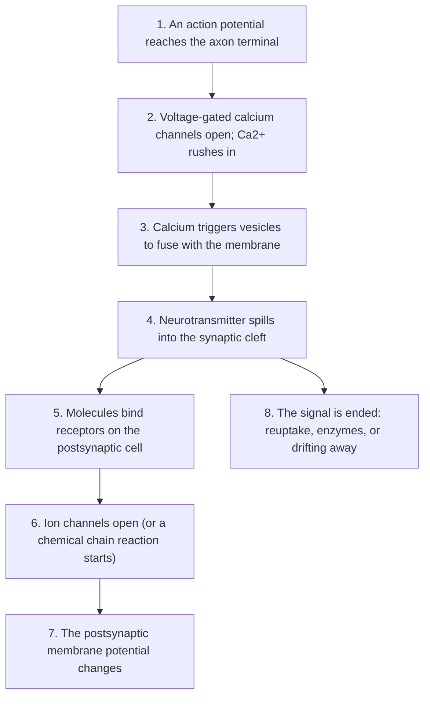

# Chapter 3: Synapses and Neurotransmitters

## Summary

Neurons do not touch each other. Between them is a tiny gap, and most signals cross it as chemicals called neurotransmitters. This chapter follows a signal from the moment an action potential reaches the end of an axon to the moment the next cell "decides" whether to fire. Along the way you will meet the major neurotransmitters, learn how drugs such as caffeine, nicotine, and antidepressants act at synapses, and see what happens when the immune system attacks the synapse between nerve and muscle in myasthenia gravis.

## Concepts Covered

1. Synapse
2. Chemical Synapse
3. Electrical Synapse
4. Synaptic Vesicle
5. Neurotransmitter
6. Receptor
7. Ionotropic Receptor
8. Metabotropic Receptor
9. Excitatory Postsynaptic Pot.
10. Inhibitory Postsynaptic Pot.
11. Synaptic Integration
12. Reuptake
13. Glutamate
14. GABA
15. Acetylcholine
16. Dopamine
17. Serotonin
18. Norepinephrine
19. Neuromuscular Junction
20. Agonist and Antagonist
21. Myasthenia Gravis

## Prerequisites

- [Chapter 1: Neurons, Glia, and the Nervous System](../01-neurons-and-glia/index.md) (axon terminals, dendrites, glia, motor neurons)
- [Chapter 2: The Action Potential](../02-action-potential/index.md) (resting potential, threshold, ion channels, depolarization and hyperpolarization)

!!! mascot-welcome "Welcome to the gap!"
    { class="mascot-admonition-img" }
    I'm a sea slug, and synapses are kind of my thing. Scientists studied my species to learn how synapses change when an animal learns. In this chapter you'll see where many brain drugs, several diseases, and even your morning coffee do their work: in the gap between two cells.

## 3.1 Maya's Morning Coffee

It's 7:15 a.m., and Maya has a chemistry test second period. She stayed up late studying for the Brain Bee, and her eyelids feel heavy. Her dad hands her a small coffee. Twenty minutes later she feels sharper. Nothing about her neurons' wiring changed in those twenty minutes. So how did a drink change how her brain works?

The answer is at the synapses. While Maya is awake, a molecule called adenosine slowly builds up in her brain and attaches to special proteins on her neurons. When adenosine attaches, it pushes those neurons toward sleepiness. Caffeine has a shape close enough to adenosine that it fits into the same proteins, but it does not switch them on. It just sits there, taking up the spot, so adenosine can't deliver its "time to rest" message. Caffeine doesn't add energy. It blocks a signal that would have made Maya feel tired.

That one example holds the whole chapter in miniature. Neurons talk with chemicals. Those chemicals work by fitting into proteins on the next cell. And any outside molecule that fits those proteins, whether it's a drug, a toxin, or an antibody made by a confused immune system, can change the conversation.

## 3.2 The Gap Between Neurons

### An everyday picture first

Picture a relay race where the runners are not allowed to touch. The first runner can't hand over the baton. Instead, she has to throw a bunch of small tennis balls across a narrow gap, and the next runner only starts if she catches enough of them. That sounds clumsy, but it has big advantages. The thrower can throw more or fewer balls. The catcher can hold out more or fewer hands. And a third person standing nearby could block the throw, swap in fake balls, or sweep the balls away. All of those are ways to control the race.

That is roughly how most neurons communicate.

### Naming the parts

A **synapse** is a junction where a neuron passes a signal to another cell. The other cell might be a neuron, a muscle fiber, or a gland cell. The cell sending the signal is the **presynaptic** cell ("before the synapse"). The cell receiving it is the **postsynaptic** cell ("after the synapse"). In Chapter 1 you met the axon terminal, the swollen tip at the end of an axon. Most synapses form where an axon terminal sits next to a dendrite or cell body of the next neuron.

The word "synapse" is older than most people guess. The British physiologist Charles Sherrington introduced it in 1897, when scientists were still arguing about whether neurons were separate cells at all.

### Two kinds of synapses

There are two ways to cross the gap.

A **chemical synapse** uses molecules as messengers. The presynaptic terminal releases a chemical into a narrow space called the **synaptic cleft**, which is only about 20 to 40 nanometers wide (a nanometer is a billionth of a meter). The chemical drifts across and is detected by the postsynaptic cell. Most synapses in the human brain are chemical.

An **electrical synapse** is a direct connection. At special contact points called **gap junctions**, the two cells come within about 3.5 nanometers of each other, and tiny protein tunnels link the inside of one cell to the inside of the other. Ions flow straight through, so the electrical change in one cell spreads almost instantly to the next. Electrical synapses are faster, and signals can usually flow in both directions. They are useful wherever many cells need to fire in sync or a response must be as fast as possible.

The table below sums up what we just compared.

| Feature | Chemical synapse | Electrical synapse |
|---|---|---|
| What crosses | Neurotransmitter molecules | Ions, through gap junction tunnels |
| Gap between cells | About 20 to 40 nm (the synaptic cleft) | About 3.5 nm |
| Speed | Short delay while chemicals are released and detected | Nearly instant |
| Direction | One way: presynaptic to postsynaptic | Usually both ways |
| Can the signal be made bigger, smaller, or flipped? | Yes, in many ways | Much less so |
| How common in the human brain | The large majority | An important minority |

If chemical synapses are slower, why does the brain use them so much? Look at the last two rows. A chemical synapse is adjustable. It can turn a signal up or down, switch excitation into inhibition, and change its strength with experience. That flexibility is what makes learning possible, and it is also why drugs and diseases act at chemical synapses so often. The rest of this chapter is about chemical synapses.

### How we learned the gap was chemical

For a long time, many scientists thought nerves must signal by electricity alone. The German pharmacologist Otto Loewi settled the question with a famous experiment in 1921, using two frog hearts. He stimulated the vagus nerve of the first heart, which slowed its beating. Then he took the fluid that had bathed that heart and put it on a second heart whose nerve had not been touched. The second heart slowed down too. Some chemical released by the nerve had carried the message. Loewi called it *Vagusstoff* ("vagus substance"). It was later shown to be **acetylcholine**, which you'll meet again soon. Loewi shared the 1936 Nobel Prize in Physiology or Medicine with Henry Dale for discoveries about the chemical transmission of nerve impulses.

## 3.3 Step by Step at a Chemical Synapse

Before we walk through the steps, you need two terms.

A **neurotransmitter** is a chemical messenger that a neuron releases at a synapse to affect the next cell. Neurotransmitters are made by neurons and stored near the release site until needed.

A **synaptic vesicle** is a tiny bubble of membrane inside the axon terminal that is packed with neurotransmitter molecules. The terminal holds many vesicles, clustered close to the membrane that faces the cleft.

Now we can follow one signal across. The flowchart below shows the sequence.

Here is each step in a little more detail.

1. **The action potential arrives.** In Chapter 2 you saw the action potential race down the axon. When it reaches the terminal, its depolarization does something new.
2. **Calcium enters.** The terminal membrane has voltage-gated channels for calcium ions (Ca²⁺). Depolarization opens them, and calcium floods in, because there is far more calcium outside the cell than inside.
3. **Vesicles fuse.** Calcium-sensitive proteins attached to the vesicles change shape. That pulls docked vesicles into the cell membrane until they merge with it, a little like two soap bubbles joining.
4. **Release.** The vesicle's contents spill into the cleft. Because the cleft is so thin, the neurotransmitter concentration there shoots up for a brief moment.
5. **Binding.** Neurotransmitter molecules drift across and attach to receptors on the postsynaptic membrane.
6. **Response.** The receptors either open ion channels or start a chain of chemical reactions inside the cell.
7. **A new voltage.** The postsynaptic cell's membrane potential moves up or down.
8. **Cleanup.** The neurotransmitter must be removed quickly, or the next signal would be blurred into the last one.

Notice what happened: an electrical signal (the action potential) became a chemical signal (neurotransmitter), which then became an electrical signal again (a change in the postsynaptic voltage). Electrical, chemical, electrical. That conversion is what synaptic transmission is all about.

## 3.4 Receptors: The Locks on the Other Side

### Lock and key

A **receptor** is a protein, usually sitting in the cell membrane, that a specific molecule can bind to and that changes the cell's activity when it does. A neurotransmitter and its receptor fit like a key and a lock. A key cut for one lock usually won't open another. That's why a neuron can carry several kinds of receptors and respond to several messengers without mixing them up.

The receptor, not the neurotransmitter, mostly decides what happens next. The same neurotransmitter can excite one cell and calm another, depending on which receptors that cell has. Receptors come in two big families.

### Ionotropic receptors: fast doors

An **ionotropic receptor** is a receptor that is also an ion channel. When the neurotransmitter binds, the protein changes shape and a pore opens right through it, letting certain ions cross the membrane. Another name for it is a *ligand-gated ion channel* ("ligand" just means the molecule that binds). The effect starts within milliseconds and ends quickly. Think of it as a door with a keyhole: turn the key and the door swings open.

### Metabotropic receptors: slower, longer messages

A **metabotropic receptor** has no pore of its own. When the neurotransmitter binds, the receptor switches on a partner protein inside the cell called a **G protein**. The G protein then turns on other molecules, called **second messengers**, which spread the signal inside the cell. Second messengers might open ion channels somewhere else on the membrane, change how the cell uses energy, or even switch genes on and off. Think of it less like a door and more like a doorbell. Pressing the button doesn't let anyone in, but it starts a chain of events inside the house. Metabotropic effects are slower to start but can last much longer, from seconds to minutes or more.

| | Ionotropic receptor | Metabotropic receptor |
|---|---|---|
| Is the receptor itself a channel? | Yes | No; it works through a G protein |
| Speed | Very fast (milliseconds) | Slower to start |
| How long the effect lasts | Brief | Can last much longer |
| What it can change | Mainly the membrane voltage, right away | Voltage, cell chemistry, even gene activity |
| Example | Nicotinic acetylcholine receptor on skeletal muscle | Muscarinic acetylcholine receptor in the heart |

Look at the last row. Acetylcholine binds both kinds of receptors. Your skeletal muscles use the fast ionotropic kind, so your muscles respond instantly. Your heart's pacemaker cells use the slower metabotropic kind, which is the receptor Loewi's *Vagusstoff* was acting on when it slowed the frog heart.

## 3.5 Adding Up the Votes: EPSPs, IPSPs, and Integration

### Small nudges, not full signals

When neurotransmitter opens channels on a dendrite, the postsynaptic cell does not fire a full action potential right away. Instead, its voltage takes a small step up or down. These small steps are called **postsynaptic potentials**.

An **excitatory postsynaptic potential (EPSP)** is a small depolarization of the postsynaptic membrane. It moves the voltage up, closer to threshold, so the cell becomes *more* likely to fire. EPSPs usually happen when channels open that let positive sodium ions flow into the cell. The neurotransmitter most often behind EPSPs in the brain is glutamate.

An **inhibitory postsynaptic potential (IPSP)** is a small hyperpolarization, or a change that holds the voltage down. It moves the cell *away* from threshold, so it becomes *less* likely to fire. IPSPs often happen when channels open that let negative chloride ions in, or let positive potassium ions out. The neurotransmitters most often behind IPSPs are GABA in the brain and glycine in the spinal cord.

Postsynaptic potentials are very different from the action potentials in Chapter 2:

- They are **graded**, meaning they can be big or small depending on how much neurotransmitter arrives and how many receptors open. An action potential is all-or-none.
- They **fade** as they spread away from the synapse.
- They can **add together**. Action potentials can't.

### Synaptic integration

A single neuron in your brain can receive input from thousands of synapses. Some are shouting "fire!" and others are saying "stay quiet." **Synaptic integration** is the process by which a neuron adds up all of its EPSPs and IPSPs to decide whether to fire an action potential.

There are two ways the adding happens:

- **Spatial summation:** inputs from *different* synapses arrive at about the same time and add together.
- **Temporal summation:** inputs from the *same* synapse arrive in quick succession, so each new EPSP starts before the last one has faded.

The decision is made near the **axon hillock**, the spot where the axon leaves the cell body. That region has many voltage-gated sodium channels, so it is where an action potential usually starts. If the summed voltage there reaches threshold, the neuron fires. If not, nothing leaves the cell.

### A worked example

Let's use round, illustrative numbers. (Real EPSP sizes vary a lot from synapse to synapse.) Suppose a neuron rests at −70 mV and its threshold is −55 mV. It needs a total push of 15 mV.

- Three EPSPs of +6 mV arrive together: \( -70 + 6 + 6 + 6 = -52 \) mV. That's above −55 mV, so the neuron fires.
- Now the same three EPSPs arrive along with one IPSP of −5 mV: \( -70 + 18 - 5 = -57 \) mV. That's just short of threshold, so the neuron stays silent.

One "no" vote changed the outcome. Inhibition doesn't have to be loud to matter. It only has to shift the total at the right moment.

!!! mascot-thinking "Neurons are tiny voting machines"
    { class="mascot-admonition-img" }
    Every neuron is constantly counting yes votes (EPSPs) and no votes (IPSPs), and only the total at the axon hillock matters. That's why a drug that only slightly boosts inhibition everywhere can make a whole brain drowsy.

## 3.6 Ending the Signal: Reuptake and Cleanup

A text message that kept buzzing forever would be useless. A synapse has the same problem. If neurotransmitter stayed in the cleft, the postsynaptic cell couldn't tell one signal from the next. Synapses use three main ways to clear the cleft.

1. **Reuptake.** **Reuptake** is the process of pumping a released neurotransmitter back into the presynaptic terminal through special proteins called **transporters**. The neuron can then repackage it into vesicles and reuse it. Reuptake ends the signal for many neurotransmitters, including dopamine, serotonin, and norepinephrine. Nearby glial cells called astrocytes (Chapter 1) also have transporters that soak up glutamate and GABA.
2. **Enzymes.** Some neurotransmitters are broken apart right in the cleft. Acetylcholine is the classic example: an enzyme called **acetylcholinesterase** splits it, and the pieces are recycled.
3. **Diffusion.** Some molecules simply drift out of the cleft and away.

Reuptake is one of the most important targets in all of medicine. If you slow it down, neurotransmitter stays in the cleft longer and keeps acting on receptors. That's exactly what many antidepressants and some drugs of abuse do, as you'll see in Section 3.8.

## 3.7 Meet the Neurotransmitters

More than 100 substances are known to act as neurotransmitters, but six of them come up again and again in neuroscience, in medicine, and in Brain Bee questions. Remember the rule from Section 3.4: whether a neurotransmitter excites or inhibits depends on the receptor. The descriptions below give each one's *usual* job.

**Glutamate** is the main excitatory neurotransmitter of the brain. It is the "go" signal at most fast excitatory synapses, and it is central to learning and memory (Chapter 9). Too much glutamate activity can damage neurons, a problem called excitotoxicity that is involved in stroke and several brain diseases (Chapters 13 and 14).

**GABA** (gamma-aminobutyric acid) is the main inhibitory neurotransmitter of the brain. It is used at most fast inhibitory synapses. GABA keeps excitation in check, which is why many sedative and anti-anxiety drugs work by boosting GABA's effects. In the spinal cord, a related amino acid, glycine, does much of the inhibitory work.

**Acetylcholine** (often written ACh) is the neurotransmitter motor neurons use to tell skeletal muscles to contract. It also slows the heart, as Loewi discovered. In the brain, it helps with alertness, attention, and memory. The loss of acetylcholine-producing neurons is associated with the memory problems of Alzheimer's disease (Chapter 13).

**Dopamine** has several separate pathways in the brain. One, starting in a region called the substantia nigra, helps control movement; losing those neurons causes most of the movement symptoms of Parkinson's disease (Chapter 7). Another pathway is involved in motivation and reward, the drive to seek out things we want. Many addictive drugs raise dopamine signaling in that pathway (Chapter 15).

**Serotonin** helps regulate mood, sleep, appetite, and body temperature, among other things. Surprisingly, most of the body's serotonin (roughly 90%) is made in the gut, where it helps control digestion, not in the brain.

**Norepinephrine** (also called noradrenaline) prepares the brain and body for action. In the brain, much of it comes from a small cluster of neurons in the brainstem called the locus coeruleus, and it raises arousal, alertness, and attention. Its levels are lowest during sleep and highest during stress or danger, as part of the fight-or-flight response.

Now that you've met all six, here they are side by side.

| Neurotransmitter | Usual effect | Main jobs | A medical connection |
|---|---|---|---|
| Glutamate | Excitatory | Fast "go" signals; learning and memory | Excitotoxicity in stroke |
| GABA | Inhibitory | Fast "stop" signals; calming circuits | Sedatives that boost GABA |
| Acetylcholine | Excitatory at muscle; varies elsewhere | Muscle contraction; heart rate; attention, memory | Myasthenia gravis; Alzheimer's disease |
| Dopamine | Depends on receptor | Movement; motivation and reward | Parkinson's disease; addiction |
| Serotonin | Depends on receptor | Mood, sleep, appetite | Target of SSRI antidepressants |
| Norepinephrine | Depends on receptor | Arousal, alertness, fight-or-flight | Stress responses (Chapter 11) |

## 3.8 Drugs at the Synapse: Agonists and Antagonists

Now we can return to Maya's coffee with better words for what happened.

An **agonist** is a molecule that binds a receptor and activates it, mimicking the natural neurotransmitter. An **antagonist** is a molecule that binds a receptor without activating it, so it blocks the natural neurotransmitter from doing its job. In the lock-and-key picture, an agonist is a copied key that turns the lock. An antagonist is a key that fits in the lock but won't turn, and it's jammed in there so the real key can't get in.

Caffeine is an antagonist at adenosine receptors. That's why it doesn't give you energy so much as hide your tiredness.

Drugs can also act at other steps of synaptic transmission. Some change how much neurotransmitter is released. Others change how fast it is cleared. Each example in the table below works at one of the steps you learned in Sections 3.3 to 3.6.

| Substance | What it does | Step it affects |
|---|---|---|
| Caffeine | Antagonist at adenosine receptors | Receptor binding |
| Nicotine | Agonist at nicotinic acetylcholine receptors | Receptor binding |
| Heroin and other opioids | Mimic natural opioid chemicals and activate opioid receptors (agonists) | Receptor binding |
| Naloxone | Opioid antagonist; reverses an opioid overdose | Receptor binding |
| Curare | Antagonist at the acetylcholine receptors on muscle; causes paralysis | Receptor binding |
| SSRIs (selective serotonin reuptake inhibitors) | Block the serotonin transporter | Reuptake |
| Cocaine | Interferes with transporters, so neurotransmitters such as dopamine are not recycled normally | Reuptake |
| Botulinum toxin | Stops the release of acetylcholine at the neuromuscular junction | Vesicle release |
| Pyridostigmine | Slows the enzyme that breaks down acetylcholine | Enzyme cleanup |

Two of these deserve a closer look.

**SSRIs** are a common class of antidepressant medicines. By blocking the serotonin transporter, they keep serotonin in the cleft longer. The improvement in mood usually takes several weeks to appear. That delay is one clue that SSRIs probably work through gradual changes in brain signaling and in receptors, not just "more serotonin right now."

**Naloxone** shows how powerful an antagonist can be. In an opioid overdose, opioid drugs activate so many opioid receptors that breathing slows or stops. Naloxone binds tightly to those same receptors without activating them. It pushes the opioids off and blocks them from binding again, which can quickly restore breathing. You'll study this in Chapter 15.

!!! mascot-warning "An antagonist is not an 'opposite'"
    { class="mascot-admonition-img" }
    A common mistake is to think an antagonist does the reverse of the neurotransmitter. It doesn't produce its own opposite effect. It just blocks the receptor, so the result is "less of the normal signal," not "the opposite signal."

## 3.9 The Neuromuscular Junction

Every movement you make, from a soccer kick to a blink, starts at a special chemical synapse. The **neuromuscular junction** (often shortened to NMJ) is the synapse between a motor neuron and a skeletal muscle fiber.

It works exactly like the synapses you've studied, with a few special features:

- The neurotransmitter is **acetylcholine**.
- The muscle fiber's receptors are **nicotinic acetylcholine receptors**, which are ionotropic. When acetylcholine binds, the channel opens and positive ions rush in, depolarizing the muscle membrane.
- The cleft is filled with **acetylcholinesterase**, the enzyme that splits acetylcholine almost as soon as it has acted. So at the NMJ, the signal is ended by an enzyme rather than by reuptake.
- In a healthy NMJ, one action potential in the motor neuron reliably triggers one action potential in the muscle fiber. The junction releases more acetylcholine, and has more receptors, than it strictly needs to reach threshold. Neurologists call that extra margin the **safety factor**.

That safety factor is easy to overlook until it's gone. With fewer working receptors, each nerve impulse produces a smaller depolarization in the muscle. It may still reach threshold at first. But when a nerve fires again and again, the amount of acetylcholine released with each impulse naturally drops a bit. In a healthy junction that small drop doesn't matter. In a junction with too few receptors, it can push the response below threshold, and some muscle fibers stop responding. Keep that idea in mind. It is the key to the bedside case.

!!! mascot-tip "Brain Bee tip: my famous synapse"
    { class="mascot-admonition-img" }
    My species, *Aplysia californica*, has only about 20,000 large neurons, so Eric Kandel could study single synapses in its gill-withdrawal reflex. He found that serotonin strengthens a key synapse when the slug learns, and he shared the 2000 Nobel Prize with Arvid Carlsson and Paul Greengard for discoveries about signaling in the nervous system. You'll see this again in Chapter 9.

## 3.10 Try It: The Synapse Simulator

Now you can run a synapse yourself. The simulator shows one strong excitatory chemical synapse in slow motion. Red dots are neurotransmitter molecules. Blue blocks on the terminal are reuptake transporters. Green cups on the postsynaptic membrane are receptors, which turn bright green while a molecule is bound. On the right, one graph tracks how much transmitter is in the cleft, and the other tracks the postsynaptic membrane potential in millivolts, with a dashed threshold line.

#### Diagram: Synapse Simulator

<iframe src="../../sims/ch03-synapse/main.html" height="552px" width="100%" scrolling="no"></iframe>

[Open the Synapse Simulator fullscreen](../../sims/ch03-synapse/main.html){ .md-button .md-button--primary }

MicroSim specification: Synapse Simulator

Type: microsim
**sim-id:** ch03-synapse 
**Library:** p5.js 
**Status:** Implemented 
**Bloom Level:** Apply 
**Bloom Verb:** predict 
**Learning Objective:** The learner will predict how a reuptake blocker, a receptor antagonist, and a loss of receptors each change the amount of neurotransmitter in the cleft and the size and duration of the postsynaptic potential, then check each prediction in the simulator.

**Canvas:** 470 px drawing area plus 80 px control area (iframe height 552 px); width responsive.

**Controls:** Start/Pause button; "Fire once" button (one presynaptic action potential); Reset button; firing-rate slider (0 to 5 per second, step 1, default 1, slow motion); condition menu with Normal, Reuptake blocker (like an SSRI), Receptor antagonist, and Fewer receptors (myasthenia-like).

**Behavior:** Each firing releases transmitter particles from vesicles; the releasable store shrinks with each release and refills over about 2 seconds, so release falls at high firing rates. Particles diffuse, bind free receptors briefly, unbind, and are removed by transporters (or slowly drift away). The postsynaptic potential rises with the number of bound receptors; reaching −55 mV triggers one postsynaptic spike to about +30 mV, from a resting potential of −70 mV. Reuptake blocker: transporters disabled, so transmitter lingers and the response lasts longer. Antagonist: 8 of 12 receptors capped by a drug. Fewer receptors: 6 of 12 receptors removed. A counter shows how many releases made the postsynaptic cell fire.

**Chapter Anchors:** resting potential −70 mV; threshold −55 mV; spike peak about +30 mV; 12 receptors in the normal synapse; antagonist blocks 8 of 12; fewer-receptors condition keeps 6 of 12. All other quantities are illustrative and qualitative.

Try these four experiments. Before each one, predict what the two graphs will do.

1. **Normal.** Press **Fire once** a few times. Watch the dots cross, bind, and disappear into the blue transporters. The cleft graph spikes and quickly falls, and almost every release pushes the postsynaptic cell past threshold. That is because the simulator models a strong synapse, like the nerve-to-muscle junction in Section 3.9, where one release is normally enough. Most synapses in the brain are weaker. There, a single EPSP falls short, and the cell fires only when many EPSPs add up, as in Section 3.5.
2. **Reuptake blocker.** Switch the condition and press **Start**. The transporters get a gray X. Compare the cleft graph with the normal one. The transmitter piles up and lingers, and the postsynaptic potential stays raised for longer. This is the basic idea behind an SSRI, although real SSRIs act on serotonin synapses in the brain over weeks.
3. **Receptor antagonist.** Gray caps cover most receptors. The surprise is that the cleft graph looks about normal, because the transmitter is still released and cleared. But few receptors can bind it, so the postsynaptic potential stays small and usually misses threshold.
4. **Fewer receptors.** Half of the receptors are gone, the way antibodies remove them in myasthenia gravis. Count how many releases succeed at a firing rate of 1 per second, then at 5 per second. With fewer receptors, failures become more common at high firing rates, because the smaller release per impulse is no longer enough. (At a real neuromuscular junction, acetylcholinesterase clears acetylcholine. The simulator keeps the same cleanup method in every condition so that only one thing changes at a time.)

The big lesson: a drug or disease can change synaptic transmission by acting on the *amount* of neurotransmitter, on *how long* it stays, or on the *receptors* that detect it. The cleft graph and the response graph tell you which one is happening.

!!! mascot-encourage "Stuck on which graph changed?"
    { class="mascot-admonition-img" }
    If the cleft graph changes, the drug is acting on release or cleanup. If the cleft looks normal but the response shrinks, the problem is with the receptors. Sort every drug in this chapter with that one question and you've got it.

## At the Bedside: Eyelids That Droop by Evening

!!! note "Meet the patient"
    Elena is 35 and teaches middle school math. For about two months, her eyelids have been drooping, mostly in the late afternoon. Some evenings she sees double while grading papers or driving home. Her eyelids look almost normal when she wakes up. Lately, her jaw gets tired partway through dinner, and she has to rest before she can finish chewing. She feels fine otherwise and has no numbness or pain.

**What the doctor checks:** The neurologist asks Elena to look up at a fixed point without blinking. After about a minute, her eyelids begin to sag, and her double vision returns. Her muscle strength is normal at first but fades with repeated testing, then improves after a short rest. Her sensation is normal. The doctor orders a blood test for antibodies against the acetylcholine receptor. She also orders **repetitive nerve stimulation**, a test that zaps a nerve with a series of small electrical pulses while recording the muscle's response, and a chest CT scan to look at the thymus gland.

**Where is the problem? (localization):** The weakness gets worse with use and better with rest. It affects eye and chewing muscles. And there is no numbness. A stroke or tumor in the brain would not usually come and go with exercise, and a damaged nerve would usually affect feeling too. Weakness that fatigues points to the neuromuscular junction, where each nerve impulse has to be turned into a muscle action potential.

**Diagnosis:** Myasthenia gravis. Her blood test is positive for acetylcholine receptor antibodies, and repetitive nerve stimulation shows the muscle's response shrinking with each pulse in the train.

**Why it happens:** **Myasthenia gravis** is a chronic autoimmune disease in which the immune system makes antibodies that block, alter, or destroy acetylcholine receptors at the neuromuscular junction. Less often, the antibodies target a related protein called MuSK. With fewer working receptors, the safety factor shrinks. Each nerve impulse still releases acetylcholine, but the muscle's depolarization is smaller. With repeated use, release per impulse dips, and more muscle fibers fail to reach threshold. That is why Elena's muscles are strongest in the morning and weakest after a day of use. Eye muscles are often affected first, partly because their neuromuscular junctions have a smaller safety factor to begin with. The thymus gland, which trains immune cells, is often abnormal in people with myasthenia gravis and is thought to help start the faulty immune response. The condition most commonly begins in women under 40 and men over 60, but it can start at any age.

**Treatment today:** There is no cure yet, but most people with myasthenia gravis live a normal life span. A common treatment is pyridostigmine, an acetylcholinesterase inhibitor. It slows the enzyme that breaks down acetylcholine, so each burst of acetylcholine lasts longer and has more chances to find the remaining receptors. Doctors also use medicines that calm the immune system, such as prednisone, and surgery to remove the thymus (thymectomy) helps many patients. For severe flare-ups, plasma exchange removes harmful antibodies from the blood, and intravenous immunoglobulin (IVIG) temporarily changes how the immune system behaves. The FDA has also approved complement inhibitors, such as eculizumab, for some people with generalized myasthenia gravis who test positive for acetylcholine receptor antibodies. Eculizumab was first approved for adults with this form in 2017, and in 2025 its approval was extended to children 6 and older ([Practical Neurology, 2025](https://practicalneurology.com/news/soliris-now-approved-to-treat-children-with-generalized-myasthenia-gravis)). About 15 to 20% of people with myasthenia gravis have at least one **myasthenic crisis**, when the breathing muscles become too weak to work. That is a medical emergency that may require a ventilator.

**What's new in research:** A newer class of drugs lowers the level of harmful antibodies directly. Antibodies are normally rescued from breakdown by a protein called the neonatal Fc receptor (FcRn). Drugs that block FcRn let the body clear antibodies faster, including the ones attacking the neuromuscular junction. In December 2021, the FDA approved the first of these, efgartigimod (brand name Vyvgart), for adults with generalized myasthenia gravis who test positive for acetylcholine receptor antibodies. In the phase 3 ADAPT trial ([Howard et al., *Lancet Neurology*, 2021](https://doi.org/10.1016/S1474-4422%2821%2900159-9)), 68% of antibody-positive patients improved on a measure of daily function during the first treatment cycle, compared with 30% on placebo ([FDA announcement](https://www.fda.gov/news-events/press-announcements/fda-approves-new-treatment-myasthenia-gravis)). Other FcRn blockers, rozanolixizumab (approved in 2023) and nipocalimab (approved in 2025 for people 12 and older), have followed. In 2026, the FDA widened efgartigimod's approval to adults whose blood tests show no acetylcholine receptor antibodies ([Muscular Dystrophy Association, May 2026](https://www.mda.org/press-releases/fda-expands-approval-of-vyvgart-and-vyvgart-hytrulo-to-all-adults-living-with-generalized-myasthenia)). A different approach targets the B cells that make the antibodies: inebilizumab (brand name Uplizna) was approved for adults with generalized myasthenia gravis in December 2025 ([Amgen announcement](https://www.amgen.com/newsroom/press-releases/2025/12/fda-approves-uplizna-for-adults-with-generalized-myasthenia-gravis)). As of October 2026, more drugs are still under FDA review. None of these treatments is a cure.

??? question "Your turn: diagnose a variation"
    A 50-year-old man has surgery for a broken leg. During the operation, the anesthesiologist gives him a curare-like muscle relaxant, a drug that acts as an antagonist at the acetylcholine receptors on muscle, so his muscles stay still. At the end of surgery, the anesthesiologist gives a drug called neostigmine, and his strength returns. Using this chapter, explain (1) why the first drug caused weakness, and (2) how neostigmine, which is closely related to Elena's pyridostigmine, could reverse it.

    **Answer:** (1) The muscle relaxant binds the nicotinic acetylcholine receptors without opening them, so acetylcholine released by motor neurons can't depolarize the muscle enough to reach threshold. This is a drug-made version of Elena's problem: too few *usable* receptors. (2) Neostigmine is an acetylcholinesterase inhibitor. With the enzyme slowed, acetylcholine builds up in the cleft and lasts longer, so it can outcompete the antagonist for the receptors that remain, and the muscle reaches threshold again. Neostigmine is used in exactly this way at the end of many surgeries.

*This is a fictional teaching case. It is not medical advice. If you or someone you know has symptoms like these, talk to a doctor.*

## Common Misconceptions

**Myth:** Dopamine is the brain's "pleasure chemical."  
**Reality:** Dopamine is more about *wanting* and *motivation* than about pleasure itself. In a classic set of rat experiments, animals whose dopamine was almost completely depleted still showed normal "liking" reactions to sweet tastes ([Berridge and Robinson, 1998](https://doi.org/10.1016/S0165-0173%2898%2900019-8)). The researchers concluded that dopamine matters more for how strongly a reward is *wanted* than for how good it feels. Dopamine also controls movement, which is why losing dopamine neurons causes Parkinson's disease.

**Myth:** Serotonin equals happiness, and depression is just "low serotonin."  
**Reality:** Serotonin helps regulate mood, but also sleep, appetite, and digestion, and most of the body's serotonin is in the gut. A 2022 umbrella review of the research found no consistent evidence that depression is caused by low serotonin ([Moncrieff et al., *Molecular Psychiatry*](https://www.nature.com/articles/s41380-022-01661-0)). That does not mean antidepressants don't help people. It means depression is more complicated than a single chemical running low.

**Myth:** Neurons physically touch and pass electricity straight from one to the next.  
**Reality:** At most synapses, there is a real gap of about 20 to 40 nanometers, and the signal crosses it as chemicals. Electrical synapses, where ions flow directly between cells, exist but are the minority.

**Myth:** Each neurotransmitter always has the same effect, so glutamate always "excites" and dopamine always "rewards."  
**Reality:** The receptor decides. Acetylcholine excites skeletal muscle through ionotropic receptors but slows the heart through metabotropic ones. Dopamine has several receptor types and several pathways with very different jobs.

**Myth:** Caffeine gives your brain extra energy.  
**Reality:** Caffeine is an antagonist. It blocks adenosine receptors, so the "you've been awake a long time" signal can't get through. The tiredness is hidden for a while, not erased.

## Brain Bee Practice

??? question "1. What ion's entry into the axon terminal triggers neurotransmitter release?"
    Calcium (Ca²⁺). When the action potential depolarizes the terminal, voltage-gated calcium channels open, and the incoming calcium causes vesicles to fuse with the membrane.

??? question "2. Name the enzyme that breaks down acetylcholine at the neuromuscular junction."
    Acetylcholinesterase. Drugs that inhibit it, such as pyridostigmine, are used to treat myasthenia gravis.

??? question "3. What is the difference between an ionotropic and a metabotropic receptor?"
    An ionotropic receptor is itself an ion channel that opens when the neurotransmitter binds, giving a fast, brief response. A metabotropic receptor works through a G protein and second messengers, giving a slower but longer-lasting response.

??? question "4. Which neurotransmitter is the main excitatory transmitter in the brain, and which is the main inhibitory one?"
    Glutamate is the main excitatory neurotransmitter. GABA is the main inhibitory neurotransmitter in the brain (glycine plays that role in much of the spinal cord).

??? question "5. A patient's eyelids droop more as the day goes on, and blood tests show antibodies against acetylcholine receptors. What is the diagnosis, and where is the problem?"
    Myasthenia gravis. The problem is at the neuromuscular junction, where antibodies reduce the number of working acetylcholine receptors on the muscle.

## Exercises

### Remember

1. List the three main ways a neurotransmitter's signal is ended at a synapse.
2. Name the scientist who showed in 1921 that nerves can signal with chemicals, and the neurotransmitter his experiment revealed.

??? note "Answer"
    1. Reuptake by transporters, breakdown by enzymes, and diffusion away from the cleft.
    2. Otto Loewi. The chemical was acetylcholine (he called it *Vagusstoff*).

### Understand

3. Explain why a postsynaptic potential can be graded, but an action potential is all-or-none.
4. In your own words, explain why the same neurotransmitter can excite one cell and inhibit another.

??? note "Answer"
    3. A postsynaptic potential depends on how many receptors open, which depends on how much neurotransmitter arrives, so its size can vary. An action potential happens only when threshold is reached, and then voltage-gated channels produce the same full-size spike every time.
    4. The effect depends on which receptor the cell has. Different receptors for the same neurotransmitter can open different ion channels or start different chemical chains inside the cell.

### Apply

5. A neuron at −70 mV with a threshold of −55 mV receives two EPSPs of +5 mV and one IPSP of −3 mV at the same time. Will it fire? Show your work. Then decide what single extra input would change the answer.
6. In the Synapse Simulator, predict what would happen to the cleft graph and the response graph if a drug blocked half the transporters *and* half the receptors. Explain your prediction step by step.

### Analyze

7. Botulinum toxin and curare both cause muscle weakness. Compare where each one acts at the neuromuscular junction. Would an acetylcholinesterase inhibitor be more likely to help with one than with the other? Explain.
8. Elena's weakness is worst in the evening, and repetitive nerve stimulation shows the muscle response shrinking pulse by pulse. Connect these two observations to the idea of the safety factor.

### Evaluate

9. A website claims, "Boost your dopamine to feel happier." Using evidence from this chapter, evaluate this claim. What is accurate about it, and what is misleading?
10. A friend says SSRIs "just flood your brain with serotonin, so they should work in an hour." Judge this statement using what you know about reuptake and about how long SSRIs take to help.

### Create

11. Design a new analogy (not the relay race in this chapter) that explains the difference between an agonist, an antagonist, and a reuptake blocker. Your analogy should map each part clearly to the real synapse.
12. Write a short clinical case for a classmate in which the problem is at a synapse. Include the symptoms, one test result, and the answer key explaining which step of synaptic transmission is affected.

## Key Takeaways

- A **synapse** is where a neuron passes a signal to another cell. Most are **chemical synapses**, which turn an electrical signal into a chemical one and back again. **Electrical synapses** pass ions directly through gap junctions and are faster but less adjustable.
- At a chemical synapse, an action potential opens calcium channels, **synaptic vesicles** release **neurotransmitter** into the cleft, and the transmitter binds **receptors** on the postsynaptic cell.
- **Ionotropic receptors** are fast ion channels. **Metabotropic receptors** act through G proteins and second messengers and give slower, longer effects. The receptor, not just the transmitter, decides the effect.
- **EPSPs** push a neuron toward threshold and **IPSPs** push it away. Through **synaptic integration**, the neuron adds them up, and it fires only if the total at the axon hillock reaches threshold.
- **Glutamate** (main excitatory), **GABA** (main inhibitory), **acetylcholine**, **dopamine**, **serotonin**, and **norepinephrine** are the main neurotransmitters to know, each with typical jobs and links to disease.
- **Agonists** activate receptors, **antagonists** block them, and other drugs change release or **reuptake**. Caffeine, nicotine, opioids, naloxone, SSRIs, and botulinum toxin each act at a specific step.
- At the **neuromuscular junction**, acetylcholine triggers muscle contraction with a safety margin. In **myasthenia gravis**, antibodies remove that margin by attacking acetylcholine receptors, causing weakness that worsens with use.

!!! mascot-celebration "You crossed the gap!"
    { class="mascot-admonition-img" }
    You now know how one cell talks to the next, which is the step where so much of medicine happens. Next, in Chapter 4, we'll zoom out from single synapses to tour the whole brain and see which regions do what.
