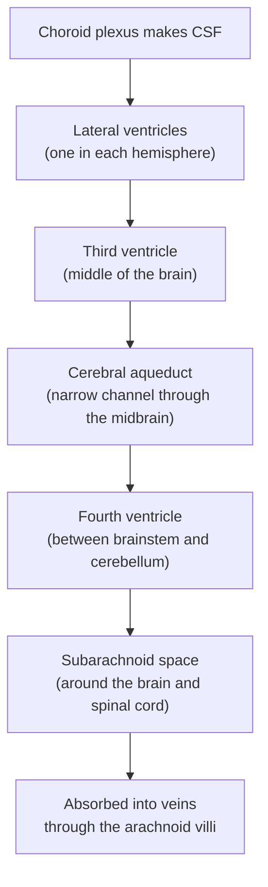

# Chapter 4: A Tour of the Brain: Neuroanatomy

## Summary

This chapter is a guided tour of the human brain. You will learn the "map language" of anatomy, then visit the four lobes of the cortex, the deep relay centers, the brainstem, cerebellum, spinal cord, and cranial nerves. You will see how the brain is protected and fed, and how the autonomic nervous system runs your organs on autopilot. The chapter ends at the bedside with Phineas Gage and a modern patient whose car crash injured the same part of the brain.

## Concepts Covered

1. Anatomical Directions
2. Brain Planes and Sections
3. Gray Matter
4. White Matter
5. Cerebral Cortex
6. Frontal Lobe
7. Parietal Lobe
8. Temporal Lobe
9. Occipital Lobe
10. Corpus Callosum
11. Thalamus
12. Hypothalamus
13. Brainstem
14. Cerebellum
15. Spinal Cord
16. Cranial Nerves
17. Ventricles and CSF
18. Meninges
19. Cerebral Blood Supply
20. Autonomic Nervous System
21. Sympathetic vs Parasympathetic
22. Localization of Function
23. Prefrontal Cortex

## Prerequisites

- [Chapter 1: Neurons, Glia, and the Nervous System](../01-neurons-and-glia/index.md)
- [Chapter 2: The Action Potential](../02-action-potential/index.md)
- [Chapter 3: Synapses and Neurotransmitters](../03-synapses-and-neurotransmitters/index.md)

!!! mascot-welcome "Welcome to the big city"
    { class="mascot-admonition-img" }
    I'm Ply, a sea slug with about 20,000 neurons. Yours has about 86 billion, packed into a three-pound brain with dozens of named neighborhoods. Knowing those neighborhoods is how doctors trace symptoms to their source, and it's a big part of the Brain Bee. Let's take the tour!

## 4.1 An Iron Rod and a Changed Man

At about 4:30 in the afternoon on September 13, 1848, a 25-year-old railroad foreman named Phineas Gage was blasting rock for a new rail line near Cavendish, Vermont. As he packed explosive powder into a hole with a long iron bar called a tamping iron, the powder exploded. The iron shot upward like a spear. It was about 3 feet 7 inches long, 1¼ inches thick, and weighed about 13¼ pounds. It entered the left side of his face, passed behind his left eye, tore through the front of his brain, and flew out the top of his skull. It landed roughly 80 feet away.

Within minutes, Gage was talking. He rode an oxcart back to town, greeted the first doctor who arrived, and later survived a dangerous infection. Yet his physician, Dr. John Harlow, later reported that Gage's friends said he was "no longer Gage." The careful, reliable foreman had become impatient, rude, and unable to stick to his plans. How could damage to one part of the brain change who a person seemed to be?

More than 170 years later, Maya, a 16-year-old soccer player studying for the Brain Bee, stares at a plastic brain model and a long list of structures. "Where do I even start?" This chapter answers that question. By the end, you will be able to point to the part of the brain Gage's iron damaged, explain what it does, and separate what really happened to him from the myths.

## 4.2 Reading the Map: Directions, Planes, and Sections

Imagine giving a friend directions in a city. "Turn left" means nothing unless you agree which way you are facing. Anatomists solved this with **anatomical directions**: fixed terms that describe where one structure sits compared with another, no matter how the body is turned. The main pairs are:

- **Anterior** (toward the face) and **posterior** (toward the back of the head).
- **Superior** (above) and **inferior** (below).
- **Dorsal** (toward the back or top) and **ventral** (toward the belly or bottom).
- **Rostral** (toward the nose or the top of the spinal cord) and **caudal** (toward the tail).
- **Medial** (toward the midline) and **lateral** (toward the side).
- **Ipsilateral** (on the same side) and **contralateral** (on the opposite side).

There is one twist. In a dog, the brain and spinal cord form a straight line. Humans stand upright, so our nervous system bends at the top of the brainstem. Because of that bend, "dorsal" means *the top of the brain* but *the back of the spinal cord*. Picture a shark's dorsal fin on top of a swimming shark.

Now think about a loaf of bread. You can slice it three ways, and each slice shows a different face of the inside. **Brain planes and sections** are the standard ways of cutting (or imaging) the brain:

- A **sagittal** section divides the brain into left and right parts. A **midsagittal** cut runs exactly down the middle, between the two halves.
- A **coronal** section (also called frontal) divides the brain into front and back parts.
- A **horizontal** section (also called axial) divides the brain into top and bottom parts.

MRI scans show the living brain in these same three planes. The table below summarizes them.

| Plane | What it separates | Everyday picture |
|---|---|---|
| Sagittal (midsagittal) | Left from right | Cutting a face down the nose |
| Coronal (frontal) | Front from back | Slicing a loaf of bread |
| Horizontal (axial) | Top from bottom | Lifting the lid off a jar |

## 4.3 Cities and Highways: Gray Matter and White Matter

Picture a country from an airplane at night: bright cities where people work, and highways carrying traffic between them. A sliced brain shows the same two kinds of tissue.

**Gray matter** is the "city" tissue, packed with neuron cell bodies, dendrites, and synapses, where information is processed. **White matter** is the "highway" tissue: bundles of axons wrapped in myelin, the fatty insulation from [Chapter 1](../01-neurons-and-glia/index.md), which makes it look white. In the brain and spinal cord, a bundle of axons is called a **tract**. Outside them, in the peripheral nervous system, it is called a **nerve**.

In the cerebrum (the big, wrinkled part of the brain), gray matter covers the outside and white matter fills the inside. The spinal cord is the reverse. Its gray matter is a butterfly-shaped core in the center, and its white matter wraps around the outside.

## 4.4 The Wrinkled Outer Layer: The Cerebral Cortex

The **cerebral cortex** is the thin outer layer of gray matter covering the cerebrum. The word *cortex* comes from the Latin word for "bark," because it covers the brain like bark on a tree. It is only about as thick as two or three stacked dimes, yet it holds about 16 billion neurons. Perception, reasoning, language, planning, and voluntary movement all depend on it.

Why is the brain so wrinkled? Try fitting a tablecloth into a small box: you crumple it. Spread flat, the cortex would be roughly the size of a pillowcase, and folding lets it fit inside the skull. Each ridge is called a **gyrus** (plural *gyri*), and each groove is called a **sulcus** (plural *sulci*). A very deep groove is called a **fissure**.

A deep fissure down the middle splits the cerebrum into left and right **hemispheres**. Two other grooves are the most important landmarks on the side of the brain:

- The **central sulcus** runs from the top of the brain down toward the ear. It separates the frontal lobe in front from the parietal lobe behind.
- The **lateral sulcus** (also called the Sylvian fissure) is a long, deep groove that runs backward from the front. It separates the temporal lobe below from the frontal and parietal lobes above.

With these landmarks, we can divide each hemisphere's cortex into four **lobes**.

**The frontal lobe**, the largest lobe, sits behind your forehead, in front of the central sulcus and above the lateral sulcus. The ridge just in front of the central sulcus (the precentral gyrus) is the **primary motor cortex**, which sends commands for voluntary movement down to the brainstem and spinal cord. The rest of the frontal lobe plans, decides, and controls behavior. In most people, **Broca's area** in the left frontal lobe helps produce speech.

**The parietal lobe** sits behind the central sulcus, under the top of your head. The ridge just behind the sulcus (the postcentral gyrus) is the **primary somatosensory cortex** ("somato" means body), which receives touch, pain, temperature, and body-position signals. The parietal lobe also tracks where your body and nearby objects are in space.

**The temporal lobe**, the second-largest, sits below the lateral sulcus, near your ears. It handles hearing, understanding language, and recognizing faces. Tucked inside it is the hippocampus, which is critical for forming new memories (Chapter 9).

**The occipital lobe**, at the very back of the head, is mainly for vision. Strangely, the part of the brain that handles sight is the part farthest from your eyes.

Now that you have met all four lobes, the table below puts them side by side.

| Lobe | Location | Main jobs | Key strip of cortex |
|---|---|---|---|
| Frontal | Behind the forehead, in front of the central sulcus | Movement, planning, judgment, speech production | Primary motor cortex (precentral gyrus) |
| Parietal | Top and upper back, behind the central sulcus | Touch, body position, spatial awareness | Primary somatosensory cortex (postcentral gyrus) |
| Temporal | Side, below the lateral sulcus | Hearing, language understanding, faces, memory | Primary auditory cortex |
| Occipital | Very back of the head | Vision | Primary visual cortex |

!!! mascot-thinking "Movement in front, feeling behind"
    { class="mascot-admonition-img" }
    My trick for the central sulcus: **movement in front, feeling behind**. The motor strip lies just in front of the groove, and the touch strip just behind it.

One more rule surprises almost everyone: each hemisphere controls and feels the **opposite** (contralateral) side of the body. The left motor cortex moves your right hand, so a stroke in the right hemisphere can weaken the left arm and leg. This happens because most motor and sensory pathways cross the midline between the brain and the body.

## 4.5 One Part, One Job? Localization of Function

In the 1800s, scientists argued: is the brain like a soup, where every part does a bit of everything, or like a hospital, where each department has its own job? The idea that particular brain areas do particular jobs is called **localization of function**. Evidence came from patients: if damage to one area causes one specific problem, that area probably helps with that job.

Both sides of the debate used Phineas Gage. One critic argued his survival proved the brain was *not* divided into special areas. The British neurologist David Ferrier used the same case to argue for localization. Today we can see why Gage fits the localization side: his iron missed the strips of cortex for movement and touch, so those abilities survived, while the area it hit was tied to his behavior changes.

Modern research shows that localization is real but limited. The motor cortex really does control movement. But complex abilities, like reading or deciding, depend on networks of areas linked by white matter, and the brain can reorganize. In people blind from early life, parts of the visual cortex can start responding to touch.

The **prefrontal cortex** is the part of the frontal lobe in front of the motor areas, right behind your forehead. It is the brain's executive. It helps you:

- plan ahead and set priorities,
- hold information in mind while you work with it (working memory),
- control impulses and wait for a bigger reward,
- switch strategies when something isn't working, and
- follow social rules and read other people's reactions.

These abilities are called **executive functions**. The prefrontal cortex is also one of the last regions to mature; the National Institute of Mental Health notes the brain keeps developing into the mid-to-late 20s (more in Chapter 8).

Here is the key idea for the bedside case. A person with prefrontal damage may have normal strength, senses, and even scores on many intelligence tests. What changes is how they *use* those abilities: how they plan, judge, and behave. That is why Gage could walk and talk, yet seemed like a different person.

### What Really Happened to Phineas Gage

Psychologist Malcolm Macmillan, the leading Gage historian, went back to the original records. In 2000, he reported that Gage appears in about 60% of introductory psychology textbooks, but many accounts contain errors, often traits borrowed from other frontal-lobe patients. Here is what the evidence supports:

- **The injury was severe.** Dr. Harlow recorded a large wound, a dangerous infection, and loss of vision in the left eye.
- **The personality change was real, at least at first.** Harlow's detailed description, published in 1868, 20 years later, called Gage impatient, profane, stubborn, and unable to follow through on plans.
- **Gage did not become a lifelong drifter.** He worked for a horse stable and coach service in New Hampshire for about 18 months. In 1852, he moved to Chile and spent years driving six-horse stagecoaches between Valparaíso and Santiago, a job that demanded planning and skill.
- **He probably recovered more than the legend says.** Macmillan and Matthew Lena (2010) argued that Gage eventually made a surprisingly good social adjustment, helped by the daily structure of his work.
- **His health eventually failed.** He became ill in 1859 and moved to San Francisco, where his mother and sister lived. Seizures began in February 1860, and he died on May 21, 1860, at about age 36. His skull and tamping iron are displayed at Harvard's Warren Anatomical Museum.

Even the location of the damage has been debated. A famous 1994 reconstruction concluded that *both* frontal lobes were damaged, but it used a model skull shaped to match Gage's. Two later studies, Ratiu and colleagues (2004) and Van Horn and colleagues (2012), used scans of Gage's actual skull and concluded that the damage was limited to the **left** frontal lobe. The 2012 study estimated that the iron damaged about 4% of the cortex's gray matter but about 11% of the brain's white matter, cutting connections between the frontal lobe and other areas.

!!! mascot-warning "Don't repeat the legend"
    { class="mascot-admonition-img" }
    Watch out for retellings that call Gage a violent, drunken drifter for life. Those details aren't in the original records. The true story is more interesting: a severe injury, a real change in behavior, and evidence of recovery.

## 4.6 Linking the Hemispheres: The Corpus Callosum

Your two hemispheres need to share information. They talk mostly through the **corpus callosum**, the largest bundle of white matter in the brain: a curved band of roughly 200 to 250 million axons that crosses the midline and connects the left and right hemispheres. In a midsagittal cut, it looks like a white, C-shaped arch above the center of the brain.

In rare cases of severe epilepsy, surgeons have cut the corpus callosum to stop seizures from spreading between hemispheres. These "split-brain" patients seem normal in daily life, but in careful lab tests one hemisphere may not know what the other has seen. For example, a patient may be unable to read aloud a word shown only to the right hemisphere, yet still pick out the matching picture.

## 4.7 Deep in the Middle: The Thalamus and Hypothalamus

Below the corpus callosum, buried in the middle of the brain, sit two small structures with huge jobs. Together they form the **diencephalon**, which means "between brain."

Think of an airport hub, where passengers from many flights are sent to the right connecting gate. The **thalamus** is the brain's hub: a pair of egg-shaped masses of gray matter, one on each side of the midline. It receives incoming sensory signals and sends each one to the right area of cortex: vision to the occipital lobe, hearing to the temporal lobe, touch to the parietal lobe. Every sense passes through the thalamus on its way to the cortex except one: smell. The thalamus also passes signals back and forth between the cortex and the circuits that control movement.

The **hypothalamus** sits just below and in front of the thalamus ("hypo" means below). It is about the size of a pearl, but it acts as the body's thermostat, keeping internal conditions steady, a balance called **homeostasis**. It helps control body temperature, hunger, thirst, sleep, stress responses, and hormone release through the **pituitary gland**, which hangs just below it on a thin stalk.

By commanding the pituitary, the "master gland," the hypothalamus links the nervous system to the hormone system. It is also a key controller of the autonomic nervous system (Section 4.12).

Other deep structures sit nearby: the **hippocampus** (new memories), the **amygdala** (fear and emotion), and the **basal ganglia** (starting and smoothing movement). You will meet each in later chapters.

## 4.8 The Stalk and the Little Brain: Brainstem and Cerebellum

### The brainstem

If the cerebrum is a house, the **brainstem** is the electrical panel in the basement: not glamorous, but if it fails, everything stops. It is the stalk connecting the cerebrum to the spinal cord, with three parts from top to bottom:

1. **The midbrain** helps control eye movements and reflexes to sights and sounds. Its **substantia nigra** ("black substance") holds dopamine neurons that help start movement; their loss causes most of the movement symptoms of Parkinson's disease (Chapter 7).
2. **The pons** (Latin for "bridge") links the cerebrum with the cerebellum, helps regulate breathing and sleep, and sends cranial nerves for chewing, facial expression, and eye movement.
3. **The medulla oblongata** runs life support: breathing, heart rate, and blood pressure, plus swallowing, coughing, and vomiting. Near its bottom, most motor axons from the cortex cross to the opposite side, a big reason each hemisphere controls the opposite side of the body.

A network called the reticular formation runs through the brainstem and helps keep you awake and alert. Because the brainstem packs so many vital functions into a small space, even a small injury there can be life-threatening.

### The cerebellum

Tucked under the back of the cerebrum is the **cerebellum** ("little brain"). The cortex decides *what* to do, such as pass to a teammate. The cerebellum works out *how* to do it smoothly: timing, force, and balance. It compares what you meant to do with what your body did, corrects the difference, and helps you learn motor skills like a new dribbling move. It is only about 10% of the brain's volume but holds roughly 80% of its neurons.

Cerebellar damage causes **ataxia**: clumsy, poorly aimed movements and an unsteady walk, usually with normal strength. Alcohol disrupts the cerebellum, which is why sobriety tests include walking a straight line and touching the nose.

!!! mascot-tip "The cerebellum breaks the crossing rule"
    { class="mascot-admonition-img" }
    The cerebrum controls the *opposite* side of the body, but each half of the cerebellum coordinates the *same* side. Damage to the left cerebellum makes the left arm clumsy, a favorite trick in localization questions.

## 4.9 Cables to the Body: The Spinal Cord and Cranial Nerves

### The spinal cord

The **spinal cord** is a cable of nervous tissue running down from the medulla through a tunnel in the backbone. With the brain, it forms the central nervous system. In adults, the cord ends near the top of the lower back (around the first or second lumbar vertebra), and a spray of nerve roots continues below. It has three main jobs:

- carry sensory messages **up** to the brain,
- carry movement commands **down** to muscles, and
- run simple **reflexes** on its own, like pulling your hand off a hot stove.

Thirty-one pairs of **spinal nerves** branch off the cord to reach the body. Cord damage blocks messages at the injury, so a person can lose movement and feeling below that point.

### The cranial nerves

The head and face get their own wiring. The **cranial nerves** are 12 pairs of nerves that connect directly to the brain instead of the spinal cord, passing through small holes in the skull. Nerves I and II attach to the forebrain; the other ten (III through XII) attach to the brainstem, so cranial nerve problems are a clue that the brainstem may be injured. (One small exception: most of the accessory nerve, XI, actually starts in the top of the spinal cord and travels up into the skull before leaving it.) In the table, notice three groups: three nerves are purely sensory, five are purely motor, and four carry both.

| # | Name | Main job | Type |
|---|---|---|---|
| I | Olfactory | Smell | Sensory |
| II | Optic | Vision | Sensory |
| III | Oculomotor | Moves most eye muscles, lifts the eyelid, narrows the pupil | Motor |
| IV | Trochlear | Moves one eye muscle (eye looks down and in) | Motor |
| V | Trigeminal | Feeling in the face; chewing muscles | Both |
| VI | Abducens | Moves the eye outward | Motor |
| VII | Facial | Facial expressions; taste from the front of the tongue | Both |
| VIII | Vestibulocochlear | Hearing and balance | Sensory |
| IX | Glossopharyngeal | Throat sensation, gag reflex, taste from the back of the tongue | Both |
| X | Vagus | Heart, lungs, and gut; swallowing and voice | Both |
| XI | Accessory | Shrugging the shoulders, turning the head | Motor |
| XII | Hypoglossal | Moving the tongue | Motor |

*Vagus* means "wandering": the vagus nerve (X) wanders down to the heart, lungs, and gut, carrying much of the "rest and digest" signaling in Section 4.12.

!!! mascot-encourage "Twelve is a lot, and that's okay"
    { class="mascot-admonition-img" }
    Nobody learns all 12 cranial nerves in one sitting. Start with ones you can test on yourself: I (smell), II (sight), VII (smile), VIII (hearing), and XII (stick out your tongue). Then add the eye-movement trio, III, IV, and VI.

## 4.10 Protecting and Feeding the Brain

The brain is soft and easily damaged, yet it survives a lifetime of bumps, headers, and falls, thanks to layers of protection, a fluid cushion, and a rich blood supply.

### The meninges

Think of packing a fragile phone: a hard box, padding, then a snug sleeve. Outside the brain is the skull (and, for the spinal cord, the backbone). Inside the bone are the **meninges**, three membranes that wrap the brain and spinal cord:

1. The **dura mater** ("tough mother"): the thick outer layer against the bone.
2. The **arachnoid mater**: the middle layer, named for its spiderweb-like look.
3. The **pia mater** ("tender mother"): a delicate layer clinging to every fold of the brain.

The space under the arachnoid, the subarachnoid space, is filled with fluid. Infection of the meninges is called meningitis.

### The ventricles and cerebrospinal fluid

The brain floats. Deep inside are four connected spaces called **ventricles**: two large lateral ventricles (one per hemisphere), a thin third ventricle in the middle, and a fourth ventricle between the brainstem and cerebellum. They hold **cerebrospinal fluid (CSF)**, a clear liquid made from the watery part of blood. Together, the **ventricles and CSF** form the brain's built-in fluid system.

CSF is made mainly by the **choroid plexus**, a blood-vessel-rich tissue inside the ventricles. It cushions the brain, carries nutrients, and washes away waste. An adult has only about 150 mL of CSF (about 5 ounces), yet makes about 400 to 600 mL per day, so the supply is replaced several times daily. Here is the route CSF travels:

If CSF is blocked, for example in the narrow aqueduct, it backs up. The ventricles swell and press on the brain, a condition called **hydrocephalus**. The most common treatment is a **shunt**, a thin tube that drains extra fluid to another part of the body, such as the abdomen.

### The cerebral blood supply

Your brain is about 2% of your body weight but uses about 20% of the oxygen and calories your body consumes, so it needs a constant flow of blood. This **cerebral blood supply** arrives through two pairs of arteries in the neck:

- The two **internal carotid arteries** run up the front of the neck and feed the front and middle of the brain.
- The two **vertebral arteries** run up through the neck bones and join to form the **basilar artery**, which feeds the brainstem, cerebellum, and back of the cerebrum.

At the base of the brain, these vessels connect in a ring called the **circle of Willis**, named after the English physician Thomas Willis (the complete, textbook version of the ring is less common than you might think: one imaging study of 525 healthy adults found it in only about 21 percent of people, and other studies report different rates, [Jalali Kondori et al., 2017](https://pubmed.ncbi.nlm.nih.gov/28412828/)). From it, three pairs of large arteries fan out over the cerebrum:

| Artery | Main territory | A blockage can cause |
|---|---|---|
| Anterior cerebral artery | Inner (medial) surface of the frontal and upper parietal lobes | Weakness and numbness of the opposite leg |
| Middle cerebral artery | Most of the outer (lateral) surface of the hemisphere | Weakness of the opposite face and arm; language problems if on the left |
| Posterior cerebral artery | Occipital lobe and lower temporal lobe | Loss of part of the visual field |

When a brain blood vessel is blocked or bursts, the result is a **stroke**. Knowing which artery feeds which lobe lets doctors predict symptoms, which you will practice in Chapter 14.

## 4.11 Put It Together: The Clickable Brain Atlas

You now have the vocabulary for the whole tour. Time to find the structures yourself.

#### Diagram: Clickable Brain Atlas

<iframe src="../../sims/ch04-brain-atlas/main.html" height="682px" width="100%" scrolling="no"></iframe>

[Open the Clickable Brain Atlas fullscreen](../../sims/ch04-brain-atlas/main.html){ .md-button .md-button--primary }

MicroSim specification: Clickable Brain Atlas

Type: microsim
**sim-id:** ch04-brain-atlas 
**Library:** p5.js 
**Status:** Implemented 
**Bloom Level:** Remember 
**Bloom Verb:** identify 
**Learning Objective:** The learner will identify 19 major brain structures and landmarks in a lateral view and a midsagittal view, with at least 80% accuracy in quiz mode.

**Content:** Lateral view (10): prefrontal cortex, frontal lobe (motor areas), parietal, temporal, and occipital lobes, cerebellum, brainstem, spinal cord, central sulcus, lateral sulcus. Midsagittal view (11): cerebrum, corpus callosum, thalamus, hypothalamus, pituitary, midbrain, pons, medulla, cerebellum, fourth ventricle, spinal cord. Each panel: name, main jobs, "If damaged," Brain Bee fact.

**Controls:** a View menu (lateral or midsagittal), a Show labels checkbox, a Quiz me button, and a Next question button.

**Behavior:** Hover highlights and names a region; click opens the info panel. Quiz mode hides labels and asks every structure in the view once, in random order, one attempt each. A wrong click names what was clicked, gives a location hint, and highlights the correct region in gold. The prefrontal cortex counts as correct for "Frontal lobe." A running score is shown.

**Evidence of Mastery:** quiz score of at least 80% in each view on the first attempt.

Start in the **Lateral view**. Before clicking, predict which region Gage's iron damaged and what its "If damaged" line will say. Then switch to the **Midsagittal view** and notice how the corpus callosum arches over the thalamus, the hypothalamus sits below and in front of the thalamus, and the three brainstem parts stack on the spinal cord.

When ready, press **Quiz me**. Labels disappear and the atlas names a structure for you to find. Aim for at least 80% in both views. If you miss one, find the landmark that would have helped: the central sulcus, lateral sulcus, or corpus callosum.

## 4.12 The Autopilot: The Autonomic Nervous System

It's the final minute of Maya's soccer game, and she steps up for a penalty kick. Her heart pounds, her mouth goes dry, and her pupils widen. She didn't decide any of this. It was controlled by the **autonomic nervous system**, the part of the nervous system that runs the internal organs without conscious effort: heart rate, breathing, blood pressure, digestion, sweating, and pupil size. It acts on heart muscle, smooth muscle (in blood vessels and the gut), and glands.

It has two main branches that work like a car's gas pedal and brake. The **sympathetic** branch prepares the body for action, the "fight or flight" response. The **parasympathetic** branch calms the body and handles maintenance, "rest and digest." Most organs receive both, and the balance sets the organ's activity. The hypothalamus and brainstem are the drivers.

Sympathetic neurons leave the middle (thoracic and lumbar) spinal cord. Parasympathetic neurons leave the brainstem, through cranial nerves such as the vagus, and the bottom (sacral) spinal cord. At the target organ, most sympathetic neurons release norepinephrine, while parasympathetic neurons release acetylcholine, neurotransmitters from [Chapter 3](../03-synapses-and-neurotransmitters/index.md).

Now that you've seen both branches, the table below compares **sympathetic vs parasympathetic** effects:

| Feature | Sympathetic ("fight or flight") | Parasympathetic ("rest and digest") |
|---|---|---|
| Heart | Beats faster and harder | Slows down |
| Pupils | Widen (dilate) | Narrow (constrict) |
| Saliva | Decreases (dry mouth) | Increases |
| Digestion | Slows down | Speeds up |
| Exits the CNS from | Thoracic and lumbar spinal cord | Brainstem and sacral spinal cord |

After Maya scores, her parasympathetic system takes over. Her heart slows, and she realizes she's starving. A third part, the **enteric nervous system**, is a web of neurons in the gut wall that manages digestion; it has hundreds of millions of neurons, about as many as the spinal cord or more.

## At the Bedside: Two Frontal Lobes, Nearly 180 Years Apart

!!! note "Meet the patient"
    Jordan is a 19-year-old college student. Two months ago, his car was hit head-on and his forehead struck the steering wheel. He was unconscious for several minutes and spent a week in the hospital. Now he walks, talks, and remembers facts normally, but his parents are worried. He skips classes because he "didn't get around to them," starts projects and never finishes them, makes crude jokes in front of his grandmother, and spent a whole paycheck on an impulse purchase. "It's like he's Jordan, but not Jordan," his mother says.

**What the doctor checks:** On the neurological exam, Jordan's strength, reflexes, coordination, sensation, vision, and cranial nerves are all normal, and his memory for facts is good. On tests of executive function, though, he struggles to switch rules in a card-sorting task, plans a multistep errand poorly, and acts before thinking. His emergency CT scan showed bruises (contusions) on the underside of both frontal lobes, and a later MRI shows them more clearly.

**Where is the problem? (localization):** Normal strength and sensation clear the motor and touch strips around the central sulcus. Normal coordination clears the cerebellum, normal cranial nerves clear the brainstem, and normal vision clears the occipital lobe. A change in planning, impulse control, and social behavior with everything else intact points to the **prefrontal cortex**, especially its lower part above the eye sockets (the orbitofrontal region).

**Diagnosis:** Traumatic brain injury with contusions of both frontal lobes, causing problems with executive function and behavior. Doctors sometimes call this pattern a dysexecutive syndrome.

**Why it happens:** When a moving head stops suddenly, the soft brain keeps moving and hits the inside of the skull. The skull floor under the frontal and temporal lobes has rough, bony ridges, so the undersides and tips of these lobes are among the most common places for brain bruises. Damage to the prefrontal cortex and its white-matter connections disrupts the brain's executive system while sparing movement and the senses. Phineas Gage showed a similar pattern: his iron passed through the left frontal lobe and missed the motor and sensory strips, so he could walk and talk while his behavior changed.

**Treatment today:** Early care focuses on survival and preventing further damage: intensive care, monitoring swelling and pressure inside the skull, and surgery if needed. Recovery then depends on **rehabilitation** by a team that may include neurologists, neuropsychologists, occupational and speech-language therapists, and counselors. Cognitive rehabilitation teaches strategies like breaking tasks into steps, using checklists and reminders, and pausing to check a plan before acting. Many people improve over months to years, although some changes can last.

**What's new in research:** Goal Management Training teaches patients to stop, state their goal, break it into steps, and check their progress. A 2019 meta-analysis of 21 publications found small to moderate improvements in executive function that usually lasted at follow-up ([Stamenova & Levine, 2019, *Neuropsychological Rehabilitation*](https://pubmed.ncbi.nlm.nih.gov/29540124/)). Historians suggest the routine of Gage's stagecoach job may have helped him in a similar way, by structuring his days ([Macmillan & Lena, 2010](https://pubmed.ncbi.nlm.nih.gov/20480430/)).

??? question "Your turn: diagnose a variation"
    A 58-year-old woman suddenly cannot move her right arm well, the right side of her face droops, and her speech comes out slow and broken, though she understands what people say. Her personality and judgment seem unchanged. Where is the problem?

    **Answer:** Right-sided weakness means the **left** hemisphere (contralateral control). Face and arm weakness points to the **primary motor cortex**, just in front of the central sulcus. Slow, effortful speech with good understanding points to **Broca's area** in the left frontal lobe. Both lie in the territory of the left **middle cerebral artery**, so a stroke there is a likely cause. Unlike Jordan's injury, this damage is in the back of the frontal lobe, not the prefrontal cortex.

*This is a fictional teaching case. It is not medical advice. If you or someone you know has symptoms like these, talk to a doctor.*

## Common Misconceptions

**Myth:** Some people are "left-brained" (logical) and others are "right-brained" (creative).  
**Reality:** Some functions lean to one side; in most people, language relies more on the left hemisphere. But a 2013 study of brain scans from more than 1,000 people aged 7 to 29 found no evidence that individuals have a stronger left-brain or right-brain network overall ([Nielsen et al., 2013](https://journals.plos.org/plosone/article?id=10.1371/journal.pone.0071275)). Everyone uses both hemispheres.

**Myth:** A bigger brain means a smarter person.  
**Reality:** A 2015 meta-analysis of more than 8,000 people found a correlation of about 0.24 between brain volume and IQ, so brain size explains only about 6% of IQ differences ([Pietschnig et al., 2015](https://pubmed.ncbi.nlm.nih.gov/26449760/)). The authors warned against treating brain size as a stand-in for intelligence.

**Myth:** After his accident, Phineas Gage became a violent, drunken drifter for the rest of his life.  
**Reality:** Those details aren't in the original records. Gage drove stagecoaches in Chile for years, and historians think he made a substantial social recovery ([Macmillan & Lena, 2010](https://pubmed.ncbi.nlm.nih.gov/20480430/)).

**Myth:** Each brain function lives in exactly one spot, like files in labeled drawers.  
**Reality:** Localization is real for basic functions like movement and vision, but complex abilities depend on networks connected by white matter. Gage's injury damaged a larger share of white matter than gray matter.

## Brain Bee Practice

??? question "1. Which sulcus separates the frontal lobe from the parietal lobe, and which two strips of cortex lie on either side of it?"
    The **central sulcus**. The primary motor cortex (precentral gyrus) lies just in front of it, and the primary somatosensory cortex (postcentral gyrus) lies just behind it.

??? question "2. Name the three parts of the brainstem from top to bottom, and give one vital function of the lowest part."
    Midbrain, pons, and medulla oblongata. The medulla controls breathing, heart rate, and blood pressure.

??? question "3. Which is the only sense that does not pass through the thalamus before reaching the cortex?"
    Smell (olfaction).

??? question "4. A patient has a clumsy, shaky left arm but normal strength. Which structure is most likely damaged, and on which side?"
    The **left** half of the cerebellum. Unlike the cerebrum, each half of the cerebellum coordinates the same side of the body.

??? question "5. Name the three layers of the meninges from outside to inside."
    Dura mater, arachnoid mater, and pia mater.

## Exercises

### Remember

1. List the four lobes of the cerebral cortex and give one main function of each.
2. Name the structure that connects the left and right hemispheres.

??? note "Answer"
    1. Frontal: movement, planning, and judgment. Parietal: touch and body position. Temporal: hearing, language understanding, and memory. Occipital: vision.
    2. The corpus callosum.

### Understand

3. Explain why "dorsal" points toward the top of the brain but toward the back of the spinal cord.
4. Explain why someone with prefrontal cortex damage might score normally on many intelligence tests yet struggle with everyday life.

??? note "Answer"
    3. Humans stand upright, so the nervous system bends at the top of the brainstem. "Dorsal" is defined relative to the nervous system, so it points up in the brain but backward in the spinal cord.
    4. The prefrontal cortex handles executive functions like planning, impulse control, and social judgment. Many tests measure knowledge in a structured setting, where these skills matter less; daily life requires people to organize their own behavior.

### Apply

5. A patient has numbness on the left side of the body but normal strength. Predict which lobe and which hemisphere are damaged.
6. A child's scan shows very large lateral and third ventricles but a normal fourth ventricle. Using the CSF pathway, predict where the blockage is.

### Analyze

7. Compare Maya's body responses before and after her penalty kick. For each, name the autonomic branch responsible and how it helps her.
8. The 1994 and 2004 reconstructions of Gage's injury disagreed about whether one or both frontal lobes were damaged. What difference in their methods could explain this?

### Evaluate

9. A brain-training app claims that its games will "activate your creative right brain." Judge this claim using evidence from this chapter.
10. A textbook calls Gage "a man who became a violent drifter after his accident." Assess this using the historical evidence, and rewrite the sentence accurately.

### Create

11. Design a one-page "brain map" study guide that uses one everyday analogy (a city, a school, or a sports team) for at least six structures from this chapter.
12. Write a short bedside case about damage to one structure from this chapter, with symptoms, exam findings, and localization reasoning. Trade with a classmate and diagnose each other's patient.

## Key Takeaways

- Fixed direction words (anterior/posterior, dorsal/ventral, medial/lateral) and three planes (sagittal, coronal, horizontal) describe any spot in the brain.
- Gray matter holds cell bodies and synapses; white matter holds myelinated axons. In the cerebrum, gray is outside. In the spinal cord, it is inside.
- The cerebral cortex has four lobes. The central sulcus and lateral sulcus are the main landmarks, with "movement in front, feeling behind" the central sulcus.
- The cerebrum controls the opposite side of the body, but each half of the cerebellum coordinates the same side.
- The thalamus relays sensory signals (except smell), the hypothalamus maintains homeostasis and controls the pituitary, and the brainstem runs life support.
- The brain is protected by the skull and meninges, cushioned by CSF, and fed by the carotid and vertebral arteries. Sympathetic and parasympathetic branches of the autonomic nervous system run the organs on autopilot.
- Gage's left frontal injury showed that the prefrontal cortex shapes planning and behavior, but his recovery was better than the legend claims.

!!! mascot-celebration "Tour complete!"
    { class="mascot-admonition-img" }
    You just toured the whole brain! In Chapter 5, we'll follow one sense, vision, from the eye all the way to the occipital lobe.
