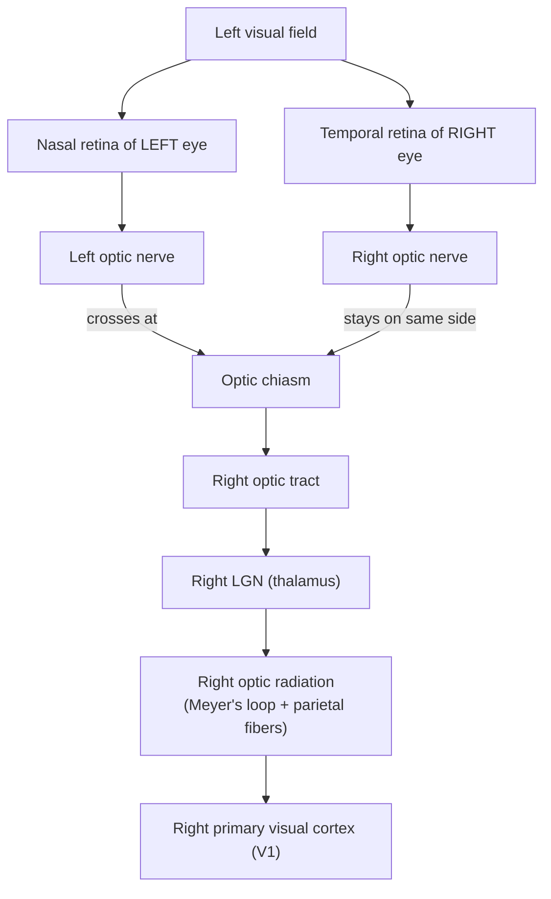

# Chapter 5: Vision

## Summary

Vision starts when photoreceptors in the retina turn light into electrical signals, a process called sensory transduction. The retina then cleans up and compresses that signal, and the optic nerves carry it to the brain along a pathway with one famous twist: at the optic chiasm, half the fibers cross to the other side. Because the pathway is laid out so precisely, a doctor can test which parts of a patient's vision are missing and work backward to find the damage. This chapter ends with a patient whose "clumsiness" turns out to be a pituitary tumor pressing on the optic chiasm.

## Concepts Covered

1. Sensory Transduction
2. Eye and Retina
3. Photoreceptor
4. Rods and Cones
5. Color Vision
6. Optic Nerve
7. Optic Chiasm
8. Visual Pathway
9. Primary Visual Cortex
10. Receptive Field
11. Visual Field
12. Visual Field Defect
13. Ventral and Dorsal Streams
14. Pituitary Tumor

## Prerequisites

- [Chapter 1: Neurons, Glia, and the Nervous System](../01-neurons-and-glia/index.md)
- [Chapter 2: The Action Potential](../02-action-potential/index.md)
- [Chapter 3: Synapses and Neurotransmitters](../03-synapses-and-neurotransmitters/index.md)
- [Chapter 4: A Tour of the Brain: Neuroanatomy](../04-neuroanatomy/index.md) (especially the occipital, temporal, and parietal lobes, the thalamus, and the cranial nerves)

!!! mascot-welcome "Welcome to the Brain's Biggest Sense"
    { class="mascot-admonition-img" }
    I'm Ply, a sea slug, and yes, I have two tiny eyes! Yours are far fancier, and the wiring behind them is one of the best maps in all of neuroscience. Learn this one pathway well, and you'll be able to look at a patient's vision test and say where in the brain the problem is.

## 5.1 Maya's Blind Side

Maya is at Tuesday soccer practice. She's dribbling up the right wing with her eyes locked on the ball. Her teammate Jordan sends a pass in from the left. Maya doesn't react until the ball is almost at her feet, and it bounces off her shin. "Didn't you see that?" Jordan yells. Maya honestly isn't sure. She saw *something* move, but it was a blur.

That night, studying for the Brain Bee, she starts to worry. Is something wrong with her eyes, or with her brain? The eyes catch light, but the brain builds the picture, and a problem anywhere along that route can steal part of your vision. By the end of this chapter, you'll know how to tell the difference, and whether Maya needs to worry.

## 5.2 Turning Light into Language: Sensory Transduction

Think about a solar panel. Sunlight hits it, and out comes electricity that wires can carry. Your senses do the same job. The world sends you light, sound, pressure, heat, and chemicals, but neurons speak only one language: electrical signals, like the action potentials from [Chapter 2](../02-action-potential/index.md). **Sensory transduction** is the process of converting a physical or chemical stimulus into an electrical signal in a nerve cell. The cells that do this are called sensory receptors.

Every sense has its own receptor type: light-sensitive cells for vision, and hair cells, nerve endings, and chemical-sensing cells for the senses in Chapter 6. Vision is a great place to start, because scientists know its transduction steps in fine detail.

## 5.3 The Eye and Retina

### The front of the eye: a focusing system

People often say the eye is "like a camera," and the front half really is. Light passes through the **cornea** (the clear dome at the front), the **pupil**, and the **lens**. The cornea and lens bend the light into a sharp image on the back of the eye, and tiny muscles reshape the lens to focus near or far.

Because a lens flips images, the picture on the back of your eye is **upside down and reversed left to right**. Your brain doesn't "flip it back." It simply learns what each spot on the retina means. Keep this flip in mind. It matters a lot for vision loss.

### The back of the eye: a thin sheet of brain

The **retina** is the thin layer of nerve tissue that lines the back of the eye and turns light into nerve signals. Surprisingly, the retina grows out of the brain in the embryo. When an eye doctor shines a light into your eye, they're looking at a piece of your central nervous system.

The retina has layers of five main kinds of neurons. The first three pass the signal forward, in this order, and the last two link cells side to side:

1. **Photoreceptors** catch light (the next section is all about them).
2. **Bipolar cells** pass the signal forward.
3. **Ganglion cells** collect the signal and send it out of the eye. Their axons form the optic nerve.
4. **Horizontal cells** connect photoreceptors and bipolar cells side to side.
5. **Amacrine cells** connect bipolar and ganglion cells side to side.

The side-to-side cells let neighbors compare notes, which is how the retina starts finding edges (Section 5.6).

Oddly, the retina is built "inside out." Light passes through the ganglion and bipolar cell layers before reaching the photoreceptors at the back. In one small spot, those layers are pushed aside. That spot is the **fovea**, a tiny pit in the center of the retina packed with cones. It gives you your sharpest vision. When you "look at" something, you're aiming your foveas at it.

### The blind spot

The ganglion cell axons leave the eye at the **optic disc**, where blood vessels also enter. The optic disc has no photoreceptors, so each eye has a **blind spot**. You don't notice it because the other eye covers that spot and your brain fills in the gap.

!!! mascot-tip "Find Your Own Blind Spot"
    { class="mascot-admonition-img" }
    Draw an X and, a few finger-widths to its right, a dot. Close your left eye, stare at the X with your right eye, and slowly move the page toward your face: at one distance the dot vanishes, because its image has landed on your optic disc.

## 5.4 Photoreceptors: Rods and Cones

### Two cameras in one eye

Imagine owning two cameras. One is a night-vision camera that works in near darkness but takes grainy, black-and-white pictures. The other takes sharp color photos, but only in plenty of light. Your retina carries both.

A **photoreceptor** is a neuron in the retina that is specialized to detect light. Humans have two kinds, called **rods and cones**:

- **Rods** work in dim light. The human retina has about 120 million of them. They are extremely sensitive: a fully dark-adapted rod can respond to a single particle of light, called a photon. But rods don't tell colors apart, and they give blurry, low-detail vision. In bright daylight they are "maxed out" and stop signaling changes. Rods are spread across the retina but are missing from the fovea.
- **Cones** work in bright light and give us sharp detail and color. There are about 6 million cones. They are packed most tightly in the fovea, with a thinner scattering in the rest of the retina.

(Numbers from the OpenStax textbook *Introduction to Behavioral Neuroscience*.) Rods outnumber cones about 20 to 1, yet your sharpest vision depends on the smaller cone team.

| Feature | Rods | Cones |
|---|---|---|
| Number per retina | About 120 million | About 6 million |
| Best light level | Dim (night) | Bright (day) |
| Color? | No | Yes (three types) |
| Detail | Low | High |
| Where most dense | Outside the fovea | In the fovea |

Now you can solve part of Maya's mystery. Jordan's pass came from far to her left, so its image landed far from her fovea. That part of the retina has few cones, and each of its ganglion cells collects signals from a wide area. So her side vision was blurry but good at noticing motion. That's why she saw "something move." This isn't a disease. To see details, you have to bring the image onto your fovea.

### How a photoreceptor catches light

Here is where sensory transduction happens. Each rod is stuffed with a light-catching molecule called **rhodopsin**. Rhodopsin has two parts: a protein called opsin and a small molecule called retinal, which your body makes from vitamin A.

In the dark, retinal has a bent shape. When it absorbs a photon, it snaps straight. That shape change switches on the opsin protein, which starts a chain reaction inside the cell. The end result is that sodium channels in the cell membrane close.

This part surprises most people. Most neurons get *more* active when stimulated. Photoreceptors do the opposite:

- **In the dark,** sodium channels are open. Positive sodium ions flow in, so the photoreceptor sits at about −40 mV. That is less negative than the −70 mV resting potential you learned for a typical neuron. In this state, the photoreceptor releases its neurotransmitter, glutamate, all the time.
- **In the light,** sodium channels close. The cell becomes more negative (it **hyperpolarizes**), and it releases *less* glutamate.

So a photoreceptor's message is "less glutamate means light," and brighter light closes more channels. A nerve signal doesn't always mean "fire more." What matters is the *change*, and the bipolar cells downstream know how to read it.

## 5.5 Color Vision

### Three cone types

**Color vision** is the ability to tell apart lights by their wavelength, which we experience as different colors. Light comes in a range of wavelengths. Shorter visible wavelengths look blue to us, and longer ones look red.

A single cone cannot tell color by itself. A cone just counts the photons it catches. A few photons at its favorite wavelength and many photons at a wavelength it barely absorbs can produce the same response. With one cone type, you'd see only shades of gray.

The fix is to compare. Humans have three types of cones, each with a slightly different opsin protein that is best at catching a different part of the spectrum:

| Cone type | Nickname | Peak sensitivity |
|---|---|---|
| S (short wavelength) | "Blue" cone | About 420 nm |
| M (medium wavelength) | "Green" cone | About 534 nm |
| L (long wavelength) | "Red" cone | About 564 nm |

For comparison, rod rhodopsin peaks near 498 nm. (A nanometer, nm, is one billionth of a meter.) These values are from OpenStax.

Your brain works out color by comparing how strongly the three cone types respond to the same patch of light. If S cones respond strongly and L cones barely respond, the light is toward the blue end. A TV screen uses this trick: mixing just red, green, and blue pixels can make a wide range of colors. Most mammals, including dogs and cats, have only two cone types, so your pet doesn't see colors the way you do.

### Opponent colors

The three cones are only the first step. Neurons in the retina and thalamus then compare the cones in "opponent" pairs. Some cells take the difference between L and M cones, a red versus green signal. Others compare S cones against L and M cones added together, a blue versus yellow signal. In the 1800s, these were rival theories: Hermann von Helmholtz argued for three color receptors (trichromacy), and Ewald Hering argued for opposing color pairs. Both turned out to capture part of the truth, at different stages: three cone types at the start, opponent comparisons after that ([Shevell and Martin, *Journal of the Optical Society of America A*, 2017](https://pmc.ncbi.nlm.nih.gov/articles/PMC6022826/)). Opponent pairs help explain afterimages. Stare at a red square and then at a white wall, and you see a greenish afterimage. The parts of the system that signal red have adapted (tired out), so the green side of the pair "wins" for a moment.

### Color blindness

Some people are born with only two working cone types, or with one cone pigment that is slightly off. They can't tell apart some colors that most people see as different. The most common type makes red and green hard to tell apart.

The National Eye Institute reports that about 1 in 12 men have a color vision deficiency. OpenStax gives about 8% of males and 0.4% of females for the red-green type. Why the big difference? The genes for the red and green cone pigments sit on the X chromosome. Males have only one X, so one faulty copy is enough to cause color blindness. Females have two X chromosomes, so a working copy on the other X usually covers for a faulty one.

## 5.6 Receptive Fields: The Retina Finds Edges

### A retina that edits

The retina doesn't send every "pixel" to the brain. Each eye has over 100 million photoreceptors but only one to two million ganglion cells, so the retina has to summarize. What it sends is mostly news about **edges**, places where light changes to dark.

To see how, we need one idea. A **receptive field** is the specific area of the sensory world that can change a particular neuron's activity. For a ganglion cell, that's a small patch of the visual scene. (The idea started with touch: a nerve fiber in your skin responds only to touch on its own small patch of skin.)

### Center and surround

In 1953, Stephen Kuffler recorded from single ganglion cells in the cat retina. He found that their receptive fields are circles with two zones: a **center** and a **surround** ring. The two zones have opposite effects:

- An **on-center** cell fires a burst when light hits its center, and is quieted by light on its surround.
- An **off-center** cell is the reverse. It fires most to a dark spot surrounded by light.

When the whole receptive field is lit evenly, the center says "fire!" and the surround says "stop!" They mostly cancel, and the cell barely responds. But when an edge puts light on the center and darkness on part of the surround, the cell responds strongly. Horizontal cells help build the surround. That's why a cartoon of a few lines is easy to recognize: your visual system cares more about edges than overall brightness.

### Out of the eye: the optic nerve

Bipolar cells are so short that they signal with graded voltage changes, not action potentials. Ganglion cells must send signals a long way, so they are the first retinal cells to fire action potentials.

The **optic nerve** is the bundle of ganglion cell axons that carries visual signals from one eye to the brain. You met it in [Chapter 4](../04-neuroanatomy/index.md) as cranial nerve II. Most of its fibers head toward the thalamus for conscious vision. Some go to the midbrain to help steer the eyes. A small group, fewer than 1 in 100 ganglion cells in the human retina, sense light themselves and report brightness to the brain's body clock.

## 5.7 The Visual Field: What You Can See Right Now

Hold your gaze on one spot straight ahead. Everything you can see without moving your eyes, from the center out to the edges, is your **visual field**. Doctors split it into halves using a vertical line through the point you're looking at:

- the **left visual field** (everything to the left of that line)
- the **right visual field** (everything to the right)

Each eye has its own visual field, and the two overlap a lot. Cover your right eye: your left eye still sees things on both your left and your right. Each eye's field has an inner part, toward the nose (the **nasal** field), and an outer part, toward the temple (the **temporal** field).

Now combine this with the upside-down, reversed image from Section 5.3. Light from your **left** visual field lands on the **right** half of each retina. For the left eye, that's the half closest to the nose, the **nasal retina**. For the right eye, it's the outer half, the **temporal retina**.

Read that twice. It's the most important idea in this chapter for understanding vision loss:

- **Temporal visual field → nasal retina**
- **Nasal visual field → temporal retina**

!!! mascot-warning "Retina Halves and Field Halves Are Opposites"
    { class="mascot-admonition-img" }
    A classic mistake on lesion questions is mixing up "temporal retina" with "temporal field." Because the lens flips the image, the temporal (outer) field always lands on the nasal (inner) retina, and the nasal field lands on the temporal retina.

## 5.8 The Visual Pathway

### The crossing rule

The **visual pathway** is the chain of nerve fibers and brain areas that carries signals from the retina to the visual cortex. First, an analogy.

Picture two delivery trucks, one from each eye, heading to a city with a Left Warehouse and a Right Warehouse. The rule: packages about the left side of the world go to the Right Warehouse, and packages about the right side go to the Left Warehouse. Each truck carries both kinds, so at a big intersection the trucks swap half their loads.

That intersection is the **optic chiasm**, the X-shaped spot at the base of the brain where the two optic nerves meet and some of their fibers cross to the other side. The rule is:

- Fibers from the **nasal** half of each retina **cross** to the other side.
- Fibers from the **temporal** half of each retina **stay** on the same side.

Since the nasal retina of the left eye and the temporal retina of the right eye both see the left visual field, this rule sends all left-field information to the right side of the brain. Roughly half the fibers cross. The result: **each side of the brain sees the opposite half of the world, using input from both eyes.**

!!! mascot-thinking "One Rule Explains Almost Everything"
    { class="mascot-admonition-img" }
    Nasal fibers cross, temporal fibers stay. If you remember that one line, plus the fact that the retina sees the world flipped, you can figure out every lesion pattern in this chapter instead of memorizing them.

### After the chiasm

After the chiasm, the bundle on each side is called an **optic tract**. Each tract holds fibers from both eyes, all about the opposite visual field. It ends in the **lateral geniculate nucleus (LGN)**, a six-layered part of the thalamus, the sensory relay station from [Chapter 4](../04-neuroanatomy/index.md). The two eyes' fibers go to separate LGN layers, so their signals are still kept apart here.

From the LGN, a broad fan of axons called the **optic radiation** sweeps back to the primary visual cortex in the occipital lobe. It has two main parts:

- The upper fibers travel under the **parietal lobe**. They carry the **lower** part of the opposite visual field.
- The lower fibers take a detour. They loop forward into the **temporal lobe** before turning back. This detour is called **Meyer's loop**, and it carries the **upper** part of the opposite visual field. (The image on the retina is upside down, so lower retina means upper field.)

The flowchart below traces the path for information about the *left* visual field.

## 5.9 The Primary Visual Cortex

### Where seeing becomes shapes

The **primary visual cortex**, also called **V1**, is the first area of the cerebral cortex to receive visual signals from the thalamus. It lies in the occipital lobe, mostly along the inner surface between the two hemispheres. You may also see it called "striate cortex" because it looks striped under a microscope.

V1 keeps a map of the visual field, called a **retinotopic map**: neighboring points in the world are handled by neighboring patches of V1. The map is stretched in the middle. Because so many ganglion cells serve the fovea, it gets a huge share of V1. Your center of gaze gets the most brainpower.

### Hubel and Wiesel's lines and edges

In 1958, David Hubel and Torsten Wiesel began recording from single neurons in the visual cortex of cats, and later monkeys. Small spots of light, which work well for retinal cells, often did little. Then, as Hubel told the story, they slid a glass slide out of their projector. Its faint straight edge swept across the screen, and the neuron suddenly fired rapidly.

They had found that many V1 neurons respond best to **lines or edges at a particular angle**. One cell might love vertical edges, and its neighbor might prefer edges tilted slightly. They described "simple cells," which need the edge in an exact spot, and "complex cells," which respond to a correctly tilted edge anywhere in their receptive field. Many complex cells also care about the direction the edge moves.

Their explanation shows receptive fields building on each other. Wire several center-surround cells lined up in a row to one V1 cell, and that cell fires most when a bar at just the right angle covers the whole row. In 1981, Hubel and Wiesel shared the Nobel Prize in Physiology or Medicine for their discoveries about how the visual system processes information. (Roger Sperry received the other half of that year's prize for his work on the two brain hemispheres.)

| Cell type | Receptive field shape | Best stimulus |
|---|---|---|
| Retinal ganglion cell | Circle with center and surround | Spot of light or dark (an edge on the center) |
| V1 simple cell | Long, narrow zones | Bar or edge at one angle, in one exact spot |
| V1 complex cell | Larger area | Bar or edge at one angle, anywhere in the field, often moving |

## 5.10 Ventral and Dorsal Streams: What and Where

V1 is only the start. Visual information then flows into many other areas, organized into two main routes called the **ventral and dorsal streams**.

- The **ventral stream** runs from the occipital lobe down into the lower temporal lobe. It answers **"What is it?"** It recognizes objects, colors, and faces. Deep in this stream, some neurons respond best to faces, and an area in the human temporal lobe called the fusiform face area becomes active when we look at faces.
- The **dorsal stream** runs from the occipital lobe up into the parietal lobe. It answers **"Where is it, and how do I act on it?"** It tracks position and movement. One area in this stream, called MT, is packed with neurons tuned to the direction of motion.

A memory trick: **v**entral is "**v**hat" (what), and **d**orsal is "where/do."

In 1982, Leslie Ungerleider and Mortimer Mishkin proposed this "what versus where" split, based partly on monkeys with damage to one stream. In 1992, Melvyn Goodale and David Milner argued that the dorsal stream is really about guiding action, or "how." A key patient, known as D.F., had brain damage from carbon monoxide poisoning. She couldn't say how a slot was tilted, yet she could post a card through it at the correct angle. Her "what" system was damaged, but her "how" system still worked.

Maya uses both streams every time she plays. Her ventral stream recognizes Jordan's face and jersey. Her dorsal stream tracks the ball's path and guides her foot to meet it.

## 5.11 Visual Field Defects: Reading the Map Backward

A **visual field defect** is a missing area in a person's visual field caused by damage somewhere along the visual pathway, from the retina to the cortex. Because the pathway is so orderly, the *shape* of the missing area tells a doctor *where* the damage is. This is called **localization**, and it's one of the most satisfying skills in neurology.

Doctors test the visual field one eye at a time. At the bedside, the doctor may wiggle fingers in each part of the field ("confrontation testing"). A machine called a perimeter is more precise: the patient stares at a center dot and presses a button whenever a faint light flashes.

Visual field maps are always drawn **as the patient sees them**: the left eye's map on the left, with the patient's left side on the left of each circle.

Two words will help you name the patterns:

- **Hemianopia** means loss of half of the visual field (the half on one side of the vertical line).
- **Homonymous** means the *same* side is lost in *both* eyes (for example, the left half in each eye).

Now apply the crossing rule:

- **In front of the chiasm** (optic nerve), only fibers from one eye are present, so the damage affects **only that eye**.
- **At the chiasm**, the damage hits the crossing fibers, which come from both nasal retinas. Nasal retinas see the temporal fields, so both eyes lose their **outer halves**. This is **bitemporal hemianopia**.
- **Behind the chiasm** (optic tract, radiation, or cortex), each side carries the opposite field from both eyes, so damage causes a **homonymous** loss on the opposite side.

| Lesion site | Field defect | Typical description |
|---|---|---|
| Left optic nerve | Left eye blind; right eye normal | Monocular vision loss |
| Center of optic chiasm | Outer half lost in each eye | Bitemporal hemianopia |
| Right optic tract | Left half lost in both eyes, often uneven between eyes | Left homonymous hemianopia |
| Left Meyer's loop (temporal lobe) | Upper-right quarter lost in both eyes | Right superior homonymous quadrantanopia ("pie in the sky") |
| Left parietal optic radiation | Lower-right quarter lost in both eyes | Right inferior homonymous quadrantanopia ("pie on the floor") |
| Right occipital cortex (V1) | Left half lost in both eyes, center often spared | Left homonymous hemianopia with macular sparing |

Two details are worth knowing. Meyer's loop damage often comes from surgery in the front of the temporal lobe, and people often don't notice the "pie in the sky" loss at first. Damage to the occipital cortex is usually from a stroke. In many of those patients, the very center of vision, served by the macula (the area around the fovea), is spared. One common explanation is that the tip of the occipital lobe, where central vision is mapped, can get blood from a second artery. But scientists still debate the reason, and sparing doesn't happen in every patient.

!!! mascot-encourage "Localization Takes Practice"
    { class="mascot-admonition-img" }
    If this feels like a lot, that's normal: doctors in training practice these maps over and over. Use the simulator below, predict before you peek, and the patterns will start to feel obvious.

#### Diagram: Visual Pathway Lesion Simulator

<iframe src="../../sims/ch05-visual-pathway/main.html" height="707px" width="100%" scrolling="no"></iframe>

[Open the Visual Pathway Lesion Simulator fullscreen](../../sims/ch05-visual-pathway/main.html){ .md-button .md-button--primary }

MicroSim specification: Visual Pathway Lesion Simulator

Type: microsim
**sim-id:** ch05-visual-pathway 
**Library:** p5.js 
**Status:** Implemented 
**Bloom Level:** Analyze 
**Bloom Verb:** differentiate 
**Learning Objective:** The learner will differentiate the visual field defects caused by lesions at five sites (left optic nerve, optic chiasm, right optic tract, left Meyer's loop, right occipital cortex) and predict the defect in each eye before revealing it.

**Canvas:** responsive width; 620 px drawing area plus 85 px control area.

**Controls:** "Lesion site" menu (None plus the five sites); clickable red dots for the same sites; "Hide result" checkbox for predict-first use.

**Behavior:** Top-down schematic with retina halves color-coded (blue = left visual field, orange = right visual field). A lesion turns cut fibers gray and dashed, and two field maps (drawn as the patient sees them) shade lost areas. Results: optic nerve = monocular blindness; chiasm = bitemporal hemianopia; optic tract = left homonymous hemianopia; Meyer's loop = right superior homonymous quadrantanopia; occipital cortex = left homonymous hemianopia with macular sparing. Maps are idealized.

**What to try.** Start with "None" and trace the blue fibers: they come from the *inner* half of the left eye and the *outer* half of the right eye, and both end in the right side of the brain. Then check **Hide result**, pick a lesion, and sketch what each eye will lose before you uncheck the box.

**What to notice.** Only the optic nerve lesion affects just one eye. Every lesion behind the chiasm takes away the *same side* in both eyes, opposite the damaged side of the brain. Try it in reverse: if both eyes lose the upper-right quarter, which red dot did you click?

### Back to Maya

So, does Maya have a field defect? Her optometrist checks each eye separately and finds a full visual field in both. Maya's "blind side" was ordinary peripheral vision. Jordan's pass landed on a part of her retina built for catching motion, not for detail. Her coach's advice, to scan the field with quick glances instead of staring at the ball, is good neuroscience: each glance points her foveas at something new.

## At the Bedside: The Driver Who Kept Bumping Door Frames

!!! note "Meet the patient"
    Mr. Alvarez is a 47-year-old delivery driver. Over the past year, he keeps bumping his shoulders on door frames and clipping his van's side mirror on gateposts. Twice a car seemed to "come out of nowhere" in the next lane. He also has dull headaches. He can still read signs and his phone, so he figures he's just tired and clumsy. His wife insists he see a doctor.

**What the doctor checks:** His sharpness of vision (visual acuity) is normal in each eye. During confrontation testing, with one eye covered, he can't see the doctor's fingers wiggling in the *outer* half of his field, and the same thing happens with the other eye. Formal perimetry confirms it: the left eye has lost the left (temporal) half of its field, and the right eye has lost the right (temporal) half. The rest of his eye exam is normal.

**Where is the problem? (localization):** Only one place holds the fibers for *both* temporal fields: the crossing fibers in the middle of the optic chiasm. An optic nerve lesion would affect only one eye, and a lesion behind the chiasm would take the *same* side from both eyes. The pituitary gland sits just below the chiasm, so a mass growing up from there is the prime suspect.

**Diagnosis:** An MRI with contrast shows a large **pituitary tumor** pushing up out of its bony pocket and pressing on the optic chiasm. A pituitary tumor is an abnormal growth in the pituitary gland, the small hormone-control gland at the base of the brain. Most are **pituitary adenomas**, which are noncancerous, grow slowly, and don't spread. Since 2022, the World Health Organization's tumor classification has recommended a new name, pituitary neuroendocrine tumor (PitNET), but many doctors and patient guides still say "adenoma" ([Tsukamoto and Miki, *Japanese Journal of Radiology*, 2023](https://pmc.ncbi.nlm.nih.gov/articles/PMC10366012/)). Blood tests show that his tumor isn't making extra hormones, so it's called a "nonfunctioning" adenoma. Final diagnosis: **bitemporal hemianopia caused by a nonfunctioning pituitary adenoma compressing the optic chiasm.**

**Why it happens:** The tumor presses on the crossing fibers in the center of the chiasm. Those fibers come from the nasal half of each retina, which sees the temporal (outer) visual field. So he loses the outer side of each eye's view and bumps into things on *both* sides. His central vision still works, which is why he could read signs and didn't notice the problem for so long.

**Treatment today:** Because the tumor is pressing on the visual pathway, the standard approach is surgery to remove it. Most pituitary tumors can be removed through the nose and sinuses, called **transsphenoidal surgery**, so no opening in the skull is needed. After surgery, doctors repeat visual field tests and check his hormone levels, because the pituitary may need support. Radiation is an option if the tumor can't be fully removed or grows back. One important exception: tumors that make the hormone prolactin (prolactinomas) are usually treated first with medicines called dopamine agonists, which can shrink the tumor.

**What's new in research:** Doctors want to predict how much vision will come back after surgery. **Optical coherence tomography (OCT)** is a quick, painless light scan that measures the thickness of the retina's nerve fiber layer (the ganglion cell axons). In a 2015 study of 107 patients, eyes with a normal-thickness layer before surgery usually recovered near-normal visual fields (81%), compared with 37% of eyes where the layer had already thinned ([Danesh-Meyer et al., *Journal of Clinical Neuroscience*, 2015](https://doi.org/10.1016/j.jocn.2015.02.001)). A 2024 study also linked a thicker layer before surgery to better results ([Han et al., *PLoS ONE*, 2024](https://journals.plos.org/plosone/article?id=10.1371/journal.pone.0313521)). The idea is simple: if the axons are still there, they have a better chance of working again once the pressure is removed.

??? question "Your turn: diagnose a variation"
    A different patient with a pituitary tumor has lost only the **upper outer quarter** of each eye's visual field. Where is the tumor pressing, and why the *upper* field?

    **Answer:** The tumor is pushing on the chiasm from **below**, so it squeezes the lower crossing fibers first. Those fibers come from the lower nasal retina. Because the image on the retina is upside down, the lower nasal retina sees the **upper temporal** field. Doctors often see this pattern early, and it can grow into a full bitemporal hemianopia if the tumor keeps growing.

*This is a fictional teaching case. It is not medical advice. If you or someone you know has symptoms like these, talk to a doctor.*

## Common Misconceptions

**Myth:** The eye works like a camera, and the brain just records the picture.  
**Reality:** Only the front of the eye works like a camera. The retina is part of the brain and edits the image, mostly reporting edges. Then many brain areas build what you "see": shape, color, motion, and faces. Seeing is constructed by the brain.

**Myth:** The left eye sends its signals to the right brain, and the right eye to the left brain.  
**Reality:** Each *half of the visual world* goes to the opposite hemisphere. Only the nasal half of each retina crosses at the chiasm. Each hemisphere gets input from **both** eyes about the opposite side of space.

**Myth:** Damage to the right side of the brain makes you blind in the right eye.  
**Reality:** Damage behind the chiasm on the right takes away the **left** half of the visual field in **both** eyes. Only damage in front of the chiasm (to the eye or optic nerve) causes blindness in one eye.

**Myth:** Color-blind people see only in black and white.  
**Reality:** Almost all color-blind people see many colors. Most have trouble telling apart certain reds and greens because one cone type is missing or works differently. Seeing no color at all is very rare.

## Brain Bee Practice

??? question "1. What is the name of the light-absorbing pigment in rods, and what vitamin is part of it made from?"
    Rhodopsin. Its light-catching part, retinal, is made from vitamin A.

??? question "2. Which retinal cells are the first to fire action potentials, and what do their axons form?"
    Retinal ganglion cells. Their axons bundle together to form the optic nerve (cranial nerve II).

??? question "3. A patient has lost the outer half of the visual field in both eyes. Name the defect and the most likely site of the lesion."
    Bitemporal hemianopia. The lesion is at the center of the optic chiasm, often from a pituitary tumor pressing on it.

??? question "4. Damage to Meyer's loop in the right temporal lobe causes what visual field defect?"
    A left superior homonymous quadrantanopia, the "pie in the sky" defect: the upper-left quarter is lost in both eyes.

??? question "5. Which visual processing stream would be most important for recognizing a friend's face, and which lobe does it travel into?"
    The ventral ("what") stream, which travels from the occipital lobe into the lower temporal lobe.

## Exercises

### Remember

1. List, in order, the structures a visual signal passes through from the retina to the primary visual cortex.
2. Name the two types of photoreceptors and state which one is responsible for color vision.

??? note "Answer"
    1. Photoreceptors → bipolar cells → ganglion cells → optic nerve → optic chiasm → optic tract → lateral geniculate nucleus (thalamus) → optic radiation → primary visual cortex (V1).
    2. Rods and cones. Cones are responsible for color vision.

### Understand

3. Explain why a photoreceptor releases *more* glutamate in the dark than in the light.
4. Explain why an on-center ganglion cell responds weakly when its whole receptive field is lit evenly.

??? note "Answer"
    3. In the dark, sodium channels in the photoreceptor stay open, so the cell is depolarized (about −40 mV) and keeps releasing glutamate. Light triggers a chain reaction that closes those channels, so the cell hyperpolarizes and releases less glutamate.
    4. Light on the center excites the cell, but light on the surround inhibits it. When both are lit, the two effects largely cancel, so the cell signals contrast (edges), not overall brightness.

### Apply

5. A person has a stroke in the left occipital lobe. Use the crossing rule to predict which part of the visual field is lost in each eye.
6. A highway warning light must catch a driver's side vision at night. Based on rods and cones, should it rely on color or on flashing? Justify your answer.

### Analyze

7. Two patients both say they have trouble seeing on their left. Patient A has lost all vision in the left eye. Patient B has lost the left half of the visual field in both eyes. Compare where each lesion is likely to be, and explain how the visual field test tells them apart.
8. Mr. Alvarez had normal visual acuity but a serious visual field defect. Analyze why acuity testing alone missed his problem, using what you know about the fovea and the crossing fibers.

### Evaluate

9. A website claims, "Your eyes see the world, and your brain just receives the image." Evaluate this claim using at least two pieces of evidence from this chapter.
10. Imagine a driver's license office that checks only visual acuity (the eye chart). Judge whether it should also test the visual field. Consider safety, cost, and people like Mr. Alvarez.

### Create

11. Write a short fictional case of a patient with a "pie in the sky" visual field defect. Include their symptoms, the exam finding, and a localization that a classmate could solve.
12. Design a one-page poster that teaches middle school students the rule "nasal fibers cross, temporal fibers stay," using an analogy of your own.

## Key Takeaways

- **Sensory transduction** turns light into electrical signals. Photoreceptors do this in an unusual way: light *hyperpolarizes* them and reduces their glutamate release.
- **Rods** (about 120 million) handle dim light with low detail. **Cones** (about 6 million) handle bright light, fine detail, and **color vision**, which comes from comparing three cone types.
- The retina is part of the brain. Its **receptive fields** have a center and a surround, so it sends mostly news about edges and contrast through the **optic nerve**.
- At the **optic chiasm**, fibers from the nasal half of each retina cross and temporal fibers stay. As a result, each hemisphere sees the opposite half of the **visual field** using both eyes.
- The **visual pathway** runs through the optic tract, the LGN of the thalamus, and the optic radiation (including Meyer's loop) to the **primary visual cortex (V1)**, where neurons respond to lines and edges at specific angles.
- Beyond V1, the **ventral stream** identifies "what" and the **dorsal stream** handles "where" and "how."
- The shape of a **visual field defect** reveals the lesion site. A **pituitary tumor** pressing on the chiasm classically causes bitemporal hemianopia.

!!! mascot-celebration "You Can Read the Map Now!"
    { class="mascot-admonition-img" }
    You just learned to look at a vision test and point to a spot in the brain, which is real clinical reasoning! Next, in [Chapter 6](../06-hearing-touch-taste-smell-pain/index.md), we'll see how the other senses perform their own transductions, from hair cells that "hear" to the strange case of pain in a missing limb.
