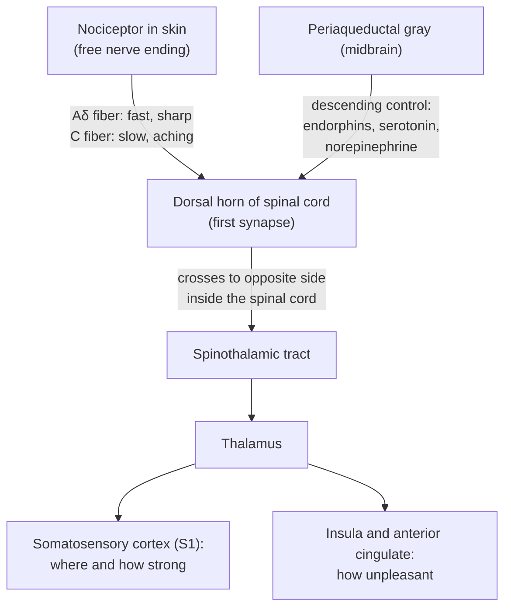

# Chapter 6: Hearing, Touch, Taste, Smell, and Pain

## Summary

Every sense starts with a receptor cell that turns energy, such as a sound wave, a push on the skin, or a chemical, into electrical signals. This chapter follows those signals for hearing, balance, touch, body position, taste, smell, and pain. You will see how the somatosensory cortex keeps a distorted map of the body, and how doctors use skin "stripes" called dermatomes to find spinal problems. The chapter ends with a puzzle that has fascinated doctors for more than 150 years: pain in a limb that is no longer there.

## Concepts Covered

1. Cochlea and Hair Cells
2. Auditory Pathway
3. Vestibular System
4. Somatosensory System
5. Mechanoreceptor
6. Dermatome
7. Somatosensory Cortex
8. Homunculus
9. Olfaction
10. Gustation
11. Nociception
12. Pain Pathway
13. Gate Control Theory
14. Phantom Limb Pain
15. Proprioception

## Prerequisites

- [Chapter 1: Neurons, Glia, and the Nervous System](../01-neurons-and-glia/index.md)
- [Chapter 2: The Action Potential](../02-action-potential/index.md)
- [Chapter 3: Synapses and Neurotransmitters](../03-synapses-and-neurotransmitters/index.md)
- [Chapter 4: A Tour of the Brain: Neuroanatomy](../04-neuroanatomy/index.md)
- [Chapter 5: Vision](../05-vision/index.md)

!!! mascot-welcome "Five senses? Try a lot more."
    { class="mascot-admonition-img" }
    I'm a sea slug with no ears, so I rely on touch and chemical senses. You get ears that hear and balance you, skin that tells silk from sandpaper, and a nose and tongue that work as a team. In this chapter you'll learn how each sense reports to the brain, and how a doctor can touch your skin with a pin and figure out which part of your spinal cord is hurt.

## 6.1 A Paper Cut, a Bruise, and a Bland Slice of Pizza

Maya is 16, plays soccer, and is studying for the Brain Bee. On Tuesday she slices her fingertip on the edge of a flashcard. The cut is so tiny she can barely see it, yet it stings so sharply that she drops the cards. That afternoon a defender kicks her shin at practice, leaving a big purple bruise. It aches, but she can almost ignore it.

On Friday Maya has a cold. Her nose is stuffed up, and her favorite pizza tastes like warm cardboard. Nothing is wrong with her tongue. So why does a tiny cut hurt more than a big bruise? And why does a blocked *nose* ruin the *taste* of food? By the end of this chapter you will be able to answer both questions with real neuroscience.

## 6.2 How Any Sense Works: Translators at the Border

Imagine your brain as a control room sealed inside the skull. It never touches the outside world directly. All it receives are action potentials, which you met in [Chapter 2](../02-action-potential/index.md). So each sense needs a translator at the border: a cell that turns outside energy into the brain's electrical language.

That translation step is called **sensory transduction**. The translator cell is a **sensory receptor**. Different senses use receptors tuned to different kinds of energy:

- Push, stretch, or vibration (mechanical energy): hearing, balance, touch, body position
- Chemicals: taste and smell
- Heat and cold: temperature sense
- Damaging or nearly damaging stimuli: pain

Action potentials all look alike. A signal from a touch receptor *feels like touch* because of **where the wire goes**: touch nerves connect to touch areas of the brain, and sound nerves connect to hearing areas. This is sometimes called the "labeled line" idea.

!!! mascot-thinking "Same message, different wires"
    { class="mascot-admonition-img" }
    When someone touches my siphon, touch-sensing neurons fire and I pull my gill in to protect it. That simple reflex is what Eric Kandel studied in my species. Your brain uses the same trick I do: the meaning of a signal comes from which neurons carry it, not from the shape of the spike.

So how many senses do people have? Far more than five. The table lists the ones in this chapter, plus vision from [Chapter 5](../05-vision/index.md).

| Sense | What it detects | Receptor type |
|---|---|---|
| Vision | Light | Photoreceptors (rods and cones) |
| Hearing | Sound waves | Hair cells (mechanical) |
| Balance | Head turning, tilting, and speeding up | Hair cells (mechanical) |
| Touch | Pressure, vibration, stretch, texture | Mechanoreceptors |
| Body position | Where your limbs are | Muscle spindles, tendon organs |
| Temperature | Warm and cold | Temperature-sensitive nerve endings |
| Pain | Damage or threat of damage | Nociceptors |
| Taste | Chemicals dissolved in saliva | Taste receptor cells |
| Smell | Chemicals floating in air | Olfactory sensory neurons |

## 6.3 Hearing: The Cochlea and Hair Cells

Sound is a pressure wave in the air. Its **frequency**, measured in hertz (Hz), is how many waves pass each second, and we hear it as pitch. Humans hear from about 20 Hz (a deep rumble) to about 20,000 Hz (a high whine).

Before we name the parts, picture a piano keyboard rolled up like a snail shell, with low notes at one end and high notes at the other. When a sound comes in, the "key" for that pitch moves the most. Your inner ear works much like this.

Here is the path a sound takes:

1. Sound waves make the **eardrum** vibrate.
2. Three tiny middle-ear bones (malleus, incus, and stapes) pass the vibration along and amplify it.
3. The last bone pushes on a window into the **cochlea**, a snail-shaped, fluid-filled tube in the inner ear.
4. The fluid ripples, and a ribbon of tissue inside, the **basilar membrane**, moves in a traveling wave.
5. Sensory cells on that membrane bend and start the electrical signal.

Those sensory cells are **hair cells**. Each has a bundle of tiny stiff projections on top called **stereocilia**. When the basilar membrane moves, the stereocilia tilt, ion channels at their tips open, positive ions rush in, and the hair cell releases neurotransmitter onto auditory nerve fibers. Together, the **cochlea and hair cells** are where sound becomes neural signals.

The basilar membrane is stiff and narrow at the **base** of the cochlea (near the middle ear) and floppy and wide at the **apex** (the tip of the spiral). So high sounds, around 20,000 Hz, vibrate the base most, and low sounds, around 20 Hz, travel to the apex. This map of pitch is called **tonotopy**, and it is kept at almost every station on the way to the cortex. Cochlear implants use it: electrodes near the base stimulate high-pitch nerve fibers, and deeper electrodes stimulate low-pitch fibers.

The human cochlea has about 3,500 **inner hair cells**, which do most of the job of sending sound information to the brain. Three more rows of **outer hair cells** act like tiny amplifiers. They change length very quickly and boost faint sounds at particular pitches.

Hair cells are delicate. According to the National Institute on Deafness and Other Communication Disorders (NIDCD), sounds at or below 70 A-weighted decibels (dBA) are unlikely to cause hearing loss even after long exposure, but long or repeated exposure to sounds at or above 85 dBA can cause hearing loss, mostly by killing hair cells. Birds and amphibians can regrow hair cells, but humans cannot. After loud noise, hearing can be dulled for 16 to 48 hours and then seem to recover, though some lasting damage may remain ([NIDCD](https://www.nidcd.nih.gov/health/noise-induced-hearing-loss)). An extremely loud burst, such as a gunshot or explosion, can cause permanent loss right away. Once hair cells die, that hearing loss is permanent. That is a real reason to turn your earbuds down.

## 6.4 The Auditory Pathway

Once hair cells fire, the signal travels along cranial nerve VIII (the vestibulocochlear nerve) into the brainstem. The route from the cochlea to the cortex is the **auditory pathway**, and it has several relay stations, each with a job.

One key job is finding *where* a sound comes from. A car honking on your left reaches your left ear a tiny bit sooner, and louder, than your right. The **superior olivary complex** in the brainstem, the first station that receives input from both ears, compares their timing and loudness.

The table lists the main stops in order.

| Stop | Location | Main job |
|---|---|---|
| Cochlear nuclei | Brainstem, where the medulla meets the pons | First stop for every auditory nerve fiber; keeps the pitch map |
| Superior olivary complex | Lower brainstem (pons) | Compares the two ears to locate sounds |
| Lateral lemniscus | Bundle of axons in the brainstem | Carries signals upward |
| Inferior colliculus | Midbrain | Major relay; combines pitch, timing, and location |
| Medial geniculate body | Thalamus | Gateway from the brainstem to the cortex |
| Primary auditory cortex | Temporal lobe | Conscious hearing; pitch is still mapped in order |

Because each ear's signals reach both sides of the brain, damage to one auditory cortex usually does not cause deafness in one ear. One-sided deafness usually points to the ear or the auditory nerve.

## 6.5 Balance: The Vestibular System

Try this. Look at a finger held at arm's length and shake your head side to side. The finger stays sharp. Now hold your head still and wave the finger at the same speed. It blurs. The difference is the **vestibular system** at work.

The vestibular system is the inner ear's balance sensor. It shares fluid, hair cells, and cranial nerve VIII with the cochlea. It has two kinds of parts:

- **Semicircular canals.** Three fluid-filled loops at roughly right angles, like the corner of a box. When you turn your head, the fluid lags behind because of inertia, like coffee in a spinning mug, and bends a gel flap holding hair cells. The canals sense rotation.
- **Otolith organs.** Two pouches, the **utricle** and **saccule**, whose hair cells sit under a gel topped with calcium carbonate grains called **otoconia**. Gravity and straight-line acceleration shift the grains, telling your brain which way is down and when you speed up.

The finger test shows the **vestibulo-ocular reflex**. When your head turns, signals from the semicircular canals reach your eye muscles through only a few synapses, so your eyes swing the opposite way fast enough to keep the world steady. This reflex is why Maya can read a defender's body while dribbling at full speed. It also explains why you feel dizzy after spinning and stopping: the fluid in your canals keeps sloshing, so your ears say "turning" while your eyes say "still."

In a common balance problem called **benign paroxysmal positional vertigo**, loose otoconia tumble into a semicircular canal and send false "spinning" signals, causing brief, intense vertigo with certain head movements, such as rolling over in bed.

## 6.6 Touch and Body Sense: The Somatosensory System

"Soma" means body. The **somatosensory system** is the set of receptors, nerves, and brain areas that handle touch, pressure, vibration, temperature, pain, and body position. Its receptors are spread over the whole body, not packed into one organ like the eye or ear.

### Mechanoreceptors

A **mechanoreceptor** is a receptor that responds to mechanical force, such as pressure, stretch, or vibration. In the skin, many are nerve endings wrapped in capsules or attached to special cells. Force opens ion channels in the nerve ending, including a family called **Piezo** channels.

Two features make each mechanoreceptor good at a different job:

- **Depth.** Receptors near the surface have small, sharp **receptive fields**, the patch of skin that can activate them. Deeper receptors have large, blurry receptive fields.
- **Adaptation.** *Slowly adapting* receptors keep firing as long as pressure lasts, like a doorbell held down. *Rapidly adapting* receptors fire when something changes and then go quiet, like a motion-sensor light.

The table compares the four classic touch receptors.

| Receptor | Depth in skin | Adaptation | Good at sensing |
|---|---|---|---|
| Merkel disk | Shallow | Slow | Steady pressure, edges, and shapes, like the dots of Braille |
| Meissner corpuscle | Shallow | Rapid | Light touch and slipping, like a cup sliding in your grip |
| Ruffini ending | Deep | Slow | Skin stretch, like bending a finger |
| Pacinian corpuscle | Deep | Rapid | Vibration, like a phone buzzing in your pocket |

Rapid adaptation is why you stop noticing your socks soon after putting them on.

In 2021, David Julius and Ardem Patapoutian shared the Nobel Prize in Physiology or Medicine for discovering receptors for temperature and touch, including the Piezo channels.

### Proprioception

Close your eyes and touch your nose. You can do it because of **proprioception**, the sense of where your body parts are and how they move. Its receptors sit in muscles, tendons, and joints. The two most important are **muscle spindles**, which sense how much a muscle is stretched, and **Golgi tendon organs**, which sense how hard a muscle is pulling on its tendon. You will meet muscle spindles again in [Chapter 7](../07-movement/index.md), because they drive the knee-jerk reflex.

### Nerve fibers: fast lanes and slow lanes

Each receptor connects to a sensory neuron whose cell body sits in a **dorsal root ganglion**, a cluster of cell bodies just outside the spinal cord. As you learned in [Chapter 2](../02-action-potential/index.md), thicker axons with more myelin conduct faster. Sensory fibers come in several sizes.

| Fiber type | Myelin | Approximate speed | Main signals |
|---|---|---|---|
| Aβ (A-beta) | Thick | 36 to 72 m/s | Touch, vibration, pressure |
| Aδ (A-delta) | Thin | 4 to 36 m/s | Sharp, fast pain; temperature |
| C | None | 0.4 to 2 m/s | Slow, burning or aching pain; temperature; itch |

### From skin to cortex: the touch pathway

Touch and body-position signals take the **dorsal column pathway**. The sensory axon climbs the spinal cord on the *same* side to the medulla. There it synapses, and the next neuron crosses to the *opposite* side and rises to the **thalamus**, which relays the signal to the cortex. Because of that crossing, the left side of your brain feels the right side of your body.

!!! mascot-encourage "Keep your eye on the crossing"
    { class="mascot-admonition-img" }
    Sensory pathways can feel like a maze of names. For each one, ask just two questions: where does it cross the midline, and where does it end? Those two answers solve most lesion puzzles.

## 6.7 Maps of the Body: Dermatomes, Cortex, and the Homunculus

### Dermatomes: stripes on the skin

The spinal cord has 31 segments: 8 cervical (neck), 12 thoracic (chest), 5 lumbar (lower back), 5 sacral, and 1 coccygeal. Each segment has a pair of dorsal roots that bring in sensory information. A **dermatome** is the strip of skin whose sensation is carried by one spinal nerve root.

Picture a person on hands and knees. The dermatomes run in roughly horizontal bands, like zebra stripes, and get stretched out along the arms and legs.

Doctors use dermatomes like an address book. Numbness in one stripe points to a problem at that spinal level or nerve root, such as a herniated disc pressing on one root in the neck. Doctors test standard "key points," listed below.

| Spinal level | Key test spot on the skin |
|---|---|
| C4 | Top of the shoulder |
| C6 | Thumb |
| C7 | Middle finger |
| C8 | Little finger |
| T4 | Chest at the nipple line |
| T10 | Belly button (umbilicus) |
| L3 | Inner knee |
| L4 | Inner ankle |
| L5 | Top of the foot |
| S1 | Outer heel |

Two warnings come with this table. First, dermatome maps disagree between textbooks, and borders vary from person to person because neighboring dermatomes overlap. Treat these as standard test spots, not perfect borders. Second, the face has no spinal dermatome. Facial skin is supplied mainly by the **trigeminal nerve** (cranial nerve V).

### The somatosensory cortex and the homunculus

Touch signals from the thalamus arrive at the **somatosensory cortex**. The first stop, the **primary somatosensory cortex** (S1), is a strip of cortex on the **postcentral gyrus**, the ridge just behind the central sulcus at the front of the parietal lobe (see [Chapter 4](../04-neuroanatomy/index.md)).

S1 holds an orderly map of the opposite side of the body, with neighboring body parts mostly in neighboring patches. The leg and foot are near the top of the brain and on the inner (medial) wall between the hemispheres. Moving down the side of the brain, you pass the trunk, arm, hand, and fingers, then the face, lips, tongue, and throat.

The map is not to scale. Body parts with densely packed receptors, like the hands, lips, and face, get huge areas, while the trunk gets a small one. Draw a little person with each part sized by its share of cortex and you get the famous **homunculus** ("little man"), with giant hands and lips.

Neurosurgeon Wilder Penfield built this map in Montreal by stimulating the exposed cortex of awake patients during epilepsy surgery and asking what they felt. He and Edwin Boldrey published the first homunculus in the journal *Brain* in 1937, using data from 126 patients. That first drawing combined sensory and motor results in one figure. The real map is messier than the cartoon, and in 1950 Penfield himself warned against reading too much into the drawing's shapes and sizes. Still, the main idea holds: more receptors means more cortex and finer touch.

!!! mascot-warning "Whose left is it?"
    { class="mascot-admonition-img" }
    In a front view of a person, their right side is on *your* left. Then touch crosses to the opposite hemisphere. Students often flip one of these and get the wrong side, so say both steps out loud: "patient's right hand, so left hemisphere."

In the MicroSim below, click a spot on the body to see its S1 segment on the opposite hemisphere and its dermatome level.

#### Diagram: Homunculus and Dermatome Map

<iframe src="../../sims/ch06-homunculus-dermatomes/main.html" height="752px" width="100%" scrolling="no"></iframe>

[Open the Homunculus and Dermatome Map fullscreen](../../sims/ch06-homunculus-dermatomes/main.html){ .md-button .md-button--primary }

MicroSim specification: Homunculus and Dermatome Map

Type: microsim
**sim-id:** ch06-homunculus-dermatomes 
**Library:** p5.js 
**Status:** Implemented 
**Bloom Level:** Apply 
**Bloom Verb:** locate 
**Learning Objective:** The learner will locate where a touched body region is represented on the opposite primary somatosensory cortex and name the spinal level (dermatome) or cranial nerve that carries it.

**Canvas:** 700 px drawing area plus a 50 px control row; responsive width.

**Controls:** region dropdown (11 regions), side dropdown, "Quiz me" button, "Show labels" checkbox; clicking a body dot also selects a region.

**Content:** lips (trigeminal nerve), shoulder C4, thumb C6, middle finger C7, little finger C8, nipple line T4, belly button T10, inner knee L3, inner ankle L4, top of foot L5, outer heel S1 (ISNCSCI key points). Cortex segments run medial (toes) to lateral (throat); sizes are illustrative.

**Behavior:** the chosen region lights up on the opposite hemisphere. Quiz mode asks for a random region; first-try correct answers score; after two misses the answer is shown.

Click the person's right thumb, then their left thumb, and watch the slice flip hemispheres. Compare the thumb's share of the strip with the whole trunk's. Then click the lips: the readout names the trigeminal nerve, not a spinal level. Finally, press **Quiz me** and try to place five regions in a row on the first try.

## 6.8 Taste: Gustation

**Gustation** is the sense of taste. It detects chemicals dissolved in saliva. Taste receptor cells are grouped into **taste buds**, each a cluster of about 50 to 150 cells shaped a bit like a garlic bulb. Most sit in the bumps on your tongue, called papillae, but some are on the roof of the mouth and in the throat. A newborn has about 10,000 taste buds, and people may start to lose some after age 50.

Taste receptors respond to at least five basic taste qualities:

| Taste | What it usually signals | Example |
|---|---|---|
| Sweet | Sugars, which mean energy | Fruit |
| Salty | Sodium and other minerals | Chips |
| Sour | Acids, which can mean spoiled or unripe food | Lemon |
| Bitter | Many plant toxins | Coffee, kale |
| Umami | Savory amino acids such as glutamate | Parmesan, broth |

Taste travels on three cranial nerves: the **facial nerve** (VII) for the front two-thirds of the tongue, the **glossopharyngeal nerve** (IX) for the back third, and the **vagus nerve** (X) for the throat. All three reach the **nucleus of the solitary tract** in the medulla. Signals then pass through the thalamus to the **gustatory cortex** in the insula, tucked inside the lateral sulcus.

Different types of taste cells are scattered all over the tongue, so every part with taste buds can detect all five tastes. The famous "tongue map," with sweet at the tip and bitter at the back, is a myth. It grew out of a 1901 German study that found only small differences in sensitivity, which later textbook drawings turned into separate "zones."

## 6.9 Smell: Olfaction

**Olfaction** is the sense of smell. It detects chemicals called **odorants** that float in the air. The receptors are **olfactory sensory neurons**, real neurons that sit in a small patch of tissue high in the nasal cavity. Their axons pass through tiny holes in a thin bone called the cribriform plate and reach the **olfactory bulb** on the underside of the brain.

Each olfactory sensory neuron makes just one type of odorant receptor protein. Humans have about 400 working odorant receptor genes, while mice and dogs have roughly two to three times as many. Richard Axel and Linda Buck shared the 2004 Nobel Prize in Physiology or Medicine for discovering these odorant receptors and how the olfactory system is organized.

How can a few hundred receptor types tell apart thousands of smells? Think of an alphabet. Neurons with the same receptor all send axons to the same knot in the olfactory bulb, called a **glomerulus**. Each odor activates a *combination* of glomeruli, the way a word combines letters, and hundreds of "letters" make an enormous number of "words."

Smell has two unusual features:

- **A shortcut to the cortex.** Vision, hearing, touch, and taste pass through the thalamus before reaching the cortex. Smell does not. The olfactory bulb sends signals straight to the olfactory (**piriform**) cortex and has direct links to the amygdala, an emotion center. (Some smell information does reach the thalamus later, but only after the olfactory cortex.) This direct route may help explain why a smell can bring back a memory or feeling so suddenly.
- **Self-repair.** Olfactory sensory neurons are constantly replaced from stem cells in the nasal lining, which is rare for neurons. This ability declines with age.

Now for the rest of Maya's puzzle. When you chew, aromas drift from the back of your throat up into your nose. This **retronasal smell** combines with taste to create **flavor**, and much of the "taste" of pizza is really smell. A cold blocks that channel, so food tastes bland even though the tongue works fine.

## 6.10 Pain: Nociception and the Pain Pathway

The International Association for the Study of Pain, a worldwide group of pain researchers, updated its definition in 2020 ([Raja et al., *Pain*, 2020](https://doi.org/10.1097/j.pain.0000000000001939)). It defines pain as an unpleasant sensory *and emotional* experience linked to actual or possible tissue damage, or resembling such an experience. That definition separates two things that are easy to mix up:

- **Nociception** is the nervous system's detection of damaging or potentially damaging stimuli: the signal.
- **Pain** is what the brain makes of that signal, shaped by attention, mood, and context.

You can have nociception without much pain, or pain with no new tissue damage at all, as you will see with phantom limbs.

### Nociceptors

The receptors for nociception are **nociceptors**: **free nerve endings**, bare branches of sensory axons with no capsule, found in skin, muscles, joints, and many organs. They respond to intense pressure, extreme temperatures, or chemicals from damaged tissue. Many use TRP ion channels. One TRP channel opens with dangerous heat and also with capsaicin, which is why chili peppers feel hot. Its discovery was part of David Julius's 2021 Nobel Prize work.

Nociceptors use two fiber types from Section 6.6. Thin myelinated **Aδ fibers** carry a fast, sharp "first pain." Unmyelinated **C fibers** carry a slower, aching "second pain." Stub your toe and you feel both: a sharp jolt, then a spreading ache.

A rare genetic condition shows why nociception matters. People with **congenital insensitivity to pain**, which can be caused by changes in a sodium channel (Nav1.7) that pain fibers rely on, feel touch but not pain, so they can be badly injured without noticing.

### The pain pathway

The main route for pain and temperature is the **spinothalamic tract**. It differs from the touch pathway in where it crosses.

1. A nociceptor fiber enters the **dorsal horn** of the spinal cord and synapses there.
2. The second neuron crosses to the opposite side **within the spinal cord**, close to the level where it entered.
3. It climbs the spinal cord and brainstem to the **thalamus**.
4. Thalamic neurons send the signal to S1, which tells you *where* it hurts and *how much*.
5. Other branches reach the **insula**, the **anterior cingulate cortex**, and limbic areas involved in emotion, which help make pain feel *unpleasant* and motivating.

The flowchart summarizes the **pain pathway**, including the brain's own volume control, which comes next.

The bottom arrow in the chart is the **descending pain control system**. Starting in a midbrain region called the **periaqueductal gray**, it sends signals down to the dorsal horn that can turn pain transmission down. It works through the body's own opioid chemicals, called **endorphins**, and through serotonin and norepinephrine from [Chapter 3](../03-synapses-and-neurotransmitters/index.md). It helps explain why soldiers and athletes sometimes feel little pain from serious injuries during intense action.

Because touch crosses in the medulla but pain crosses in the spinal cord, damage to one half of the spinal cord causes loss of fine touch and position sense on the *same* side below the injury, but loss of pain and temperature on the *opposite* side. This classic pattern is called **Brown-Séquard syndrome**.

Now we can partly answer Maya's paper cut question. Her fingertip is packed with sensory endings and owns a large territory on the somatosensory map, so her brain gets a detailed, sharply located signal, and she keeps using the finger. Her shin bruise is deeper damage in a region with a smaller cortical map, felt mostly as a dull C-fiber ache that is harder to pin down. Pain is not a simple measure of damage.

## 6.11 Gate Control Theory: Why Rubbing Helps

When Maya gets kicked in the shin, she rubs it, and it really does help a little. Why?

In 1965, Ronald Melzack and Patrick Wall proposed the **gate control theory** of pain in the journal *Science*. Their idea was that the dorsal horn of the spinal cord acts like a gate that controls how much pain information gets sent up to the brain. Here is a simple version of the circuit:

- Pain fibers (C and Aδ) excite the projection neuron that sends pain signals to the brain. They also *quiet* a small **inhibitory interneuron** in the dorsal horn. Both effects open the gate.
- Large touch fibers (Aβ) weakly excite the projection neuron but strongly *excite* the inhibitory interneuron, which releases inhibitory transmitters such as GABA to quiet the pain pathway. That helps close the gate.

So rubbing a bump fires many touch fibers, which boosts the inhibitory interneuron and partly closes the gate. Signals from the brain can also open or close the gate, which helps explain why distraction, stress, and expectations change how much something hurts. Some details of the 1965 model have since been revised, but its central idea, that pain signals are filtered in the spinal cord and by the brain, changed pain science.

## 6.12 Phantom Limbs: When the Map Outlives the Body

During the U.S. Civil War, physician Silas Weir Mitchell treated many soldiers who had lost limbs and still felt them, sometimes painfully. He is usually credited with coining the term "phantom limb" in 1871, though earlier doctors had described the experience.

Doctors now separate three related experiences after an amputation:

- **Phantom sensation:** feeling that the missing limb is still there, sometimes with a position or tingling, but without pain.
- **Residual limb pain:** pain in the remaining part of the limb, often from an irritated nerve end at the cut.
- **Phantom limb pain:** pain that feels like it comes from the missing part, such as a clenched fist, burning, or cramping fingers.

Phantom limb pain is common. A 2020 review that combined many studies estimated that about 64% of people with amputations experience it. A larger 2026 review of 51 studies and about 13,000 people found a similar figure, about 61% ([Zhang et al., *BMC Musculoskeletal Disorders*, 2026](https://doi.org/10.1186/s12891-026-09716-x)). Both reviews saw a wide range between studies.

How can a missing limb hurt? Part of the answer is the cortical map. After an arm amputation, the hand area of S1 loses its usual input, and on the homunculus the face area sits right next to it. In the 1990s, V. S. Ramachandran and colleagues reported that touching the face of some arm amputees made them feel touch on the missing hand, suggesting face inputs had spread into the silent hand territory. A 1995 brain-imaging study by Herta Flor and colleagues linked more phantom limb pain to more reorganization of the S1 map.

The story is not settled. A 2013 study found that people with more phantom pain actually kept *more* of their original hand map. Then, in 2025, a team scanned three adults before and for months to years after an arm amputation. The hand and lip maps in S1 stayed almost the same, with no sign of the lip area spreading into the hand area ([Schone et al., *Nature Neuroscience*, 2025](https://doi.org/10.1038/s41593-025-02037-7)). Three people is a small study, but it challenges the classic "remapping" story. Today most scientists think phantom limb pain comes from several sources together: injured nerve endings in the residual limb, changes in the dorsal horn, and changes in the brain's representation of the missing limb.

!!! mascot-thinking "The map is part of you"
    { class="mascot-admonition-img" }
    Phantom limbs show that what you feel is built by the brain's map of your body, not by the body part alone. Remove the hand, and the map can still produce a hand, sometimes a painful one.

## At the Bedside: Pain in a Hand That Is No Longer There

!!! note "Meet the patient"
    Daniel is a 32-year-old Army veteran whose right arm was amputated below the elbow eight months ago after a vehicle crash during his service. The wound has healed well. But most nights he feels his missing right hand clenched into a tight fist, fingernails "digging into" his palm, with cramping and burning pain. It is worse when he is stressed or tired, and it ruins his sleep.

**What the doctor checks:** The doctor examines the residual limb for infection or skin breakdown and checks the prosthetic socket fit. She taps along the nerves of the residual limb to look for a **neuroma**, a tangled, oversensitive bundle of regrowing nerve fibers that can fire a shooting pain when touched. She asks Daniel to describe three things separately: pain in the residual limb, painless feelings in the missing hand, and pain that seems to come from the missing hand. When she lightly touches his face, he feels some touches on his "missing" fingers.

**Where is the problem? (localization):** There is no tissue where Daniel feels the pain, so the problem must lie along the nervous system that used to serve the hand: cut nerve endings in the residual limb, pain neurons in the dorsal horn of the spinal cord segments that served the hand (about C6 to T1), and the hand area of his **left** primary somatosensory cortex, because the right side of the body is mapped on the left hemisphere. Face touches felt in the phantom hand were long explained by the neighboring face area spreading into the hand's territory, though newer brain scans (Section 6.12) question how much the map really changes.

**Diagnosis:** Phantom limb pain, with phantom sensations.

**Why it happens:** The brain's map of the right hand loses its input but does not disappear. Injured nerve endings can fire on their own and send noisy signals, dorsal horn neurons can become more excitable, and the brain's hand map, which largely stays in place, reads those signals as coming from the missing hand. With no feedback that the hand has relaxed, the brain may produce a painful, stuck posture, and stress can open the spinal "gate" further.

**Treatment today:** No single treatment works for everyone. Care usually combines medicines for nerve pain, physical therapy, a well-fitted prosthesis, support for sleep and stress, and sometimes surgery for a painful neuroma.

Many clinics also try **mirror therapy**: a mirror between Daniel's arms shows his left hand's reflection where his right hand used to be, so when he opens his real left hand, his brain "sees" the missing hand open too. V. S. Ramachandran and colleagues introduced the idea in the 1990s, and a small 2007 trial in people with leg amputations reported less pain with a mirror than with a covered mirror or mental imagery. The overall evidence is mixed. A 2022 combined analysis of randomized trials found a short-term benefit, but a 2023 review of only placebo-controlled trials could not conclude that it works, mainly because the trials were small and of low quality. Mirror therapy is low-risk and helps some patients, but it is not a proven cure.

**What's new in research:** In **targeted muscle reinnervation** (TMR), surgeons give cut nerves a new "job" by connecting them to motor nerves of nearby muscles, which may make painful neuromas less likely. In a randomized trial of 28 people with chronic pain after major limb amputation, TMR reduced phantom limb pain more than standard neuroma surgery over a year of follow-up, although one simpler comparison just missed statistical significance (Dumanian and colleagues, *Annals of Surgery*, 2019). Larger studies are still needed.

??? question "Your turn: diagnose a variation"
    A patient with a below-knee amputation feels a sharp, electric jolt in his residual limb whenever his prosthetic socket presses one spot, and tapping that spot reproduces it. He also feels his missing foot, but it does not hurt. What is the likely source of his pain, and is it phantom limb pain?

    **Answer:** This sounds like residual limb pain from a **neuroma** at a cut nerve end. The pain is triggered at one spot and felt in the residual limb, so the main problem is the peripheral nerve, not the brain's map. His painless feeling of the missing foot is a **phantom sensation**, not phantom limb pain. Care would focus on the socket fit and the neuroma.

*This is a fictional teaching case. It is not medical advice. If you or someone you know has symptoms like these, talk to a doctor.*

## Common Misconceptions

**Myth:** Humans have exactly five senses.  
**Reality:** You also sense balance (vestibular system), body position (proprioception), temperature, and pain, each with its own receptors and pathways.

**Myth:** The tongue has separate zones for sweet, salty, sour, and bitter.  
**Reality:** Every area of the tongue with taste buds can detect all five basic tastes. The "tongue map" came from textbook redrawings that exaggerated small differences in sensitivity found in a 1901 study.

**Myth:** How much something hurts tells you how much damage there is.  
**Reality:** Pain depends on which receptors fire, how densely packed they are, how the spinal "gate" filters the signal, and what the brain attends to. A paper cut can hurt more than a large bruise.

**Myth:** Phantom limb pain is imaginary or "all in the patient's head."  
**Reality:** Phantom limb pain is real, with causes in the nerves, spinal cord, and the brain's body map. Calling it imaginary can keep people from getting help.

## Brain Bee Practice

??? question "1. Which part of the cochlea responds best to high-pitched sounds, and what is this pitch map called?"
    The base of the cochlea (near the middle ear); the apex responds to low pitches. The pitch map is called tonotopy.

??? question "2. Name the two kinds of vestibular sense organs and what each detects."
    The semicircular canals detect head rotation. The otolith organs (utricle and saccule) detect gravity, head tilt, and straight-line acceleration.

??? question "3. A patient has numbness on the back of the middle finger but nowhere else. Which spinal nerve root is most likely affected?"
    C7. The middle finger is the standard key test spot for the C7 dermatome.

??? question "4. Why does smell differ from all other senses in how it reaches the cortex?"
    Olfactory signals go from the olfactory bulb straight to the olfactory (piriform) cortex without first relaying through the thalamus. Other senses pass through the thalamus first.

??? question "5. According to gate control theory, why does rubbing an injury reduce pain?"
    Rubbing activates large Aβ touch fibers, which excite inhibitory interneurons in the dorsal horn. These quiet the projection neurons that carry pain to the brain, partly "closing the gate."

## Exercises

### Remember

1. List the four classic skin mechanoreceptors and state whether each adapts slowly or rapidly.
2. Name the three cranial nerves that carry taste and the brainstem nucleus where taste signals first arrive.

??? note "Answer"
    1. Merkel disk (slow), Meissner corpuscle (rapid), Ruffini ending (slow), Pacinian corpuscle (rapid).
    2. Facial (VII), glossopharyngeal (IX), and vagus (X); they deliver taste to the nucleus of the solitary tract in the medulla.

### Understand

3. Explain why a signal from a touch receptor feels like touch rather than sound, even though all action potentials look alike.
4. Explain why food tastes bland when you have a stuffed-up nose.

??? note "Answer"
    3. A signal's meaning depends on where its pathway ends. Touch receptors connect to pathways ending in the somatosensory cortex, so their signals are felt as touch (the "labeled line" idea).
    4. Much of flavor is retronasal smell, aromas rising from the mouth into the nose. A cold blocks that channel, so the brain gets taste but little smell.

### Apply

5. A patient's left hand is touched with a cotton swab, and an fMRI scan (a brain scan that shows which areas are active) is recorded. Predict which hemisphere and which gyrus will show the strongest early response, and roughly where along that gyrus.
6. A construction worker uses a loud jackhammer all day without ear protection. Predict what will happen to his hearing over the years and explain why it cannot be reversed.

### Analyze

7. After an injury that damaged the left half of the spinal cord at a mid-chest level, a patient cannot feel a pin prick on his right leg but can feel it on his left leg. He also cannot tell which way his left big toe is being moved. Use the crossing points of the two sensory pathways to explain this pattern.
8. Compare the touch pathway and the smell pathway. Identify two ways their routes to the cortex differ and one way they are similar.

### Evaluate

9. A website calls mirror therapy "a proven cure for phantom limb pain." Evaluate this claim using the evidence in this chapter, and rewrite it as one accurate sentence.
10. Dermatome maps differ between textbooks. Should doctors still use dermatome key points in exams? Defend your answer with two reasons.

### Create

11. Design a safe experiment, using household materials, to test whether the fingertip can tell two nearby points apart better than the back of the hand. State your hypothesis, procedure, and how you will record results.
12. Write a short fictional case of a patient whose symptoms point to damage in one part of the auditory or vestibular system. Include the key symptom, one exam finding, and the location a classmate should identify.

## Key Takeaways

- Every sense uses receptors that transduce energy into electrical signals, and the brain reads each signal by where its pathway ends. Humans have far more than five senses.
- Cochlear hair cells turn sound into neural signals, with pitch mapped from high (base) to low (apex). Lost human hair cells do not grow back.
- The vestibular system senses rotation (semicircular canals) and gravity and linear acceleration (otolith organs).
- Skin mechanoreceptors detect touch, muscle spindles and tendon organs detect body position, and nociceptors detect damage, carried by Aδ and C fibers.
- Touch crosses in the medulla and pain crosses in the spinal cord; both reach the opposite somatosensory cortex, a distorted body map called the homunculus. Dermatomes link skin areas to spinal levels, though maps vary.
- Taste detects five basic qualities across the tongue. Smell uses combinations of hundreds of receptor types, skips the thalamus, and supplies most of flavor.
- Pain is built by the brain. It can be turned down by the spinal gate and descending control, and it can even come from a missing limb.

!!! mascot-celebration "You can map a body now!"
    { class="mascot-admonition-img" }
    You followed signals from ears, skin, tongue, and nose all the way to the cortex, and you can now turn a numb finger into a spinal level. In Chapter 7, we flip the direction: instead of signals coming in, you'll see how the brain sends commands out to move your muscles.
