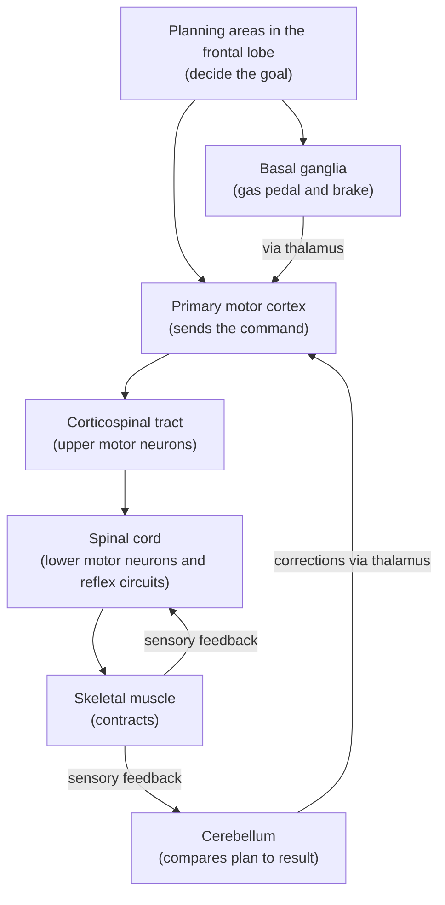

# Chapter 7: Movement: Muscles, Reflexes, and Motor Control

## Summary

Every movement you make, from a blink to a penalty kick, ends with muscle fibers pulling. This chapter follows a movement from the bottom up: how a muscle fiber contracts, how motor units set force, and how spinal reflexes act without waiting for the brain. Then it climbs to the top: the motor cortex and corticospinal tract send commands, the basal ganglia act as a gas pedal and brake, and the cerebellum corrects errors and helps you learn skills. It ends at the bedside with Parkinson's disease, where losing dopamine neurons makes movement slow and hard to start.

## Concepts Covered

1. Skeletal Muscle Contraction
2. Motor Unit
3. Reflex Arc
4. Stretch Reflex
5. Primary Motor Cortex
6. Corticospinal Tract
7. Upper vs Lower Motor Neuron
8. Basal Ganglia
9. Substantia Nigra
10. Direct and Indirect Pathways
11. Cerebellar Coordination
12. Motor Learning
13. Parkinson's Disease
14. Levodopa
15. Deep Brain Stimulation

## Prerequisites

- [Chapter 1: Neurons, Glia, and the Nervous System](../01-neurons-and-glia/index.md)
- [Chapter 2: The Action Potential](../02-action-potential/index.md)
- [Chapter 3: Synapses and Neurotransmitters](../03-synapses-and-neurotransmitters/index.md)
- [Chapter 4: A Tour of the Brain: Neuroanatomy](../04-neuroanatomy/index.md)

!!! mascot-welcome "Let's get moving!"
    { class="mascot-admonition-img" }
    I'm a sea slug, so my top speed is not very impressive. But my slow crawl and your fastest sprint follow the same plan: decide, command, adjust, and pull. In this chapter you'll learn how a decision becomes motion, and why a doctor can often tell *where* a problem is just by watching someone move.

## 7.1 One Kick, Many Brain Areas

It's the last minute of a tied soccer game. Maya, a 16-year-old midfielder who is also studying for the Brain Bee, steps up to take a penalty kick. She glances at the goalkeeper, picks the bottom-left corner, takes three steps, plants her left foot, and swings her right leg through the ball. The whole thing takes about two seconds.

Those two seconds use a surprising amount of brain. Something had to *decide* to aim left. Something had to turn that plan into muscle commands, keep her balanced on one leg, and adjust the swing when the grass was slippery. At the very end, thousands of muscle fibers in her thigh had to pull at the right moment with the right force. Why does one kick need so many parts of the nervous system?

### An everyday analogy: a film crew

Before naming any brain structures, picture a film crew shooting a stunt. A **director** decides what the scene should be. A **camera operator** turns the plan into specific actions. A **safety officer** keeps a hand on the brake, letting only the planned action start. A **stunt coordinator** compares each take to the plan and calls out corrections. The **stunt performers** do the physical work. And some actions, like flinching when something flies at your face, happen so fast that nobody waits for the director.

Your motor system has all of these roles. The performers are your **muscles**, the instant flinches are **reflexes** run by the spinal cord, the camera operator is the **primary motor cortex**, the safety officer is the **basal ganglia**, and the stunt coordinator is the **cerebellum**. The director's job is spread across planning areas in the front of the brain.

The flowchart below shows how these pieces connect. Planning areas decide, the motor cortex sends commands down the spinal cord, and two "advisor" loops (basal ganglia and cerebellum) shape the command.

We'll start at the bottom of this chart, with the muscle, and work our way up.

## 7.2 How a Muscle Pulls

Muscles can only pull. They never push. When you straighten your knee, muscles on the front of your thigh pull. When you bend it, muscles on the back pull. Muscles that pull in opposite directions around a joint work in pairs, so every movement is a tug-of-war that the nervous system referees.

### The analogy: hands on a rope

Imagine a team hauling a boat to shore with a rope. Each person grabs the rope, pulls, lets go, reaches forward, and grabs again. No single grab moves the boat far, but thousands of quick grabs haul it in. Inside each muscle fiber, tiny protein "hands" do almost exactly this.

### The real steps

**Skeletal muscle contraction** is the process in which an electrical signal from a motor neuron makes a muscle fiber shorten and pull on a bone. A skeletal muscle is made of long cells called **muscle fibers**. Inside each fiber are two kinds of protein filaments. **Actin** filaments are the "rope." **Myosin** filaments have little heads that act as the "hands." Here is the sequence, building on [Chapter 2](../02-action-potential/index.md) and [Chapter 3](../03-synapses-and-neurotransmitters/index.md):

1. An action potential travels down a motor neuron to the **neuromuscular junction**, the synapse between a motor neuron and a muscle fiber.
2. The axon terminal releases **acetylcholine**, which binds to receptors on the muscle fiber and depolarizes it.
3. The muscle fiber fires its own action potential, which spreads across its membrane.
4. That electrical wave makes an internal storage compartment, the **sarcoplasmic reticulum**, release calcium inside the fiber.
5. Calcium moves a blocking protein (tropomyosin) aside, uncovering grip sites on actin.
6. Myosin heads grab actin, bend, and pull it toward the center. This is the "power stroke."
7. **ATP**, the cell's energy molecule, lets each myosin head let go and reset to grab again. When nerve signals stop, calcium is pumped back into storage and the muscle relaxes.

One surprise: ATP is needed to *release* the grip. After death, ATP runs out, myosin stays locked onto actin, and muscles stiffen. This is rigor mortis ([OpenStax, Section 10.1](https://openstax.org/books/introduction-behavioral-neuroscience/pages/10-1-the-physiological-actions-implementing-movement-contraction-of-muscles)).

The table below sums up who does what in the steps you just read.

| Player | Job in contraction |
|---|---|
| Acetylcholine | Carries the signal across the neuromuscular junction |
| Calcium | The "on switch" that uncovers grip sites on actin |
| Actin | The "rope" that gets pulled |
| Myosin | The "hands" that grab and pull |
| ATP | Lets myosin let go and reset |

## 7.3 Motor Units: How the Brain Sets the Force

Maya uses the same thigh muscle to tap a short pass and to blast a shot at the goal. How does one muscle produce both?

Each muscle fiber gets input from just one motor neuron, but one motor neuron branches to many muscle fibers. A **motor unit** is one motor neuron plus all of the muscle fibers it controls. When that neuron fires, all of its fibers contract together. A muscle contains many motor units ([OpenStax, Section 10.1](https://openstax.org/books/introduction-behavioral-neuroscience/pages/10-1-the-physiological-actions-implementing-movement-contraction-of-muscles)).

The nervous system turns up force in two ways:

1. **Fire faster.** A higher rate of action potentials releases calcium again before the fibers relax, so their pulls add up.
2. **Recruit more motor units** to pull at the same time.

Recruitment follows the **size principle**. Small motor neurons, which control few fibers, are easier to excite, so they fire first. Large motor neurons, which control many fibers, need stronger input and join only when more force is needed ([OpenStax, Section 10.2](https://openstax.org/books/introduction-behavioral-neuroscience/pages/10-2-eliciting-contractions-from-lower-levels-lower-motoneurons-and-reflex-arcs)). That's how you can hold an egg gently, then lift a heavy backpack with the same hand.

| | Small motor units | Large motor units |
|---|---|---|
| Fibers per motor neuron | Few | Many |
| Input needed to fire | Small | Large |
| When recruited | First, for light tasks | Later, for more force |
| Example in Maya's game | A soft pass | A full-power shot |

!!! mascot-thinking "Muscles don't decide on their own"
    { class="mascot-admonition-img" }
    A muscle fiber has no idea how hard it "should" pull. The nervous system decides, by choosing how many motor units to recruit and how fast each one fires.

## 7.4 Reflexes: Shortcuts in the Spinal Cord

Remember touching a hot pan in Chapter 2? Your hand jerked away before you felt the pain. That was a reflex, handled mostly by your spinal cord.

Think of an automatic door at a grocery store. It doesn't call the manager when you walk up. A sensor detects you, a small local circuit decides "open," and a motor slides the door. Reflexes work the same way: a fast local circuit handles a predictable situation, and the brain hears about it afterward.

### The reflex arc

A **reflex arc** is the nerve pathway that produces a reflex, an automatic and rapid response to a stimulus. It has five parts:

1. A **sensory receptor** detects the stimulus.
2. A **sensory neuron** carries the signal into the spinal cord.
3. An **integration center** in the spinal cord links input to output, either by a direct synapse or through interneurons.
4. A **motor neuron** carries the command out.
5. An **effector**, usually a muscle, responds.

Because the signal makes a short trip, a reflex is faster than a movement that goes up to the brain and back.

### The stretch reflex and the knee-jerk test

The **stretch reflex** is the automatic contraction of a muscle when it is suddenly stretched. The sensors are **muscle spindles**, tiny stretch detectors inside the muscle. They are part of **proprioception**, your sense of body position, from [Chapter 6](../06-hearing-touch-taste-smell-pain/index.md).

When a doctor taps the tendon below your kneecap:

1. The tap stretches the quadriceps, the big muscle on the front of the thigh.
2. Muscle spindles in the quadriceps fire.
3. Their sensory neurons enter the spinal cord and synapse **directly** on quadriceps motor neurons. With only one synapse, this is a **monosynaptic** reflex.
4. The quadriceps contracts, and the lower leg kicks forward.
5. A branch of the sensory neuron also excites an inhibitory interneuron that relaxes the hamstrings on the back of the thigh, so they don't fight the kick. This is **reciprocal inhibition**.

The knee-jerk (patellar) reflex tests spinal cord segments L2 to L4 ([Wikipedia: Patellar reflex](https://en.wikipedia.org/wiki/Patellar_reflex)). A missing reflex can point to damage in that loop. A much-too-strong reflex can point to a problem *above* the loop, as Section 7.6 explains. In daily life, the stretch reflex helps keep a buckling knee from collapsing when Maya lands awkwardly.

Reflexes are not fully separate from the brain. Signals from the brain constantly turn them up or down. When that control is cut off, for example after a spinal cord injury, reflexes below the injury often become exaggerated ([OpenStax, Section 10.2](https://openstax.org/books/introduction-behavioral-neuroscience/pages/10-2-eliciting-contractions-from-lower-levels-lower-motoneurons-and-reflex-arcs)).

Reflexes can even learn. Eric Kandel studied a protective reflex in the sea slug *Aplysia*, which has only about 20,000 nerve cells: touch it, and it pulls in its gill. He showed that this reflex could be strengthened for days or weeks by changes at the synapse between sensory and motor neurons, work that earned a share of the 2000 Nobel Prize in Physiology or Medicine ([Nobel Prize press release, 2000](https://www.nobelprize.org/prizes/medicine/2000/press-release/)). You'll see more in [Chapter 9](../09-learning-memory-plasticity/index.md).

## 7.5 From Command to Muscle: The Motor Cortex and the Corticospinal Tract

Reflexes are automatic. Maya's penalty kick is not. A voluntary movement starts in the brain.

### The primary motor cortex

The **primary motor cortex** is a strip of the frontal lobe, on the **precentral gyrus** just in front of the central sulcus, that sends the main commands for voluntary movement. It lies right in front of the somatosensory cortex from Chapter 6.

The motor cortex holds a body map, the **motor homunculus**. Neighboring body parts are controlled by neighboring strips of cortex, and parts that need fine control, like the hands, lips, and tongue, get far more cortex than the trunk or legs ([OpenStax, Section 10.3](https://openstax.org/books/introduction-behavioral-neuroscience/pages/10-3-our-brain-gets-involved-responsibilities-of-upper-motor-systems)). That's why you can thread a needle with your fingers but not your toes.

The real map is less tidy than the classic drawing of a little person stretched along the cortex. A 2023 brain-imaging study in humans found that the foot, hand, and mouth areas are not one continuous strip. They alternate with zones that don't control any single body part. Those zones are wired to a brain network involved in planning actions and in body control such as arousal, and they became active when people planned coordinated hand and foot movements or moved the trunk or face. The researchers named this system the **somato-cognitive action network (SCAN)**: the motor strip mixes areas for fine control of one body part with areas for whole-body action planning ([Gordon and colleagues, 2023, *Nature*](https://pmc.ncbi.nlm.nih.gov/articles/PMC10172144/)). The homunculus is still a useful first picture, as long as you remember it is a simplification.

Control of the limbs is **contralateral**: each side of the motor cortex controls the opposite side of the body. Maya's right-legged kick came mainly from her *left* motor cortex.

### The corticospinal tract

A command reaches motor neurons in the spinal cord through the **corticospinal tract**, a long bundle of axons running from the cortex (*cortico*) to the spinal cord (*spinal*). The axons start in the motor cortex and nearby areas, descend through the deep white matter and the brainstem, and most of them cross to the other side in the lowest part of the brainstem, the medulla. That crossing is why the left brain controls the right body. The crossed fibers form the **lateral corticospinal tract**, which mainly controls the limbs, especially fine finger movements. A smaller set controls trunk muscles ([OpenStax, Section 10.3](https://openstax.org/books/introduction-behavioral-neuroscience/pages/10-3-our-brain-gets-involved-responsibilities-of-upper-motor-systems); [Wikipedia: Corticospinal tract](https://en.wikipedia.org/wiki/Corticospinal_tract)). In the spinal cord, these axons connect to motor neurons and to the reflex circuits you just learned about.

## 7.6 Upper vs. Lower Motor Neurons: A Doctor's Shortcut

The command chain uses two kinds of neurons, and doctors care a lot about which one is damaged.

- An **upper motor neuron** starts in the brain, such as in the motor cortex, and carries commands down to the brainstem or spinal cord. It never touches a muscle.
- A **lower motor neuron** has its cell body in the brainstem or the front (ventral) part of the spinal cord, and its axon runs out to a muscle. Every command, from the brain or from a reflex, must pass through lower motor neurons.

Upper motor neurons don't just say "go." They also hold spinal reflex circuits in check. So the two kinds of damage look different:

- **Lower** motor neuron damage cuts the muscle's only connection. The muscle becomes weak and floppy, its reflexes shrink or vanish, it wastes away over time, and it may show small twitches called fasciculations ([Wikipedia: Lower motor neuron lesion](https://en.wikipedia.org/wiki/Lower_motor_neuron_lesion)).
- **Upper** motor neuron damage leaves the reflex loops working but unsupervised. The muscle is weak, reflexes are exaggerated, and muscles become stiff in a way that increases with fast stretching, called **spasticity**. Stroking the sole makes the big toe point up instead of curling down: the **Babinski sign**, which is abnormal after about 12 months of age ([Wikipedia: Upper motor neuron lesion](https://en.wikipedia.org/wiki/Upper_motor_neuron_lesion)).

The table below organizes the comparison you just read.

| Finding | Upper motor neuron damage | Lower motor neuron damage |
|---|---|---|
| Muscle tone | Increased (spastic) | Decreased (floppy) |
| Reflexes | Exaggerated | Reduced or absent |
| Babinski sign | Present (toe goes up) | Absent |
| Muscle wasting | Little | Marked |
| Fasciculations | No | Yes |
| Example | Stroke in the motor cortex | Injury to a nerve |

Some diseases damage both. Amyotrophic lateral sclerosis (ALS), covered in [Chapter 13](../13-aging-and-neurodegeneration/index.md), attacks upper and lower motor neurons, so patients can show both sets of signs.

!!! mascot-tip "A quick way to remember"
    { class="mascot-admonition-img" }
    Think "**U**pper = **U**p." With upper motor neuron damage, tone goes up, reflexes go up, and the big toe goes up.

## 7.7 The Basal Ganglia: Gas Pedal and Brake

We have a commander and a delivery route. But how does the brain choose *which* movement to send, and keep the others from slipping out? When Maya kicks, she must swing her right leg *and* hold back every competing movement.

### The analogy: a car with the parking brake on

Picture a car parked on a hill with the parking brake pulled tight. To drive, you release the brake for the movement you want and keep it on for everything else. Your brain works this way. At rest, a set of nuclei holds a steady brake on movement. To move, the brain releases that brake for one chosen action. Releasing a brake is a "double negative": you create movement by *stopping* something that was stopping you.

!!! mascot-encourage "This part has a lot of names"
    { class="mascot-admonition-img" }
    The basal ganglia circuit is famous for being confusing, so it's fine if it takes two reads. Keep the car in mind: one pathway releases the brake, one presses it, and dopamine tips the balance.

### Meet the players

The **basal ganglia** are a group of nuclei deep in the brain that help select wanted movements, suppress unwanted ones, and form habits. They work in a loop with the cortex and thalamus. The main motor parts are:

- The **striatum** (the caudate and putamen), the input station. It receives excitatory input from the cortex, and its output neurons are inhibitory (they use GABA).
- The **globus pallidus**, with an external part (**GPe**) and an internal part (**GPi**).
- The **subthalamic nucleus (STN)**, the only basal ganglia nucleus whose output is excitatory (glutamate).
- The **substantia nigra**, a midbrain nucleus named "black substance" for its dark color. Its **pars compacta (SNc)** contains dopamine-making neurons that send dopamine to the striatum. Its **pars reticulata (SNr)** works with the GPi as an output station.

GPi and SNr are the brake. Their inhibitory neurons fire at a high rate all the time, holding back the thalamus, which would otherwise excite the motor cortex ([Wikipedia: Basal ganglia](https://en.wikipedia.org/wiki/Basal_ganglia)).

### The direct and indirect pathways

From the striatum, signals reach the brake by two routes, called the **direct and indirect pathways**.

**Direct pathway ("GO"):** Cortex excites striatal neurons that carry D1 dopamine receptors. These neurons inhibit GPi/SNr. Inhibiting the brake releases the thalamus, which excites the motor cortex, and the chosen movement goes ahead.

**Indirect pathway ("NO-GO"):** Cortex excites a different set of striatal neurons that carry D2 receptors. These inhibit GPe. Because GPe normally inhibits the STN, quieting GPe releases the STN. The STN then excites GPi/SNr, pressing the brake harder, and competing movements are held back.

The table lists every connection in this classic model and its sign. If you keep track of the signs, the rest of the circuit makes sense.

| Connection | Transmitter | Effect |
|---|---|---|
| Cortex → striatum | Glutamate | Excites (+) |
| Striatum (D1) → GPi/SNr | GABA | Inhibits (−) |
| Striatum (D2) → GPe | GABA | Inhibits (−) |
| GPe → STN | GABA | Inhibits (−) |
| STN → GPi/SNr | Glutamate | Excites (+) |
| GPi/SNr → thalamus | GABA | Inhibits (−) |
| Thalamus → cortex | Glutamate | Excites (+) |
| SNc → striatal D1 neurons | Dopamine | Excites (+) |
| SNc → striatal D2 neurons | Dopamine | Inhibits (−) |

### Dopamine tips the balance

Look at the last two rows. Dopamine excites the D1 (GO) neurons and inhibits the D2 (NO-GO) neurons ([Wikipedia: Basal ganglia](https://en.wikipedia.org/wiki/Basal_ganglia); [OpenStax, Section 10.3](https://openstax.org/books/introduction-behavioral-neuroscience/pages/10-3-our-brain-gets-involved-responsibilities-of-upper-motor-systems)). Both effects push the same way: **more dopamine means a weaker brake and more movement.**

This two-pathway picture is the classic model of the basal ganglia, laid out in the late 1980s, including in a widely cited 1989 review by Albin, Young, and Penney ([*Trends in Neurosciences*, 1989](https://pubmed.ncbi.nlm.nih.gov/2479133/)). It explains movement disorders as two opposite kinds of imbalance:

- **Hypokinetic disorders** ("too little movement") happen when the brake is too strong. Parkinson's disease is the main example.
- **Hyperkinetic disorders** ("too much movement") happen when the brake is too weak. Examples include the dance-like movements called **chorea** in Huntington's disease, in which striatal neurons break down and die ([NINDS: Huntington's Disease](https://www.ninds.nih.gov/health-information/disorders/huntingtons-disease)), and the extra movements (dyskinesia) some people with Parkinson's develop after years of dopamine-boosting medicine.

!!! mascot-warning "A useful model, not the whole brain"
    { class="mascot-admonition-img" }
    The two-pathway model is a simplified map. Real basal ganglia have extra routes, such as a "hyperdirect" pathway from cortex straight to the STN, and scientists still debate how cleanly the two pathways separate. In mice, for example, neurons of both pathways become active together just as a movement starts, which challenges the simple idea that one pathway only means "go" and the other only means "stop" ([Cui and colleagues, 2013](https://pubmed.ncbi.nlm.nih.gov/23354054/)).

Now try the circuit yourself. Every label in the simulation (striatum, GPe, GPi/SNr, STN, SNc, thalamus, direct and indirect pathways) was defined above.

#### Diagram: Basal Ganglia Gas and Brake

<iframe src="../../sims/ch07-basal-ganglia/main.html" height="602px" width="100%" scrolling="no"></iframe>

[Open the Basal Ganglia Gas and Brake fullscreen](../../sims/ch07-basal-ganglia/main.html){ .md-button .md-button--primary }

MicroSim specification: Basal Ganglia Gas and Brake

Type: microsim
**sim-id:** ch07-basal-ganglia 
**Library:** p5.js 
**Status:** Implemented 
**Bloom Level:** Understand 
**Bloom Verb:** explain 
**Learning Objective:** The learner will explain how lowering or raising dopamine shifts the balance between the direct and indirect pathways, and predict whether movement output will be too little, normal, or too much.

**Canvas:** width-responsive; 550 px drawing area plus 50 px control area (iframe 602 px).

**Controls:** dopamine slider, 0% to 200% of normal (step 10%, default 100%); Reset button.

**Behavior:** nodes and connection signs match the table in Section 7.7 (arrows with + are excitatory, flat bars with − are inhibitory, dashed lines are dopamine). Line thickness scales with the sending node's activity. Illustrative model with dopamine d (1 = normal): D1 = 0.5 + 0.35(d − 1); D2 = 0.5 − 0.35(d − 1); GPe = 1 − D2; STN = 1 − GPe; GPi/SNr = 0.5 − 0.5(D1 − 0.5) + 0.5(STN − 0.5); movement output = thalamus = 1 − GPi/SNr. The meter reads "Too little" when output < 0.35 (dopamine 50% or less), "Normal" from 0.35 to 0.65, and "Too much" when output > 0.65 (dopamine 150% or more). The sim is labeled as a simplified model with illustrative values.

Start at 100% dopamine, where every pathway is medium thickness and the meter reads "Normal." **Before you touch the slider, predict:** if dopamine drops, which pathway gets thinner and which gets thicker? Then drag the slider to 30%. The direct pathway fades, the indirect pathway thickens, the GPi/SNr brake strengthens, the thalamus goes quiet, and the meter slides into "Too little." That is the basal ganglia in Parkinson's disease.

Now drag the slider to 170%. The direct pathway dominates, the brake weakens, and the meter moves into "Too much," like the extra movements that can appear when dopamine signaling is pushed too high. Find the settings where the meter changes zones, and notice that "normal" is a balance, not a maximum.

## 7.8 The Cerebellum: The Coordination Coach

The basal ganglia help choose *which* movement happens. The cerebellum helps make it *smooth and accurate*.

A navigation app constantly compares where you *are* with where you *should be*, and recalculates when you drift. The **cerebellum**, the wrinkled structure under the back of the brain, does this for movement.

**Cerebellar coordination** is the cerebellum's job of timing and smoothing movements by comparing the intended movement with the actual one and sending corrections. It receives a copy of the **plan** from the cortex (through the brainstem) and **feedback** about the actual movement, mostly from muscle spindles and other proprioceptors. When the two don't match, it sends corrections through the thalamus to the motor cortex ([OpenStax, Section 10.3](https://openstax.org/books/introduction-behavioral-neuroscience/pages/10-3-our-brain-gets-involved-responsibilities-of-upper-motor-systems)). If Maya's planted foot slips, her cerebellum helps adjust the swing.

The cerebellum is small but packed. It is only about 10% of the brain's mass, yet it holds about 69 billion of the brain's roughly 86 billion neurons, about four out of five ([Herculano-Houzel, 2009](https://pmc.ncbi.nlm.nih.gov/articles/PMC2776484/)).

Cerebellar damage doesn't paralyze anyone. Instead, movements become clumsy and poorly timed, a condition called **ataxia**. Signs include **dysmetria** (overshooting or undershooting a target), an **intention tremor** that gets worse as the hand nears a target, and a wide, unsteady walk. Damage to one side of the cerebellum affects the **same** side of the body ([Wikipedia: Cerebellum](https://en.wikipedia.org/wiki/Cerebellum)), unlike the motor cortex. Doctors use this difference to locate a problem.

| Question | Basal ganglia | Cerebellum |
|---|---|---|
| Main job | Select and start wanted movements; suppress others | Coordinate, time, and correct movements |
| Analogy | Gas pedal and brake | Navigation app that recalculates |
| Damage causes | Too little movement (Parkinson's) or too much (chorea) | Clumsy, inaccurate movement (ataxia) |
| Typical tremor | At rest (in Parkinson's disease) | During movement, worse near the target |

## 7.9 Motor Learning: Practice Makes Automatic

The first time Maya tried to curve a ball around a wall of defenders, she had to think about every detail. Now she does it without thinking. What changed?

**Motor learning** is the process by which practice turns a clumsy, effortful movement into a smooth, accurate, and largely automatic skill. It leans on two structures you just met ([OpenStax, Section 10.3](https://openstax.org/books/introduction-behavioral-neuroscience/pages/10-3-our-brain-gets-involved-responsibilities-of-upper-motor-systems)):

- The **cerebellum** uses the errors from each attempt to fine-tune the next. Slow, careful practice gives it time to notice and fix errors.
- The **basal ganglia**, working with the cortex, help "package" a sequence of movements into a habit that runs with little conscious attention.

As a skill moves from early (slow, many errors) to late (fast, automatic), attention is freed for the game, like watching the goalkeeper instead of your own foot. OpenStax also notes that imagined practice, rehearsing a movement in your mind, can improve performance because it uses some of the same circuits. It adds to real practice but doesn't replace it.

## 7.10 When the Brake Is Stuck: Parkinson's Disease, Levodopa, and DBS

Now we can put the chapter together to understand one of the most common movement disorders.

### What goes wrong

**Parkinson's disease** is a nervous system disorder that affects movement and gets worse over time. It happens mainly because dopamine-making neurons in the substantia nigra pars compacta weaken and die. By the time symptoms appear, most people have lost about 60 to 80% or more of these cells ([NINDS: Parkinson's Disease](https://www.ninds.nih.gov/health-information/disorders/parkinsons-disease)). Damaged cells in most people with Parkinson's contain **Lewy bodies**, clumps of a protein called **alpha-synuclein**.

The average age when symptoms start is in the early to mid-60s. In most people the cause is unknown, and both genes and environment are thought to contribute (NINDS). Because the risk rises with age, the number of people living with Parkinson's is growing as populations get older. A 2025 study based on Global Burden of Disease data projected that the number of people with Parkinson's worldwide will more than double between 2021 and 2050, to about 25 million, with population aging as the main driver ([Su and colleagues, 2025, *BMJ*](https://pmc.ncbi.nlm.nih.gov/articles/PMC11881235/)).

Your simulation shows why losing dopamine slows movement. The direct pathway weakens, the indirect pathway strengthens, and both changes tighten the brake on the thalamus. NINDS lists four common motor signs:

- **Tremor** most obvious when the hand is at rest, often a "pill-rolling" rub of thumb and finger. Some people never develop a tremor.
- **Rigidity**, stiffness a doctor feels when moving the person's arm, sometimes with small catches ("cogwheel" rigidity).
- **Bradykinesia**, slowness of movement, including fewer facial expressions.
- **Postural instability**, balance problems that raise the risk of falls, often with a stooped, shuffling walk.

Many people also have sleep problems, constipation, or loss of smell before movement symptoms begin ([NIA: Parkinson's Disease](https://www.nia.nih.gov/health/parkinsons-disease/parkinsons-disease-causes-symptoms-and-treatments)).

### Levodopa: refilling the tank

Why not just give dopamine? Because dopamine in the blood can't easily cross the **blood-brain barrier**, the tightly sealed lining of the brain's blood vessels. Its precursor can. **Levodopa** (L-dopa) is a medicine that the brain converts into dopamine, and it is the main treatment for Parkinson's disease. Levodopa is almost always combined with **carbidopa**, which blocks levodopa's breakdown in the rest of the body so more reaches the brain ([NINDS](https://www.ninds.nih.gov/health-information/disorders/parkinsons-disease)).

The story connects back to Ply. Arvid Carlsson showed that dopamine is a neurotransmitter that matters for movement: animals given a drug that depleted their transmitter stores stopped moving on their own, and recovered after receiving L-dopa. His work led to the realization that Parkinson's is caused by too little dopamine and could be treated with L-dopa. Carlsson shared the 2000 Nobel Prize with Paul Greengard and with Eric Kandel, the *Aplysia* scientist ([Nobel Prize press release, 2000](https://www.nobelprize.org/prizes/medicine/2000/press-release/)).

Levodopa eases symptoms, but it does not replace lost neurons or stop the disease from progressing. After years of treatment, its effect may wear off between doses ("off" periods), and some people develop **dyskinesia**, extra twisting or writhing movements (NINDS). In the simulation, that is like overshooting from "Too little" into "Too much."

### Deep brain stimulation

**Deep brain stimulation (DBS)** is a treatment in which a neurosurgeon implants a thin wire electrode deep in the brain, connected to a battery-powered pulse generator under the skin of the chest, like a heart pacemaker. The electrical pulses change abnormal activity in the circuit. DBS does not cure Parkinson's and does not help every symptom (NINDS).

The targets come straight from the basal ganglia circuit: the **subthalamic nucleus (STN)** or the **internal globus pallidus (GPi)**. The FDA approved DBS at these targets for Parkinson's disease in 2002, after approving DBS in the thalamus for essential tremor and Parkinson's tremor in 1997 ([NINDS: DBS history](https://www.ninds.nih.gov/about-ninds/what-we-do/impact/ninds-contributions-approved-therapies/deep-brain-stimulation-dbs-treatment-parkinsons-disease-and-other-movement-disorders)). A newer version, **adaptive DBS**, senses brain signals and adjusts stimulation automatically. The FDA approved the first adaptive DBS system for Parkinson's disease in February 2025 ([Medtronic press release, February 24, 2025](https://news.medtronic.com/2025-02-24-Medtronic-earns-U-S-FDA-approval-for-the-worlds-first-Adaptive-deep-brain-stimulation-system-for-people-with-Parkinsons)).

## At the Bedside: The Slowing Teacher

!!! note "Meet the patient"
    Mr. Alvarez is a 62-year-old retired history teacher. For about a year, his right hand has shaken while it rests in his lap. The shaking fades when he reaches for his coffee. His wife says he walks more slowly, with short shuffling steps, and his right arm no longer swings. His handwriting has become small and cramped, and his voice is softer. Looking back, he lost much of his sense of smell several years ago, and his wife says he sometimes seems to act out his dreams.

**What the doctor checks:** The neurologist watches him sit, stand, and walk. His right hand shows a pill-rolling tremor at rest that lessens when he moves on purpose. Moving his right wrist, she feels stiffness with small catches (cogwheel rigidity). When he taps finger and thumb quickly, the taps get smaller and slower (bradykinesia). He takes several small steps to turn. Just as important, his strength is normal, his reflexes are normal, there is no Babinski sign, and his finger-to-nose test is accurate.

**Where is the problem? (localization):** Normal strength, normal reflexes, and no Babinski sign argue against upper or lower motor neuron damage. An accurate finger-to-nose test with no intention tremor argues against the cerebellum. A resting tremor, rigidity, and slowness that began on one side point to the **basal ganglia**, specifically to lost dopamine input from the **substantia nigra pars compacta**. The early loss of smell and dream-enacting behavior fit the same disease.

**Diagnosis:** **Parkinson's disease.** No single test proves it. Doctors diagnose it mainly from the history and exam. Blood tests and MRI help rule out other conditions, and a dopamine transporter (DaT) scan can help, though it can't tell Parkinson's apart from some related disorders ([NINDS](https://www.ninds.nih.gov/health-information/disorders/parkinsons-disease)).

**Why it happens:** Most of his dopamine neurons in the SNc have been lost. With less dopamine in the striatum, the direct (GO) pathway weakens and the indirect (NO-GO) pathway strengthens. The GPi/SNr brake on the thalamus becomes too strong, so the motor cortex gets too little "go" signal: the "Too little" zone in the simulation.

**Treatment today:** Standard care starts with medicine that raises dopamine signaling, most often carbidopa-levodopa. Other options include dopamine agonists, which act like dopamine, and MAO-B inhibitors, which slow dopamine breakdown. Exercise, physical therapy, and speech therapy help with movement, balance, and voice. If medicines later stop working smoothly, his neurologist may discuss DBS of the STN or GPi ([NINDS](https://www.ninds.nih.gov/health-information/disorders/parkinsons-disease)). Newer options, as of 2026, include a small pump that delivers a levodopa-based medicine under the skin around the clock, which the FDA approved in October 2024 for advanced Parkinson's with "off" periods ([AbbVie, 2024](https://www.biospace.com/press-releases/u-s-fda-approves-vyalev-foscarbidopa-and-foslevodopa-for-adults-living-with-advanced-parkinsons-disease)). In September 2026 the FDA approved tavapadon, the first approved dopamine agonist designed to act selectively on D1-type receptors (D1 and D5), the kind found on direct (GO) pathway neurons ([NeurologyLive, 2026](https://www.neurologylive.com/view/fda-approves-tavapadon-for-the-treatment-of-parkinson-disease)). Like levodopa, these treat symptoms. None has been shown to slow the disease.

**What's new in research:** The **alpha-synuclein seed amplification assay (SAA)** is a lab test that checks spinal fluid for misfolded alpha-synuclein "seeds" that can make normal alpha-synuclein misfold and clump. In a study of 1,123 people, it was positive in 87.7% of people with Parkinson's disease and negative in 96.3% of healthy controls, and it was also positive in many people who had early warning signs like loss of smell or dream-enacting behavior but no movement symptoms yet ([Siderowf et al., 2023, *Lancet Neurology*](https://pmc.ncbi.nlm.nih.gov/articles/PMC10627170/)). In 2024 the FDA issued a **Letter of Support** encouraging its use in research and clinical trials ([Michael J. Fox Foundation, 2024](https://www.michaeljfox.org/news/fda-encourages-use-parkinsons-biomarker-future-clinical-trials)). That is **not** FDA approval of a diagnostic test.

A version is offered by a commercial lab, and NINDS notes that such tests can help diagnose Parkinson's but cannot tell it apart from some similar disorders, such as multiple system atrophy and Lewy body dementia (NINDS). Researchers hope it will help find people early enough to test treatments that might slow the disease.

??? question "Your turn: diagnose a variation"
    Eight years later, Mr. Alvarez still takes carbidopa-levodopa. About an hour after each dose, he develops twisting, writhing movements of his arms and trunk that he can't control. Before his next dose, he becomes slow and stiff again. What is happening, and how does the basal ganglia model explain it?

    **Answer:** These are **levodopa-induced dyskinesias** plus **"off" periods**. At the dose's peak, dopamine signaling overshoots: the direct pathway dominates, the indirect pathway is suppressed, and the GPi/SNr brake becomes too weak, so unwanted movements slip through (the "Too much" zone). As the dose wears off, he slides back into "Too little." Swings like this are one reason doctors may adjust medicines or consider DBS.

*This is a fictional teaching case. It is not medical advice. If you or someone you know has symptoms like these, talk to a doctor.*

## Common Misconceptions

**Myth:** Muscles decide for themselves how hard to contract.  
**Reality:** A muscle fiber contracts only when its motor neuron fires. The nervous system sets force by choosing how many motor units to recruit and how fast each one fires.

**Myth:** Parkinson's disease is just shaking.  
**Reality:** Slowness (bradykinesia) and rigidity are core features, and some people with Parkinson's never develop a tremor. Many also have non-movement symptoms, like loss of smell or sleep problems, sometimes years before movement symptoms.

**Myth:** Every reflex goes up to the brain before you react.  
**Reality:** Reflexes like the knee-jerk are handled by spinal cord circuits. The brain finds out afterward, though it does adjust how strong reflexes are.

**Myth:** Levodopa is dopamine, and it cures Parkinson's.  
**Reality:** Levodopa is the raw material the brain turns into dopamine, used because dopamine can't easily cross the blood-brain barrier. It eases symptoms but doesn't restore lost neurons or stop progression.

## Brain Bee Practice

??? question "1. What is a motor unit?"
    A single motor neuron together with all of the muscle fibers it controls. When the neuron fires, all of those fibers contract together.

??? question "2. Name the parts of a reflex arc in order."
    Sensory receptor, sensory neuron, integration center in the spinal cord, motor neuron, and effector (usually a muscle).

??? question "3. A patient has weakness in one arm, exaggerated reflexes, and an upgoing big toe when the sole is stroked. Upper or lower motor neuron damage?"
    Upper motor neuron damage. Brisk reflexes, spasticity, and a Babinski sign mean the lower motor neurons and reflex loops work but have lost control from above.

??? question "4. Which neurons die in Parkinson's disease, and which neurotransmitter do they make?"
    Neurons in the substantia nigra pars compacta, in the midbrain. They make dopamine and send it to the striatum.

??? question "5. Damage to the right side of the cerebellum causes clumsiness on which side of the body?"
    The right side. Cerebellar damage affects the same side of the body, unlike motor cortex damage, which affects the opposite side.

## Exercises

### Remember

1. List the two ways the nervous system increases the force of a muscle contraction.
2. Name the two pathways from the striatum to GPi/SNr, and say which is "GO" and which is "NO-GO."

??? note "Answer"
    1. Firing motor neurons faster, and recruiting more motor units.
    2. The direct pathway is "GO"; the indirect pathway is "NO-GO."

### Understand

3. Explain why ATP is needed for a muscle to *relax*, not just to contract.
4. Explain why dopamine, which excites D1 neurons but inhibits D2 neurons, pushes both pathways toward more movement.

??? note "Answer"
    3. ATP lets each myosin head release actin and reset. Without ATP, myosin stays locked on, which is why muscles stiffen after death (rigor mortis).
    4. Exciting the direct pathway inhibits the GPi/SNr brake. Inhibiting the indirect pathway weakens a route that would press the brake harder. Both weaken the brake and favor movement.

### Apply

5. A doctor taps a patient's patellar tendon and gets no response on either side. Using the reflex arc, list three different places where the problem could be.
6. In the Basal Ganglia Gas and Brake simulation, find the lowest dopamine setting that still reads "Normal." Describe how the direct pathway, indirect pathway, and GPi/SNr compare with 100%.

### Analyze

7. Compare a patient with a stroke in the left motor cortex to a patient with damage to the left side of the cerebellum. Which side of the body is affected in each, and how would the movement problems look different?
8. Huntington's disease damages striatal neurons. The classic model proposes that chorea comes from early loss of the striatal neurons that form the indirect pathway. Use the circuit signs to explain why losing a NO-GO pathway would cause *extra* movement.

### Evaluate

9. A website claims, "Parkinson's is caused by low dopamine, so the best treatment is the highest possible dose of levodopa." Evaluate this claim using the direct and indirect pathways and dyskinesia.
10. The alpha-synuclein seed amplification assay has an FDA Letter of Support for clinical trials but is not an FDA-approved diagnostic. Weigh the benefits and risks of using it to tell people without symptoms that they may develop Parkinson's disease.

### Create

11. Design a classroom demonstration (no animals or medicines) that shows the difference between small and large motor units, or between a reflex and a voluntary movement. Describe materials, steps, and what students should observe.
12. Write a short fictional case of a patient with a cerebellar problem. Include at least three findings and a localization paragraph explaining why the cerebellum, not the basal ganglia or motor neurons, is the likely site.

## Key Takeaways

- Muscles only pull. A motor neuron's signal releases calcium in a muscle fiber, letting myosin pull on actin; ATP lets myosin let go and reset.
- A motor unit is one motor neuron and all its fibers. The brain sets force by recruiting small motor units first, then larger ones, and by firing them faster.
- Reflex arcs, like the monosynaptic stretch reflex tested by the knee-jerk, run through the spinal cord, though the brain sets their strength.
- The primary motor cortex sends commands down the corticospinal tract, which mostly crosses in the medulla, so each side of the brain controls the opposite side of the body.
- Upper motor neuron damage causes spasticity, brisk reflexes, and a Babinski sign. Lower motor neuron damage causes floppy weakness, weak reflexes, wasting, and fasciculations.
- The basal ganglia act as a gas pedal and brake. Dopamine from the substantia nigra strengthens the direct (GO) pathway and weakens the indirect (NO-GO) pathway. The cerebellum corrects errors, and both help motor learning.
- In Parkinson's disease, lost dopamine neurons make the brake too strong. Levodopa, other medicines, exercise, and DBS of the STN or GPi treat symptoms but don't cure the disease.

!!! mascot-celebration "You followed a movement from neuron to bedside!"
    { class="mascot-admonition-img" }
    You can now trace a kick from a decision in the cortex to myosin pulling on actin, and explain why a missing brain chemical can freeze a person in place. Next, in Chapter 8, we'll see how these circuits are built, and why the teenage brain is still under construction.
