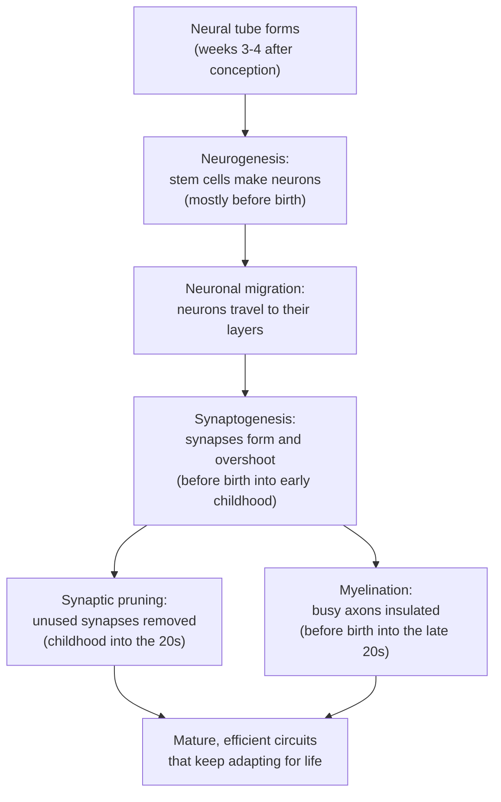

# Chapter 8: The Developing and Teenage Brain

## Summary

Your brain was not built all at once. It started as a tiny folded tube, filled with new neurons that crawled to their places, and made far more connections than it would keep. During childhood and the teen years, the brain prunes the connections it doesn't use and insulates the ones it does, with the prefrontal cortex finishing last. This chapter follows that journey to the mid-twenties, explains why teens are drawn to rewards and peers, and shows what happens when alcohol interferes before birth.

## Concepts Covered

1. Neural Tube
2. Neurogenesis
3. Neuronal Migration
4. Synaptogenesis
5. Synaptic Pruning
6. Myelination Over Time
7. Critical Period
8. Adolescent Brain
9. Prefrontal Maturation
10. Reward Sensitivity in Teens
11. Teratogen
12. Fetal Alcohol Spectrum
13. Nature and Nurture

## Prerequisites

- [Chapter 1: Neurons, Glia, and the Nervous System](../01-neurons-and-glia/index.md) (neurons, glia, myelin)
- [Chapter 2: The Action Potential](../02-action-potential/index.md) (how signals travel along axons)
- [Chapter 3: Synapses and Neurotransmitters](../03-synapses-and-neurotransmitters/index.md) (synapses, dopamine, glutamate, GABA)
- [Chapter 4: A Tour of the Brain: Neuroanatomy](../04-neuroanatomy/index.md) (cerebral cortex, frontal lobe, prefrontal cortex)

!!! mascot-welcome "A Brain Under Construction"
    { class="mascot-admonition-img" }
    I'm Ply, a sea slug with only about 20,000 neurons, so I got built pretty fast. Your brain took much longer, and parts of it are still being remodeled as you read this. This chapter is about you: how your brain got built, why the teen years are a special construction phase, and what can go wrong before birth.

## 8.1 Why Do Teenagers Take More Risks?

Maya is 16. After a Saturday soccer game, a teammate with a brand-new license offers her a ride home. Three other friends pile in. Someone turns the music up and dares the driver to "see what this car can do." Maya knows the road curves ahead. She aced a reaction-time quiz last week while studying for the Brain Bee. Yet with friends cheering in the back seat, the dare doesn't sound as dumb as it would if she were alone.

That night, Maya scrolls past a headline: "Teen brains aren't finished until 25!" Is her brain "half-built"? And if she knew the risk, why did the dare feel so tempting? This chapter answers with what scientists have actually measured. The short answer: the teenage brain isn't broken. It is in a very active phase of construction, and the timing of that construction helps explain both the risks teens take and how quickly they learn.

## 8.2 Building a Brain: The Big Picture

Before we name any structures, picture how a new city might be built.

First, builders lay down the outline. Next, factories make lots of workers, who travel along scaffolding to their job sites. Then they build roads between every building they can reach, far more than the city needs. For years, the city watches traffic. Busy roads are kept and paved into highways. Unused roads are closed. The city ends up with fewer roads, but a much more efficient network.

Your brain was built in almost exactly that order:

1. A flat sheet of cells folds into a tube that sets the basic outline (the **neural tube**).
2. Stem cells divide to make enormous numbers of new neurons (**neurogenesis**).
3. The new neurons travel to their final positions (**neuronal migration**).
4. Neurons connect to each other by forming synapses, overshooting what an adult brain keeps (**synaptogenesis**).
5. Unused synapses are removed (**synaptic pruning**), and busy pathways are insulated with myelin (**myelination**).

The first three steps happen mostly before birth. The last two continue into the twenties. The flowchart below summarizes the sequence.

## 8.3 The Neural Tube: Where It All Starts

Early in pregnancy, part of the embryo's outer cell layer (the ectoderm) forms a flat strip called the neural plate. Its edges rise like two walls, curl toward each other, and zip together into a hollow tube. This is the **neural tube**, which becomes the entire central nervous system. The upper end becomes the brain and the rest becomes the spinal cord. The hollow inside remains as the brain's fluid-filled ventricles and the spinal cord's central canal ([OpenStax, Section 5.1](https://openstax.org/books/introduction-behavioral-neuroscience/pages/5-1-gastrulation-and-formation-of-the-neural-tube-neurulation); [NINDS](https://www.ninds.nih.gov/health-information/disorders/birth-disorders-brain-and-spinal-cord)).

According to the National Institute of Neurological Disorders and Stroke (NINDS), the neural tube typically folds and closes during the third and fourth weeks of development, about a month after conception, often before a person knows they are pregnant.

When the tube does not close properly, the result is a **neural tube defect**. If the back end fails to close, part of the spinal cord can be left exposed, a condition called spina bifida. If the front end fails to close, the forebrain does not develop, a condition called anencephaly ([NINDS](https://www.ninds.nih.gov/health-information/disorders/birth-disorders-brain-and-spinal-cord)).

The CDC reports that folic acid, a B vitamin, is the only form of folate shown to help prevent neural tube defects. Because the tube closes so early, the CDC recommends folic acid every day for anyone who could become pregnant, not just after a positive test ([CDC](https://www.cdc.gov/folic-acid/about/index.html)). Keep this example in mind for Section 8.13.

## 8.4 Making Neurons and Moving Them Into Place

### Neurogenesis

Cells lining the inner wall of the neural tube divide very fast. These are **neural stem cells**, which can copy themselves and also produce specialized cells. **Neurogenesis** is the creation of new neurons from stem cells. Later, stem cells switch to producing glia, the support cells from Chapter 1 ([OpenStax, Section 5.2](https://openstax.org/books/introduction-behavioral-neuroscience/pages/5-2-growth-and-development-of-the-early-brain)).

NINDS states that most of the brain's neurons have already been created by the time we're born. Whether adults make many new neurons is still debated. NINDS notes that neuroscientists disagree about how many and how often ([NINDS, Brain Basics](https://www.ninds.nih.gov/health-information/public-education/brain-basics/brain-basics-life-and-death-neuron)). The big neuron-building phase happens before birth.

### Neuronal migration

New neurons usually aren't born where they will work. **Neuronal migration** is the movement of new neurons from their birthplace to their final home. Many climb along long glial fibers called **radial glia**, which stretch like ropes from the inner wall of the neural tube to the outer surface ([NINDS, Brain Basics](https://www.ninds.nih.gov/health-information/public-education/brain-basics/brain-basics-life-and-death-neuron)). Radial glia are also neural stem cells, so they help make neurons and then guide them. The cortex is built "inside-out": the earliest-born neurons settle in the deepest layers, and later-born neurons crawl past them toward the surface ([OpenStax, Section 5.2](https://openstax.org/books/introduction-behavioral-neuroscience/pages/5-2-growth-and-development-of-the-early-brain)).

If migration goes wrong, neurons end up in the wrong place. In a rare condition called **lissencephaly** ("smooth brain"), the cortex develops without its normal folds. NINDS lists neuronal migration problems as the cause ([NINDS](https://www.ninds.nih.gov/health-information/disorders/birth-disorders-brain-and-spinal-cord)).

Surprisingly, the developing brain also makes extra neurons, and large numbers die along the way. This is part of the plan. Neurons compete for survival signals called neurotrophins, and those that don't get enough self-destruct in an orderly process called apoptosis ([OpenStax, Section 5.3](https://openstax.org/books/introduction-behavioral-neuroscience/pages/5-3-synapse-formation-and-maturation)).

## 8.5 Wiring Up: Synaptogenesis and Synaptic Pruning

### Synaptogenesis: making too many connections

Once a neuron arrives, it grows dendrites and an axon and connects with other neurons. Recall from Chapter 3 that a synapse is the junction where one neuron passes a chemical message to another. **Synaptogenesis** is the formation of new synapses.

In a classic study, Peter Huttenlocher and Arun Dabholkar measured synapse density in human cortex at different ages, comparing an auditory (hearing) area with a prefrontal (planning) area. Synapse formation began in both before birth. But auditory cortex peaked around 3 months after birth, while the prefrontal area didn't peak until after 15 months ([Huttenlocher and Dabholkar, 1997](https://pubmed.ncbi.nlm.nih.gov/9336221/)).

At their peaks, young brains are crowded with synapses. A later study of the human prefrontal cortex found that dendritic spines, the tiny bumps where most excitatory synapses sit, are two to three times more dense in childhood than in adults ([Petanjek and colleagues, 2011](https://pmc.ncbi.nlm.nih.gov/articles/PMC3156171/)).

### Synaptic pruning: use it or lose it

Why build extra connections? Your genes can't predict which language you'll hear or whether you'll play soccer or piano. So the brain overbuilds, then lets experience decide.

**Synaptic pruning** is the removal of weak or unused synapses during development. The rule is often summarized as "use it or lose it." Synapses that are active often get strengthened and kept. Synapses that are rarely used get removed ([OpenStax, Section 5.3](https://openstax.org/books/introduction-behavioral-neuroscience/pages/5-3-synapse-formation-and-maturation)). Like closing unused roads, this makes traffic flow better.

Pruning, like synapse formation, follows a regional schedule. In Huttenlocher's data, net synapse loss in the auditory cortex was over by about age 12, while in the prefrontal cortex it extended to mid-adolescence ([Huttenlocher and Dabholkar, 1997](https://pubmed.ncbi.nlm.nih.gov/9336221/)). Petanjek's team found that substantial pruning of prefrontal spines continues through the twenties before settling at adult levels ([Petanjek and colleagues, 2011](https://pmc.ncbi.nlm.nih.gov/articles/PMC3156171/)).

Who does the pruning? Partly microglia, the brain's resident immune cells. In young mice, microglia were caught "eating" synaptic inputs in the visual system during peak pruning, and this depended on how active those inputs were ([Schafer and colleagues, 2012](https://pmc.ncbi.nlm.nih.gov/articles/PMC3528177/)).

!!! mascot-thinking "Less Can Be More"
    { class="mascot-admonition-img" }
    A mature brain has fewer synapses than a toddler's brain, and that's a good thing. Pruning turns a tangled thicket into tuned circuits shaped by what you actually do. Every big idea starts at a single synapse, but a good brain also knows which ones to let go!

## 8.6 Myelination Over Time

Pruning is half of the remodeling story. The other half is insulation. Recall from Chapters 1 and 2 that **myelin** is a fatty wrapping made by glial cells, and it lets action potentials jump from node to node, so signals travel much faster.

Myelin starts being laid down before birth. It appears first in peripheral nerves, then the spinal cord, then the brain. The busiest period is the first year after birth, and it continues in the front of the brain through childhood and adolescence ([OpenStax, Section 5.3](https://openstax.org/books/introduction-behavioral-neuroscience/pages/5-3-synapse-formation-and-maturation)). We call this gradual, region-by-region process **myelination over time**.

How long does it continue? MRI can track **white matter**, the parts of the brain made mostly of myelinated axons. One team scanned 103 people aged 5 to 32, each at least twice. Many pathways finished maturing by late adolescence, but the long "association" pathways linking distant parts of the cortex kept maturing after adolescence ([Lebel and Beaulieu, 2011](https://pmc.ncbi.nlm.nih.gov/articles/PMC6623097/)).

A huge study combined 123,984 MRI scans from 101,457 people, from before birth to age 100. Total white matter volume rose quickly in early childhood, then kept rising slowly, peaking at about 29 years. Gray matter volume (cell bodies and synapses), by contrast, peaked at about 6 years and then slowly declined ([Bethlehem and colleagues, 2022](https://pmc.ncbi.nlm.nih.gov/articles/PMC9021021/)). Both changes are part of normal maturation.

The MicroSim below puts this together. Its curves follow the findings above: sensory cortex peaks and prunes early, prefrontal cortex peaks later and keeps pruning into the twenties, and white matter keeps rising for years.

#### Diagram: Synaptic Pruning Over a Lifetime

<iframe src="../../sims/ch08-synaptic-pruning/main.html" height="642px" width="100%" scrolling="no"></iframe>

[Open the Synaptic Pruning Over a Lifetime fullscreen](../../sims/ch08-synaptic-pruning/main.html){ .md-button .md-button--primary }

MicroSim specification: Synaptic Pruning Over a Lifetime

Type: microsim
**sim-id:** ch08-synaptic-pruning 
**Library:** p5.js 
**Status:** Implemented 
**Bloom Level:** Understand 
**Bloom Verb:** compare 
**Learning Objective:** The learner will compare the timing of synapse overproduction, synaptic pruning, and myelination in sensory cortex versus prefrontal cortex from birth to age 30.

**Canvas:** drawing area 590 px tall plus a 50 px control area; width responsive.

**Controls:** Start/Pause button (plays age forward from 0 to 30, then loops; starts paused) and an age slider (0 to 30 years, step 0.1).

**Behavior:** Top: sensory (blue) and prefrontal (orange) neuron patches; solid lines are synapses, dashed gray lines are pruned synapses, and three long axons gain thicker myelin with age. Bottom: schematic relative synapse density (sensory peaks near 3 months and prunes until about 12; prefrontal peaks near 2 years and prunes into the mid-20s) and relative white matter volume (peak near 29), with adolescence (10 to 19) shaded and a marker at the chosen age. Labeled "approximate, schematic trends based on research"; no numeric y-axis.

**Sources:** Huttenlocher and Dabholkar 1997; Petanjek and colleagues 2011; Bethlehem and colleagues 2022 (all cited in Sections 8.5 and 8.6).

**What to try:** Drag the slider slowly from birth to age 3. Which region peaks first? Keep going and watch dashed "pruned" lines appear in the sensory patch while the prefrontal patch stays crowded. Stop at 16, Maya's age, and read the note above the graph.

**What to notice:** At 16, sensory pruning is long finished, but prefrontal pruning is under way and white matter is still climbing. Notice what the sim does *not* show: a sudden "finish line." The curves are schematic, so focus on the order and shape of events, not exact heights.

## 8.7 Critical Periods: Windows for Experience

What happens if a young brain doesn't get the experience it expects? David Hubel and Torsten Wiesel answered this in kittens. They closed one eyelid for a time, then recorded from neurons in the visual cortex. If the eye was closed during a window in the first few months of life, the cortex rewired so that far fewer neurons responded to the closed eye. During the most sensitive weeks (the fourth and fifth weeks of life), closing an eye for as little as 3 to 4 days caused a sharp change. Closing an adult cat's eye for over a year produced no detectable effect ([Hubel and Wiesel, 1970](https://pmc.ncbi.nlm.nih.gov/articles/PMC1348655/)).

Hubel and Wiesel shared the 1981 Nobel Prize in Physiology or Medicine for their discoveries about how the visual system processes information ([NobelPrize.org](https://www.nobelprize.org/prizes/medicine/1981/summary/)).

A **critical period** is a window in development when a particular experience (or a harmful exposure) has an especially large and lasting effect on the brain.

This matters in the clinic. In **amblyopia** ("lazy eye"), the brain and one eye don't work together well, so the brain relies on the stronger eye and vision in the weaker eye worsens. Doctors cover the stronger eye with a patch, or blur it with eye drops, to force the brain to use the weaker eye. The National Eye Institute says early treatment works well, and treatment is usually less effective in adults than in children ([NEI](https://www.nei.nih.gov/learn-about-eye-health/eye-conditions-and-diseases/amblyopia-lazy-eye)).

Critical periods don't mean the brain stops changing afterward. Plasticity, the brain's ability to change with experience, is highest early in life and declines with age, but it doesn't disappear ([OpenStax, Section 5.4](https://openstax.org/books/introduction-behavioral-neuroscience/pages/5-4-experience-dependent-plasticity)). Chapter 9 explores lifelong plasticity.

## 8.8 The Adolescent Brain: Remodeling, Not Broken

**Adolescence** is the phase of life between childhood and adulthood. The World Health Organization defines it as ages 10 to 19 ([WHO](https://www.who.int/health-topics/adolescent-health)). The **adolescent brain** is the brain during this phase. Surprisingly, the National Institute of Mental Health (NIMH) explains that the brain stops growing in size by early adolescence. The teen years are about fine-tuning how the brain works ([NIMH](https://www.nimh.nih.gov/health/publications/the-teen-brain-7-things-to-know)), through the pruning and myelination you just explored. NIMH lists several features of the teen brain:

- **It is highly adaptable.** Challenging classes, exercise, and creative activities like music or art can help strengthen brain circuits.
- **Sleep timing shifts.** The sleep hormone melatonin stays high later at night and drops later in the morning, which may explain why teens stay up late and struggle to wake early.
- **It may respond to stress differently,** which may raise the risk of anxiety and depression.
- **Many mental illnesses first appear in adolescence,** including anxiety, depression, bipolar disorder, eating disorders, and schizophrenia (see Chapters 11 and 15).
- **Most teens become healthy adults,** and some adolescent brain changes may support long-term resilience.

None of these points says the teen brain is "defective." It is specialized for a stage of life where learning fast, exploring, and building social connections really matter.

## 8.9 Prefrontal Maturation: The Last Region to Finish

Recall from Chapter 4 that the **prefrontal cortex**, at the front of the frontal lobe, handles executive functions: planning, prioritizing, resisting impulses, and weighing long-term consequences. NIMH describes it as one of the last brain regions to mature ([NIMH](https://www.nimh.nih.gov/health/publications/the-teen-brain-7-things-to-know)).

**Prefrontal maturation** is the slow refinement of this region and its connections. It includes pruning of extra synapses, myelination of the long pathways linking the prefrontal cortex to the rest of the brain, and strengthening of the circuits that get used.

A well-known study scanned 13 healthy children every two years for 8 to 10 years (ages 4 to 21). Time-lapse "movies" of gray matter showed that higher-order association areas, which combine information, matured only after the sensory and motor areas that feed them ([Gogtay and colleagues, 2004](https://pmc.ncbi.nlm.nih.gov/articles/PMC419576/)). A 2021 review calls this a "sensorimotor-to-association axis" of development ([Sydnor and colleagues, 2021](https://pmc.ncbi.nlm.nih.gov/articles/PMC8448958/)). It's the same pattern you saw in the MicroSim: sensory first, prefrontal last.

### So is the brain "finished" at 25?

You have probably heard that "the brain isn't done developing until 25." Here is what the research shows:

- **Development continues into the twenties.** NIMH states that the brain finishes developing and maturing in the mid-to-late 20s ([NIMH](https://www.nimh.nih.gov/health/publications/the-teen-brain-7-things-to-know)). Prefrontal pruning continues through the twenties ([Petanjek and colleagues, 2011](https://pmc.ncbi.nlm.nih.gov/articles/PMC3156171/)), and total white matter volume peaks at about 29 ([Bethlehem and colleagues, 2022](https://pmc.ncbi.nlm.nih.gov/articles/PMC9021021/)).
- **There is no single finish line.** Different measures level off at different ages. Gray matter volume peaks in childhood, while white matter keeps growing into the late twenties. Neuroscientists themselves have urged the field to work out how "brain maturity" should even be defined and measured ([Somerville, 2016](https://pubmed.ncbi.nlm.nih.gov/28009272/)).
- **People vary a lot.** The brain-chart study found large differences between individuals of the same age ([Bethlehem and colleagues, 2022](https://pmc.ncbi.nlm.nih.gov/articles/PMC9021021/)). No one's brain flips a switch on their 25th birthday.
- **Different abilities mature at different ages.** A study of 5,227 people aged 10 to 30 in 11 countries found that cognitive capacity, the ability to reason logically in calm conditions, reached adult levels around age 16. Psychosocial maturity, the ability to restrain yourself in emotional, exciting, or risky moments, didn't reach adult levels until after 18 ([Icenogle and colleagues, 2019](https://pmc.ncbi.nlm.nih.gov/articles/PMC6551607/)).

So "25" is rough shorthand, not a hard cutoff. Brain development continues gradually into the mid-to-late twenties, with large individual differences, and the brain keeps changing with experience for life.

!!! mascot-warning "Careful With the Number 25"
    { class="mascot-admonition-img" }
    Don't say "the brain is finished at 25" on a Brain Bee answer or anywhere else. Say "brain development, especially in the prefrontal cortex, continues into the mid-to-late twenties, and the timing varies from person to person." That's accurate, and it shows you know the science behind the slogan.

## 8.10 Reward Sensitivity in Teens

Back to Maya in the car: she understood the danger, so why did the dare feel tempting? The answer involves two brain systems that mature on different schedules.

The first is the reward system. Dopamine neurons (Chapter 3) signal to a deep region called the **ventral striatum**, which includes the **nucleus accumbens**. This circuit becomes active when we expect something good, like praise or the thrill of winning. The second is the control system centered on the prefrontal cortex, which can put the brakes on impulses.

Psychologist Laurence Steinberg proposed that around puberty, the brain's reward-related and social-emotional system is remodeled, driven mainly by big changes in the dopamine system. This increases **reward sensitivity**, the tendency to be strongly motivated by possible rewards, especially in the presence of peers. Meanwhile, the control system matures gradually through adolescence and young adulthood. The gap between the two makes mid-adolescence a time of heightened vulnerability to risky choices ([Steinberg, 2008](https://pmc.ncbi.nlm.nih.gov/articles/PMC2396566/)).

In one fMRI study of 37 people aged 7 to 29, teens showed exaggerated activity in the nucleus accumbens when they received rewards, compared with both children and adults. Meanwhile, a prefrontal area involved in evaluating rewards looked more like a child's than an adult's ([Galvan and colleagues, 2006](https://pmc.ncbi.nlm.nih.gov/articles/PMC6673830/)).

### The peer effect

In one experiment, 306 adolescents (13 to 16), young adults (18 to 22), and adults (24 and older) completed questionnaires and a risk-taking task, either alone or with two same-age peers present. Everyone took more risks with friends, but the peer effect was much stronger for adolescents and young adults than for adults ([Gardner and Steinberg, 2005](https://pubmed.ncbi.nlm.nih.gov/16060809/)).

A later study put teens, young adults, and adults in an fMRI scanner during a simulated driving task. When teens knew peers were watching, reward-related regions, including the ventral striatum, became more active, and that activity predicted their risky choices. Adults didn't show this peer boost ([Chein and colleagues, 2011](https://pmc.ncbi.nlm.nih.gov/articles/PMC3075496/)). So friends do more than "pressure" teens. Just having them around seems to make the reward of a risky choice feel bigger.

According to the CDC (in a fact page updated in 2025), drivers aged 16 to 19 have a fatal crash rate almost three times as high as drivers aged 20 and older per mile driven, and the presence of teen or young adult passengers increases the crash risk of unsupervised teen drivers ([CDC](https://www.cdc.gov/teen-drivers/risk-factors/index.html)). That is one reason the graduated driver licensing systems recommended by the CDC limit teen passengers and nighttime driving while new drivers gain experience ([CDC](https://www.cdc.gov/teen-drivers/prevention/index.html)).

Reward sensitivity isn't all bad. The same drive also pushes teens to try new things, make friends, and learn skills, which are important jobs of adolescence. The goal is to point that energy toward healthy challenges.

!!! mascot-tip "Use Your Brain's Schedule"
    { class="mascot-admonition-img" }
    Knowing about the peer effect is a tool. Decide on your rules (like "I don't ride with a driver who's showing off") when you're calm and alone, because your in-the-moment judgment will be under the most pressure exactly when friends are cheering.

## 8.11 Teratogens: When the Environment Interferes

A **teratogen** is something in the environment that can cause, or raise the risk of, a birth defect by interfering with an embryo's or fetus's development. Examples include some medicines, street drugs, alcohol, tobacco and nicotine, toxic chemicals, and some viruses and bacteria ([Nationwide Children's Hospital](https://www.nationwidechildrens.org/conditions/health-library/medical-genetics-teratogens)). Because the brain and spinal cord keep developing throughout pregnancy, they stay sensitive to teratogens the whole time.

Timing matters. Critical periods work in both directions: the brain's sensitivity during these windows can be beneficial or damaging ([OpenStax, Section 5.4](https://openstax.org/books/introduction-behavioral-neuroscience/pages/5-4-experience-dependent-plasticity)). An exposure while the neural tube is closing can affect different structures than the same exposure while synapses are forming.

Alcohol in a pregnant person's blood passes to the developing baby through the umbilical cord ([CDC](https://www.cdc.gov/fasd/about/index.html)). In a widely cited study in young rats, alcohol triggered the death of large numbers of developing neurons by blocking a type of glutamate receptor and over-activating a type of GABA receptor (Chapter 3). The researchers found that the most vulnerable period lined up with the period of rapid synapse formation, which in humans runs from about the sixth month of pregnancy to several years after birth ([Ikonomidou and colleagues, 2000](https://pubmed.ncbi.nlm.nih.gov/10669420/)). Animal studies can't tell us everything about people, but they help explain why prenatal alcohol exposure is linked to a smaller brain.

## 8.12 Fetal Alcohol Spectrum Disorders

**Fetal alcohol spectrum disorders (FASDs)** are a group of conditions that can occur in a person who was exposed to alcohol before birth. The word "spectrum" means the effects range from mild to severe and differ from person to person. FASDs can affect behavior, learning, and physical health for life ([CDC](https://www.cdc.gov/fasd/about/index.html)).

FASD is an umbrella term, not a single diagnosis. The CDC describes several diagnoses under it:

| Diagnosis | What it involves (simplified) |
|---|---|
| Fetal alcohol syndrome (FAS) | The most involved end of the spectrum: central nervous system problems, specific facial features, and growth problems |
| Partial fetal alcohol syndrome (pFAS) | Prenatal alcohol exposure, some of the facial features, and either growth problems or central nervous system problems |
| Alcohol-related neurodevelopmental disorder (ARND) | Problems with learning and behavior, and sometimes intellectual disability, without the full set of physical features |
| Alcohol-related birth defects (ARBD) | Problems with organs such as the heart, kidneys, bones, or hearing |
| Neurobehavioral disorder associated with prenatal alcohol exposure (ND-PAE) | Problems with thinking and memory, behavior, and daily living skills |

*Source: [CDC, About FASDs](https://www.cdc.gov/fasd/about/index.html).*

### Signs and how common it is

Common signs include trouble paying attention, hyperactivity, poor memory, learning disabilities (especially in math), poor judgment, poor coordination, small head size, and short height or low weight. Some people also have distinctive facial features, such as a smooth ridge between the nose and upper lip, called a smooth philtrum ([CDC](https://www.cdc.gov/fasd/about/index.html)). But many people with an FASD, such as those with ARND, don't have these features, and NIAAA notes that FASDs are often undiagnosed or misdiagnosed ([NIAAA](https://www.niaaa.nih.gov/publications/brochures-and-fact-sheets/understanding-fetal-alcohol-spectrum-disorders)).

FASDs are more common than many people think. A study that examined first graders in four U.S. communities between 2010 and 2016 estimated that 1.1% to 5.0% had an FASD ([May and colleagues, 2018](https://pmc.ncbi.nlm.nih.gov/articles/PMC5839298/)). The authors note that four communities may not represent every part of the country, but this study is still the source of the "1% to 5% of U.S. first graders" estimate in NIAAA's fact sheet, updated in December 2025 ([NIAAA](https://www.niaaa.nih.gov/publications/brochures-and-fact-sheets/understanding-fetal-alcohol-spectrum-disorders)). NIAAA calls prenatal alcohol exposure a leading preventable cause of birth defects and neurodevelopmental disorders in the United States ([NIAAA](https://www.niaaa.nih.gov/publications/brochures-and-fact-sheets/understanding-fetal-alcohol-spectrum-disorders)).

### What happens in the brain

Brain scans of people exposed to alcohol before birth most often show a smaller overall brain volume and abnormalities of the corpus callosum, the thick bundle of axons connecting the two hemispheres. A review of imaging studies concluded that alcohol's effects appear widespread, affecting almost the entire brain ([Lebel, Roussotte, and Sowell, 2011](https://pmc.ncbi.nlm.nih.gov/articles/PMC3098972/)). That fits this chapter: alcohol can disrupt several steps of the building plan.

### Prevention

The CDC is clear: there is no known safe amount of alcohol during pregnancy or while trying to get pregnant, no safe time, and no safe type (wine and beer included). It's also never too late to stop, because the baby's brain keeps growing throughout pregnancy ([CDC](https://www.cdc.gov/fasd/about/index.html)). FASDs are completely preventable if a developing baby is not exposed to alcohol.

## 8.13 Nature and Nurture: Both, Always

Is the brain shaped by **nature** (genes) or **nurture** (environment and experience)? This chapter's honest answer: both, working together.

- **Genes set up the plan.** Genes guide the folding of the neural tube, the birth of neurons, and the paths they migrate along. OpenStax estimates that about 70% of neural tube defects are due to genetic factors.
- **The environment can change the outcome.** Yet many of those same defects can be prevented when the mother gets enough folic acid ([OpenStax, Section 5.1](https://openstax.org/books/introduction-behavioral-neuroscience/pages/5-1-gastrulation-and-formation-of-the-neural-tube-neurulation)). A genetic risk plus a nutritional factor together determine what happens.
- **Experience tunes the wiring.** Hubel and Wiesel's kittens had normal genes for vision, but without visual experience in one eye during the critical period, their visual cortex wired up differently.
- **Harmful exposures and supportive environments both matter.** Alcohol before birth can alter brain development. After birth, the CDC lists early diagnosis, special education and social services, and a stable, loving home free of violence as protective factors that can reduce later problems for people with FASDs ([CDC, FASD Treatment](https://www.cdc.gov/fasd/treatment/index.html)).

So **nature and nurture** don't compete. They work together: genes build a brain designed to be shaped by experience, and experience works on the brain genes have built. The teen years are one of the most important stages of that back-and-forth.

## At the Bedside: A Second Grader Who Can't Keep Up

!!! note "Meet the patient"
    Jordan is 7 and in second grade. His teacher reports that he has trouble sitting still, loses track of directions halfway through, and is falling behind in math even with extra help. His foster mother adds that he forgets things he learned the week before, gets frustrated easily, and is the shortest child in his class. His records note that his birth mother drank alcohol regularly during her pregnancy.

**What the doctor checks:** The pediatrician measures Jordan's height, weight, and head circumference and plots them on growth charts. All three are below the 10th percentile for his age. She examines his face closely and notes short eye openings, a thin upper lip, and a smooth philtrum (the ridge between the nose and upper lip). His neurological exam shows mild clumsiness but no weakness. A team evaluation, including a psychologist, finds below-average memory and executive function (attention, planning, and impulse control). There is no blood test for FASDs. The diagnosis is made from history, physical findings, growth, and neurodevelopmental testing ([CDC](https://www.cdc.gov/fasd/about/index.html); [Hoyme and colleagues, 2016](https://pmc.ncbi.nlm.nih.gov/articles/PMC4960726/)).

**Where is the problem? (localization):** Unlike a stroke, which damages one spot, Jordan's symptoms point to many systems at once: attention and impulse problems suggest prefrontal circuits, memory problems suggest circuits including the hippocampus, clumsiness suggests motor networks, and a small head suggests the brain grew less than expected. Imaging studies of people with prenatal alcohol exposure fit this picture: reduced overall brain volume, frequent abnormalities of the corpus callosum, and widespread changes in many regions ([Lebel, Roussotte, and Sowell, 2011](https://pmc.ncbi.nlm.nih.gov/articles/PMC3098972/)). This is a **diffuse developmental** problem, not a focal lesion.

**Diagnosis:** Fetal alcohol syndrome, the most involved condition on the fetal alcohol spectrum. Jordan has all four key elements: characteristic facial features, growth problems, signs of reduced brain growth (small head size), and neurobehavioral impairment, along with documented prenatal alcohol exposure ([Hoyme and colleagues, 2016](https://pmc.ncbi.nlm.nih.gov/articles/PMC4960726/)).

**Why it happens:** Alcohol reached Jordan through the umbilical cord while his brain was being built. It acted as a teratogen during critical windows. Animal research suggests it can kill large numbers of developing neurons during the period of rapid synapse formation, partly by disrupting glutamate and GABA signaling ([Ikonomidou and colleagues, 2000](https://pubmed.ncbi.nlm.nih.gov/10669420/)). Fewer neurons, altered wiring, and a smaller brain help explain his trouble with attention, memory, and learning.

**Treatment today:** There is no cure for FASDs, but early help makes a real difference. Care includes special education matched to the child's needs, behavioral support, social services for the family, medicines for some symptoms, and case management ([CDC, FASD Treatment](https://www.cdc.gov/fasd/treatment/index.html); [NIAAA](https://www.niaaa.nih.gov/publications/brochures-and-fact-sheets/understanding-fetal-alcohol-spectrum-disorders)). A stable, loving home, early diagnosis, and freedom from violence are protective factors that reduce later problems.

**What's new in research:** Researchers are testing whether the nutrient **choline** helps young children with FASDs. A combined report of three small randomized, placebo-controlled trials in children aged 2.5 to 5.9 found a modest benefit of choline on a memory task compared with placebo (partly only a trend, and larger in the youngest children), but no effect on IQ or executive functioning ([Wozniak and colleagues, 2025](https://pmc.ncbi.nlm.nih.gov/articles/PMC12002193/)). Choline is still being studied for FASDs. It is not an established standard treatment, and families should not start supplements without talking to a doctor.

??? question "Your turn: diagnose a variation"
    Suppose a different second grader, Sam, has the same attention and impulse-control problems as Jordan. But Sam's height, weight, and head size are all normal, his face has none of the features listed above, and his birth mother is known not to have drunk alcohol during pregnancy. What condition should the doctor think about first, and why can't the doctor diagnose an FASD?

    **Answer:** Without prenatal alcohol exposure, an FASD isn't the right diagnosis. Attention and impulse problems with normal growth and features could instead suggest attention-deficit/hyperactivity disorder (ADHD), which the CDC notes shares some symptoms with FAS ([CDC](https://www.cdc.gov/fasd/about/index.html)). This shows why the history (including prenatal exposures) and the physical exam matter: similar behaviors can come from different causes.

!!! example "Part 2: Not a disease, a developmental stage"
    Nothing is medically wrong with Maya. Her brain is doing what a typical 16-year-old brain does. Her reward system is highly responsive, especially with friends watching ([Chein and colleagues, 2011](https://pmc.ncbi.nlm.nih.gov/articles/PMC3075496/)), and her prefrontal control circuits are still being refined ([Steinberg, 2008](https://pmc.ncbi.nlm.nih.gov/articles/PMC2396566/)). Her logical knowledge of the danger is adult-level, but her self-control in an exciting, emotional moment may not be yet ([Icenogle and colleagues, 2019](https://pmc.ncbi.nlm.nih.gov/articles/PMC6551607/)).

    **What helps:** Planning ahead when calm, graduated licensing rules that limit teen passengers and night driving, and a parent-teen driving agreement ([CDC](https://www.cdc.gov/teen-drivers/prevention/index.html)) work *with* the teen brain. Next time, Maya rides home with a teammate's parent.

*This is a fictional teaching case. It is not medical advice. If you or someone you know has symptoms like these, talk to a doctor.*

## Common Misconceptions

**Myth:** "The teenage brain is just a broken or unfinished adult brain."  
**Reality:** The teen brain is in a normal, active remodeling phase. It is highly adaptable, and NIMH notes that most teens become healthy adults.

**Myth:** "Brain development is over by 18."  
**Reality:** Prefrontal pruning continues through the twenties, long association pathways keep maturing after adolescence, and white matter volume peaks at about 29. Development continues into the mid-to-late twenties.

**Myth:** "The brain is finished at exactly 25."  
**Reality:** "25" is rough shorthand. Different measures level off at different ages, people vary widely, and scientists are still working out how to define and measure "brain maturity."

**Myth:** "More synapses always means a smarter brain."  
**Reality:** Toddlers have far more synapses than adults. Pruning away unused synapses makes circuits more efficient. Mature brains are tuned, not crowded.

**Myth:** "A little alcohol late in pregnancy is safe for the baby."  
**Reality:** The CDC states there is no known safe amount, time, or type of alcohol during pregnancy. The baby's brain grows throughout pregnancy.

## Brain Bee Practice

??? question "1. What embryonic structure gives rise to the brain and spinal cord, and when does it normally close?"
    The neural tube. According to NINDS, it typically folds and closes in the third to fourth week after conception, often before a person knows they are pregnant.

??? question "2. What type of glial cell acts as a guide rope for migrating neurons in the developing cortex?"
    Radial glia. New neurons climb along their long fibers from the inner wall of the neural tube toward the brain's surface. Radial glia also act as neural stem cells.

??? question "3. Define synaptic pruning, and name a region that finishes pruning early and one that finishes late."
    Synaptic pruning is the removal of weak or unused synapses during development ("use it or lose it"). Sensory cortex, such as auditory cortex, finishes early (by about age 12), while prefrontal cortex continues pruning through adolescence and into the twenties.

??? question "4. What did Hubel and Wiesel's kitten experiments show about critical periods?"
    Closing one eye during a window early in life caused far fewer visual cortex neurons to respond to the closed eye, and the effect lasted, while closing an adult cat's eye had no detectable effect. This showed a critical period for visual cortex wiring. Hubel and Wiesel shared the 1981 Nobel Prize.

??? question "5. Name the umbrella term for conditions caused by prenatal alcohol exposure, and name its most involved diagnosis."
    Fetal alcohol spectrum disorders (FASDs). The most involved diagnosis is fetal alcohol syndrome (FAS), which includes central nervous system problems, characteristic facial features, and growth problems.

## Exercises

### Remember

1. List the five main steps of brain construction in order, starting with the neural tube.
2. What is a teratogen? Give one example from this chapter.

??? note "Answer"
    1. Neural tube formation, neurogenesis, neuronal migration, synaptogenesis, then synaptic pruning together with myelination.
    2. A teratogen is something in the environment that can interfere with development before birth and cause a birth defect. Alcohol is the main example in this chapter.

### Understand

3. Explain, using the "city roads" analogy, why the brain makes more synapses than it keeps.
4. Explain why the CDC recommends folic acid for anyone who could become pregnant, not just people who already know they are pregnant.

??? note "Answer"
    3. The brain can't know in advance which connections will be useful, just as a city can't predict which roads will carry traffic. It builds extra connections, then keeps and strengthens the busy ones and removes the unused ones, which makes the remaining circuits more efficient.
    4. The neural tube closes about three to four weeks after conception, often before someone knows they are pregnant. Folic acid has to already be in the body during that window to help prevent neural tube defects.

### Apply

5. A 9-year-old has amblyopia in her left eye. Using the idea of a critical period, explain why her eye doctor wants to start patching her right eye now rather than waiting until she is an adult.
6. Maya's younger brother is about to get his driver's license. Using what you learned about reward sensitivity and peers, design two rules for his first six months of driving and explain the brain science behind each.

### Analyze

7. In the MicroSim, compare the sensory and prefrontal synapse curves at ages 2, 12, and 22. What pattern do you see, and how does it match Gogtay's finding about the order of cortical maturation?
8. Jordan (the Bedside case) and a child with a stroke might both have trouble with attention. Analyze why the doctor localizes Jordan's problem as "diffuse" but a stroke as "focal."

### Evaluate

9. A news headline says: "Science proves teens can't make good decisions until 25." Evaluate this claim using at least three pieces of evidence from Section 8.9. What would a more accurate headline say?
10. Some say a developing brain means teens have no responsibility for their choices; others say the brain science is irrelevant. Evaluate both views using the "maturity gap" study.

### Create

11. Design a one-page poster explaining synaptic pruning and myelination to 9th graders, with an analogy, a sketch graph labeled as schematic, and one healthy-habit takeaway.
12. Write a short public-awareness message (about 100 words) about preventing fetal alcohol spectrum disorders. It must be accurate, non-blaming, and include at least two facts from the CDC.

## Key Takeaways

- The nervous system starts as a **neural tube** that closes about three to four weeks after conception. Folic acid helps prevent neural tube defects.
- Most neurons are made before birth (**neurogenesis**) and then travel to their places, often along radial glia (**neuronal migration**).
- The brain overproduces synapses (**synaptogenesis**) and then removes unused ones (**synaptic pruning**). Sensory cortex peaks and prunes early, while prefrontal cortex peaks later and keeps pruning into the twenties.
- **Myelination** continues for decades, and total white matter volume peaks at about age 29. Experience during **critical periods** has an especially strong effect on wiring.
- The **adolescent brain** is remodeling, not broken. Development continues into the mid-to-late twenties with large individual variation. "25" is shorthand, not a finish line.
- Teens show heightened **reward sensitivity**, especially around peers, while prefrontal control circuits are still maturing. This helps explain risk-taking, and it can be managed with smart planning.
- Alcohol is a **teratogen**. Prenatal exposure can cause **fetal alcohol spectrum disorders**, which are lifelong but completely preventable. Brain development always reflects **nature and nurture** working together.

!!! mascot-celebration "You Followed a Brain From Tube to Twenties!"
    { class="mascot-admonition-img" }
    You just traced how a brain builds, trims, and insulates itself, and why your own brain is in one of its most exciting construction phases right now. Next up, in Chapter 9, we'll see how all those carefully kept synapses store memories, and meet the famous patient H.M., who taught scientists where memories are made.
