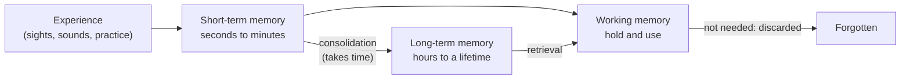

# Chapter 9: Learning, Memory, and Neuroplasticity

## Summary

Every time you learn something, your brain physically changes. This chapter explains what memory is, how short-term, working, and long-term memory differ, and why the hippocampus is needed to form new memories of facts and events but not new skills. You will see how synapses grow stronger through Hebbian learning and long-term potentiation, and how Eric Kandel used the sea slug *Aplysia* to watch learning happen at a single synapse. The chapter ends with Patient H.M., the man whose surgery in 1953 taught science that memory is not one thing.

## Concepts Covered

1. Learning
2. Memory
3. Short-Term Memory
4. Working Memory
5. Long-Term Memory
6. Declarative Memory
7. Procedural Memory
8. Hippocampus
9. Memory Consolidation
10. Neuroplasticity
11. Hebbian Learning
12. Long-Term Potentiation
13. Habituation and Sensitization
14. Aplysia Model
15. Amnesia
16. Patient H.M.

## Prerequisites

- [Chapter 1: Neurons, Glia, and the Nervous System](../01-neurons-and-glia/index.md)
- [Chapter 2: The Action Potential](../02-action-potential/index.md)
- [Chapter 3: Synapses and Neurotransmitters](../03-synapses-and-neurotransmitters/index.md)
- [Chapter 4: A Tour of the Brain: Neuroanatomy](../04-neuroanatomy/index.md)

!!! mascot-welcome "Welcome to my favorite chapter"
    { class="mascot-admonition-img" }
    This is the chapter where my family gets famous! Scientists used sea slugs like me to discover how a memory is stored at a synapse. By the end, you'll know why your brain is never quite the same after you learn something, and you'll have better ways to study for your next test.

## 9.1 Maya's Two-Week Problem

Maya's Brain Bee competition is two weeks away. She has a thick stack of flashcards on neuroanatomy, and soccer practice takes up most of her afternoons. Her plan is simple: relax for twelve days, then cram everything into the last two nights. Her older cousin, a nursing student, shakes her head. "Do twenty minutes a day instead," she says. "Same total time. You'll remember way more."

Maya isn't convinced. The total hours are the same, so why would the schedule matter?

Her cousin is right, and the reasons go all the way down to the synapse. In the 1880s, Hermann Ebbinghaus memorized lists of nonsense syllables and tested himself after different delays. He found that forgetting is fast at first and then slows down, a pattern now called the **forgetting curve**. A 2015 study repeated his experiment and got similar results ([Murre & Dros, 2015](https://pmc.ncbi.nlm.nih.gov/articles/PMC4492928/)).

Ebbinghaus also noticed that spreading repetitions out in time works better than bunching them together. A large 2006 review pooled 839 tests of this idea from 317 experiments and confirmed the **spacing effect**: spaced study usually beats cramming for long-term recall ([Cepeda et al., 2006](https://digitalcommons.usf.edu/psy_facpub/1771/)).

By the end of this chapter, you'll be able to explain a leading idea about *why* spacing works, using what happens inside neurons. First, though, we need to pin down what learning and memory are.

## 9.2 Intuition First: Paths Through a Field

Imagine a grassy field between your school and a bus stop. The first person who walks across leaves almost no mark. But if people keep taking the same route, the grass gets trampled, and a path appears. Soon the path is the easiest way across, and people follow it without thinking. If everyone stops using it, the grass slowly grows back.

Your brain works in a similar way. Your neurons are linked by an enormous number of synapses. When a pattern of activity runs through the same connections again and again, those connections change so the pattern is easier to repeat. That's the core idea of this whole chapter.

Now for the scientific words.

- **Learning** is the process by which experience changes the nervous system, and therefore changes later behavior. It includes studying vocabulary, getting used to a noisy room, and practicing a soccer move.
- **Memory** is the information that learning leaves behind, along with the brain's ability to store it and get it back later. Learning is the *walking*; memory is the *path*.

Memory has three basic steps. First, **encoding** turns an experience into a pattern of neural activity. Second, **storage** keeps that information over time. Third, **retrieval** brings it back when you need it. A failure at any step feels like "forgetting," but the cause can be very different.

## 9.3 Memory Comes in Stages

Not all memories last the same amount of time. Psychologists and neuroscientists sort them by how long they last.

**Short-term memory** holds a small amount of information for seconds to a few minutes. When a friend tells you a phone code and you repeat it until you type it in, you are using short-term memory. If you get distracted, it's usually gone.

**Working memory** is a special kind of short-term memory that you actively *use*, not just hold. Think of it as the brain's mental whiteboard. When Maya does a math problem in her head, she keeps the numbers on the whiteboard, works with them, and erases them when she's done. Working memory depends on networks in the cerebral cortex, including the frontal and parietal lobes ([OpenStax, Section 18.1](https://openstax.org/books/introduction-behavioral-neuroscience/pages/18-1-memory-is-classified-based-on-time-course-and-type-of-information-stored)). What sets it apart is that information is thrown away once it's no longer needed. You don't need to remember where you parked last Tuesday, only where you parked today.

**Long-term memory** stores information for hours, days, or a lifetime. Your first day of high school, the rules of soccer, and how to ride a bike are all long-term memories.

How does a fragile short-term memory become a lasting long-term one? Through **memory consolidation**: the gradual process that turns new, easily disrupted memories into stable, long-lasting ones. Consolidation takes time. Right after learning, a memory can be weakened or lost. As consolidation goes on, the memory becomes much harder to disrupt. Emotion matters too. Stress hormones released right after an event can strengthen consolidation, which is one reason emotional moments are often remembered vividly (OpenStax, Section 18.1).

The flowchart below shows how information moves through these stages. Every term in it has already been defined above.

Notice the arrow from long-term memory back to working memory. When you remember something, you pull it out of storage and into your mental whiteboard so you can use it.

## 9.4 Two Big Families of Long-Term Memory

Long-term memory is not one single system. It splits into two big families that depend on different brain regions.

**Declarative memory** is memory you can consciously bring to mind and *declare*, or put into words. It answers "what" questions. It has two types:

- **Episodic memory** holds personal events tied to a time and place, like Maya's last birthday party.
- **Semantic memory** holds facts and general knowledge, like "the hippocampus is in the temporal lobe."

**Procedural memory** is memory for skills and habits. It answers "how" questions: how to dribble a ball, type on a keyboard, or tie your shoes. It builds up slowly with practice, and it's hard to explain in words. Try describing exactly how you keep your balance on a bike. You can do it, but you can't easily *say* it.

Procedural memory is the best-known member of a wider family that scientists call **nondeclarative memory**: memory that shows up in what you *do* rather than in what you can report. Besides skills and habits, this family includes simple conditioning, emotional learning, and *priming*, where seeing something once makes it easier to recognize later even if you don't remember seeing it ([Squire, 2009](https://pmc.ncbi.nlm.nih.gov/articles/PMC2649674/)). This chapter focuses on procedural memory because it gives the clearest contrast with declarative memory.

The table below summarizes the two families you just met.

| Feature | Declarative memory | Procedural memory |
|---|---|---|
| Question it answers | "What?" (facts and events) | "How?" (skills and habits) |
| Can you put it into words? | Yes | Not easily |
| How it's learned | Can form after a single experience | Usually needs repeated practice |
| Example | Remembering that dopamine is a neurotransmitter | Getting faster at a video game |
| Key brain regions | Hippocampus and nearby medial temporal lobe, plus cortex for long-term storage | Basal ganglia and cerebellum, among others |

The brain-region row comes from decades of patient and animal studies, summarized in [Squire (2009)](https://pmc.ncbi.nlm.nih.gov/articles/PMC2649674/). You'll see where that evidence came from in Section 9.6.

## 9.5 The Hippocampus: Memory's Librarian

The **hippocampus** is a curved structure tucked inside the medial (inner) part of each temporal lobe. You have two, one on each side of the brain. Its name comes from the Greek word for "seahorse," because of its curled shape. It was one of the deep structures on the brain tour in [Chapter 4](../04-neuroanatomy/index.md).

The hippocampus is essential for *forming* new declarative memories. Think of it as a librarian who receives a new book (an experience), catalogs it, and links it to related books on shelves all over the library (the cortex). Over months and years, those links in the cortex become strong enough to stand on their own. That's why damage to the hippocampus mostly harms *new* memories while many old memories survive. This slow handoff from the hippocampus to the cortex is one form of memory consolidation.

The hippocampus also helps with spatial memory, meaning memory for places and routes. A famous study used MRI to compare licensed London taxi drivers, who must learn the city's tangled streets, with people who didn't drive taxis. The back (posterior) part of the hippocampus was larger in the taxi drivers, and its size was related to how long they had been driving ([Maguire et al., 2000](https://pmc.ncbi.nlm.nih.gov/articles/PMC18253/)). At the same time, a front part of the hippocampus was *smaller* in the drivers. The study suggests that adult brains can change their structure in response to what we ask them to do. Because it compares groups at one point in time, though, it can't prove by itself that driving *caused* the change.

!!! mascot-warning "The hippocampus is not a hard drive"
    { class="mascot-admonition-img" }
    A common mistake is saying "memories are stored in the hippocampus." The hippocampus is needed to *form* new memories of facts and events, but long-term declarative memories end up spread across the cortex. Skills rely mostly on other regions, like the basal ganglia and cerebellum.

## 9.6 Amnesia and the Lessons of Patient H.M.

**Amnesia** is a serious loss of memory caused by brain injury, disease, or (rarely) psychological trauma. Doctors describe two main kinds, based on time:

- **Anterograde amnesia** is trouble forming *new* memories after the injury. ("Antero" means forward.)
- **Retrograde amnesia** is loss of memories from *before* the injury. ("Retro" means backward.)

Many people with amnesia have some of both. Unlike in movies, a person with amnesia usually still knows who they are and can hold a conversation.

The most famous case of amnesia in history is **Patient H.M.**, whose real name, Henry Molaison, was made public after he died in 2008. In 1953, at age 27, Henry had severe epilepsy that high doses of medication could not control. His seizures made it impossible for him to work. A neurosurgeon named William Scoville, in Hartford, Connecticut, removed the medial part of the temporal lobe on *both* sides of his brain. This is called a bilateral medial temporal lobe resection. By the surgeon's description, it included much of the hippocampus, the amygdala, and nearby cortex ([Squire, 2009](https://pmc.ncbi.nlm.nih.gov/articles/PMC2649674/)).

The operation helped control his seizures, but it left him with severe anterograde amnesia. The psychologist **Brenda Milner** traveled from Montreal to test him. She and Scoville published the results in 1957 ([Scoville & Milner, 1957](https://pmc.ncbi.nlm.nih.gov/articles/PMC497229/)). H.M. was studied by Milner, her student Suzanne Corkin, and many others for about five decades. What they found reshaped neuroscience:

1. **Memory is its own brain function.** H.M.'s intelligence, personality, language, and perception seemed largely intact. Before his case, many scientists thought memory was spread evenly through the cortex and mixed in with other abilities. H.M. showed that forming new memories depends on specific structures.
2. **Short-term memory is separate from long-term memory.** H.M. could repeat back a string of six or seven digits, a normal score. He could keep a number in mind for a while by rehearsing it over and over. But once his attention moved to something else, the information was gone ([Squire, 2009](https://pmc.ncbi.nlm.nih.gov/articles/PMC2649674/)).
3. **Old memories can survive.** H.M. recognized famous people who were in the news before his surgery much better than those who became famous after it. Some memories from the years just before surgery were lost, so he also had some retrograde amnesia.
4. **Procedural memory is separate from declarative memory.** This was the most surprising finding. Milner asked H.M. to trace a star while seeing his hand and the paper only in a mirror. That is hard for anyone at first, because the mirror flips every movement. Over three days of practice, H.M. got steadily better, just like healthy people do. Yet each day he had no memory of ever doing the task before ([Squire, 2009](https://pmc.ncbi.nlm.nih.gov/articles/PMC2649674/)).

That mirror-drawing result showed that a person can learn a skill without remembering the learning. The brain has more than one memory system.

!!! mascot-thinking "One man, two memory systems"
    { class="mascot-admonition-img" }
    H.M. got better and better at mirror drawing but couldn't remember practicing it. His procedural memory worked while his declarative memory for new events did not. That's strong evidence that the brain uses separate systems for "knowing that" and "knowing how."

One more point keeps the story accurate. Because H.M.'s surgery removed several structures, his case alone could not show that the hippocampus *by itself* is the key. Later studies of patients and animals with smaller lesions showed that the hippocampus and the cortex around it form a medial temporal lobe memory system. Damage limited to the hippocampus causes real but milder memory loss than H.M. had (Squire, 2009). You'll see H.M. again at the bedside at the end of this chapter.

## 9.7 Neuroplasticity: The Brain That Changes

So far, we've talked about *where* memories form. Now we ask *how*. The answer is neuroplasticity.

**Neuroplasticity** (or just "plasticity") is the nervous system's ability to change its structure and function in response to experience. "Plastic" here means moldable, like clay, not the material water bottles are made of. Plasticity happens at several levels:

- **Synapses** can become stronger or weaker.
- **Neurons** can grow new branches and new synapses, or lose old ones.
- **Brain regions** can change size or take on new jobs, as in the taxi-driver study.

Plasticity is strongest early in life (you read about synaptic pruning in [Chapter 8](../08-developing-teenage-brain/index.md)), but it continues throughout adulthood. Every new memory is a small act of plasticity.

## 9.8 Hebbian Learning: Firing Together

In 1949, the psychologist Donald Hebb proposed an idea in his book *The Organization of Behavior*. If neuron A repeatedly helps make neuron B fire, he suggested, the connection from A to B should grow stronger. This rule is called **Hebbian learning**. It's often summed up as "neurons that fire together, wire together." That catchy phrase came later from other scientists, not from Hebb himself, but it captures his idea.

In the field analogy, each time two connected neurons are active together, the path between them gets a little more worn in. Hebbian learning explains how memories can link things together. If you always hear a song during summer road trips, the neurons that represent the song and the neurons that represent the trips are active at the same time. Their connections strengthen. Later, the song alone can bring back the memories of the trips.

Hebb's rule was a smart guess. For about 25 years, nobody had direct proof that real synapses behave this way.

## 9.9 Long-Term Potentiation: Hebb's Idea in a Real Brain

In 1973, Timothy Bliss and Terje Lømo reported the evidence. Working with anesthetized rabbits, they stimulated a bundle of axons, called the perforant path, that carries signals into a part of the hippocampus called the dentate gyrus. Then they gave a burst of high-frequency stimulation. Afterward, the same single test pulse produced a bigger response in the dentate gyrus than before. In most of their animals, the boost lasted from 30 minutes to 10 hours ([Bliss & Lømo, 1973](https://pmc.ncbi.nlm.nih.gov/articles/PMC1350458/)). Later experiments showed that it can last for weeks.

This lasting boost in synaptic strength after intense activity is called **long-term potentiation (LTP)**. "Potentiation" just means "made stronger." The opposite process, a long-lasting *weakening* of a synapse, is called **long-term depression (LTD)**. Both are needed: a brain that could only strengthen synapses would eventually fill up and lose flexibility (OpenStax, [Section 18.4](https://openstax.org/books/introduction-behavioral-neuroscience/pages/18-4-synaptic-mechanisms-of-long-term-memory)).

### How LTP works: a lock that needs two keys

To understand LTP, recall from [Chapter 3](../03-synapses-and-neurotransmitters/index.md) that **glutamate** is the brain's main excitatory neurotransmitter. At many synapses in the hippocampus, glutamate acts on two kinds of receptors on the receiving (postsynaptic) neuron:

- **AMPA receptors** are channels that open when glutamate binds. They let in sodium ions and depolarize (excite) the cell. They do most of the everyday signaling.
- **NMDA receptors** are channels that also bind glutamate, but at resting voltage their pore is plugged by a magnesium ion. The plug only pops out when the cell is *already* strongly depolarized. When NMDA receptors do open, they let in calcium ions as well as sodium.

That means an NMDA receptor is like a lock that needs two keys at the same time: glutamate from the sending neuron *and* strong depolarization of the receiving neuron. Scientists call this a **coincidence detector**. It's Hebb's rule built out of a protein: the synapse is strengthened only when the sending neuron fires *and* the receiving neuron is strongly active at the same time.

Here is the sequence, step by step:

1. A strong burst of activity releases lots of glutamate.
2. Many AMPA receptors open, and the postsynaptic neuron depolarizes strongly.
3. The depolarization pops the magnesium plug out of the NMDA receptors.
4. Calcium flows in through the NMDA receptors.
5. Calcium switches on enzymes, including one called CaMKII. These enzymes make existing AMPA receptors work better and add new AMPA receptors to the membrane.
6. With more and better AMPA receptors, the same amount of glutamate now produces a bigger response. The synapse has been potentiated.

This first stage is called **early LTP**. It lasts a few hours and uses proteins already present in the synapse. A longer-lasting stage, **late LTP**, needs the neuron to make *new* proteins, and it can involve growing new synaptic connections, such as new dendritic spines (OpenStax, Section 18.4). Hold on to that idea. You'll see it again in the sea slug.

!!! mascot-encourage "This part is dense, and that's okay"
    { class="mascot-admonition-img" }
    If the NMDA receptor feels confusing, just remember the two-key lock: glutamate *and* a strongly excited receiving cell. Everything else in LTP follows from that one clever trick.

Does LTP really underlie memory? The evidence is strong but still being tested. In rats, drugs that block NMDA receptors interfere with some kinds of learning. In 2006, researchers also showed that a single learning experience (rats learning to avoid a mild shock) produced the same synaptic changes in the hippocampus as LTP made in the lab ([Whitlock et al., 2006](https://pubmed.ncbi.nlm.nih.gov/16931756/)). Most neuroscientists think changes in synaptic strength like LTP and LTD are a central mechanism of memory, but the full link is still an active research question (OpenStax, Section 18.4).

## 9.10 The Aplysia Model: Learning in a Sea Slug

The human brain has billions of neurons, far too many to track the change behind a single memory. The neuroscientist **Eric Kandel** decided to study learning in a much simpler animal: the sea slug *Aplysia*. According to the Nobel committee, *Aplysia* has only around 20,000 nerve cells, many of them unusually large and easy to record from ([Nobel Prize press release, 2000](https://www.nobelprize.org/prizes/medicine/2000/press-release/)). (Some textbooks give a lower estimate, about 10,000.) Using a simple animal to discover rules that also apply to humans is called the **Aplysia model**, and it's a classic example of how basic research works.

*Aplysia* breathes through a delicate **gill**. Behind the gill is a fleshy spout called the **siphon**. If you gently touch the siphon, the slug quickly pulls its gill in for protection. This is the **gill-withdrawal reflex**. The circuit behind it is small enough to map neuron by neuron:

- A **sensory neuron** in the siphon detects the touch.
- It connects directly to a **motor neuron** that makes the gill muscle contract.
- A shock to the tail activates other sensory neurons, which drive **facilitating interneurons**. The most important of these release the neurotransmitter **serotonin** (5-HT) onto the terminal of the siphon sensory neuron ([Kandel, 2012](https://pmc.ncbi.nlm.nih.gov/articles/PMC3514210/)).

### Two simple kinds of learning

With this reflex, Kandel's team studied two of the simplest forms of learning. Neither one links two different things together; both simply change how strongly an animal responds. Together they are called **habituation and sensitization**.

**Habituation** is a decrease in response to a harmless stimulus that is repeated over and over. You do this all the time. When you first sit near a loud air conditioner, you notice it. After a while, you stop hearing it. When the siphon is touched again and again, the slug's gill withdrawal gets smaller and smaller. Kandel's group showed that the cause is not a tired muscle or a worn-out sense organ. Instead, the siphon sensory neuron releases *less neurotransmitter* onto the motor neuron with each touch. The synapse itself weakens ([Kandel, 2012](https://pmc.ncbi.nlm.nih.gov/articles/PMC3514210/)). After a rest, a habituated response gradually comes back.

**Sensitization** is an *increase* in response to many stimuli after a strong or unpleasant one. After a scary movie, you might jump at the smallest creak in the house. In *Aplysia*, a shock to the tail makes the gill pull in harder when the siphon is touched later, even though the siphon touch hasn't changed. It works like this. The tail shock activates the facilitating interneurons, which release serotonin onto the siphon sensory neuron's terminal. Serotonin triggers a chain of chemical signals inside that terminal, using a messenger called cAMP and an enzyme called protein kinase A. The result is that the sensory neuron releases *more* transmitter with each action potential, so the motor neuron gets a bigger signal (Kandel, 2012). When sensitization restores a response that had been habituated, it's called **dishabituation**.

Notice that the same synapse can be weakened by one kind of experience and strengthened by another. The synapse is where the learning lives.

#### Diagram: Aplysia Habituation and Sensitization

<iframe src="../../sims/ch09-aplysia-learning/main.html" height="532px" width="100%" scrolling="no"></iframe>

[Open the Aplysia Habituation and Sensitization MicroSim fullscreen](../../sims/ch09-aplysia-learning/main.html){ .md-button .md-button--primary }

MicroSim specification: Aplysia Habituation and Sensitization

**sim-id:** ch09-aplysia-learning 
**Library:** p5.js 
**Status:** Implemented 
**Bloom Level:** Understand 
**Bloom Verb:** explain 
**Learning Objective:** The learner will explain how repeated siphon touches and a tail shock change the strength of the sensory-to-motor synapse, producing habituation or sensitization of the gill-withdrawal reflex.

**Canvas:** responsive width; 480 px drawing area plus 50 px control area.

**Controls:** buttons for Touch siphon, Shock tail, Rest, and Reset.

**Behavior:** Each siphon touch records a response bar equal to 100 times the current synaptic strength (arbitrary units) and then depresses the synapse (habituation). A tail shock raises a serotonin facilitation factor and partly restores a depressed synapse, so later touches give larger, orange bars (sensitization and dishabituation). Rest recovers half of the remaining habituation and removes half of the remaining facilitation. The side view shows the gill pulling in by an amount that matches the response. The circuit panel shows the siphon sensory neuron, motor neuron, tail sensory neuron, and serotonin interneuron, with a synaptic-strength meter. Labeled as a simplified, qualitative model.

Try this in the sim. Touch the siphon six or seven times and watch the bars shrink while the synapse-strength meter falls below 1.0. That's habituation. Now shock the tail and touch again. The next bar jumps up and turns orange, because serotonin has boosted transmitter release from the sensory neuron. Press **Rest**, test again, and see the partial recovery.

Then press **Reset** and shock the tail *before* any touches. The first response is bigger than the baseline of 100. In each case, ask yourself: did the siphon touch change, or did the synapse change? The numbers are arbitrary and show direction only.

### From short-term to long-term memory in a slug

Kandel's team found that *Aplysia* has both short-term and long-term memory, just like we do.

- A **single** tail shock produces sensitization that lasts minutes. This short-term memory uses chemical changes to proteins that are already in the synapse.
- **Repeated, spaced** shocks produce sensitization that lasts days to weeks. This long-term memory needs the neuron to switch on genes and build *new proteins*. If protein synthesis is blocked, the long-term change fails, but the short-term change still works ([Kandel, 2012](https://pmc.ncbi.nlm.nih.gov/articles/PMC3514210/); [Nobel press release, 2000](https://www.nobelprize.org/prizes/medicine/2000/press-release/)).

Long-term memory also changes the *structure* of the synapse. After long-term habituation, sensory neurons had about 35 percent fewer connections onto their target cells than in untrained animals. After long-term sensitization, the number of sensory-neuron terminals more than doubled ([Kandel, 2012](https://pmc.ncbi.nlm.nih.gov/articles/PMC3514210/)). Learning literally rewires the circuit.

This should sound familiar. Short-term memory in the slug works like early LTP (modify existing proteins). Long-term memory in the slug works like late LTP (make new proteins, grow new connections). The same basic rules show up in sea slugs and in the mammalian hippocampus.

For this work, Eric Kandel shared the **2000 Nobel Prize in Physiology or Medicine** with Arvid Carlsson and Paul Greengard "for their discoveries concerning signal transduction in the nervous system." The Nobel committee credited Kandel with showing how the strength of synapses can be changed and which molecules are involved, using the sea slug's nervous system ([Nobel Prize press release, 2000](https://www.nobelprize.org/prizes/medicine/2000/press-release/)). Kandel's Nobel lecture was titled "The Molecular Biology of Memory Storage: A Dialog between Genes and Synapses" ([Nobel lecture page](https://www.nobelprize.org/prizes/medicine/2000/kandel/lecture/)).

## 9.11 Back to Maya: Why Spacing Beats Cramming

Now we can answer Maya's question. Remember the key finding from the sea slug: a single training session produces a short-term change, but **repeated, spaced** sessions switch on new protein synthesis and the growth of new connections. The same holds for many animals. A 2016 review found that spaced training produces stronger long-term memory than massed (crammed) training in *Aplysia*, fruit flies, bees, rodents, and monkeys, as well as people ([Smolen, Zhang & Byrne, 2016](https://pmc.ncbi.nlm.nih.gov/articles/PMC5126970/)). Researchers are still working out exactly why, but one idea is that the molecular steps that build long-term memory need time between sessions to finish and reset.

Cramming feels effective because the information is fresh the next morning, but much of it slides down the steep early part of the forgetting curve. Spaced study gives your synapses repeated chances to consolidate. Here's Maya's new plan:

| Study habit | What it does in the brain | Maya's version |
|---|---|---|
| Space it out | Gives consolidation time between sessions | 20 minutes of flashcards every day for two weeks |
| Test yourself | Practices retrieval. On tests given days later, it beat re-reading, even though re-reading looked better on a test given 5 minutes later ([Roediger & Karpicke, 2006](https://profiles.wustl.edu/en/publications/test-enhanced-learning-taking-memory-tests-improves-long-term-ret/)) | Says answers out loud before flipping the card |
| Mix in meaning | Links new facts to existing memories (Hebbian connections) | Connects "hippocampus" to H.M.'s story instead of just the word |
| Practice skills often | Builds procedural memory through repetition | Uses short daily sessions to label brain diagrams |

!!! mascot-tip "Study like a sea slug"
    { class="mascot-admonition-img" }
    Five short sessions spread over a week usually beat one five-hour marathon. In sea slugs like me, spacing gives synapses time to build the new proteins that long-term memory needs, and scientists think something similar may happen in you.

## At the Bedside: Patient H.M. and Anterograde Amnesia

This bedside case is different from the others in this book. It describes a real, well-documented historical patient. The clinical reasoning below is written for teaching. It shows how the case would be understood with today's knowledge.

!!! note "Meet the patient"
    In 1953, Henry Molaison is 27 years old and lives in Connecticut. He has had seizures since childhood, and they have become so frequent and severe that he can't hold a job, even on high doses of anti-seizure medicine. After an experimental operation on both sides of his brain, his seizures are much better controlled. But his family and the hospital staff notice something alarming. He doesn't recognize hospital staff he has seen many times. He apologizes for forgetting the names of people he was introduced to minutes ago, and he forgets each day's events almost as fast as they happen. Yet he can chat normally, his personality seems unchanged, and he does well on intelligence tests.

**What the doctor checks:** A neurologist or neuropsychologist would test several kinds of memory separately. A digit-span test (repeating back a list of numbers) checks short-term memory; H.M. did normally. Delayed recall, such as remembering a short story or a list of words after 20 minutes of distraction, checks the formation of new declarative memories; H.M. failed. Questions about public events and famous faces from different decades check older memories. Skill-learning tasks like mirror drawing check procedural memory; H.M. improved normally. Today, an MRI scan would show exactly which structures were missing. Doctors evaluating memory loss also commonly use cognitive testing, blood tests, and brain imaging to look for causes ([MedlinePlus](https://medlineplus.gov/ency/article/003257.htm)).

**Where is the problem? (localization):** The pattern points to a specific system. Attention, language, and short-term memory work, so the cortex as a whole is functioning. Skill learning works, so the basal ganglia and cerebellum are fine. Older memories are mostly present, so long-term storage in the cortex is largely intact. What's broken is the step that turns new experiences into lasting declarative memories. That step depends on the hippocampus and the surrounding medial temporal lobe on *both* sides. The surgery removed exactly that region.

**Diagnosis:** Severe anterograde amnesia, with some retrograde amnesia for the years just before the operation, caused by bilateral medial temporal lobe resection.

**Why it happens:** Without the hippocampus and nearby cortex on both sides, new information can stay in short-term or working memory but can't be consolidated into long-term declarative memory. Because procedural memory relies on different circuits, H.M. could still learn new motor skills without remembering that he had practiced them.

**Treatment today:** There is no treatment that can regrow a removed hippocampus. Care for memory loss depends on the cause, and support focuses on daily life: written reminders for important tasks, familiar objects and photos, and help from family and caregivers ([MedlinePlus](https://medlineplus.gov/ency/article/003257.htm)).

H.M.'s case showed how much memory can be lost when the medial temporal lobes are removed on both sides, and epilepsy surgery is planned very differently today. According to the National Institute of Neurological Disorders and Stroke (NINDS), surgery is usually considered only after at least two seizure medicines have failed, surgeons try to avoid brain areas needed for memory, speech, and movement, and less invasive options now include laser ablation and implanted responsive-stimulation devices ([NINDS: Epilepsy and Seizures](https://www.ninds.nih.gov/health-information/disorders/epilepsy-and-seizures)).

**What's new in research:** After Henry Molaison died on December 2, 2008, his brain was preserved and sliced into thin sections for study. In 2014, a team led by Jacopo Annese published a detailed 3D digital reconstruction built from 2,401 images collected during a 53-hour sectioning procedure. They found that a sizable piece of the back part of his hippocampus had actually survived the operation, while most of the entorhinal cortex, which feeds information into the hippocampus, had been removed. They also found a small lesion in the left orbitofrontal cortex and changes in the white matter ([Annese et al., 2014](https://www.nature.com/articles/ncomms4122)). These details help scientists interpret five decades of testing.

??? question "Your turn: diagnose a variation"
    A 60-year-old woman has a stroke that damages her cerebellum. Months later, she can tell you what she had for breakfast and describe the details of her hospital stay. But in physical therapy, she improves much more slowly than expected at a new balance exercise, even after weeks of practice. Which memory system is most affected, and how is she the "opposite" of H.M.?

    **Answer:** Her declarative memory (remembering events and facts) works, so her hippocampus is doing its job. Her trouble is learning a new motor skill, which is procedural memory. The cerebellum is one of the structures important for procedural learning. She is roughly the reverse of H.M., who could learn skills but couldn't remember new events. Comparing patients like this is how neuroscientists show that two brain systems are truly separate.

*H.M. was a real, historical patient whose case is documented in the published scientific literature; the "Your turn" variation is a fictional teaching case. This is not medical advice. If you or someone you know has symptoms like these, talk to a doctor.*

## Common Misconceptions

**Myth:** Memory works like a video recording that plays back exactly what happened.  
**Reality:** Remembering is an active rebuilding process. Each time you recall a memory, it can be changed and then stored again, a process called reconsolidation (OpenStax, [Section 18.1](https://openstax.org/books/introduction-behavioral-neuroscience/pages/18-1-memory-is-classified-based-on-time-course-and-type-of-information-stored)). That's why two people can honestly remember the same event differently, and why confident memories can still be wrong.

**Myth:** Everyone has a learning style (visual, auditory, or kinesthetic), and you learn best when teaching matches your style.  
**Reality:** People do have preferences, but a major 2008 review found virtually no evidence that matching teaching to a person's "style" improves learning ([Pashler et al., 2008](https://digitalcommons.usf.edu/psy_facpub/1765/)). Strategies like spacing and self-testing help nearly everyone.

**Myth:** Cramming works just as well as spacing if the total study time is the same.  
**Reality:** Cramming can get you through tomorrow's quiz, but spaced practice leads to much better long-term memory. The spacing effect holds across hundreds of experiments ([Cepeda et al., 2006](https://digitalcommons.usf.edu/psy_facpub/1771/)).

**Myth:** The adult brain is fixed, and only children's brains can change.  
**Reality:** Plasticity is strongest early in life, but it continues in adults. Every new long-term memory changes synapses, and adult brain structure can differ with experience, as in London taxi drivers ([Maguire et al., 2000](https://pmc.ncbi.nlm.nih.gov/articles/PMC18253/)).

**Myth:** H.M. couldn't learn anything after his surgery.  
**Reality:** H.M. could not form new declarative memories, but he learned new motor skills such as mirror drawing at a normal rate. He just couldn't remember the practice sessions.

## Brain Bee Practice

??? question "1. What is the difference between anterograde and retrograde amnesia?"
    Anterograde amnesia is an inability to form new memories after a brain injury. Retrograde amnesia is the loss of memories formed before the injury. Patient H.M. had severe anterograde amnesia and some retrograde amnesia.

??? question "2. Which receptor acts as a coincidence detector during long-term potentiation, and why?"
    The NMDA glutamate receptor. It opens only when glutamate is bound *and* the postsynaptic cell is strongly depolarized, which removes the magnesium block from its pore. Calcium then enters and triggers the strengthening of the synapse.

??? question "3. In Aplysia, which neurotransmitter released by facilitating interneurons produces sensitization of the gill-withdrawal reflex?"
    Serotonin (5-HT). A tail shock activates interneurons that release serotonin onto the siphon sensory neuron's terminal. This increases transmitter release onto the gill motor neuron.

??? question "4. What task showed that Patient H.M. could still form procedural memories?"
    Mirror drawing. Brenda Milner had him trace a star while seeing only its reflection in a mirror. He improved over three days of practice but did not remember having done the task before.

??? question "5. Who shared the 2000 Nobel Prize in Physiology or Medicine with Eric Kandel?"
    Arvid Carlsson and Paul Greengard. The prize recognized their discoveries about signal transduction in the nervous system. Kandel's part was showing how synapses change during learning and memory, using *Aplysia*.

## Exercises

### Remember

1. Define *memory consolidation* in one sentence.
2. Name the two main types of declarative memory and give an example of each.

??? note "Answer"
    1. Memory consolidation is the gradual process that turns new, fragile memories into stable long-term memories.
    2. Episodic memory (a personal event, like your last birthday) and semantic memory (a fact, like "glutamate is excitatory").

### Understand

3. Explain why habituation in *Aplysia* is considered learning and not just muscle fatigue.
4. Explain, in your own words, how Hebbian learning could make a song remind you of a summer trip.

??? note "Answer"
    3. Kandel's group showed the change happens at the synapse between the sensory neuron and the motor neuron, which releases less transmitter with each touch. The muscle and sense organ still work, and a tail shock can bring the response right back (dishabituation), which fatigue would not explain.
    4. During the trip, neurons representing the song and neurons representing the trip are active at the same time, so the connections between them strengthen. Later, activating the "song" neurons is enough to activate the "trip" neurons.

### Apply

5. A new student moves next to a train track. At first, every train wakes her up. After two weeks, she sleeps through them. One night a smoke alarm goes off, and afterward she wakes up at the next train. Name the type of learning shown in each part of this story.
6. Using what you learned about the spacing effect and late LTP, design a two-week study schedule for a 40-word vocabulary list. Explain why your schedule should work better than studying the night before.

### Analyze

7. Compare early LTP in the hippocampus with short-term sensitization in *Aplysia*. What is similar, and what is different?
8. H.M. could not form new declarative memories, but many of his older memories survived. What does this tell you about where long-term declarative memories are stored, compared with where they are formed?

### Evaluate

9. A company advertises an app that "identifies your learning style so you can study the way your brain prefers." Using evidence from this chapter, judge whether a student should pay for it.
10. H.M.'s surgery was an experiment that caused permanent harm, yet it led to major discoveries. Today, surgeons would not do this operation. Evaluate how modern epilepsy surgery has changed because of what was learned.

### Create

11. Design a simple experiment, using classmates as volunteers, to test whether spaced study beats cramming. Name your two groups, what they study, how you will measure memory, and what result would support the spacing effect.
12. Create a one-page comic strip in which a single synapse "narrates" what happens to it during habituation, sensitization, and long-term memory formation in *Aplysia*. Include serotonin, transmitter release, and new protein synthesis.

## Key Takeaways

- **Learning** changes the nervous system; **memory** is what that change stores. Memories move from short-term and working memory into long-term memory through **consolidation**.
- Long-term memory has separate systems: **declarative memory** (facts and events) depends on the **hippocampus** and medial temporal lobe to form, while **procedural memory** (skills) relies on other circuits like the basal ganglia and cerebellum.
- **Patient H.M.** lost the ability to form new declarative memories after both medial temporal lobes were removed in 1953, but he could still learn motor skills. His case showed that memory is a distinct brain function with several systems.
- **Neuroplasticity** means the brain changes with experience at every age. **Hebbian learning** proposes that connections strengthen when neurons are active together.
- **Long-term potentiation** is a lasting increase in synaptic strength. NMDA receptors act as coincidence detectors, letting in calcium that adds and boosts AMPA receptors.
- In the **Aplysia model**, **habituation** weakens and **sensitization** strengthens the same sensory-to-motor synapse. Long-term memory there needs new proteins and new synaptic connections, work recognized with Kandel's 2000 Nobel Prize.
- Spaced practice usually beats cramming for long-term memory. A leading explanation, best shown in animals like *Aplysia*, is that lasting synaptic changes need time and repeated activation to build.

!!! mascot-celebration "You just rewired your brain!"
    { class="mascot-admonition-img" }
    Every big idea starts at a single synapse, and reading this chapter changed some of yours! Come back in a few days to make those changes last. Next, in Chapter 10, we'll look at sleep and how it connects to memory.
