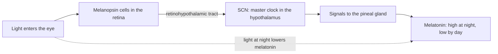

# Chapter 10: Sleep and Brain States

## Summary

Every night your brain moves through a predictable series of states, from relaxed waking to light sleep, deep slow-wave sleep, and dreaming REM sleep. This chapter explains how scientists read those states with the EEG, how a master clock in the hypothalamus times them, and why sleep matters for memory, mood, and safety. You'll see why teenagers need 8 to 10 hours of sleep and why so few get it. Finally, you'll meet a teen with narcolepsy and learn how the loss of a small group of orexin neurons can make the boundary between waking and sleep fall apart.

## Concepts Covered

1. Consciousness
2. Circadian Rhythm
3. Suprachiasmatic Nucleus
4. Melatonin
5. Sleep Stages
6. NREM Sleep
7. REM Sleep
8. Electroencephalogram (EEG)
9. Brain Waves
10. Sleep and Memory
11. Teen Sleep Needs
12. Sleep Deprivation
13. Narcolepsy
14. Orexin (Hypocretin)

## Prerequisites

- [Chapter 1: Neurons, Glia, and the Nervous System](../01-neurons-and-glia/index.md)
- [Chapter 2: The Action Potential](../02-action-potential/index.md)
- [Chapter 3: Synapses and Neurotransmitters](../03-synapses-and-neurotransmitters/index.md)
- [Chapter 4: A Tour of the Brain: Neuroanatomy](../04-neuroanatomy/index.md)
- [Chapter 9: Learning, Memory, and Neuroplasticity](../09-learning-memory-plasticity/index.md)

!!! mascot-welcome "Welcome to the night shift"
    { class="mascot-admonition-img" }
    I'm a sea slug, and even I have daily rhythms of rest and activity. You'll spend about a third of your life asleep, yet most people have no idea what their brain is doing during those hours. By the end of this chapter, you'll be able to read a night of sleep like a doctor reads a chart, and you'll know why your own sleep is worth protecting.

## 10.1 Maya's Six-Hour Nights

It's the middle of Brain Bee season, and Maya has a system. Soccer practice ends at 6, homework fills the evening, and after that she studies neuroanatomy flashcards until about 12:30 a.m. Her alarm goes off at 6:30. That's six hours of sleep on school nights. On Saturdays she sleeps until almost noon, and she figures that evens things out.

Lately, though, something is off. Facts she studied on Tuesday seem to have vanished by Thursday. She snapped at her younger brother over nothing. During a free period she put her head down "for a second" and woke up 20 minutes later. Maya is a smart, careful student, so she asks a fair question: *Is six hours actually a problem, and if so, what exactly is her brain missing?*

To answer her, we need to see what the brain does at night. Sleep is not one thing. It's a sequence of very different brain states, and the last hours before the alarm are not like the first.

## 10.2 Is the Brain Off When You Sleep? Consciousness and Brain States

Think about your school building at night. The halls are dark, but the custodians are cleaning and the computers are backing up. The building isn't off. It's in a different *mode*, doing work that can't happen during class. Your brain at night is a lot like that.

**Consciousness** is your state of awareness of yourself and your surroundings. In medicine, doctors often think about two parts: *arousal* (how awake you are) and *awareness* (what you are experiencing). In deep sleep, both drop. During dreaming, you're hard to wake, but you can still have vivid experiences inside your head.

A **brain state** is an overall pattern of activity across the brain that goes along with a certain level of consciousness. Waking, light sleep, deep sleep, and dreaming sleep are all different brain states. Each has its own electrical signature and chemistry.

The key idea for this chapter: **the brain never shuts off during sleep.** Neurons keep firing action potentials (you met these in [Chapter 2](../02-action-potential/index.md)). What changes is the *pattern* of firing, which neurons are active, and which neurotransmitters are being released.

## 10.3 Listening to the Brain: The EEG and Brain Waves

### The stadium analogy

Imagine standing outside a packed football stadium with a microphone. If 70,000 fans are all chatting in small groups, your microphone picks up a low, fuzzy hum. You can't make out any single voice, and the sound is small. But if the whole crowd starts chanting together, slowly and in rhythm, your microphone picks up big, rolling waves of sound.

That is almost exactly how a brain recording works. Each neuron is one fan. When millions of cortical neurons are busy with different jobs, their electrical signals partly cancel out, and the recording looks small and fast. When large groups of neurons fire together in a slow rhythm, their signals add up into tall, slow waves.

### What an EEG measures

An **electroencephalogram (EEG)** is a recording of the brain's electrical activity made with small metal disks (electrodes) placed on the scalp. The electrodes don't record single action potentials. Instead, they pick up the combined, mostly synaptic electrical activity of huge numbers of cortical neurons lined up near the surface. (Those synaptic currents come from the receptor channels you studied in [Chapter 3](../03-synapses-and-neurotransmitters/index.md).)

The German psychiatrist Hans Berger recorded the first human EEG in 1924 and published his results in 1929. One of the first patterns he described was a rhythm of about 10 waves per second over the back of the head when a person relaxed with eyes closed. We now call it the alpha rhythm.

In a sleep study, the EEG is combined with sensors for eye movements, muscle tone, and breathing. That full overnight recording is called a **polysomnogram**.

### Brain waves

**Brain waves** are the repeating rhythms that show up in an EEG. Scientists describe them with two measurements:

- **Frequency:** how many waves happen each second, measured in hertz (Hz). Ten waves per second is 10 Hz.
- **Amplitude:** how tall the waves are, measured in microvolts (µV), or millionths of a volt.

Fast, small waves usually mean many neurons are doing different jobs. Slow, tall waves usually mean large groups of neurons are firing together in sync, like the chanting crowd. Now that both terms are defined, here is a summary of the main rhythms you'll meet in this chapter.

| Brain wave | Frequency (approx.) | When you see it |
|---|---|---|
| Beta | faster than about 13 Hz | Alert, eyes open, thinking hard |
| Alpha | about 8 to 13 Hz | Awake and relaxed with eyes closed |
| Theta | about 4 to 7 Hz | Drowsy; N1 sleep |
| Delta (slow waves) | below about 4 Hz; the slow waves that define N3 are 0.5 to 2 Hz and tall (over 75 µV) | Deep N3 sleep |

!!! mascot-thinking "Slow and tall means in sync"
    { class="mascot-admonition-img" }
    Remember this one rule: tall, slow EEG waves mean lots of neurons are firing *together*. That's why deep sleep has the biggest waves of the night, even though you are the least aware you'll ever be.

## 10.4 The Clock Inside: Circadian Rhythms, the SCN, and Melatonin

### A rhythm that keeps time on its own

Most people get sleepy around the same time each night, even without a bedtime rule. That's because your body runs on an internal clock.

A **circadian rhythm** is a cycle in the body or behavior that repeats about once every 24 hours. The word comes from Latin: *circa* ("about") and *dies* ("day"). Body temperature, hormone levels, alertness, and the timing of sleep all follow circadian rhythms.

The "about" matters. When people live in carefully controlled labs with no clues about the time of day, their clocks keep running, but not at exactly 24 hours. A well-known 1999 study found that the human circadian clock runs on an average cycle of about 24.18 hours ([Czeisler and colleagues, *Science*, 1999](https://pubmed.ncbi.nlm.nih.gov/10381883/)). Each day, morning light nudges the clock back into step with the real day. Resetting a biological clock to match the outside world is called *entrainment*.

### The master clock: the suprachiasmatic nucleus

The brain's master clock is the **suprachiasmatic nucleus (SCN)**, a pair of tiny clusters of neurons in the hypothalamus. The name tells you where it sits: *supra* means "above," and the *chiasm* is the optic chiasm, where the two optic nerves cross. (You toured the hypothalamus in [Chapter 4](../04-neuroanatomy/index.md).)

That location is not an accident. The SCN needs to know when it's light outside. A special group of cells in the retina, called *intrinsically photosensitive retinal ganglion cells*, contain a light-sensitive pigment called melanopsin. These cells send signals straight to the SCN along a pathway called the retinohypothalamic tract. Melanopsin is most sensitive to blue light, at about 480 nanometers ([OpenStax, *Introduction to Behavioral Neuroscience*, section 15.2](https://openstax.org/books/introduction-behavioral-neuroscience/pages/15-2-where-are-rhythms-in-the-brain)).

Inside each SCN neuron, "clock genes" keep time with a feedback loop: the proteins CLOCK and BMAL1 turn on the *Per* and *Cry* genes, and the PER and CRY proteins slowly build up and switch CLOCK and BMAL1 back off. One full loop takes about a day.

### Melatonin: the darkness signal

The SCN controls many body rhythms, including the release of a hormone that signals "it's night." **Melatonin** is a hormone made by the pineal gland, a small gland deep in the brain. Melatonin levels are high at night and low during the day. Rising melatonin in the evening helps you feel sleepy as it gets dark ([NINDS, *Brain Basics: Understanding Sleep*](https://www.ninds.nih.gov/health-information/public-education/brain-basics/brain-basics-understanding-sleep)).

Bright light, especially at night, quickly lowers melatonin. That's one reason doctors and scientists talk so much about evening light from rooms and screens.

The flowchart below traces the pathway from light to melatonin that we just described.

### Two forces that time your sleep

The clock is only half the story. Scientists often describe sleep timing with a **two-process model** ([OpenStax, section 15.3](https://openstax.org/books/introduction-behavioral-neuroscience/pages/15-3-regulation-of-sleep)):

- **Process S (sleep pressure):** the longer you stay awake, the stronger your need for sleep becomes. One chemical that builds up during waking is adenosine, which makes you feel sleepy. Caffeine works by blocking adenosine's effects, which is why coffee delays sleepiness without removing the need for sleep.
- **Process C (the circadian clock):** the SCN pushes you toward alertness at some times of day and toward sleep at others, no matter how long you've been awake.

When both forces line up at night, falling asleep is easy. When they fight, as after flying across time zones, sleep gets harder.

## 10.5 A Night in Stages: NREM and REM Sleep

### Sleep is a staircase, not a light switch

Falling asleep is less like flipping a switch and more like walking down a staircase into a basement, then climbing back up to a strange, busy attic, several times a night.

These steps are called **sleep stages**: distinct phases of sleep identified from the EEG, eye movements, and muscle tone. Under the scoring rules of the American Academy of Sleep Medicine (AASM), there are three stages of NREM sleep (N1, N2, and N3) and one stage of REM sleep. (Older books split deep sleep into "stage 3" and "stage 4." The current rules combine them into N3.)

### NREM sleep

**NREM sleep** (non-rapid eye movement sleep) is the part of sleep in which the eyes are mostly still and the EEG slows down step by step. It includes three stages.

- **N1 (falling asleep).** This is the lightest stage and the doorway into sleep. It usually lasts only several minutes. The relaxed alpha rhythm fades and is replaced by slower theta waves of about 4 to 7 Hz.
- **N2 (light sleep).** Two new EEG features appear. **Sleep spindles** are short bursts of fast waves, roughly 12 to 14 Hz, lasting at least half a second. **K-complexes** are single large waves: a sharp swing one way followed by a slower swing the other way. N2 takes up more of the night than any other stage ([NINDS](https://www.ninds.nih.gov/health-information/public-education/brain-basics/brain-basics-understanding-sleep)).
- **N3 (deep or slow-wave sleep).** The EEG fills with tall, slow delta waves of about 0.5 to 2 Hz, over 75 µV in amplitude ([Watson and colleagues, 2013](https://pmc.ncbi.nlm.nih.gov/articles/PMC3875326/)). This is the deepest stage of sleep, and it's the hardest one to wake someone from. Most N3 happens in the first half of the night.

### REM sleep

**REM sleep** (rapid eye movement sleep) is the stage in which the eyes dart back and forth under closed lids, the EEG looks surprisingly like waking, and most of the body's muscles are temporarily paralyzed. It was first described by Eugene Aserinsky and Nathaniel Kleitman in a short 1953 paper in *Science*, after Aserinsky noticed bursts of rapid eye movements in sleeping people.

REM has three features worth remembering:

1. **An "awake-looking" EEG.** The waves are low in amplitude and mixed in frequency. REM often includes runs of *sawtooth waves* (about 2 to 6 Hz), which look like the teeth of a saw.
2. **Rapid eye movements** in bursts.
3. **Muscle atonia**, a near-total loss of muscle tone in the arms and legs. The brainstem actively blocks movement signals so that you don't act out your dreams. Breathing muscles and eye muscles keep working.

Dreams are most vivid in REM, though people can dream in other stages too. Across a night, a person spends about two hours dreaming, even if they remember little of it ([NINDS](https://www.ninds.nih.gov/health-information/public-education/brain-basics/brain-basics-understanding-sleep)).

!!! mascot-encourage "Four stages, one trick"
    { class="mascot-admonition-img" }
    That's a lot of vocabulary, so tie each stage to one picture: N1 is "drifting," N2 is "spindles," N3 is "big slow waves," and REM is "busy brain, frozen body." If you can sketch one wave for each, you're ready for the Brain Bee.

### Cycles across the night

A healthy sleeper goes N1 → N2 → N3 → back up to N2 → REM. That loop is one **sleep cycle**, and it takes about 90 minutes. The first REM period usually begins about 90 minutes after you fall asleep and lasts only about 10 minutes. Later REM periods get longer and can reach about an hour near morning ([OpenStax, section 15.3](https://openstax.org/books/introduction-behavioral-neuroscience/pages/15-3-regulation-of-sleep)).

So the night is lopsided:

- **Early night:** mostly N2 and N3, with short REM periods.
- **Late night:** little or no N3, with mostly N2 and long REM periods.

The table below sums up the four stages you just read about.

| Stage | Type | EEG signature | Body and experience |
|---|---|---|---|
| N1 | NREM | Theta waves (about 4 to 7 Hz) | Drifting off; easy to wake |
| N2 | NREM | Sleep spindles and K-complexes | Light sleep; largest share of the night |
| N3 | NREM | Tall delta waves (about 0.5 to 2 Hz) | Deep sleep; hard to wake; mostly early in the night |
| REM | REM | Low-voltage, mixed, "awake-looking" | Rapid eye movements, vivid dreams, limb muscles paralyzed; longer toward morning |

## 10.6 Building a Hypnogram

A **hypnogram** is a graph of sleep stages across a night. Time runs left to right, and each stage gets its own row, with Wake at the top and N3 at the bottom. Sleep doctors make hypnograms from a polysomnogram.

The MicroSim below shows an illustrative hypnogram for a healthy teenager who sleeps 9 hours. With cycles of about 90 minutes, 9 hours holds roughly five or six cycles. The data are made up to show the typical pattern, not taken from a real person.

#### Diagram: Hypnogram Builder

<iframe src="../../sims/ch10-hypnogram/main.html" height="702px" width="100%" scrolling="no"></iframe>

[Open the Hypnogram Builder fullscreen](../../sims/ch10-hypnogram/main.html){ .md-button .md-button--primary }

MicroSim specification: Hypnogram Builder

Type: microsim
**sim-id:** ch10-hypnogram 
**Library:** p5.js 
**Status:** Implemented 
**Bloom Level:** Analyze 
**Bloom Verb:** interpret 
**Learning Objective:** The learner will interpret a hypnogram to identify each sleep stage by its EEG signature and explain which stages are lost when a 9-hour night is cut to 6 hours.

**Content:** Illustrative (not real) 540-minute teen night, six cycles of about 90 minutes. Totals: REM 135, N2 273, N3 113, N1 15, Wake 4 minutes. N3 only in the first four cycles; REM periods grow from 10 to 35 minutes. Schematic 3-second EEG per stage (alpha 8 to 13 Hz; theta 4 to 7 Hz; spindle about 12 to 14 Hz and K-complex; delta 0.5 to 2 Hz; low-voltage mixed waves with sawtooth waves), labeled "Schematic shape, not a real recording."

**Controls:** "Hours of sleep" slider (4 to 9 h, step 0.5, default 9). "Show EEG for" menu (default N3). "Reset to 9 h" button. Clicking a stage label or hovering over the night also selects a stage.

**Behavior:** Time after the "Alarm" line is grayed out; a readout lists minutes of REM, N2 and N3 kept and lost. At 6.0 h: REM 68 of 135 kept (lost 67, 50%), N2 167 of 273 (lost 106, 39%), N3 113 of 113 (lost 0). Not animated.

**Chapter Anchors:** cycles of about 90 minutes; most N3 in the first half of the night; REM periods longer toward morning; cutting 9 h to 6 h loses about half of REM and almost no N3.

**Try this:**

1. Click each stage name on the left (or use the menu) and compare the EEG traces. Which stage has the tallest, slowest waves? Where do you see a spindle and a K-complex?
2. Hover across the night from left to right. Notice where the N3 "valleys" are and how the red REM bars get longer as morning approaches.
3. Now be Maya. Drag the **Hours of sleep** slider down to **6.0 h**, which is like setting the alarm three hours early.

When you cut the night to 6 hours, almost all of the N3 survives, because deep sleep is packed into the early cycles. But you lose about half of the night's REM sleep (67 of 135 minutes in this example) and more than a third of N2. Short sleep doesn't shave a little off every stage evenly. It chops off the end of the night, where the longest REM periods live. Going to bed later with the same alarm has a similar effect.

## 10.7 Why Sleep? Sleep and Memory

### The librarian analogy

Picture a library. All day, returned books pile up on a small cart by the front desk. After closing, the librarian shelves each book where it belongs, next to related books. By morning the cart is empty and ready for a new day.

In [Chapter 9](../09-learning-memory-plasticity/index.md), you learned that the hippocampus helps form new memories, while long-term storage depends heavily on the cortex. The hippocampus is like the cart, and the cortex is like the shelves. A lot of the sorting happens while you sleep.

### What sleep does for memory

**Sleep and memory** is the research area that studies how sleep strengthens and reorganizes what we learned while awake, a process called *memory consolidation*. Here's what researchers have found so far ([Diekelmann and Born, *Nature Reviews Neuroscience*, 2010](https://pubmed.ncbi.nlm.nih.gov/20046194/); [Rasch and Born, *Physiological Reviews*, 2013](https://pmc.ncbi.nlm.nih.gov/articles/PMC3768102/)):

- **During slow-wave (N3) sleep,** slow oscillations in the cortex, sleep spindles, and fast bursts in the hippocampus appear to work together. They help *replay* new memories and move them from the hippocampus toward long-term storage in the cortex.
- **During REM sleep,** brain activity and gene activity related to synaptic plasticity may help strengthen and stabilize those memories in cortical circuits.
- **Both kinds of sleep likely matter.** The NINDS notes that memory consolidation most likely requires both NREM and REM sleep.

Sleep may also help the brain take out the trash. In a 2013 study in mice, the space between brain cells grew by about 60% during sleep, and a waste protein called beta-amyloid was cleared faster ([Xie and colleagues, *Science*, 2013](https://pubmed.ncbi.nlm.nih.gov/24136970/)). This was a mouse study, and scientists are still testing how well the idea applies to people.

## 10.8 Teen Sleep Needs and the Shifted Teen Clock

### How much sleep do teens need?

**Teen sleep needs** refers to how much sleep adolescents require for good health, and it's more than most people think. The American Academy of Sleep Medicine recommends that teenagers 13 to 18 years old sleep **8 to 10 hours per 24 hours** on a regular basis ([Paruthi and colleagues, *Journal of Clinical Sleep Medicine*, 2016](https://pmc.ncbi.nlm.nih.gov/articles/PMC4877308/)). The CDC uses the same range of 8 to 10 hours for teens ([CDC, *About Sleep*](https://www.cdc.gov/sleep/about/index.html)). Adults 18 and older need 7 or more hours.

Very few teens reach that target. In 2023, only about 1 in 4 U.S. high school students reported getting at least 8 hours of sleep on an average school night, and that share had dropped since 2013 ([CDC Youth Risk Behavior Survey, Data Summary and Trends](https://www.cdc.gov/yrbs/dstr/dietary-physical-sleep-behaviors.html)).

### The teen clock runs late

Part of the problem is biology. During puberty, circadian rhythms commonly shift later. Teens tend to feel sleepy later at night and need to sleep later in the morning ([CDC, *MMWR*, 2015](https://www.cdc.gov/mmwr/preview/mmwrhtml/mm6430a1.htm)). This is not laziness. It's a real change in the timing of the clock.

Now add an early school bell. In 2014 the American Academy of Pediatrics recommended that middle and high schools start no earlier than 8:30 a.m. But a CDC analysis of the 2011-12 school year found that the average start time for U.S. public middle and high schools was 8:03 a.m., and only 17.7% of these schools started at 8:30 or later ([CDC, *MMWR*, 2015](https://www.cdc.gov/mmwr/preview/mmwrhtml/mm6430a1.htm)).

If your clock makes it hard to fall asleep before 11:30 p.m. and you must wake at 6:30 a.m., the most you can get is 7 hours.

!!! mascot-tip "Work with your clock, not against it"
    { class="mascot-admonition-img" }
    Your SCN listens to light. Bright light in the morning helps set your clock earlier, while bright light late at night pushes it later and lowers melatonin. A regular wake time, even on weekends, gives your clock a steady anchor.

## 10.9 Sleep Deprivation: What Short Sleep Costs

**Sleep deprivation** means getting less sleep than your body needs. It can be *acute* (one all-nighter) or *chronic* (too little sleep night after night, like Maya's six-hour routine).

### The 6-hour experiment

One of the most important studies on chronic short sleep was done in a lab with 48 healthy adults ([Van Dongen and colleagues, *Sleep*, 2003](https://pubmed.ncbi.nlm.nih.gov/12683469/)). Participants were assigned to spend 4, 6, or 8 hours in bed each night for 14 nights in a row (a fourth group stayed awake for three nights straight). The researchers tested their attention and thinking every day.

- People limited to 6 hours or less got steadily worse over the two weeks.
- By the end, their performance problems were as large as those seen after up to two full nights with no sleep at all.
- The surprising part was that their *ratings of their own sleepiness* barely changed after the first few days. They didn't realize how impaired they had become.

That matters for Maya. She feels "used to" six hours, but her brain may be paying a price she can't feel.

### Effects across the body and mind

The National Heart, Lung, and Blood Institute lists many effects of sleep deficiency ([NHLBI](https://www.nhlbi.nih.gov/health/sleep-deprivation)), which we can group like this:

| Area | What short sleep can do |
|---|---|
| Learning and attention | Harder to learn, focus, and react quickly |
| Mood and social life | More frustration and worry; harder to read other people's emotions |
| Safety | Drowsy driving causes serious crashes, injuries, and deaths |
| Long-term health | Linked to high blood pressure, heart disease, diabetes, obesity, and depression |

### Can you catch up on weekends?

Sleeping in on Saturday does help you feel better, and it partly pays back some sleep debt. But it doesn't fully undo a week of short nights. In a 2019 lab study of adults, a pattern of short weeknight sleep followed by weekend "recovery" sleep still disrupted the body's metabolism ([Depner and colleagues, *Current Biology*, 2019](https://pubmed.ncbi.nlm.nih.gov/30827911/)). Big swings between weekday and weekend sleep times also create what scientists call *social jet lag*: returning to the weekday schedule on Monday is like adjusting to a new time zone ([OpenStax, section 15.5](https://openstax.org/books/introduction-behavioral-neuroscience/pages/15-5-circadian-rhythms-and-society)).

So, back to Maya's question. Her six-hour nights cut off the REM-rich end of every night, they keep her in the zone where performance slips without her noticing, and her Saturday sleep-ins can't fully fix it. The forgotten facts, the short temper, and the accidental nap in study hall all fit.

## 10.10 Orexin: The Brain's Wake Stabilizer

### A light switch that needs a hand on it

Healthy people don't flicker in and out of sleep all day. Scientists describe this with a **flip-flop switch** model ([OpenStax, section 15.3](https://openstax.org/books/introduction-behavioral-neuroscience/pages/15-3-regulation-of-sleep)):

- A sleep-promoting group of neurons in the hypothalamus releases the inhibitory neurotransmitter GABA to quiet the wake centers.
- Wake-promoting groups in the brainstem and hypothalamus release norepinephrine, serotonin, histamine, and acetylcholine, and they quiet the sleep center in return.

Because each side shuts down the other, the system tends to snap firmly into one state. But a switch like that can be wobbly. It works best when something holds it steady in the "awake" position during the day.

### Meet orexin

That stabilizer is **orexin**, also called **hypocretin**: a small signaling peptide made by a cluster of neurons in the lateral hypothalamus. It helps keep the brain awake and keeps the sleep-wake switch stable. Orexin neurons excite the wake-promoting centers, helping you stay awake through the day and preventing pieces of REM sleep from breaking into waking life.

Orexin has two names because two research teams discovered it at almost the same time in 1998. One team named the peptides "hypocretins" ([de Lecea and colleagues, *PNAS*, 1998](https://pubmed.ncbi.nlm.nih.gov/9419374/)). The other named them "orexins," from the Greek word for appetite, because the team first studied their role in feeding ([Sakurai and colleagues, *Cell*, 1998](https://pubmed.ncbi.nlm.nih.gov/9491897/)).

The link to sleep came from dogs. A research group had long studied a line of Doberman pinschers with inherited narcolepsy. In 1999 they showed that the dogs' disorder came from a mutation in the gene for orexin receptor 2 ([Lin and colleagues, *Cell*, 1999](https://pubmed.ncbi.nlm.nih.gov/10458611/)). A year later, two groups studying human brains found that people with narcolepsy had lost most of their orexin. One reported an 85 to 95% reduction in the number of orexin neurons ([Thannickal and colleagues, *Neuron*, 2000](https://pmc.ncbi.nlm.nih.gov/articles/PMC8760623/)), and the other found a widespread absence of the orexin peptides themselves ([Peyron and colleagues, *Nature Medicine*, 2000](https://pubmed.ncbi.nlm.nih.gov/10973318/)).

!!! mascot-warning "Missing orexin is not the same as being tired"
    { class="mascot-admonition-img" }
    Don't confuse narcolepsy with ordinary sleepiness from staying up late. A sleep-deprived teen has a working switch that's being pushed too hard. A person with narcolepsy type 1 has lost the hand that holds the switch steady, so even a full night's sleep doesn't fix the problem.

## At the Bedside: The Student Who Collapsed When She Laughed

!!! note "Meet the patient"
    Alex is a 17-year-old high school senior. For about a year she has been falling asleep in class, sometimes in the middle of a test, even after 9 hours of sleep. She takes naps after school and wakes up feeling refreshed for a short while. Her friends have noticed something stranger: when she laughs hard at a joke, her head drops, her knees buckle, and once she slid to the floor. She stayed fully aware the whole time and could hear everyone, and it was over in less than a minute. She also reports waking up unable to move for a few seconds, sometimes while "seeing" a person standing in her room. Her parents first wondered if she was just staying up too late.

**What the doctor checks:** The doctor takes a careful history and asks Alex to keep a sleep diary for one to two weeks to make sure she isn't simply short on sleep. A neurological exam is normal. Next comes a sleep study in two parts ([NINDS](https://www.ninds.nih.gov/health-information/disorders/narcolepsy)).

First, an overnight **polysomnogram** records her EEG, eye movements, muscle tone, and breathing. The next day, a **multiple sleep latency test (MSLT)** gives her several scheduled nap chances and measures how fast she falls asleep and whether she goes straight into REM. Under current diagnostic criteria, narcolepsy is supported by an average time to fall asleep of 8 minutes or less across the naps, plus REM sleep appearing soon after sleep onset at least twice (in the naps, or in the naps plus the night before) ([Reiter and colleagues, *Sleep*, 2015](https://pmc.ncbi.nlm.nih.gov/articles/PMC4434552/)). Alex falls asleep in about 3 minutes on average and enters REM in three of five naps. Doctors can also measure orexin (hypocretin-1) in spinal fluid from a lumbar puncture; very low levels confirm type 1.

**Where is the problem? (localization):** Two clues point to the hypothalamus. First, Alex is sleepy all day despite enough sleep, so the system that *holds* wakefulness is failing. Second, pieces of REM sleep are breaking into waking life: losing muscle tone while awake is REM atonia at the wrong time, and "seeing" a figure while paralyzed on waking is a dream overlapping with waking. The neurons that keep the wake switch stable and keep REM in its place are the orexin neurons of the lateral hypothalamus.

**Diagnosis:** **Narcolepsy** type 1 (narcolepsy with cataplexy). Narcolepsy is a chronic neurological disorder in which the brain can't properly control the sleep-wake cycle. Type 1 is defined by excessive daytime sleepiness plus either very low orexin in spinal fluid or cataplexy with a positive MSLT. **Cataplexy** is a sudden loss of muscle tone, often triggered by strong emotions like laughter, during which the person stays conscious. Narcolepsy type 1 affects an estimated 1 in 2,000 people in the U.S. ([FDA, 2026](https://www.fda.gov/news-events/press-announcements/fda-approves-first-drug-treat-full-range-narcolepsy-type-1-symptoms)), and symptoms usually begin between ages 7 and 25 ([NINDS](https://www.ninds.nih.gov/health-information/disorders/narcolepsy)).

**Why it happens:** Nearly everyone with type 1 has extremely low orexin, mostly because the orexin-making neurons in the hypothalamus have been lost. Scientists think the most likely cause is an attack by the person's own immune system on these neurons, together with genetic and environmental factors. A gene variant called HLA-DQB1\*06:02 raises the risk, and new cases have followed infections such as strep throat and the 2009 H1N1 flu ([NINDS](https://www.ninds.nih.gov/health-information/disorders/narcolepsy)). Without orexin, the flip-flop switch from Section 10.10 becomes unstable, so Alex slips into sleep by day and REM features leak into wakefulness.

**Treatment today:** There's no cure, but treatment can control symptoms well, and it often takes time to find the right mix ([NINDS](https://www.ninds.nih.gov/health-information/disorders/narcolepsy)). Care usually combines:

- **Healthy sleep habits:** a regular sleep schedule and short planned naps during the day.
- **Wake-promoting medicines and stimulants** for daytime sleepiness.
- **Sodium oxybate**, which is FDA-approved for cataplexy and daytime sleepiness and is distributed under tight restrictions.
- **Pitolisant**, a medicine that acts on histamine receptors and is approved for daytime sleepiness in adults and in children 6 and older.
- **Certain antidepressants**, which can reduce cataplexy.
- **Support at school and safety planning,** such as scheduled nap breaks during the day and talking with the doctor about when driving is safe.

**What's new in research:** On August 5, 2026, the FDA approved oveporexton (brand name Orzeyful), a twice-daily tablet that activates orexin receptor 2. According to the FDA, it directly activates the same brain receptor that the body's own orexin would normally stimulate, standing in for the missing signal rather than only treating individual symptoms ([FDA press announcement, August 5, 2026](https://www.fda.gov/news-events/press-announcements/fda-approves-first-drug-treat-full-range-narcolepsy-type-1-symptoms)). The approval is for **adults** with narcolepsy type 1. Its safety and effectiveness have not been established in people under 18, so for 17-year-old Alex it is not yet an approved option. The path to this drug ran straight from the orexin discoveries in Section 10.10.

??? question "Your turn: diagnose a variation"
    Jordan, 16, is also falling asleep in class. Jordan has never had sudden weakness when laughing or startled. A sleep diary shows Jordan sleeps about 5.5 hours on school nights (gaming until after 1 a.m., alarm at 6:45) and 11 hours on weekends. After two weeks of going to bed earlier and getting 9 hours a night, the daytime sleepiness mostly goes away. What is the most likely explanation, and why is it probably not narcolepsy type 1?

    **Answer:** The most likely explanation is chronic insufficient sleep, or sleep deprivation. Jordan has no cataplexy, and the sleepiness improves once Jordan gets enough sleep. That points to a working sleep-wake switch that has simply been shortchanged, not lost orexin neurons. This is why doctors check a sleep diary before an MSLT: a person who is simply short on sleep can also fall asleep quickly during nap tests.

*This is a fictional teaching case. It is not medical advice. If you or someone you know has symptoms like these, talk to a doctor.*

## Common Misconceptions

**Myth:** "The brain shuts off when you sleep."  
**Reality:** The brain stays active all night. It cycles through distinct states, and during REM sleep the EEG looks much like it does when you're awake. Sleep is a change in the *pattern* of activity, not an off switch.

**Myth:** "You can catch up on all your lost sleep on the weekend."  
**Reality:** Sleeping in helps you feel better, but it doesn't fully undo a week of short nights. A lab study found that weekday short sleep plus weekend catch-up sleep still disrupted metabolism, and big weekend schedule swings cause social jet lag.

**Myth:** "After a while, your body gets used to six hours of sleep."  
**Reality:** In the 14-day lab study, people on 6 hours a night kept getting worse at attention tasks, but they *felt* only a little sleepier. Feeling used to short sleep is not the same as performing well.

**Myth:** "Teens stay up late only because they're lazy or glued to their phones."  
**Reality:** Screens and habits can make it worse, but puberty itself commonly shifts the circadian clock later. That's a big reason the American Academy of Pediatrics and the American Academy of Sleep Medicine recommend school start times of 8:30 a.m. or later.

**Myth:** "People with narcolepsy are just very tired."  
**Reality:** Narcolepsy type 1 is a neurological disorder caused by the loss of orexin neurons. Its symptoms, like cataplexy and sleep paralysis, come from REM sleep breaking into waking. Ordinary sleep loss does not cause cataplexy.

## Brain Bee Practice

??? question "1. Which brain structure is the body's master circadian clock, and where is it located?"
    The suprachiasmatic nucleus (SCN). It's in the hypothalamus, just above the optic chiasm, where it receives light information from the retina.

??? question "2. Name two EEG features that mark stage N2 sleep."
    Sleep spindles (brief bursts of fast waves, roughly 12 to 14 Hz) and K-complexes (single large waves with a sharp swing followed by a slower swing in the opposite direction).

??? question "3. Why is REM sleep sometimes called 'paradoxical sleep'?"
    During REM sleep the EEG looks much like waking, with low-voltage, mixed fast activity, yet the person is deeply asleep and most body muscles are paralyzed. An awake-looking brain inside a sleeping, motionless body is the paradox.

??? question "4. A patient has sudden loss of muscle tone when laughing but stays fully conscious. What is this symptom called, and which neurons are usually lost?"
    Cataplexy. It's the hallmark of narcolepsy type 1, which is caused by the loss of orexin (hypocretin) neurons in the lateral hypothalamus.

??? question "5. Which hormone does the pineal gland release at night, and what does light do to it?"
    Melatonin. Bright light, especially at night, quickly lowers melatonin levels.

## Exercises

### Remember

1. List the four sleep stages used in current sleep scoring, and say which ones are NREM.
2. What does the abbreviation EEG stand for, and what does it measure?

??? note "Answer"
    1. N1, N2, N3, and REM. N1, N2, and N3 are NREM stages.
    2. Electroencephalogram. It records the combined electrical activity of large groups of cortical neurons using electrodes on the scalp.

### Understand

3. Explain in your own words why deep N3 sleep produces taller EEG waves than waking does.
4. Describe how light reaching the eye can change melatonin levels. Name the structures in the pathway.

??? note "Answer"
    3. In N3, large groups of cortical neurons fire together in a slow rhythm, so their electrical signals add up into tall, slow waves. When you're awake, neurons are doing many different jobs at different times, so their signals partly cancel out and the EEG looks small and fast.
    4. Light activates melanopsin-containing retinal ganglion cells, which signal the SCN through the retinohypothalamic tract. The SCN controls the pineal gland, and light (especially at night) lowers the pineal gland's release of melatonin.

### Apply

5. Using the Hypnogram Builder, set the slider to 7.5 hours. Record how many minutes of REM and N3 are kept, then explain why one stage loses more than the other.
6. A friend says, "I'll just drink an energy drink, so I don't need sleep." Use the idea of adenosine and sleep pressure to explain what caffeine does and doesn't do.

### Analyze

7. Two hypnograms are shown to you. Night A has N3 in the first three cycles and REM periods that get longer through the night. Night B has REM appearing within a few minutes of falling asleep and several brief awakenings. Which night is more consistent with narcolepsy, and what evidence supports your answer?
8. Compare sleep deprivation and narcolepsy type 1. How are their causes different, even though both cause daytime sleepiness?

### Evaluate

9. Your school board is debating whether to move the high school start time from 7:30 a.m. to 8:30 a.m. Using evidence from this chapter, write a short argument for or against the change. Include at least one possible drawback.
10. A sleep-tracking app claims it can tell you exactly how many minutes of REM you got last night using only your phone's motion sensor. Judge how trustworthy that number is, given how sleep stages are actually scored.

### Create

11. Design a two-week experiment to test whether getting 9 hours of sleep instead of 6 improves vocabulary recall in high school students. Describe your groups, what you would measure, and how you would make the comparison fair.
12. Create a one-page poster for your school that explains teen sleep needs using accurate facts from this chapter and one hypnogram drawing.

## Key Takeaways

- The brain never shuts off during sleep. It moves through distinct brain states that the EEG can tell apart by frequency and amplitude.
- Sleep has NREM stages (N1, N2, N3) and REM sleep. Cycles last about 90 minutes, with most deep N3 early in the night and the longest REM periods near morning.
- The suprachiasmatic nucleus in the hypothalamus is the master circadian clock. Light reaches it from the retina, and it controls the pineal gland's release of melatonin.
- Sleep helps consolidate memories, with slow-wave sleep and REM sleep likely playing complementary roles.
- Teens need 8 to 10 hours of sleep, but puberty shifts the clock later, and only about 1 in 4 U.S. high school students gets 8 hours on school nights.
- Cutting sleep short mostly removes late-night REM and N2, and chronic short sleep impairs performance even when people don't feel it.
- Narcolepsy type 1 is caused by the loss of orexin (hypocretin) neurons, which destabilizes the sleep-wake switch and lets REM features like cataplexy intrude into waking.

!!! mascot-celebration "You made it through the night!"
    { class="mascot-admonition-img" }
    You can now read a hypnogram, name every sleep stage by its brain waves, and explain why a missing peptide can make someone collapse with laughter. Next, in Chapter 11, we'll look at emotion and stress, and how the brain and body react when life gets intense.
