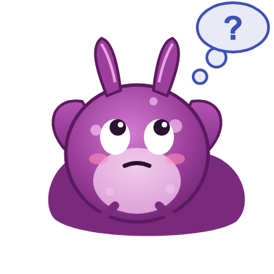
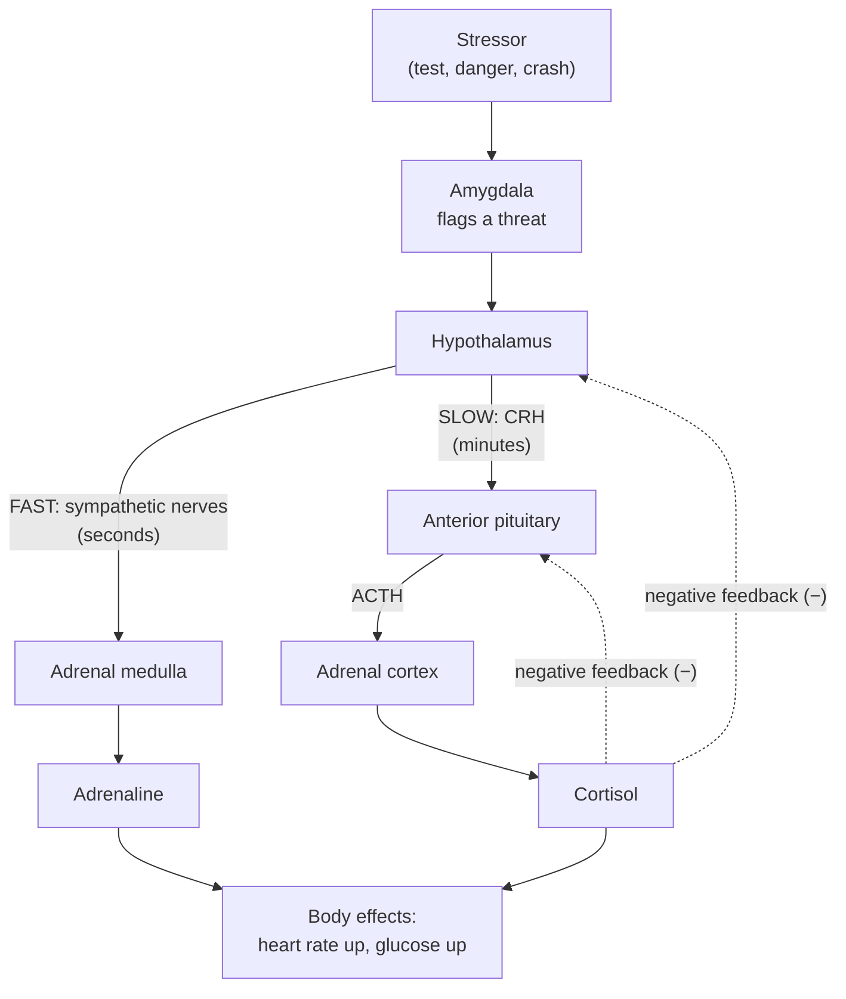
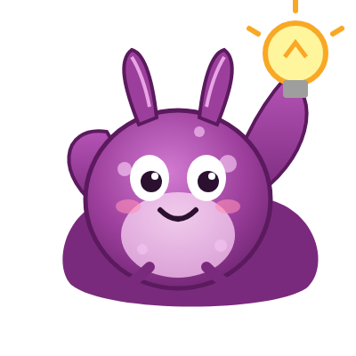
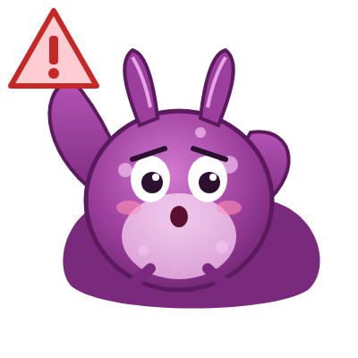

# Chapter 11: Emotion, Stress, and the Body

## Summary

Emotions are more than feelings. They are whole-body responses run by a network of brain regions, with the amygdala as one key hub. In this chapter you'll learn how the brain learns what to fear and how it triggers two stress systems: a fast, nerve-based "fight-or-flight" response and a slower hormone chain called the HPA axis, which releases cortisol. You'll see why a short burst of stress is healthy, why stress that never switches off wears the body and brain down, and how people regulate their emotions. The chapter ends at the bedside with post-traumatic stress disorder (PTSD) after a car crash, and the treatments that help.

## Concepts Covered

1. Emotion
2. Limbic System
3. Amygdala
4. Fear Conditioning
5. Stress Response
6. HPA Axis
7. Cortisol
8. Fight or Flight
9. Chronic Stress Effects
10. Emotion Regulation
11. Post-Traumatic Stress Disorder

## Prerequisites

- [Chapter 1: Neurons, Glia, and the Nervous System](../01-neurons-and-glia/index.md)
- [Chapter 2: The Action Potential](../02-action-potential/index.md)
- [Chapter 3: Synapses and Neurotransmitters](../03-synapses-and-neurotransmitters/index.md)
- [Chapter 4: A Tour of the Brain: Neuroanatomy](../04-neuroanatomy/index.md)
- [Chapter 9: Learning, Memory, and Neuroplasticity](../09-learning-memory-plasticity/index.md)

!!! mascot-welcome "Why your heart pounds"
    { class="mascot-admonition-img" }
    Even I pull my gill in fast when something pokes my tail, and I only have about 20,000 neurons! You have billions, and some of them are wired to keep you alive when danger shows up. In this chapter we'll follow a scare from your eyes to your hormones and back again. Once you understand your stress system, it gets a lot less mysterious.

## 11.1 Maya's Racing Heart

It's 7:55 a.m., five minutes before Maya's chemistry test. She studied. She knows the material. But her heart is pounding, her palms are damp, her mouth is dry, and her stomach feels like it's doing laps. When the teacher hands out the papers, Maya's mind goes blank for a second, and then, slowly, the answers come back.

Nothing in that classroom is dangerous. Nobody is chasing Maya. So why does her body act as if a bear just walked in? And why do the jitters fade after a few minutes of writing, while the tired, drained feeling sticks around for the rest of the morning?

The answers lie in two systems that run side by side: a fast one that uses nerves and a slow one that uses hormones in the blood. Both are steered by brain regions that decide what matters to you emotionally. By the end of this chapter, you'll be able to trace Maya's whole experience.

## 11.2 What Is an Emotion?

Think about a smoke alarm. It doesn't know whether the smoke is from burnt toast or a house fire. Its job is to notice a possible threat fast and get everyone moving. You can decide afterward whether it was a false alarm. Your emotional brain works a lot like that, except it also comes with feelings, facial expressions, and changes all over your body.

An **emotion** is a brief, organized response to something that matters to you. It has three parts that usually happen together:

- **Body changes:** heart rate, breathing, sweating, muscle tension, and hormone levels shift.
- **Behavior:** you freeze, run, smile, frown, or speak in a shaky voice.
- **Feeling:** the private experience you put a name to, like "I'm scared" or "I'm excited."

Scientists have argued for more than a century about the order of these parts. In the 1880s, William James and Carl Lange proposed that the body reacts first and the feeling comes from noticing those body changes. In the 1920s, Walter Cannon and Philip Bard pushed back. They argued that the brain produces the feeling and the body changes at the same time, rather than one causing the other. Later theories added a third ingredient: how you *interpret* the situation. A racing heart can feel like terror on a turbulent airplane and like fun on a roller coaster.

The table below sums up these three classic ideas.

| Theory | Main idea | Example: you see a growling dog |
|---|---|---|
| James-Lange | Body change comes first; the feeling is your brain reading that change | Your heart races, and noticing it makes you feel afraid |
| Cannon-Bard | Brain triggers the feeling and the body change at the same time | Fear and a racing heart start together |
| Two-factor (Schachter-Singer) | Feeling depends on body arousal *plus* how you label the situation | Your heart races, and because there's a growling dog, you call it fear |

Modern neuroscience keeps a piece of each. The role of interpretation will come back when we get to emotion regulation.

## 11.3 The Limbic System: The Brain's Emotion Network

In [Chapter 4](../04-neuroanatomy/index.md) you toured the brain's major regions. Several of them sit in a ring along the inner edge of each hemisphere, wrapped around the brainstem. In 1878, the French physician Paul Broca named this border region the "great limbic lobe," from the Latin *limbus*, meaning "edge." In 1937, the American neuroanatomist James Papez proposed that a loop of these structures produces emotional experience. Around 1950, Paul MacLean grouped them under the name **limbic system**.

Today, the **limbic system** is a useful nickname for a set of connected structures, deep in the brain, that work together on emotion, motivation, and emotional memory. Here are the main members and what each one contributes.

| Structure | Where it is | Role in emotion and stress |
|---|---|---|
| Amygdala | Deep in the front of each temporal lobe | Flags what is emotionally important, especially threats; triggers stress responses |
| Hippocampus | Just behind the amygdala, in the temporal lobe | Stores the context of events (where, when); helps turn the stress response off |
| Hypothalamus | Below the thalamus, at the base of the brain | Launches the hormone and nerve responses to stress |
| Cingulate cortex (front part) | Arches over the corpus callosum | Tracks body sensations and gives them emotional meaning |
| Prefrontal cortex (especially its middle and lower surfaces) | Front of the frontal lobe | Reins in the amygdala and helps regulate emotion |
| Thalamus | Center of the brain | Relays sensory signals, including a quick route to the amygdala |

Scientists don't all agree on exactly which structures belong in the limbic system, and many argue the term is outdated. One reason is that its most famous member, the hippocampus, turned out to be mainly about memory, not emotion. Another is that regions outside the old ring, like the prefrontal cortex in the table above, matter a lot for emotion. Some researchers now describe separate networks for emotion and for memory rather than one "limbic system" ([Rolls, 2015](https://pubmed.ncbi.nlm.nih.gov/24439664/)). Emotion isn't "housed" in one place. Think of the limbic system as a loose nickname for a team, not a single room.

## 11.4 The Amygdala: More Than a "Fear Center"

The **amygdala** is an almond-shaped cluster of nuclei (groups of neuron cell bodies) deep in each temporal lobe. You have two, one per hemisphere. Its main job is to tag incoming information with emotional importance: *Does this matter to me? Is it dangerous? Is it rewarding?*

The amygdala gets sensory information from two routes. A quick route comes almost straight from the thalamus. It's rough, but fast, like a blurry photo. A slower route passes through the sensory cortex first and delivers a detailed picture. This is a popular explanation for why you can jump at a garden hose before you realize it isn't a snake. Keep in mind that the fast route was mapped mainly in rats. In humans, some researchers argue it plays only a small role and that the cortex does more of the work than the simple two-route story suggests ([Pessoa and Adolphs, 2010](https://pubmed.ncbi.nlm.nih.gov/20959860/)). The amygdala also gets context from the hippocampus ("I'm at the zoo, behind glass") and guidance from the prefrontal cortex ("this is just a test").

When the amygdala detects a threat, it sends signals to two main targets:

1. The **hypothalamus**, which launches the hormone stress response, and
2. **Brainstem** areas that speed the heart, change breathing, and trigger freezing or a startle.

Evidence for the amygdala's role in fear comes from several directions:

- **Monkeys.** In the late 1930s, Heinrich Klüver and Paul Bucy removed large parts of the temporal lobes, including the amygdala, in monkeys. The animals became strangely calm and stopped showing normal fear of threats.
- **A rare patient.** A woman known in research as S.M. has a rare genetic condition, Urbach-Wiethe disease, that destroyed both of her amygdalae. In a 2011 study, researchers exposed her to live snakes and spiders, took her through a haunted house, and showed her scary films. She showed no fear and reported almost none (Feinstein and colleagues, 2011).
- **Brain imaging.** fMRI studies show the amygdala becomes more active during emotional stress.

!!! mascot-thinking "The amygdala does more than fear"
    { class="mascot-admonition-img" }
    Calling the amygdala the "fear center" is like calling your phone a "flashlight." The amygdala also responds to rewarding things, helps you recognize emotions in other people's faces, and makes emotional events easier to remember.

Emotional events tend to stick in memory because the amygdala boosts the hippocampus while a memory is being stored. And in a later study, S.M. and two other people with the same condition *did* feel intense panic when they breathed air with extra carbon dioxide. So even fear is not handled by the amygdala alone. Some internal alarms use other pathways.

## 11.5 Fear Conditioning: Learning What to Fear

In [Chapter 9](../09-learning-memory-plasticity/index.md) you saw how experience strengthens synapses. One famous kind of learning built on this is **classical conditioning**, learning that one event predicts another. In Ivan Pavlov's classic experiments, dogs learned that a sound predicted food, so the sound alone made them drool. The same kind of learning happens with danger.

**Fear conditioning** is a form of classical conditioning in which a neutral cue becomes a trigger for fear because it was paired with something painful or frightening. In a typical lab experiment with rats:

1. A tone plays. The rat ignores it. (The tone is the *neutral* stimulus.)
2. The tone plays again, and this time it ends with a mild foot shock. (The shock is the *unconditioned* stimulus. It causes fear without any learning.)
3. After a few pairings, the tone alone makes the rat freeze, and its heart rate and stress hormones rise. (The tone is now a *conditioned* stimulus.)

Where is this learning stored? The tone and shock signals meet on the same neurons in the amygdala. Pairing them strengthens the synapses that carry the tone signal, using the same kind of synaptic strengthening you learned about in Chapter 9 (long-term potentiation). When parts of the amygdala are damaged or blocked in animals, fear conditioning fails.

This learning is ancient. Ply's relatives prove it. In 1983, Thomas Carew, Robert Hawkins, and Eric Kandel showed that *Aplysia* could be classically conditioned. A light touch to the siphon, paired with a strong shock to the tail, soon caused a much bigger defensive withdrawal on its own (Carew, Hawkins, and Kandel, 1983). Even a sea slug can learn that a harmless cue predicts trouble.

### Extinction: unlearning fear

What happens if the tone keeps playing and the shock never comes again? The rat slowly stops freezing. This is called **extinction**. But extinction doesn't erase the old fear memory. It creates a *new* memory that says "this cue is safe now." The new safety memory depends heavily on the ventromedial prefrontal cortex (the lower middle part of the prefrontal cortex), which can quiet the amygdala's output. Because the old memory still exists, fear can come back after a long break, in a new place, or after a big stressor.

Extinction matters for medicine because some treatments for anxiety and PTSD work by building new safety learning, as you'll see in the Bedside case.

## 11.6 The Stress Response: Two Systems, Two Speeds

Back to Maya at 7:55 a.m. Her amygdala has flagged the test as a threat. What happens next?

A **stressor** is anything that challenges your body's balance, whether it's a real danger, an imagined one, or a demand like a deadline. The **stress response** is the set of changes your body makes to meet that challenge. The endocrinologist Hans Selye, who helped found the field of stress research in the 1930s, described stress as "the nonspecific response of the body to any demand made upon it." The key word is *any*: a test, a breakup, a soccer final, and a car crash all trigger the same basic machinery.

Think of a fire station. When an alarm sounds, a dispatcher *radios* the nearest truck, which pulls out within seconds. At the same time, the dispatcher *mails* a request for extra supplies, which arrive later but last for days. Your stress response has the same two channels:

- **The fast channel (nerves):** the sympathetic nervous system, which acts in seconds.
- **The slow channel (hormones in the blood):** the HPA axis, which acts over minutes and can last for hours.

### The fast channel: fight or flight

In [Chapter 4](../04-neuroanatomy/index.md) you learned that the autonomic nervous system has two branches. The parasympathetic branch handles "rest and digest." The sympathetic branch handles emergencies. In 1915, the American physiologist Walter Cannon described the body's emergency mode as preparing for "fighting or flight," and the name **fight or flight** stuck.

The **fight-or-flight response** is the fast, sympathetic part of the stress response. Signals travel from the hypothalamus down through the brainstem and spinal cord and out along sympathetic nerves. Within seconds, two things happen:

1. Sympathetic nerves release **norepinephrine** (noradrenaline) directly onto many organs, such as the heart, blood vessels, and liver.
2. Sympathetic nerves also reach the **adrenal medulla**, the inner core of each adrenal gland (the adrenal glands sit on top of the kidneys). The adrenal medulla releases **epinephrine**, also called **adrenaline**, into the blood.

Here is what that does, and why each change helps in a true emergency.

| Body change | Why it helps in danger | What Maya noticed |
|---|---|---|
| Heart beats faster and harder; blood pressure rises | Delivers more oxygen and fuel to muscles | Pounding heart |
| Airways widen, breathing speeds up | More oxygen in | Quick, shallow breaths |
| Liver releases glucose into the blood | Instant fuel for muscles and brain | (Not felt directly) |
| Blood shifts away from the gut and skin toward muscles | Muscles get priority; digestion can wait | "Butterflies," dry mouth |
| Pupils widen | Lets in more light | (Not felt directly) |
| Sweating increases | Cools the body during action | Damp palms |

Animals and people also **freeze**, holding still to avoid being noticed.

## 11.7 The HPA Axis and Cortisol

The slow channel is a relay race of three hormones passed between three organs: **h**ypothalamus, **p**ituitary, **a**drenal. Together they form the **HPA axis** (hypothalamic-pituitary-adrenal axis), the hormone chain that produces the stress hormone cortisol.

Here's how the relay runs:

1. **Hypothalamus → CRH.** When the amygdala signals a threat, neurons in the hypothalamus release **CRH** (corticotropin-releasing hormone) into a tiny network of blood vessels that leads straight to the pituitary gland just below.
2. **Pituitary → ACTH.** CRH tells the anterior (front) pituitary to release **ACTH** (adrenocorticotropic hormone) into the general bloodstream.
3. **Adrenal cortex → cortisol.** ACTH travels to the adrenal glands and tells the **adrenal cortex**, the outer layer of each gland, to make and release cortisol.

Notice that the same adrenal gland shows up in both channels. Its inner core (the medulla) answers the fast nerve signal with adrenaline. Its outer shell (the cortex) answers the slow hormone signal with cortisol.

The flowchart below puts both channels side by side.

### What cortisol does

**Cortisol** is a steroid hormone, the body's main glucocorticoid ("glucose-related steroid"). During stress it:

- raises blood glucose, so the brain and muscles have fuel,
- helps keep blood pressure up,
- calms inflammation and changes how the immune system works,
- turns down "non-urgent" systems, such as reproduction,
- acts on the brain, including the hippocampus, amygdala, and prefrontal cortex.

Why is cortisol slow? Part of the reason is the relay itself: three hormones must be released in order. Another part is how cortisol works. As a steroid, it's a small, fat-based molecule. It slips through cell membranes and binds receptors *inside* the cell. Those receptors then travel to the nucleus and change which genes are turned on. Changing gene activity takes time, usually an hour or more, but it also means cortisol's effects last. These gene-driven effects can continue for hours, even after cortisol levels themselves have come back down ([Joëls and Baram, 2009](https://pubmed.ncbi.nlm.nih.gov/19339973/)).

Cortisol isn't only about stress, though. It also follows a daily rhythm. Levels rise quickly after you wake up, peak within about 30 to 45 minutes, fall through the day, and reach their low point in the middle of the night. That's why doctors often measure cortisol in the morning.

### The brake: negative feedback

A system that only had an accelerator would be dangerous. The HPA axis also has a brake. When cortisol rises, it travels back to the brain and *slows its own production*. It tells the hypothalamus to release less CRH and the pituitary to release less ACTH. This is called **negative feedback**: a signal that turns down its own source.

A home thermostat is the classic example. When the room gets warm enough, the thermostat shuts off the furnace. The hippocampus helps with this brake too. It has many cortisol receptors, and when cortisol is high, it sends signals that help shut the hypothalamus down.

Because of this brake, a healthy stress response is **self-limiting**. Cortisol rises, does its job, and then returns to its resting level. Now try it yourself.

#### Diagram: HPA Axis Feedback Loop

<iframe src="../../sims/ch11-hpa-axis/main.html" height="627px" width="100%" scrolling="no"></iframe>

[Open the HPA Axis Feedback Loop fullscreen](../../sims/ch11-hpa-axis/main.html){ .md-button .md-button--primary }

MicroSim specification: HPA Axis Feedback Loop

Type: microsim
**sim-id:** ch11-hpa-axis 
**Library:** p5.js 
**Status:** Implemented 
**Bloom Level:** Analyze 
**Bloom Verb:** differentiate 
**Learning Objective:** The learner will differentiate a self-limiting acute stress response from a sustained cortisol elevation by predicting, then observing, how the cortisol curve changes when negative feedback is weakened or stressors repeat.

**Canvas:** width-responsive, 625 px tall (iframe 627 px).

**Controls:** Start/Pause (starts paused); Stressor! (one acute pulse); Reset; Chronic stress checkbox (a stressor every 30 simulated minutes); Feedback strength slider (0 to 1, step 0.1, default 1.0).

**Diagram:** Stressor → Hypothalamus (CRH) → Pituitary (ACTH) → Adrenal cortex (cortisol) → Body effects, with "+" links and dashed "−" feedback from cortisol to the hypothalamus and pituitary; a fast path runs through sympathetic nerves to the adrenal medulla (adrenaline).

**Behavior:** simplified model, relative units (1.0 = baseline). Adrenaline peaks within minutes; cortisol peaks about 20 to 30 minutes after a stressor and, with intact feedback, is near baseline in about an hour. Weaker feedback gives a higher, longer peak. Chronic stress keeps cortisol above baseline; chronic stress with feedback off reaches about 6 times baseline. The plot shows the last 240 simulated minutes.

Start with **Feedback strength** at 1.0 and press **Stressor!** Watch the orange adrenaline line jump almost at once, then fade. The red cortisol line rises more slowly, peaks later, and then glides back down to the dashed baseline. That delay is the HPA relay race at work, and the return to baseline is negative feedback doing its job.

Now predict before you test: what will happen if you drag the slider down to 0.3 and press **Stressor!** again? Then reset, check **Chronic stress**, and watch. With repeated stressors, cortisol never gets a chance to return to baseline, even with an intact brake. Finally, combine chronic stress with feedback set to 0. This is the model's picture of a stress system that can't switch off.

!!! mascot-tip "Read the two curves separately"
    { class="mascot-admonition-img" }
    When you describe the graph, talk about the two lines separately. Adrenaline answers "how fast?" and cortisol answers "how long?" Mixing them up is one of the most common mistakes on stress questions.

## 11.8 When Stress Doesn't Switch Off: Chronic Stress Effects

Is stress bad for you? It depends on how much, and for how long.

### The good side of stress

Short bursts of stress are often helpful. Psychologists often describe this with an **inverted U** (the Yerkes-Dodson law): as stress rises from very low, performance improves, but past a sweet spot, more stress makes performance worse. Treat this as a rough rule of thumb, not a precise law. The original 1908 study tested how fast mice learned a black-or-white choice with electric shocks of different strengths, and later writers stretched it to cover stress and human performance in general. The helpful zone is called **eustress** ("good stress"), stress you feel you can handle. How you view a challenge matters. Seeing a pile of exams as a challenge you can meet, rather than a threat you can't, is linked to feeling the positive side of stress.

### The costly side of stress

The stress response is built for short emergencies. Problems start when it is turned on too often, for too long, or when it fails to shut off. The scientist Bruce McEwen called this cumulative wear and tear **allostatic load**. (*Allostasis* means keeping the body stable by changing it, as the stress response does.) Ongoing stress can come from family conflict, money worries, bullying, or caring for a sick relative.

**Chronic stress effects** are the changes in the body and brain that can build up when stress lasts for weeks, months, or years. They include:

| System | Possible effects of long-lasting stress |
|---|---|
| Sleep | Trouble falling or staying asleep |
| Heart and blood vessels | Higher blood pressure; added strain on the heart over time |
| Immune system | Short-term stress can boost some immune responses, but chronic stress tends to suppress them |
| Digestion | Stomachaches and other digestive problems |
| Mood | Higher risk of anxiety disorders and depression |
| Brain | Structural remodeling in the hippocampus, amygdala, and prefrontal cortex (best documented in animal studies) |

The brain changes deserve a closer look, because they can create a vicious cycle. In animal studies, chronic stress shrinks the branching dendrites of some neurons in the hippocampus and prefrontal cortex. It also strongly suppresses the birth of new neurons in the hippocampus. Meanwhile, dendrites in part of the amygdala *expand*, and the amygdala can become more active. Put those together:

- The **hippocampus**, which normally helps shut off the HPA axis, works less well.
- The **prefrontal cortex**, which normally calms the amygdala, works less well.
- The **amygdala**, which turns the stress response on, gets louder.

The result can be a stress system that is quicker to turn on and slower to turn off. That's like turning the MicroSim's feedback slider down. Much of this evidence comes from rats and mice, and human brains are more complicated. The brain also stays plastic (able to change), so these patterns are not fixed destinies. Regular physical activity and social support are linked to a lower stress burden and better resilience.

!!! mascot-warning "Correlation is not causation"
    { class="mascot-admonition-img" }
    Most human stress research is correlational, which means it finds that two things go together. If people under chronic stress have more health problems, that's a strong clue, but other factors (like poverty or poor sleep) may also play a role. Animal experiments help scientists test cause and effect.

## 11.9 Emotion Regulation

Emotions are not pure reflexes. You can change them, and your brain has circuits for doing it.

**Emotion regulation** is the set of strategies people use to influence which emotions they have, how strong those emotions are, and how they express them. Some strategies change the situation (walking away from an argument) or your attention. One of the best studied is **cognitive reappraisal**: changing how you *think* about a situation to change how it *feels*.

Here's how Maya might use reappraisal. Before her next test, her heart starts pounding again. Instead of thinking "I'm panicking, I'm going to fail," she tells herself, "My heart is speeding up because my body is getting ready to focus. This is fuel." The situation hasn't changed, but her interpretation has, and that can change the feeling.

What happens in the brain during reappraisal? A 2014 analysis combined the results of 48 brain imaging studies. When people reappraised upsetting images, control regions in the prefrontal and parietal cortex became more active, and activity in the amygdala went down on both sides of the brain (Buhle and colleagues, 2014). In other words, the "thinking" brain can turn down the "alarm" brain.

Other strategies supported by health experts include:

- keeping a regular sleep routine,
- getting regular exercise and eating regular meals,
- trying relaxation methods, such as slow, deep breathing or mindfulness,
- writing in a journal,
- noticing and challenging unhelpful thoughts,
- leaning on supportive friends and family.

Slow breathing is interesting from a neuroscience point of view. It engages the parasympathetic "rest and digest" branch, partly through the vagus nerve, which helps counter the sympathetic surge.

!!! mascot-encourage "Asking for help is a skill too"
    { class="mascot-admonition-img" }
    Regulating emotions doesn't mean handling everything alone. If stress or sadness keeps getting in the way of sleep, school, or friendships, talking to a trusted adult, school counselor, or doctor is a smart, strong move.

If you or someone you know is struggling, call or text **988** (the Suicide & Crisis Lifeline in the U.S.).

## 11.10 Post-Traumatic Stress Disorder

After something terrifying, such as a serious accident, an assault, a disaster, or combat, it is natural to have strong reactions like poor sleep, jumpiness, or replaying the event. Most people recover over time.

For some people, the reactions don't fade. **Post-traumatic stress disorder (PTSD)** is a mental health condition in which symptoms continue for more than a month after a traumatic event and are severe enough to interfere with daily life, such as relationships, school, or work. According to the National Institute of Mental Health (NIMH, 2023), about 6 of every 100 people will have PTSD at some point in their lives. A national survey of U.S. teens ages 13 to 18 (collected from 2001 to 2004) found that about 5% had had PTSD at some point, and it was more common in girls than boys.

NIMH groups PTSD symptoms into four types. To be diagnosed, an adult needs symptoms from all four groups for at least a month:

| Symptom group | What it can look like |
|---|---|
| Re-experiencing | Flashbacks, nightmares, upsetting memories, a racing heart when reminded |
| Avoidance | Staying away from places, people, or thoughts linked to the event |
| Arousal and reactivity | Being easily startled, feeling on edge, trouble sleeping or concentrating, angry outbursts |
| Cognition and mood | Trouble remembering parts of the event, guilt or blame, ongoing fear or shame, losing interest in activities |

Anyone can develop PTSD at any age, and it is not a sign of weakness. Risk factors include earlier trauma (especially in childhood), getting hurt during the event, and having little support afterward. Support from friends and family is linked to a lower chance of developing PTSD.

Researchers often describe PTSD as a problem of fear learning and recovery: a powerful fear memory forms during the trauma, and the brain struggles to learn that reminders are now safe. Imaging studies comparing groups of people have found stronger amygdala responses to emotional stress in people with PTSD.

## At the Bedside: Nightmares After the Crash

!!! note "Meet the patient"
    Jordan is a 22-year-old college student. Five months ago, Jordan was driving home at night when another car ran a red light and hit the passenger side. Jordan's friend in the passenger seat was badly hurt but survived. Jordan had only bruises. Since then, Jordan has had nightmares about headlights almost every week and sometimes "sees" the crash again while awake, heart pounding. Jordan now takes the bus or walks long distances to avoid driving, jumps at car horns, sleeps poorly, and has stopped going out with friends. Jordan feels guilty, thinking, "I should have seen that car coming." Grades are slipping, and Jordan's roommate encouraged a visit to the campus health center.

**What the doctor checks:** A careful history: what happened, when symptoms started, how long they've lasted, and how much they interfere with life. Because there was a crash, the doctor asks about head injury (a concussion can also cause sleep and concentration problems) and does a brief neurological exam, which is normal. The doctor asks about mood, alcohol and drug use, and thoughts of self-harm, and uses a short PTSD screening questionnaire. A mental health clinician may confirm the diagnosis with a structured interview such as the Clinician-Administered PTSD Scale (CAPS-5).

**Where is the problem? (localization):** This is not a single damaged spot, like a stroke, but a *network* problem in this chapter's circuits. Re-experiencing and jumpiness fit an amygdala that responds too strongly to reminders like headlights and horns. Feeling unsafe in situations that are actually safe fits weak fear extinction, which depends on the prefrontal cortex's ability to calm the amygdala. Trouble placing the memory in the past and the right context fits the hippocampus, which stores context. The racing heart and sweating are the sympathetic fight-or-flight system firing on cue. Keep in mind that PTSD is diagnosed by a trained health professional from symptoms and history, not from a brain scan.

**Diagnosis:** Post-traumatic stress disorder (PTSD). Jordan has symptoms from all four groups (re-experiencing, avoidance, arousal and reactivity, and changes in thinking and mood), they've lasted much longer than a month, and they interfere with school and friendships.

**Why it happens:** During the crash, Jordan's amygdala and stress hormones were extremely active, which helped stamp in a powerful fear memory. Cues that were present (headlights, horns, being behind the wheel) became conditioned stimuli, just like the tone in a fear conditioning experiment. Normally, safe drives after a crash would build a new extinction memory: "driving is usually safe." But Jordan's avoidance means that new safety learning never gets a chance to happen, so the fear stays strong. PTSD is also not simply "too much cortisol." Some studies have even found lower-than-expected cortisol in people with PTSD, and scientists are still working out what that means.

**Treatment today:** PTSD is treatable. According to the U.S. Department of Veterans Affairs' National Center for PTSD and the 2023 VA/DoD clinical practice guideline (still the current version as of 2026), certain **trauma-focused talk therapies** work best, and they are recommended over medication as a first choice. These include:

- **Prolonged Exposure (PE):** gradually and safely approaching the memory and avoided situations (like driving), which builds new safety learning, much like extinction.
- **Cognitive Processing Therapy (CPT):** learning to notice and change stuck, unhelpful thoughts about the trauma, such as Jordan's self-blame.
- **Eye Movement Desensitization and Reprocessing (EMDR):** recalling the trauma while paying attention to a back-and-forth movement or sound.

Some medications also help. The FDA has approved two SSRI antidepressants for PTSD (sertraline and paroxetine), and the National Center for PTSD and the 2023 VA/DoD guideline list paroxetine, sertraline, and venlafaxine as the recommended medications. A doctor and patient choose treatment together. Support from friends and family also matters.

**What's new in research:** Traditional trauma-focused therapies often take about 12 weekly sessions, and many people drop out. In a 2018 randomized trial of 126 adults with PTSD, a five-session treatment called **Written Exposure Therapy (WET)**, in which patients write about the trauma during sessions, worked about as well as 12 sessions of Cognitive Processing Therapy, and far fewer people dropped out (Sloan, Marx, Lee, and Resick, *JAMA Psychiatry*, 2018). As of 2026, the National Center for PTSD lists WET among other supported therapies, and the 2023 VA/DoD guideline "suggests" it, a weaker endorsement than it gives PE, CPT, or EMDR, because there is less research behind it so far. Researchers are still studying who benefits most from shorter treatments.

??? question "Your turn: diagnose a variation"
    Sam, 17, was in a similar crash **two weeks ago**. Sam has had two nightmares, feels jumpy in cars, and is sleeping poorly. Does Sam have PTSD?

    **Answer:** Not yet. Sam's reactions are common, natural responses to a frightening event, and PTSD requires symptoms lasting **more than a month** that interfere with daily life. Most people's symptoms fade over time, especially with support. A doctor would check in with Sam, watch how the symptoms change, check for injuries such as a concussion, and encourage Sam to keep up normal routines rather than avoid cars completely. If the symptoms last beyond a month and get in the way of life, Sam should be evaluated for PTSD.

*This is a fictional teaching case. It is not medical advice. If you or someone you know has symptoms like these, talk to a doctor.*

## Common Misconceptions

**Myth:** Stress is always bad for you.  
**Reality:** The stress response is a survival system. Short bursts of adrenaline and cortisol supply fuel and can improve performance. Problems come from stress that is too intense, too frequent, or doesn't switch off.

**Myth:** The amygdala is the brain's "fear center" and does nothing else.  
**Reality:** The amygdala flags anything emotionally important, including rewards, and strengthens emotional memories. Fear also involves the hypothalamus, brainstem, hippocampus, and prefrontal cortex.

**Myth:** Cortisol is a "bad" hormone that only shows up when you're stressed.  
**Reality:** Cortisol follows a daily rhythm, peaking shortly after you wake up, and helps control blood glucose, blood pressure, and inflammation. Trouble comes when it stays high for long periods.

**Myth:** People with PTSD are weak, or they could get over it if they tried harder.  
**Reality:** PTSD reflects real changes in how the brain's fear and stress circuits learn and recover. It can happen to anyone after trauma, and it's treatable with evidence-based therapies.

**Myth:** The best way to deal with a scary memory is to avoid every reminder of it.  
**Reality:** Avoidance brings short-term relief, but it blocks the new safety learning (extinction) that helps fear fade. Gradual, supported exposure is a core part of several effective PTSD treatments.

## Brain Bee Practice

??? question "1. Name the three structures of the HPA axis, in order, and the hormone each one releases."
    Hypothalamus (CRH), anterior pituitary (ACTH), and adrenal cortex (cortisol).

??? question "2. What part of the adrenal gland releases adrenaline, and what controls it?"
    The adrenal medulla, the inner core of the adrenal gland. It is controlled directly by sympathetic nerves, which is why the adrenaline response is so fast.

??? question "3. What happened to patient S.M.'s amygdalae, and what did that reveal?"
    A rare genetic condition, Urbach-Wiethe disease, destroyed both of her amygdalae. She showed almost no fear of snakes, spiders, haunted houses, or scary films, which showed that the amygdala is needed for normal fear responses to outside threats.

??? question "4. In fear extinction, is the original fear memory erased? Explain."
    No. Extinction creates a new "this is safe now" memory that competes with the old fear memory. It depends heavily on the ventromedial prefrontal cortex. Because the old memory remains, fear can return later.

??? question "5. How does cortisol limit its own release?"
    Through negative feedback. Cortisol acts on the hypothalamus and pituitary (with help from the hippocampus) to reduce the release of CRH and ACTH, so cortisol production slows down.

## Exercises

### Remember

1. Define *emotion* and list its three parts.
2. What does "HPA" stand for?

??? note "Answer"
    1. An emotion is a brief, organized response to something that matters to you. Its three parts are body changes, behavior, and feeling.
    2. Hypothalamic-pituitary-adrenal.

### Understand

3. Explain why the adrenaline response is faster than the cortisol response.
4. Explain, using the idea of a thermostat, what negative feedback does in the HPA axis.

??? note "Answer"
    3. Adrenaline release is triggered directly by sympathetic nerves within seconds. Cortisol requires a three-step hormone relay (CRH, then ACTH, then cortisol) through the bloodstream, and cortisol acts partly by changing gene activity, which takes longer.
    4. Like a thermostat that shuts off the furnace when the room is warm, cortisol acts on the hypothalamus and pituitary to reduce CRH and ACTH. That lowers cortisol production and returns the system to baseline.

### Apply

5. In the HPA Axis Feedback Loop MicroSim, set feedback to 1.0, check **Chronic stress**, and let the graph run for 240 minutes. Then do the same with feedback at 0. Record the approximate cortisol level at the end of each run, and explain the difference in terms of the hypothalamus and pituitary.
6. Maya's friend Leo feels his heart pounding before a soccer penalty kick and thinks, "I'm going to choke." Write two sentences Leo could say to himself using cognitive reappraisal, and explain which brain region this strategy is thought to engage.

### Analyze

7. A rat is fear conditioned to a tone. Researchers then block activity in its ventromedial prefrontal cortex during extinction training. Predict what will happen to the rat's freezing over the next several days, and explain why.
8. Compare the amygdala, hippocampus, and prefrontal cortex in terms of how each one affects the stress response. Which one turns it up, and which ones help turn it down? How might chronic stress shift the balance?

### Evaluate

9. A wellness app claims, "Cortisol is toxic. Our program will drive your cortisol to zero!" Evaluate this claim using what you learned about cortisol's normal functions and daily rhythm.
10. A news headline reads, "Stress shrinks your brain." Judge how accurate this is. In your answer, consider the kind of evidence (animal or human, correlational or experimental) and whether the changes can reverse.

### Create

11. Design a one-week "stress plan" for a student facing three exams. Include four strategies from this chapter and name the system or brain circuit each one targets.
12. Design an experiment testing whether extinction training reduces a conditioned fear response (a mild, harmless startle cue) in volunteers. Describe your groups, what you would measure (such as heart rate), and one ethical safeguard.

## Key Takeaways

- An **emotion** is a whole-body response that combines body changes, behavior, and feeling, and is shaped by how you interpret a situation.
- The **limbic system** is a loose, debated label for a network of deep brain structures, including the amygdala, hippocampus, and hypothalamus, that works with the prefrontal cortex on emotion and stress.
- The **amygdala** tags what is emotionally important, triggers stress responses, and stores **fear conditioning**. Extinction is new safety learning, not erasing the old fear memory.
- The **stress response** has a fast nerve-based channel (**fight or flight**, adrenaline from the adrenal medulla) and a slow hormone channel (the **HPA axis**: CRH, then ACTH, then **cortisol** from the adrenal cortex).
- Cortisol raises blood glucose and blood pressure, calms inflammation, follows a daily rhythm, and shuts off its own production through **negative feedback**.
- Short-term stress can be helpful, but **chronic stress** can disrupt sleep, mood, immunity, and heart health and can remodel the hippocampus, amygdala, and prefrontal cortex.
- **Emotion regulation** strategies like reappraisal engage prefrontal control over the amygdala, and **PTSD** is a treatable condition, with trauma-focused talk therapies as the most effective treatments.

!!! mascot-celebration "You traced a scare from start to finish!"
    { class="mascot-admonition-img" }
    You can now follow a stressor from the amygdala all the way to cortisol and back through the feedback loop. Next, in [Chapter 12](../12-language-attention-decisions/index.md), we'll explore how the brain produces language, focuses attention, and makes decisions, and what happens when a stroke disrupts them.
