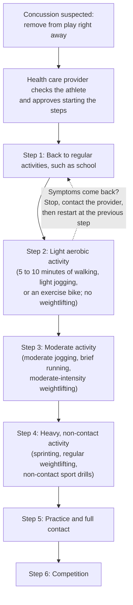

# Chapter 14: Brain Injury, Stroke, and Epilepsy

## Summary

The brain can be hurt in three very different ways: by a physical hit (traumatic brain injury and concussion), by losing its blood supply or bleeding (stroke), or by a burst of runaway electrical activity (a seizure). This chapter explains what goes wrong in neurons, blood vessels, and circuits in each case, and teaches what to do in the first minutes: remove an injured athlete from play, recognize stroke with BE-FAST and call 911, and give seizure first aid. It ends with spinal cord injury and a stroke map you can use to predict symptoms from a blocked artery.

## Concepts Covered

1. Traumatic Brain Injury
2. Concussion
3. Return-to-Learn and Play
4. Chronic Traumatic Enceph.
5. Stroke
6. Ischemic Stroke
7. Hemorrhagic Stroke
8. BE-FAST Warning Signs
9. Clot-Busting Treatment
10. Seizure
11. Epilepsy
12. Seizure First Aid
13. Spinal Cord Injury

## Prerequisites

- [Chapter 1: Neurons, Glia, and the Nervous System](../01-neurons-and-glia/index.md)
- [Chapter 2: The Action Potential](../02-action-potential/index.md)
- [Chapter 3: Synapses and Neurotransmitters](../03-synapses-and-neurotransmitters/index.md)
- [Chapter 4: A Tour of the Brain](../04-neuroanatomy/index.md)
- [Chapter 5: Vision](../05-vision/index.md)
- [Chapter 6: Hearing, Touch, Taste, Smell, and Pain](../06-hearing-touch-taste-smell-pain/index.md)
- [Chapter 7: Movement](../07-movement/index.md)
- [Chapter 12: Language, Attention, and Decision-Making](../12-language-attention-decisions/index.md)

!!! mascot-welcome "When Seconds Matter"
    { class="mascot-admonition-img" }
    I'm Ply, and this might be the most useful chapter in the whole book. Everything you learned about neurons, synapses, and brain maps comes together here, in real emergencies. By the end, you'll know what to do if a teammate takes a hard hit, a grandparent's face suddenly droops, or a classmate has a seizure.

## 14.1 A Header, Then a Fog

It's the second half of a Saturday soccer game. Maya, 16, rises for a header just as a defender jumps for the same ball, and their heads knock together. Maya doesn't black out. She shakes it off and jogs back into position. But the field seems too bright, her head is pounding, and when her coach shouts a play she has run a hundred times, she can't remember where to go. She tells a teammate she feels "foggy."

Maya wants to keep playing. She never lost consciousness, so how bad could it be? This chapter answers that question, then visits two other sudden brain emergencies: a stroke and a seizure. In all three, what bystanders do in the first few minutes can change the outcome.

## 14.2 Intuition First: Three Ways a City Can Fail

Picture the brain as a busy city. Its buildings (neurons) sit inside a hard wall (the skull), cushioned by a moat of fluid (cerebrospinal fluid). Fuel trucks (blood vessels) deliver oxygen and sugar around the clock, because the city has almost no storage. And the whole city runs on an electrical grid (the action potentials and synapses of [Chapter 2](../02-action-potential/index.md) and [Chapter 3](../03-synapses-and-neurotransmitters/index.md)).

A city like that can fail in three main ways:

- **An earthquake** shakes everything, stretching and snapping power lines. This is a traumatic brain injury.
- **A blocked road or a burst pipe** cuts off one neighborhood, which shuts down within minutes. This is a stroke.
- **A power surge** makes huge numbers of buildings switch on and off together. This is a seizure.

These problems are common. A 2024 *Lancet Neurology* study from the Global Burden of Disease (GBD) project found that nervous system conditions affected about 3.4 billion people in 2021, 43% of the world's population. Together, they were the leading cause of ill health and disability worldwide ([GBD 2021 Nervous System Disorders Collaborators, 2024](https://pmc.ncbi.nlm.nih.gov/articles/PMC10949203/)). The study measured burden in **disability-adjusted life years (DALYs)**, the years of healthy life lost to illness, disability, or early death. Out of 37 nervous system conditions, stroke ranked first by this measure, and epilepsy ranked seventh.

## 14.3 Traumatic Brain Injury: When Force Meets the Brain

A **traumatic brain injury (TBI)** is a brain injury caused by an outside force: a blow, bump, or jolt to the head or body, or an object that enters the skull ([NINDS](https://www.ninds.nih.gov/health-information/disorders/traumatic-brain-injury-tbi)). TBIs range from mild to severe. Falls, car crashes, sports, and violence are common causes, and NINDS notes that adults 65 and older have the highest risk of being hospitalized or dying from a TBI, mostly because of falls.

Why can a hit to the *body* hurt the brain? The soft brain floats in fluid inside the skull. When the head speeds up or stops suddenly, the brain keeps moving for a split second and strikes the skull. Twisting motions are especially harmful because they stretch the long, thin axons that connect brain regions ([Chapter 1](../01-neurons-and-glia/index.md)). Widespread stretching damage to white matter is called **diffuse axonal injury**, which NINDS lists as one of the most common kinds of TBI.

### Concussion: a mild TBI that still matters

A **concussion** is a type of mild TBI caused by a bump, blow, or jolt to the head, or by a hit to the body that makes the head and brain move rapidly back and forth ([CDC HEADS UP](https://www.cdc.gov/heads-up/about/index.html)). "Mild" means it is usually not life-threatening. It does not mean the effects are minor.

Inside the brain, a chain of events called the **neurometabolic cascade** unfolds ([Giza and Hovda, 2014](https://pmc.ncbi.nlm.nih.gov/articles/PMC4479139/)):

1. Stretched neuron membranes let ions rush across. Potassium floods out, and sodium and calcium flow in.
2. Many neurons fire at once and release the excitatory neurotransmitter glutamate.
3. Sodium-potassium pumps work overtime to restore the ion balance, burning huge amounts of energy.
4. Meanwhile, blood flow to the area can drop. The brain enters an "energy crisis": high demand, low supply.

This crisis helps explain the symptoms. It also explains why a second hit before recovery is dangerous: NINDS warns that a second concussion soon after the first can cause lasting damage and, in rare cases, death.

!!! mascot-thinking "No Blackout Needed"
    { class="mascot-admonition-img" }
    Maya figured she was fine because she never blacked out. But a concussion is a change in how the brain *works*, not a matter of being knocked out. The CDC has stated that most concussions happen without any loss of consciousness.

That statement comes from CDC testimony to Congress ([CDC, 2010](https://archive.cdc.gov/www_cdc_gov/washington/testimony/2010/t20100908.htm)), and today's HEADS UP pages treat passing out as just one possible sign. The table sorts the main signs CDC lists for children and teens ([CDC HEADS UP](https://www.cdc.gov/heads-up/signs-symptoms/index.html)).

| What others may see | What the athlete may feel or say |
|---|---|
| Appears dazed or confused | Headache |
| Sudden trouble with memory or concentration | Dizziness or balance problems |
| Slower answers and reactions | Feeling "foggy" or slowed down |
| More clumsy than usual | Sensitivity to light or noise |
| Mood or behavior changes; vomiting soon after the hit | Nausea, vision problems, fatigue, sleep changes |

Some signs suggest something worse than a concussion, such as bleeding that presses on the brain. CDC says to call 911 or go to the nearest emergency department right away for any of these **danger signs**:

- a headache that gets worse and does not go away
- repeated nausea or vomiting
- slurred speech, weakness, numbness, or decreased coordination
- convulsions or seizures
- loss of consciousness with increasing drowsiness, inability to wake up, or inability to stay awake
- one pupil larger than the other, or double vision
- not recognizing people or places
- unusual behavior, increased confusion, restlessness, or agitation

## 14.4 Healing After a Concussion: Return-to-Learn and Play

The first rule is simple. If a concussion is suspected, CDC says to **remove the athlete from play right away** and keep them out for the rest of that day and until a health care provider clears them ([CDC HEADS UP: How to Respond](https://www.cdc.gov/heads-up/response/index.html)). Coaches and parents shouldn't judge how bad the injury is. Deciding when to return is a medical decision.

Recovery then follows **return-to-learn and play**: a gradual, step-by-step return to school and daily life, then to sports, moving forward only if symptoms stay away. CDC's guidance says ([CDC HEADS UP: What to Do After a Concussion](https://www.cdc.gov/heads-up/guidelines/recovery-from-concussion.html)):

- **First 1 to 2 days:** rest if needed, and limit screen time and physically or mentally demanding activities. But don't stay in a dark room all day. Light activity, such as short walks, is encouraged even with mild symptoms.
- **Back to school:** most children can return within 1 to 2 days, at first with supports such as rest breaks, homework help, and extra time on tests.
- **Most feel better within 2 to 4 weeks.** Some have symptoms for months and should keep working with a health care provider.

Returning to sports has its own ladder. CDC describes six steps, each usually lasting at least 24 hours, started only with a health care provider's approval ([CDC HEADS UP: Returning to Sports](https://www.cdc.gov/heads-up/guidelines/returning-to-sports.html)). CDC also advises that a student be back to all regular non-sports activities, without extra supports, before fully returning to sports. The flowchart shows the steps and the rule for moving between them.

The dotted arrow shows the key rule: at any step, if symptoms return, the athlete stops, contacts their provider, and after more rest restarts at the previous step.

## 14.5 Many Hits Over Many Years: CTE

Most people recover fully from a single concussion. But some people exposed to many head impacts over years develop a progressive brain disease. **Chronic traumatic encephalopathy (CTE)** is a disorder in which the protein **tau** clumps inside neurons in a distinctive pattern, often around small blood vessels at the bottoms of the brain's folds ([McKee et al., 2023](https://pmc.ncbi.nlm.nih.gov/articles/PMC10020327/)). Tau also forms tangles in Alzheimer's disease, but its pattern in CTE is different.

Two facts about CTE are easy to get wrong:

- **It can currently be confirmed only after death,** by examining brain tissue. NINDS notes that researchers are working on tests to detect it in living people.
- **Living patients get a different label.** In 2021, a panel organized through NINDS published research criteria for **traumatic encephalopathy syndrome (TES)**: substantial exposure to repeated head impacts, problems with memory, thinking, or behavior control, a worsening course, and no better explanation ([Katz et al., 2021](https://pubmed.ncbi.nlm.nih.gov/33722990/)).

## 14.6 Stroke: When the Brain Loses Its Blood Supply

A **stroke** happens when something blocks the blood supply to part of the brain, or when a blood vessel in the brain bursts, so that brain cells in that area are damaged or die ([CDC](https://www.cdc.gov/stroke/about/index.html)). According to CDC's stroke facts page (last updated in 2024), more than 795,000 people in the U.S. have a stroke each year, about one every 40 seconds ([CDC Stroke Facts](https://www.cdc.gov/stroke/data-research/facts-stats/index.html)).

### Two kinds of stroke

An **ischemic stroke** happens when a blood clot or other particle blocks a vessel supplying the brain. ("Ischemia" means not enough blood flow.) The clot may form in a narrowed brain artery or travel up from elsewhere, often the heart. About 87% of strokes are ischemic, according to CDC.

A **hemorrhagic stroke** happens when a blood vessel in the brain leaks or bursts, and the leaked blood damages brain cells. Long-term high blood pressure can weaken small vessels until they rupture. A weak, ballooning spot in an artery, called an **aneurysm**, can also burst, often bleeding into the space around the brain ([NINDS](https://www.ninds.nih.gov/health-information/stroke/assess-and-treat)).

A **transient ischemic attack (TIA)**, or "mini-stroke," blocks blood flow only briefly, usually for less than 5 minutes. The symptoms go away, but CDC calls a TIA a medical emergency and a warning sign of a future stroke. Early symptoms can't tell a TIA from a major stroke, so both need a 911 call. The table summarizes the two main types.

| Feature | Ischemic stroke | Hemorrhagic stroke |
|---|---|---|
| What goes wrong | A clot blocks an artery | A vessel leaks or bursts |
| City analogy | A supply road is blocked | A water main bursts |
| Share of strokes (CDC) | About 87% | The rest |
| Clot-busting drugs? | Can help if given early | Never; they would worsen bleeding |

### "Time is brain"

Neurologist Jeffrey Saver estimated that in a typical large ischemic stroke, the brain loses about 1.9 million neurons for every minute blood flow is not restored ([Saver, 2006](https://pubmed.ncbi.nlm.nih.gov/16339467/)). That's an estimate, not a rule for every patient, but it captures the slogan "time is brain." Around the dying core there is often a zone of stunned but still-living tissue that fast treatment can save.

!!! mascot-thinking "The Stopwatch Starts at the First Symptom"
    { class="mascot-admonition-img" }
    I only have about 20,000 neurons, so losing millions a minute is hard for me to imagine! For a stroke, the most important number to remember is when the symptoms started. Doctors use it to decide which treatments are still possible.

## 14.7 BE-FAST: Spot a Stroke and Call 911

Stroke symptoms appear **suddenly**: numbness or weakness of the face, arm, or leg (especially on one side), confusion or trouble speaking or understanding, trouble seeing, trouble walking or loss of balance, or a severe headache with no known cause ([CDC Stroke Signs](https://www.cdc.gov/stroke/signs-symptoms/index.html)). To make the quick check easy to remember, CDC uses the **BE-FAST warning signs**:

| Letter | Check | What to look for |
|---|---|---|
| **B**alance | Is the person suddenly off-balance or dizzy? | Sudden trouble walking or standing |
| **E**yes | Is there sudden trouble seeing? | Vision loss in one or both eyes |
| **F**ace | Ask them to smile. | One side of the face droops |
| **A**rms | Ask them to raise both arms. | One arm drifts downward |
| **S**peech | Ask them to repeat a simple phrase. | Slurred or strange speech |
| **T**ime | If you see any of these signs | Call 911 right away and note when symptoms started |

CDC also advises calling 911 instead of driving to the hospital, because the ambulance crew can begin care on the way.

### Treatment: reopen the road, or stop the flood

The two stroke types need opposite treatments, so one of the first things the hospital does is a brain scan, usually CT, to look for bleeding ([NINDS](https://www.ninds.nih.gov/health-information/stroke/assess-and-treat)).

For an ischemic stroke, the goal is to reopen the artery fast. **Clot-busting treatment** means giving a medicine through a vein that dissolves the clot and restores blood flow. The first of these drugs, tissue plasminogen activator (t-PA, or alteplase), came out of NINDS-funded research and became the first FDA-approved treatment for acute ischemic stroke. In that research, people treated within three hours of their first symptoms were 30% more likely to have little or no disability three months later. NINDS notes that most doctors now treat suitable patients within a 4.5-hour window.

In early 2025 (February 28), the FDA approved a second clot buster, tenecteplase (TNKase), for adults with acute ischemic stroke ([FDA approval letter](https://www.accessdata.fda.gov/drugsatfda_docs/appletter/2025/103909Orig1s5197ltr.pdf)). The maker announced it on March 3 ([Genentech, 2025](https://www.gene.com/media/press-releases/15053/2025-03-03/fda-approves-genentechs-tnkase-in-acute-)). A January 2026 guideline from the American Heart Association and American Stroke Association lists alteplase and tenecteplase as options and says the drug should be started as quickly as possible within 4.5 hours of the first symptoms ([Practical Neurology, 2026](https://practicalneurology.com/news/guidelines-for-the-management-of-acute-ischemic-stroke-published/2485579/)). These drugs work best when started early.

Clot busters don't work well on large arteries blocked by big clots. For those patients, doctors can perform a **thrombectomy**: a thin tube called a catheter is threaded from an artery in the leg into the brain, and a device grabs or suctions out the clot. Several large clinical studies have shown that this helps people with severe strokes from large clots ([NINDS](https://www.ninds.nih.gov/health-information/stroke/assess-and-treat)).

For a hemorrhagic stroke, clot busters would worsen the bleeding. Doctors instead control the bleeding source and pressure in the skull, and may seal an aneurysm with a surgical clip or tiny coils placed through a catheter.

Afterward, **rehabilitation** helps the brain adapt, and doctors work to prevent another stroke. CDC calls high blood pressure the leading cause of stroke. Smoking and diabetes also raise the risk.

## 14.8 Where Is the Stroke? Mapping Arteries to the Body

A stroke's symptoms depend on *which part* of the brain loses blood, so a careful exam can locate it. You need three ideas you already know. First, each side of the brain controls the **opposite** side of the body, because motor pathways cross the midline ([Chapter 7](../07-movement/index.md)). Second, the motor and touch strips are body maps, with the leg area near the top midline and the face and arm areas lower on the outer side ([Chapter 6](../06-hearing-touch-taste-smell-pain/index.md)). Third, each occipital lobe handles vision for the opposite half of what you see ([Chapter 5](../05-vision/index.md)).

!!! mascot-encourage "Three Arteries, One Big Idea"
    { class="mascot-admonition-img" }
    Artery names can feel like a pile of new vocabulary, but you only need three. Match each one to the part of the body map it feeds, and the symptoms almost predict themselves.

Each hemisphere gets blood from three main cerebral arteries:

- The **anterior cerebral artery (ACA)** runs along the inner, midline surface of the frontal and parietal lobes, where the leg area of the motor and touch strips sits.
- The **middle cerebral artery (MCA)** fans out over the outer side of the hemisphere. It feeds the face and arm areas and, on the left side in most people, the language areas from [Chapter 12](../12-language-attention-decisions/index.md).
- The **posterior cerebral artery (PCA)** supplies the back of the brain, including the occipital lobe (vision) and the inner temporal lobe.

The table below follows the stroke syndromes in the *Merck Manual* ([Merck Manual Professional Version](https://www.merckmanuals.com/professional/neurologic-disorders/stroke/overview-of-stroke)). These are typical patterns. Real strokes vary, and many involve only part of a territory.

| Blocked artery | Typical problems (on the body side opposite the stroke) |
|---|---|
| ACA | Weakness and numbness worst in the leg; sometimes apathy, poor judgment, or bladder control problems |
| MCA, left hemisphere | Right face and arm weakness and numbness (worse than the leg); aphasia; possible loss of the right half of vision |
| MCA, right hemisphere | Left face and arm weakness and numbness (worse than the leg); neglect of the left side; possible loss of the left half of vision |
| PCA | Loss of the opposite half of vision in both eyes (homonymous hemianopia); sometimes memory problems; usually no limb weakness |

#### Diagram: Stroke Territory Map

<iframe src="../../sims/ch14-stroke-territories/main.html" height="702px" width="100%" scrolling="no"></iframe>

[Open the Stroke Territory Map fullscreen](../../sims/ch14-stroke-territories/main.html){ .md-button .md-button--primary }

MicroSim specification: Stroke Territory Map

- **sim-id:** ch14-stroke-territories; **Library:** p5.js; **Bloom level:** Apply (predict)
- **Learning objective:** Given which cerebral artery (ACA, MCA, or PCA) is blocked and in which hemisphere, the learner will predict which side of the body and which functions are typically affected.
- **Canvas:** width-responsive; 620 px drawing area plus 80 px of controls (iframe 702 px).
- **Controls:** artery select (None, ACA, MCA, PCA); hemisphere select (Left, Right); a "Predict first" checkbox that hides the body until unchecked. Clicking a territory on the brain slice also selects it.
- **Behavior:** a CT-style brain slice (person's right on the viewer's left) shows three territories per hemisphere; the chosen one darkens. A body facing the viewer highlights the opposite face, arm, and leg, a vision circle shades the lost half-field, and an info panel lists typical deficits (*Merck Manual*) with the note "Typical patterns only; real strokes vary."

Try this: check **Predict first**, choose **MCA** and the **Left** hemisphere, and say which side of the body will be weak and whether speech will suffer. Then uncheck the box. Next, try the **ACA** and notice that the leg takes the main hit. Finally, pick the **PCA**: the limbs are spared, but half of the visual world disappears.

Notice that the highlights always land on the *opposite* side, and that the CT view puts the person's right on your left, the way doctors read real scans (you'll learn more about CT in [Chapter 16](../16-how-doctors-examine-the-brain/index.md)).

## 14.9 Seizures: An Electrical Storm

In a healthy brain, excitation and inhibition stay balanced: glutamate synapses push neurons to fire, and GABA synapses hold them back ([Chapter 3](../03-synapses-and-neurotransmitters/index.md)). Now imagine that balance tips. A group of neurons starts firing too much and in lockstep, spreading the extra activity to its neighbors.

A **seizure** is a sudden, temporary burst of abnormal, excessive, synchronized electrical activity in the brain that changes how a person moves, feels, behaves, or is aware. What it looks like depends on where it starts and how far it spreads. NINDS divides seizures into two broad groups ([NINDS](https://www.ninds.nih.gov/health-information/disorders/epilepsy-and-seizures)):

- **Focal seizures** start in one area. A seizure in the motor strip might make a hand jerk; one in the temporal lobe might bring a strange smell or a sense of déjà vu, or make the person stare without awareness. About 60% of people with epilepsy have focal seizures.
- **Generalized seizures** involve both sides of the brain from the start. In a **tonic-clonic seizure**, the person loses consciousness, the muscles stiffen (tonic phase), and the body jerks rhythmically (clonic phase). In an **absence seizure**, the person stares, unaware, for a few seconds.

Afterward, many people are confused or sleepy for a while. Some seizures are **provoked** by a clear, temporary cause, such as very low blood sugar, a high fever in a young child, or alcohol withdrawal. In people prone to seizures, triggers such as stress, missed meals, and lack of sleep can set one off. NINDS calls sleep deprivation a powerful trigger.

### Epilepsy

**Epilepsy** is a brain disorder in which a person has a lasting tendency to have unprovoked seizures. It is usually diagnosed after two or more unprovoked seizures more than 24 hours apart. The International League Against Epilepsy also allows the diagnosis after one unprovoked seizure when the risk of more is high, or when the person has a recognized epilepsy syndrome ([Fisher et al., 2014](https://pubmed.ncbi.nlm.nih.gov/24730690/)). Doctors use an EEG (a recording of the brain's electrical activity) and brain imaging to find the type and cause.

CDC estimates that during 2021 and 2022 about 2.9 million U.S. adults (about 1%) had active epilepsy, and that about 456,000 U.S. children (2022 data) have it ([CDC](https://www.cdc.gov/epilepsy/data-research/facts-stats/index.html)). Causes include genes, brain injury, stroke, tumors, and infections, but NINDS notes that about half of people with epilepsy don't know the cause. Treatments include:

- **Medications:** more than 40 antiseizure medicines exist, and NINDS notes that most seizures can be controlled with one drug.
- **Surgery:** removing or disconnecting the small area where seizures start can greatly reduce or stop them for many people.
- **Devices:** vagus nerve, responsive, and deep brain stimulation deliver small electrical pulses.
- **Diet:** a supervised ketogenic diet helps some people, especially children with certain epilepsies.

Epilepsy is a medical condition, not a personal failing, and many people with epilepsy go to school, play sports, and work. Person-first language ("a person with epilepsy," not "an epileptic") keeps the focus on the person.

## 14.10 Seizure First Aid: Stay, Safe, Side

Most seizures end on their own within a few minutes. **Seizure first aid** is the set of simple steps any bystander can take to keep a person safe during and after a seizure and to know when to call for help. The Epilepsy Foundation teaches three words, **Stay, Safe, Side** ([Epilepsy Foundation](https://www.epilepsy.com/recognition/first-aid-resources)), and CDC's guidance matches ([CDC](https://www.cdc.gov/epilepsy/first-aid-for-seizures/index.html)):

1. **STAY** with the person and time the seizure. Stay calm and check for a medical ID.
2. **Keep them SAFE.** In CDC's words: ease them to the ground if they appear to be falling, clear the space around them to prevent injury, put something soft and flat under their head (like a jacket), take off their eyeglasses, and loosen anything around the neck that could block breathing.
3. **Turn them on their SIDE** if they are not awake and aware. CDC says to turn them gently onto one side with their mouth pointing to the ground, which keeps their airway clear.

What **not** to do matters just as much:

- **Do not put anything in their mouth.** Nobody can swallow their tongue during a seizure, and CDC warns that an object in the mouth can hurt their teeth or jaw.
- **Do not hold them down** or stop their movements. CDC warns this could injure you or them.
- **Do not give food, water, or pills** until they are fully alert. Stay until they are alert, then calmly tell them what happened.

!!! mascot-warning "Nothing in the Mouth!"
    { class="mascot-admonition-img" }
    Putting a spoon or wallet in someone's mouth during a seizure is an old idea that is wrong and dangerous. Protect the head, turn them on their side, and watch the clock instead.

**Call 911** if, in CDC's words, the seizure lasts longer than 5 minutes; they have another seizure soon after the first one; they have trouble breathing or waking up after the seizure; they are injured during the seizure; or the seizure happens in water. CDC also says to call 911 if the person has never had a seizure before (a **first seizure**), has diabetes and loses consciousness, or is pregnant. The Epilepsy Foundation adds calling 911 if the person does not return to their usual state or is sick. A seizure that lasts too long, or seizures that keep coming without recovery, is an emergency called **status epilepticus**, and NINDS notes that five minutes is enough to begin damaging neurons.

Schools are paying attention, too. Minnesota Statutes section 121A.24, "Seizure Training and Action Plan," requires public and charter schools, starting in the 2022-2023 school year, to put seizure action plans in place and train staff for students whose families report a diagnosed seizure disorder with prescribed seizure medication ([Minnesota Department of Health](https://www.health.state.mn.us/people/childrenyouth/schoolhealth/hco/seizures.html)).

## 14.11 Spinal Cord Injury: Cutting the Cable

The spinal cord is the main cable between brain and body, carrying motor commands down and sensations up ([Chapter 6](../06-hearing-touch-taste-smell-pain/index.md), [Chapter 7](../07-movement/index.md)). A **spinal cord injury (SCI)** is damage to the cord, directly or through broken or displaced spinal bones, that disrupts signals between the brain and the body ([NINDS](https://www.ninds.nih.gov/health-information/disorders/spinal-cord-injury)). NINDS lists car crashes and serious falls as the most common U.S. causes, and people aged 16 to 30 are at higher risk.

Two features decide what an SCI does:

- **Level.** Everything below the injury can be affected. A high neck injury can affect all four limbs (**tetraplegia**, or quadriplegia). A lower injury usually affects the legs (**paraplegia**). Injuries at C1 to C4 can stop breathing, and about one-third of people with an SCI need temporary or permanent help breathing.
- **Complete or incomplete.** In an incomplete injury, some signals still get through. In a complete injury, none pass below that level.

Central nervous system axons regrow very poorly, so care focuses on stabilizing the spine, relieving pressure on the cord, and rehabilitation. NINDS-supported researchers are testing spinal cord stimulation and brain-computer interfaces.

## At the Bedside: Three Emergencies, Three Brains

### Case 1: Maya's Concussion

!!! note "Meet the patient"
    Maya, 16, bumped heads with a defender during a soccer game. She didn't black out but felt "foggy," had a headache, was bothered by bright light, and forgot a familiar play. Her coach pulled her from the game, and her parents took her to her doctor the next morning.

**What the doctor checks:** how the injury happened and each symptom, plus memory, concentration, balance, eye movements, strength, and reflexes. Strength and reflexes are normal, and there are no danger signs.

**Where is the problem? (localization):** No single spot. Fogginess, slowed thinking, light sensitivity, and poor balance point to a temporary, brain-wide change in how neurons work, not a bleed in one area. With no danger signs, the doctor decides she doesn't need a CT scan.

**Diagnosis:** Concussion (a mild traumatic brain injury).

**Why it happens:** The collision moved Maya's brain rapidly inside her skull. Stretched neurons leaked ions, released a burst of glutamate, and entered an energy crisis.

**Treatment today:** No sports until cleared. A day or two of lighter activity and limited screens, then school with temporary supports. Once she's back to normal school without supports and her provider approves, she climbs CDC's six-step return-to-play ladder, moving up only if symptoms stay away.

**What's new in research:** In April 2024, the FDA cleared Abbott's i-STAT TBI cartridge for whole blood. It measures two proteins released by injured brain cells, GFAP and UCH-L1, in about 15 minutes to help doctors decide whether a CT scan is needed ([U.S. Army, 2024](https://www.army.mil/article/274997/army_announces_fda_clearance_of_whole_blood_rapid_test_to_help_with_assessment_of_traumatic_brain_injury)). It is cleared for adults 18 and older ([Practical Neurology, 2024](https://practicalneurology.com/news/abbotts-portable-whole-blood-test-for-tbi-cleared-by-fda/2470440)), so it wouldn't be used for Maya, and it doesn't diagnose concussion by itself.

??? question "Your turn: diagnose a variation"
    Two hours later, Maya's headache is much worse, she has vomited three times, and one pupil is bigger than the other. What should her family do?

    **Answer:** Call 911 or go to the emergency department now. These danger signs can mean bleeding inside the skull pressing on the brain, a more serious TBI than a concussion. Doctors would order an urgent CT scan.

*This is a fictional teaching case. It is not medical advice. If you or someone you know has symptoms like these, talk to a doctor.*

### Case 2: Grandpa's Sudden Face Droop

!!! note "Meet the patient"
    Maya's grandfather, 72, has high blood pressure. At breakfast he suddenly can't get his words out, and coffee dribbles from the right side of his mouth. When Maya asks him to raise both arms, his right arm drifts down. She remembers BE-FAST, calls 911 at 8:10 a.m., and notes that he was fine at 8:00.

**What the doctor checks:** the time he was last known well, a stroke severity score (the NIH Stroke Scale), and an immediate CT scan, which shows no bleeding. A CT angiogram (a scan of the blood vessels) shows a clot in his left middle cerebral artery.

**Where is the problem? (localization):** Right face and arm weakness worse than the leg points to the face and arm areas of the left motor strip. Trouble producing words points to the left-hemisphere language areas. Both are fed by the left MCA.

**Diagnosis:** Acute ischemic stroke in the left MCA territory.

**Why it happens:** A clot, perhaps from an artery narrowed by years of high blood pressure or from the heart, cut off blood to the outer left hemisphere, and neurons began failing within minutes.

**Treatment today:** With no bleeding and a fast arrival, he receives a clot-busting medicine through a vein, plus a thrombectomy because a large artery is blocked. Then come rehabilitation and blood pressure control.

**What's new in research:** In early 2025 (February 28), the FDA approved tenecteplase (TNKase) for acute ischemic stroke in adults. Its maker announced the approval on March 3 and called it the first stroke medicine approved by the FDA in nearly 30 years. It is given as a single five-second injection into a vein, instead of alteplase's quick injection followed by a one-hour infusion ([Genentech, 2025](https://www.gene.com/media/press-releases/15053/2025-03-03/fda-approves-genentechs-tnkase-in-acute-)).

??? question "Your turn: diagnose a variation"
    A 58-year-old woman suddenly has the worst headache of her life and vomits. She has no weakness, and the CT shows blood around the brain. Should she get a clot buster?

    **Answer:** No. This is a hemorrhagic stroke, likely from a burst aneurysm, and a clot buster would worsen the bleeding. Doctors would control the bleeding source (often by clipping or coiling the aneurysm) and manage pressure in the skull. This is why the scan comes first.

*This is a fictional teaching case. It is not medical advice. If you or someone you know has symptoms like these, talk to a doctor.*

### Case 3: A Teen's First Seizure

!!! note "Meet the patient"
    Jordan, 15, stayed up almost all night before a school day. At lunch he suddenly cries out, falls, and his whole body stiffens and then jerks. A friend times it at about 90 seconds. Afterward Jordan is confused, very sleepy, and doesn't remember what happened. He has never had a seizure before.

**What the doctor checks:** Because it was a first seizure, his friends called 911. Doctors check his blood sugar and blood salts, ask about sleep, drugs, and illness, and find a normal neurological exam once he is fully awake. An EEG and an MRI are scheduled.

**Where is the problem? (localization):** Loss of consciousness with stiffening and jerking on both sides suggests a generalized tonic-clonic seizure involving networks on both sides of the brain (or a focal seizure that spread quickly). The EEG and MRI help find where it began.

**Diagnosis:** A first tonic-clonic seizure. One seizure is not epilepsy unless tests show a high risk of more or a specific epilepsy syndrome.

**Why it happens:** The balance between excitation and inhibition tipped, so large groups of neurons fired together. NINDS describes sleep deprivation as a powerful seizure trigger.

**Treatment today:** Seizure first aid, an emergency evaluation, and neurology follow-up, with advice to keep regular sleep. If more unprovoked seizures occur, epilepsy is diagnosed and usually treated first with one antiseizure medication.

**What's new in research:** NINDS-supported BRAIN Initiative projects aim to predict when seizures will start and deliver stimulation to stop them, and other teams use machine learning to locate where seizures begin ([NINDS](https://www.ninds.nih.gov/health-information/disorders/epilepsy-and-seizures)).

??? question "Your turn: diagnose a variation"
    A classmate with known epilepsy has a tonic-clonic seizure in the gym. You time it at 6 minutes, and it hasn't stopped. What do you do?

    **Answer:** Call 911 now. A seizure lasting more than 5 minutes may be status epilepticus, which can damage neurons. Keep them safe and on their side, put nothing in their mouth, and alert the school nurse in case their seizure action plan includes a rescue medicine.

*This is a fictional teaching case. It is not medical advice. If you or someone you know has symptoms like these, talk to a doctor.*

## Common Misconceptions

**Myth:** You have to be knocked out to have a concussion.  
**Reality:** A concussion is a change in how the brain works after a hit or jolt. CDC has stated that most concussions happen without loss of consciousness.

**Myth:** Put something in a person's mouth during a seizure so they don't swallow their tongue.  
**Reality:** Nobody can swallow their tongue, and an object in the mouth can hurt their teeth or jaw. Keep the person safe, turn them on their side, and time the seizure.

**Myth:** After a concussion, stay in a dark room until every symptom is gone.  
**Reality:** CDC advises limiting screens and hard activities for 1 to 2 days, but not isolating in a dark room. Light activity and a gradual return to school help recovery.

**Myth:** Strokes only happen to old people.  
**Reality:** Risk rises with age, but strokes happen at any age. CDC reports that in 2014, 38% of people hospitalized for stroke were younger than 65 ([CDC Stroke Facts](https://www.cdc.gov/stroke/data-research/facts-stats/index.html)).

**Myth:** If stroke symptoms go away in a few minutes, there's no need to call for help.  
**Reality:** That may be a TIA, which CDC calls a medical emergency and a warning of a future stroke. Call 911 either way.

## Brain Bee Practice

??? question "1. A patient has left leg weakness much worse than left arm weakness, with a normal face. Which artery is most likely blocked, and on which side?"
    The right anterior cerebral artery (ACA). It feeds the midline area where the leg part of the motor strip sits, and the right hemisphere controls the left side of the body.

??? question "2. What does BE-FAST stand for?"
    Balance, Eyes, Face, Arms, Speech, Time. "Time" reminds you to call 911 right away and note when symptoms started.

??? question "3. Why must doctors scan the brain before giving a clot-busting drug?"
    Clot busters help ischemic strokes but would worsen a hemorrhagic stroke. A CT scan shows whether there is bleeding.

??? question "4. Which protein builds up in CTE, and how is CTE definitively diagnosed today?"
    Tau, in a distinctive pattern around small blood vessels at the depths of the brain's folds. CTE can currently be confirmed only by examining brain tissue after death.

??? question "5. How is epilepsy usually defined?"
    Two or more unprovoked seizures more than 24 hours apart. It can also be diagnosed after one unprovoked seizure if the risk of more is high, or if the person has an epilepsy syndrome.

## Exercises

### Remember

1. List the six letters of BE-FAST and what each one checks.
2. Name the three steps of seizure first aid taught by the Epilepsy Foundation.

??? note "Answer"
    1. Balance (sudden loss of balance), Eyes (sudden vision trouble), Face (drooping), Arms (one drifts down), Speech (slurred or strange), Time (call 911 and note the time).
    2. Stay with the person and time the seizure; keep them Safe; turn them on their Side.

### Understand

3. Explain, using ions and energy, why a concussed brain is vulnerable to a second hit.
4. Explain why a stroke in the left hemisphere usually weakens the right side of the body.

??? note "Answer"
    3. Ions flood across stretched membranes and glutamate is released. Pumps burn large amounts of energy to restore balance while blood flow may drop. A second hit lands on neurons already in an energy crisis.
    4. Motor pathways cross the midline, so each hemisphere controls the opposite side of the body.

### Apply

5. A teammate falls, hits their head, and says they "feel fine" but is confused about the score. Using CDC guidance, describe what should happen today and over the next weeks.
6. Use the Stroke Territory Map to predict the main problems after a right MCA stroke. Then check your prediction in the sim and explain any differences.

### Analyze

7. Two patients have right-sided weakness. Patient A's face and arm are weaker than her leg, and she struggles to find words. Patient B's leg is much weaker than his arm, and his speech is normal. Compare the likely blocked arteries and explain your reasoning.
8. One person has a seizure after a night without sleep and never has another. Another has three unprovoked seizures in a year. Which person meets the usual definition of epilepsy, and why?

### Evaluate

9. A coach says a player who "just got their bell rung" and never blacked out can return to the championship game if they feel better after 15 minutes. Evaluate this argument using evidence from the chapter.
10. Judge this plan: "If Grandma's face droops, I'll drive her to the hospital myself because it's faster." What would you recommend instead, and why?

### Create

11. Design a one-page seizure first aid poster for your school with the three key steps, two "don'ts," and when to call 911.
12. Write a 60-second public service announcement that teaches teens BE-FAST and explains "time is brain."

## Key Takeaways

- A **concussion** is a mild **traumatic brain injury**; most happen without loss of consciousness.
- Remove anyone with a suspected concussion from play right away, then follow a gradual **return-to-learn and play** plan cleared by a health care provider.
- Repeated head impacts are linked to **CTE**, a tau disease that can currently be confirmed only after death.
- A **stroke** is either **ischemic** (a blocked artery, about 87% of strokes) or **hemorrhagic** (bleeding); a scan must tell them apart before **clot-busting treatment**.
- Use **BE-FAST** and call 911 immediately, because "time is brain."
- The blocked artery predicts the symptoms: ACA hits the opposite leg, MCA the opposite face and arm (plus language or attention), and PCA the opposite half of vision.
- A **seizure** is an electrical storm; **epilepsy** is a lasting tendency to have them. **Seizure first aid**: Stay, Safe, Side, nothing in the mouth, and 911 for a seizure over 5 minutes or a first seizure.

!!! mascot-celebration "Ready for the First Five Minutes"
    { class="mascot-admonition-img" }
    You can now spot a concussion, a stroke, and a seizure, and you know what to do first. Next, in Chapter 15, we'll look at brain conditions you can't see on a scan: depression, anxiety, ADHD, and addiction.
