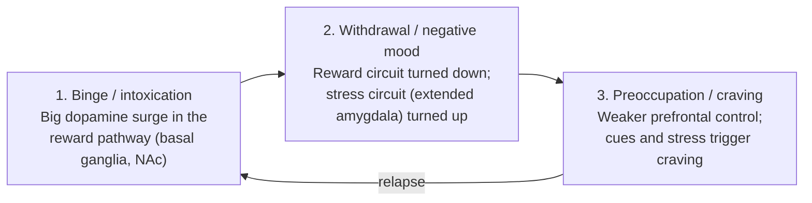

# Chapter 15: Psychiatric Disorders, Developmental Disorders, and Addiction

## Summary

Mental illnesses are common, real, and treatable conditions that involve the brain, the body, and life experiences. This chapter surveys depression, anxiety disorders, schizophrenia, autism, and ADHD, and explains why "a chemical imbalance" is too simple a story for any of them. It then follows the brain's reward pathway to show how addictive drugs, including nicotine and opioids, change synapses through tolerance and withdrawal. The chapter ends at the bedside with an opioid overdose, the medicine that reverses it (naloxone), and the treatments and attitudes that help people recover.

## Concepts Covered

1. Mental Illness
2. Depression
3. Anxiety Disorders
4. Schizophrenia
5. Autism Spectrum Disorder
6. ADHD
7. Psychiatric Medication
8. Reward Pathway
9. Addiction
10. Tolerance and Withdrawal
11. Nicotine and Vaping
12. Opioids
13. Naloxone
14. Stigma and Treatment Access

## Prerequisites

- [Chapter 1: Neurons, Glia, and the Nervous System](../01-neurons-and-glia/index.md)
- [Chapter 2: The Action Potential](../02-action-potential/index.md)
- [Chapter 3: Synapses and Neurotransmitters](../03-synapses-and-neurotransmitters/index.md)
- [Chapter 4: A Tour of the Brain: Neuroanatomy](../04-neuroanatomy/index.md)
- [Chapter 8: The Developing and Teenage Brain](../08-developing-teenage-brain/index.md)
- [Chapter 9: Learning, Memory, and Neuroplasticity](../09-learning-memory-plasticity/index.md)
- [Chapter 11: Emotion, Stress, and the Body](../11-emotion-and-stress/index.md)

!!! mascot-welcome "Brains that struggle are still brains"
    { class="mascot-admonition-img" }
    Hi, I'm Ply, and this may be the most personal chapter in the book. Almost everyone knows someone with depression, anxiety, ADHD, autism, or a substance use problem. Here, everything you learned about synapses and learning explains these conditions with science instead of blame, and knowing how to spot an overdose could let you save a life.

## 15.1 Maya's Friend and the Vape

Maya is 16, plays soccer, and is studying for the Brain Bee. After practice, her friend Jordan pulls out a small, colorful vape. "It's not like smoking," Jordan says. "It just helps me relax before a test." Lately Jordan vapes before first period, between classes, and on the bus. On a weekend trip without the vape, Jordan was irritable, couldn't focus, and talked about little else.

Maya has a Brain Bee question of her own: what is nicotine doing to Jordan's brain? To answer it, we need to know how the brain decides what is worth repeating (the reward pathway), how synapses adjust to a drug that keeps flooding them (tolerance), and why stopping feels so bad (withdrawal). First, though, we'll survey the conditions psychiatrists treat, because many involve the same circuits.

!!! note "If you need help now"
    If you or someone you know is struggling, call or text **988** (the Suicide & Crisis Lifeline in the U.S.). It is free, confidential, and available 24/7. You can also chat at [988lifeline.org](https://988lifeline.org/).

    For substance use or mental health treatment referrals, call **SAMHSA's National Helpline at 1-800-662-4357** (1-800-662-HELP). It is free, confidential, open 24/7, 365 days a year, and available in English and Spanish.

    If someone may be overdosing, **call 911**.

## 15.2 What Is a Mental Illness?

Start with an everyday picture. Think of the brain as a sound mixing board with thousands of sliders: how alert you feel, how much you worry, how much you enjoy things. Everyone's board is set a little differently, and the settings shift with sleep, stress, and life events. Usually the board adjusts itself. Sometimes a group of sliders gets stuck far out of range for weeks or months, and studying, sleeping, or connecting with others suffers. That is closer to what a mental illness is. The picture has a limit, though: the real brain has no single slider for worry or joy. Each "setting" comes from many circuits, genes, and experiences working together.

A **mental illness** is a condition that affects a person's thinking, emotions, or behavior in a lasting way and causes real distress or makes daily life harder. The National Institute of Mental Health (NIMH) separates "any mental illness" (mild to severe) from "serious mental illness," which seriously limits major life activities. These conditions involve the brain, genes, the body, relationships, and environment. None are character flaws.

Mental illness is common. In 2025, an estimated **54.6 million U.S. adults, or 20.6%, had a mental illness** in the past year, according to the National Survey on Drug Use and Health (NSDUH). Teens are affected too. In the same survey, about **15.1% of U.S. adolescents aged 12 to 17** (3.7 million) had a major depressive episode in the past year, down from 20.8% in 2021 ([SAMHSA, 2025 NSDUH](https://www.samhsa.gov/data/sites/default/files/reports/rpt57150/2025-nsduh-annual-national-report.pdf)). The survey changed how it estimates adult mental illness in 2025, so these adult numbers can't be compared directly with older published figures, such as the 23.1% for 2022 that NIMH still lists ([NIMH](https://www.nimh.nih.gov/health/statistics/mental-illness)).

How do doctors tell a disorder from a hard week? They look at:

- **How long** the symptoms last (for example, at least two weeks for depression)
- **How much** the symptoms disrupt school, work, relationships, or self-care
- **Whether something else** explains the symptoms better, such as a thyroid problem, a medication, or a drug

Clinicians use criteria from the *Diagnostic and Statistical Manual of Mental Disorders* to make these calls consistently. The current version is the DSM-5-TR, a text revision of the fifth edition released in 2022 ([American Psychiatric Association](https://psychiatry.org/news-room/news-releases/apa-releases-diagnostic-and-statistical-manual-of)). No single blood test or brain scan diagnoses these conditions today. Diagnosis comes from a careful interview and observation, plus tests to rule out other medical causes.

## 15.3 Depression and Anxiety Disorders

### Depression

Everyone feels sad sometimes. **Depression** (also called major depressive disorder or clinical depression) is different. It is a mood disorder in which a person has a low or "empty" mood, or loses interest and pleasure in most activities, for **most of the day, nearly every day, for at least two weeks** ([NIMH](https://www.nimh.nih.gov/health/publications/depression)). Other common symptoms include:

- Hopelessness, guilt, or feeling worthless
- Fatigue, trouble concentrating, and changes in sleep and appetite
- Aches and pains without a clear physical cause
- Thoughts of death or suicide

Notice how many symptoms involve the body, not just mood. Sleep, appetite, and energy depend partly on the hypothalamus and the stress system from [Chapter 11](../11-emotion-and-stress/index.md). NIMH describes the causes of depression as a mix of genetic, biological, environmental, and psychological factors.

Depression is treatable. Evidence-based talk therapies include **cognitive behavioral therapy (CBT)**, which helps people change unhelpful thoughts and behaviors. Antidepressant medicines usually take **about 4 to 8 weeks** to work. When other treatments haven't helped, doctors may use brain stimulation, such as electroconvulsive therapy (ECT) or repetitive transcranial magnetic stimulation (rTMS) ([NIMH](https://www.nimh.nih.gov/health/publications/depression)).

### Is depression a "chemical imbalance"?

You may have heard that depression is caused by "low serotonin." This idea, the **monoamine hypothesis**, guided drug development for decades because many antidepressants raise serotonin or norepinephrine at synapses. The full story is more complicated.

- If low serotonin were the whole cause, antidepressants should work within hours, because they raise serotonin at synapses quickly. Instead, they take weeks.
- Not everyone responds to medicines that target serotonin.
- A 2022 umbrella review in *Molecular Psychiatry* looked across many kinds of serotonin research and found **no consistent evidence that depression is caused by lowered serotonin** ([Moncrieff et al., 2022](https://pmc.ncbi.nlm.nih.gov/articles/PMC10618090/)). Other scientists debated some of its methods and conclusions. Most experts now describe depression as having many interacting causes rather than one missing chemical.

Still, "not caused by low serotonin" does **not** mean "antidepressants don't work" or "depression isn't real." Antidepressants help many people, possibly by changing how brain circuits adapt over weeks. One idea links long-term stress to lower levels of brain growth factors, and antidepressants to higher levels ([OpenStax, 14.2](https://openstax.org/books/introduction-behavioral-neuroscience/pages/14-2-psychotherapeutics)). Current views treat depression as the result of many interacting biological, psychological, and social factors.

!!! mascot-thinking "A traffic jam, not an empty tank"
    { class="mascot-admonition-img" }
    I like to picture depression less like a car with an empty gas tank and more like a city with a long-lasting traffic jam. Many roads, signals, and drivers are involved, so there is more than one way to help traffic flow again: medicine, therapy, sleep, exercise, and support can each open a different road.

### Anxiety disorders

Anxiety is a normal alarm. Before Maya's Brain Bee competition, her heart races, a response driven by the amygdala and stress hormones from [Chapter 11](../11-emotion-and-stress/index.md). **Anxiety disorders** are conditions in which fear or worry is too strong, lasts too long, shows up across many situations, and interferes with daily life. They are among the most common mental health conditions: based on large national surveys done in the early 2000s, NIMH reports that about a third of U.S. adolescents and adults experience an anxiety disorder at some point ([NIMH](https://www.nimh.nih.gov/health/statistics/any-anxiety-disorder)).

The table below compares the main types.

| Anxiety disorder | Core experience | Example |
|---|---|---|
| Generalized anxiety disorder (GAD) | Hard-to-control worry on most days for at least 6 months, plus symptoms like restlessness, fatigue, muscle tension, or poor sleep | Constant worry about grades, family, and health, even when things are going fine |
| Panic disorder | Repeated, unexpected surges of intense fear with a pounding heart, shortness of breath, or dizziness | Sudden fear in class that feels like a heart attack |
| Social anxiety disorder | Intense fear of being judged or embarrassed in social situations | Avoiding raising a hand or eating in the cafeteria |
| Specific phobias | Strong fear of a specific object or situation | Fear of needles that makes a person skip doctor visits |

For GAD, NIMH calls CBT the "gold standard" talk therapy. Medicines such as SSRIs and SNRIs (two antidepressant classes) can also help, though they take several weeks. Benzodiazepines act quickly, but people can develop tolerance and dependence, so doctors use them with caution and usually only briefly ([NIMH](https://www.nimh.nih.gov/health/publications/generalized-anxiety-disorder-gad)).

## 15.4 Schizophrenia

**Schizophrenia** is a serious mental illness that affects how a person thinks, feels, and behaves. People are usually first diagnosed between **ages 16 and 30**, after a first episode of **psychosis**, a state in which a person loses some contact with reality ([NIMH](https://www.nimh.nih.gov/health/topics/schizophrenia)). Doctors group the symptoms into three families ([NIMH](https://www.nimh.nih.gov/health/publications/schizophrenia)):

- **Psychotic (positive) symptoms** are experiences added to normal life: **hallucinations** (hearing or seeing things others don't, often voices), **delusions** (firm beliefs that are not true, such as being watched), and disorganized thinking or speech.
- **Negative symptoms** are abilities that are reduced: less motivation, less emotional expression, less speech, and pulling away from friends. They are sometimes mistaken for depression.
- **Cognitive symptoms** are problems with attention, concentration, and memory that make school or work harder.

Schizophrenia runs in families, but no single gene causes it. Many genes each add a little risk, which may combine with life experiences such as stressful surroundings or exposures before birth. Imaging studies find subtle differences in the size of some brain areas and in their connections.

The best-known chemical clue involves **dopamine**. Most older antipsychotic medicines block dopamine D2 receptors, and they reduce hallucinations and delusions. This led to the "dopamine hypothesis": too much dopamine signaling in certain pathways may drive psychotic symptoms. Like the serotonin story for depression, this is only part of the picture. Antipsychotics help negative and cognitive symptoms much less, and newer medicines act on several receptor types ([OpenStax, 14.2](https://openstax.org/books/introduction-behavioral-neuroscience/pages/14-2-psychotherapeutics)). In September 2024, the FDA approved xanomeline and trospium chloride (Cobenfy) for adults with schizophrenia. It is the first antipsychotic that targets acetylcholine (cholinergic) receptors instead of dopamine receptors, more evidence that dopamine is not the whole story ([FDA](https://www.fda.gov/news-events/press-announcements/fda-approves-drug-new-mechanism-action-treatment-schizophrenia)).

Treatment works best as a team effort: antipsychotic medicine reduces psychotic symptoms, and psychosocial treatments help with daily skills, school, and work. For first-episode psychosis, **coordinated specialty care**, a team-based, recovery-focused approach that includes the person and their family, is more effective at reducing symptoms than typical care ([NIMH](https://www.nimh.nih.gov/health/publications/schizophrenia)).

Two facts fight stigma. Schizophrenia is **not** "split personality," which is a different condition (dissociative identity disorder). And most people with schizophrenia are not violent. In fact, they are more likely than people without the illness to be harmed by others ([NIMH](https://www.nimh.nih.gov/health/publications/schizophrenia)).

## 15.5 Developmental Differences: Autism and ADHD

**Neurodevelopmental** conditions begin in early brain development and shape how a person experiences the world from childhood on. The **neurodiversity** perspective points out that human brains naturally vary, and that some differences bring real strengths as well as real challenges. Supports should help people thrive, not force everyone into one mold.

A note on language: many autistic people prefer identity-first language ("autistic person"), while others prefer person-first language ("person with autism"). This chapter uses both. When you're unsure how someone describes themselves, ask, and use what they prefer.

### Autism spectrum disorder

**Autism spectrum disorder (ASD)** is a neurological and developmental condition that affects how people communicate, interact with others, learn, and behave. It has two core features ([NIMH](https://www.nimh.nih.gov/health/publications/autism-spectrum-disorder)):

1. Differences in **social communication and interaction**, such as reading facial expressions, taking turns in conversation, or understanding unwritten social rules.
2. **Restricted interests and repetitive behaviors**, such as deep focus on favorite topics, strong preference for routines, repeated movements, or being over- or under-sensitive to sounds, lights, or textures.

It is called a **spectrum** because autistic people have a wide range of characteristics, needs, strengths, and challenges. One person may speak little and need daily support; another may excel at programming but find crowded hallways exhausting. Signs usually appear in the first two years of life.

The CDC's monitoring network estimated that **about 1 in 31 (3.2%) 8-year-old children** had been identified with autism in 2022 (the latest estimate as of 2026, published in 2025), and boys were identified more than three times as often as girls ([CDC](https://www.cdc.gov/autism/data-research/index.html)).

The primary causes are not fully known. Genes play a large role, and risk factors include having an autistic sibling, older parents, certain genetic conditions, and very low birth weight. **Vaccines do not cause autism.** For example, a Danish study that followed **657,461 children** found that the measles, mumps, and rubella (MMR) vaccine did not increase autism risk, even in children with an autistic sibling ([Hviid et al., 2019](https://pubmed.ncbi.nlm.nih.gov/30831578/)). The American Academy of Pediatrics says decades of large, high-quality studies have found the same thing ([AAP, HealthyChildren.org](https://www.healthychildren.org/English/safety-prevention/immunizations/Pages/Vaccine-Studies-Examine-the-Evidence.aspx)).

There is no single best approach to support. Behavioral, speech-language, and occupational therapies, along with school services, work best when started early. Medicines are not used to change autism itself, but doctors sometimes prescribe them for specific problems that can come with it, such as anxiety, attention difficulties, or irritability.

### ADHD

**Attention-deficit/hyperactivity disorder (ADHD)** is a neurodevelopmental condition marked by a lasting pattern of **inattention** (trouble staying focused, organized, or on task), **hyperactivity** (restlessness, excessive movement or talking), and **impulsivity** (acting or interrupting without waiting). Some people have mostly inattentive symptoms, some mostly hyperactive-impulsive symptoms, and some have both. To count as ADHD, symptoms must begin in childhood, show up in more than one setting, and interfere with daily life ([NIMH](https://www.nimh.nih.gov/health/topics/attention-deficit-hyperactivity-disorder-adhd)).

ADHD is real and common. An estimated **7 million U.S. children aged 3 to 17 (11.7%)** had a current ADHD diagnosis in 2024, according to a national survey of parents ([CDC](https://www.cdc.gov/adhd/data/index.html)). Studies suggest that genes play a large role, and symptoms usually continue into the teen years and adulthood.

Recall from [Chapter 8](../08-developing-teenage-brain/index.md) that the **prefrontal cortex**, the brain's planning and self-control center, matures last, and attention and impulse control depend on it. Standard ADHD treatment includes behavioral strategies, parent training, school supports, CBT, and medicine. The most common medicines are **stimulants** such as methylphenidate and amphetamine. They increase dopamine and norepinephrine signaling, especially in the prefrontal cortex ([OpenStax, 14.2](https://openstax.org/books/introduction-behavioral-neuroscience/pages/14-2-psychotherapeutics)). It may seem odd that a stimulant helps a hyperactive person, but boosting prefrontal control can make it easier to filter distractions and hold back impulses.

## 15.6 Psychiatric Medication: Acting at the Synapse

A **psychiatric medication** is a medicine used to treat a mental health condition by changing how brain cells signal. Most act at synapses, which you studied in [Chapter 3](../03-synapses-and-neurotransmitters/index.md). There are only a few basic moves a drug can make at a synapse:

- **Block reuptake**, so a neurotransmitter stays in the synapse longer (like plugging a drain)
- **Block a receptor** (an **antagonist**), so the neurotransmitter can't deliver its message
- **Activate a receptor** (an **agonist**), copying the neurotransmitter's message
- **Boost a receptor's response** to its natural messenger
- **Increase release** of a neurotransmitter

The table below matches each medication class from this chapter to its main move. These are general mechanisms only; this book never gives doses, and only a licensed clinician can decide whether a medicine is right for someone.

| Medication class | Main action at the synapse | Used for (examples) |
|---|---|---|
| SSRIs (selective serotonin reuptake inhibitors) | Block serotonin reuptake | Depression, anxiety disorders |
| Benzodiazepines | Boost the response of GABA-A receptors to GABA, the brain's main "brake" | Short-term relief of severe anxiety |
| Antipsychotics | Block dopamine D2 receptors (newer ones also act on serotonin and other receptors) | Schizophrenia and other psychotic disorders |
| Stimulants (methylphenidate, amphetamine) | Increase dopamine and norepinephrine signaling | ADHD |
| Esketamine nasal spray | Acts on the glutamate system | Treatment-resistant depression in adults; FDA-approved in 2019 and given only in a certified clinic |

Medicines are often **combined with therapy**, and for many conditions therapy alone works well. Medicines also have real side effects and warnings. For example, the FDA advises that children, teens, and young adults under 25 who start antidepressants be watched closely for new or worsening suicidal thoughts, especially early in treatment or after a dose change ([NIMH](https://www.nimh.nih.gov/health/publications/depression)). Never start, stop, or change a medicine without talking to a doctor.

## 15.7 The Reward Pathway

Back to Maya's question. First, an analogy. Imagine a teacher with a yellow highlighter. Every time something good or surprising happens (a goal in soccer, a tasty meal, a text from a friend), the teacher highlights it and writes "do this again!" Later, when you see a soccer ball or smell that food, you feel a pull toward it. Your brain has its own highlighter.

That system is the **reward pathway**, a set of connected brain regions that signal when something is valuable and help you learn to seek it again. Its main messenger is **dopamine**. The main players are:

- The **ventral tegmental area (VTA)**, a small cluster of dopamine-making neurons in the midbrain
- The **nucleus accumbens (NAc)**, a region deep in the front of the brain that is central to motivation and "wanting"
- The **prefrontal cortex (PFC)**, the front of the brain, which plans, makes decisions, and can say "not now"

Dopamine neurons in the VTA send axons along two main routes. The **mesolimbic pathway** runs to the nucleus accumbens, and the **mesocortical pathway** runs to the prefrontal cortex ([OpenStax, 14.3](https://openstax.org/books/introduction-behavioral-neuroscience/pages/14-3-neural-circuitry-of-drug-reward)). The prefrontal cortex, in turn, sends signals to the nucleus accumbens that help control whether you act on an urge. Memory and emotion regions, such as the hippocampus and amygdala, also connect to this circuit, which is how a place or a song can become linked to a reward.

Scientists still debate exactly what dopamine "means," but it is probably not a simple "pleasure chemical." The leading ideas say dopamine signals **surprise and importance**: it rises when a reward is better than expected, and it makes reward-linked cues feel worth chasing. That is a form of learning, like the synaptic strengthening in [Chapter 9](../09-learning-memory-plasticity/index.md).

Nearly all addictive drugs, though they act on different receptors, end up increasing dopamine signaling in the nucleus accumbens ([OpenStax, 14.3](https://openstax.org/books/introduction-behavioral-neuroscience/pages/14-3-neural-circuitry-of-drug-reward)). The difference from natural rewards is size and speed: drugs can produce much larger dopamine surges, which powerfully teach the brain to repeat drug use ([NIDA](https://nida.nih.gov/publications/drugs-brains-behavior-science-addiction/drugs-brain)).

## 15.8 Addiction, Tolerance, and Withdrawal

**Addiction** is a chronic, relapsing disorder in which a person compulsively seeks and uses a drug despite harmful consequences ([NIDA](https://nida.nih.gov/publications/drugs-brains-behavior-science-addiction/drug-misuse-addiction)). Doctors usually call it a **substance use disorder**. It involves lasting changes in brain circuits for reward, stress, and self-control. It is not the same as physical dependence: a person taking a prescribed pain medicine can become dependent without being addicted.

Who develops addiction? Genes, including epigenetic effects, account for an estimated **40 to 60 percent** of a person's risk. The environment matters too: stress, trauma, family drug use, peers, and drug availability all play roles. Starting young raises risk, because the teenage brain is still building its prefrontal "brakes" ([NIDA](https://nida.nih.gov/publications/drugs-brains-behavior-science-addiction/drug-misuse-addiction)).

### Tolerance: the brain turns down the volume

Picture living next to a train track. The first night, every train wakes you up. After a few weeks, you sleep right through it. **Tolerance** is the brain's version of this. When a drug floods synapses with dopamine again and again, neurons protect themselves by turning down the volume. They can **remove receptors** from their surface (called **downregulation**), release less dopamine, and change other signaling steps. The liver can also break the drug down faster ([OpenStax, 14.4](https://openstax.org/books/introduction-behavioral-neuroscience/pages/14-4-neurobiology-of-addiction)).

The result is that the same amount of drug gives a smaller effect, so the person needs more to feel the same high, or even just to feel normal. Because the reward circuit has become less responsive, everyday pleasures like food, friends, or music also feel less rewarding ([NIDA](https://nida.nih.gov/publications/drugs-brains-behavior-science-addiction/drugs-brain)).

### Withdrawal: the volume is down and the music stops

**Withdrawal** is the set of unpleasant symptoms that appear when a person who has developed dependence stops or cuts back on the drug. The brain has adjusted to the drug's constant presence, so taking it away leaves the system below its normal set point. Stress systems, especially in a region called the **extended amygdala**, become overactive and produce anxiety, irritability, and unease ([NIDA](https://nida.nih.gov/publications/drugs-brains-behavior-science-addiction/drugs-brain)). Physical withdrawal often fades over about a week, but psychological symptoms such as low mood and anxiety, and cravings triggered by cues, can last much longer ([OpenStax, 14.4](https://openstax.org/books/introduction-behavioral-neuroscience/pages/14-4-neurobiology-of-addiction)).

Researchers describe addiction as a repeating three-stage cycle, each stage linked to different brain regions. The flowchart below summarizes it.

This cycle helps explain why "just stop" is hard advice to follow: each stage pushes toward the next. Each stage is also a treatment target. Medicines can blunt a drug's effect, ease withdrawal, or reduce craving, and therapy can strengthen self-control and weaken responses to cues.

!!! mascot-thinking "Tolerance looks a bit like habituation"
    { class="mascot-admonition-img" }
    In Chapter 9, you saw my gill-withdrawal reflex shrink when I was touched over and over. Tolerance looks similar on the surface, because a repeated stimulus gives a smaller response, but it involves different molecules and much longer-lasting changes in the reward circuit.

#### Diagram: Reward Pathway and Tolerance

<iframe src="../../sims/ch15-reward-tolerance/main.html" height="547px" width="100%" scrolling="no"></iframe>

[Open the Reward Pathway and Tolerance fullscreen](../../sims/ch15-reward-tolerance/main.html){ .md-button .md-button--primary }

MicroSim specification: Reward Pathway and Tolerance

Type: microsim
**sim-id:** ch15-reward-tolerance 
**Library:** p5.js 
**Status:** Implemented 
**Bloom Level:** Understand 
**Bloom Verb:** explain 
**Learning Objective:** The learner will explain how repeated drug doses produce tolerance (smaller dopamine responses and a lower baseline from receptor downregulation) and how stopping produces a below-baseline withdrawal dip that recovers over days.

**Canvas:** drawing area 460 px plus control area 85 px (iframe 547 px); width-responsive.

**Controls:** Start/Pause, Natural reward, Drug dose, Stop drug, Reset. Starts paused; pressing Natural reward, Drug dose, or Stop drug also starts the clock.

**Behavior:** Left panel: a side view of the brain with the VTA sending dopamine to the nucleus accumbens (NAc) and prefrontal cortex (PFC), the PFC sending control signals to the NAc, and a row of 10 receptor icons on an NAc neuron. Right panel: dopamine signaling (relative units, original baseline = 1) over a scrolling 20-day window. Natural reward adds a bump of 0.6 times receptor availability; Drug dose adds a faster spike of 2.4 times receptor availability and removes 0.12 of receptor availability (floor 0.35). Stop drug adds a withdrawal dip equal to 0.5 times the receptors lost; the dip fades and receptors recover toward normal over about 20 to 30 simulated days. A message box explains each stage. All values are schematic, not measurements of any real drug.

Try this in order. Press **Start**, then **Natural reward**, and watch the small bump. Press **Drug dose** once and compare the spike. Then give five or six more doses, a second or two apart. Watch three things change at once: each spike gets shorter, the trace between spikes settles below the green "original baseline," and receptor icons disappear. That is tolerance.

Now press **Natural reward** again. The bump is smaller than before, because fewer receptors receive the signal. Finally, press **Stop drug**. The signal drops below even the lowered baseline (withdrawal), then climbs back slowly over the following "days" as receptors return. Recovery is real but slow, which is one reason support during early recovery matters. The sim does not show learned, cue-driven craving, which can outlast these receptor changes.

## 15.9 Nicotine and Vaping in the Teenage Brain

Now we can answer Maya's question. **Nicotine** is the addictive chemical in tobacco, and most e-cigarettes ("vapes") contain it. Nicotine fits into a type of acetylcholine receptor that is actually named after it, the **nicotinic acetylcholine receptor**. Activating these receptors leads to dopamine release in the reward pathway ([Wikipedia: Nicotinic acetylcholine receptor](https://en.wikipedia.org/wiki/Nicotinic_acetylcholine_receptor)). When nicotine is inhaled in cigarette smoke, levels peak within about **10 seconds** ([NIDA](https://nida.nih.gov/publications/research-reports/tobacco-nicotine-e-cigarettes/nicotine-addictive)), and fast arrival plus a dopamine boost is a strong recipe for learning to repeat a behavior.

Vaping has declined in recent years but is still common. In the **2025 National Youth Tobacco Survey**, about **1.44 million middle and high school students (5.2%)** reported currently using e-cigarettes, down from 5.9% in 2024. That included **7.1% of high school students**. Among students who vaped, **89.4%** used flavored products and **27.5%** vaped every day ([FDA](https://www.fda.gov/tobacco-products/youth-and-tobacco/results-annual-national-youth-tobacco-survey-nyts)).

Why does it matter more for teens? According to the CDC, brain development continues until about **age 25**, and nicotine during adolescence can harm parts of the brain that control attention, learning, mood, and impulse control. Teens can show signs of nicotine addiction quickly, sometimes before they vape regularly, and adolescents who use nicotine may be at higher risk for addiction to other drugs later ([CDC](https://www.cdc.gov/tobacco/e-cigarettes/health-effects.html)).

When a person dependent on nicotine stops, withdrawal can bring irritability, restlessness, anxiety, low mood, trouble sleeping or concentrating, hunger, and cravings. That matches what Maya saw in Jordan on the weekend trip. These symptoms are temporary and fade as the brain readjusts. Free help designed for teens is available at [teen.smokefree.gov](https://teen.smokefree.gov/), a National Cancer Institute site with a text-message quit program, and the free quitline 1-800-QUIT-NOW offers coaching by phone.

## 15.10 Opioids and Naloxone

### How opioids work

**Opioids** are drugs that act on the body's opioid receptors. Some are prescription pain medicines (such as morphine and oxycodone), some are illegal (heroin), and **fentanyl** is a synthetic opioid used in medicine but also made illegally. Your body makes its own opioid-like molecules, such as endorphins, that help control pain. Opioid drugs act on the same receptors, especially the **mu-opioid receptor**.

Opioid receptors sit in pain pathways, the reward pathway, and **brainstem regions that control breathing** (the medulla and pons). That last location is what makes opioids deadly: too much opioid slows breathing until the brain and heart are starved of oxygen. Fentanyl is especially dangerous. The CDC describes it as up to **50 times stronger than heroin and 100 times stronger than morphine** ([CDC](https://www.cdc.gov/stop-overdose/caring/fentanyl-facts.html)). Some counterfeit pills made to look like prescription medicines contain fentanyl, and people taking them often don't know it ([NIDA](https://nida.nih.gov/publications/drugfacts/fentanyl)).

Overdose deaths have fallen but remain high. In 2024, there were **79,384 drug overdose deaths** in the United States, and **54,045** involved an opioid. The overdose death rate fell **26.2%** from 2023 to 2024 ([CDC NCHS Data Brief 549](https://www.cdc.gov/nchs/products/databriefs/db549.htm)). Early numbers for 2025 show a third straight year of decline: CDC estimated about **69,973 overdose deaths in 2025**, about 44,564 of them involving opioids. These 2025 figures are provisional, which means they may change as more death records come in ([CDC NCHS, May 2026](https://www.cdc.gov/nchs/pressroom/releases/20260513.html)).

### Recognizing an overdose

The CDC lists these signs of an opioid overdose ([CDC](https://www.cdc.gov/stop-overdose/response/index.html)):

- Unconsciousness, or the person can't be woken up
- Slow or shallow breathing, or choking, gurgling, or snoring sounds
- Discolored skin, especially the lips and nails
- Small, constricted **"pinpoint pupils"** that don't react to light

Doctors remember the classic combination of **decreased consciousness, pinpoint pupils, and slowed breathing**.

### Naloxone: the antidote

**Naloxone** is a medicine that rapidly reverses an opioid overdose. It is an opioid **antagonist**: it attaches to opioid receptors, displaces the opioid, and blocks its effects. Breathing can recover within minutes. It comes as a nasal spray or an injection, and anyone can give it without medical training. In **March 2023**, the FDA approved **Narcan nasal spray for over-the-counter use**, making it the first naloxone product available without a prescription ([FDA](https://www.fda.gov/news-events/press-announcements/fda-approves-first-over-counter-naloxone-nasal-spray)). The FDA has since approved other over-the-counter naloxone nasal sprays, most recently in June 2026 ([FDA](https://www.fda.gov/news-events/press-announcements/fda-broadens-access-over-counter-naloxone-nasal-spray-opioid-overdose)). A related antidote, nalmefene nasal spray, was approved by prescription later in 2023.

Every reader should know these facts ([NIDA](https://nida.nih.gov/publications/drugfacts/naloxone)):

1. Naloxone has **no effect on a person with no opioids in their body**, so giving it when you aren't sure is generally safe.
2. It does **not** reverse overdoses from non-opioid drugs such as cocaine or methamphetamine.
3. It works for only about **30 to 90 minutes**, but many opioids last longer. The person can stop breathing again after naloxone wears off, so **emergency care is still needed**.
4. Strong opioids like fentanyl may need **more than one dose**.
5. A person who is dependent on opioids may go into **withdrawal** within minutes of naloxone. This is very unpleasant but usually not life-threatening.

!!! mascot-warning "Naloxone is not the end of the emergency"
    { class="mascot-admonition-img" }
    If you suspect an overdose, give naloxone if you have it **and call 911**. Stay with the person, try to keep them breathing, and lay them on their side, because naloxone can wear off before the opioid does.

### Treating opioid use disorder

Naloxone saves a life in the moment but does not treat addiction. **Opioid use disorder** is a chronic, treatable condition with effective, FDA-approved medicines ([NIDA](https://nida.nih.gov/research-topics/medications-opioid-use-disorder)):

- **Methadone** activates mu-opioid receptors slowly and lasts a long time, so it reduces cravings and withdrawal without an intense high. For opioid use disorder, it is given through approved opioid treatment programs.
- **Buprenorphine** partly activates mu-opioid receptors and also blocks other opioids from attaching. Since 2023, any clinician whose DEA registration allows prescribing this class of controlled medicine (Schedule III) can prescribe it for opioid use disorder, if state law allows ([SAMHSA](https://www.samhsa.gov/substance-use/treatment/resources/mat-act)).
- **Naltrexone** only blocks opioid receptors, so opioids can no longer produce a high. It is usually started after a person has fully stopped opioids.

These medicines reduce the risk of overdose death, yet NIDA reports that **fewer than 1 in 5** people with opioid use disorder are treated with them. The 2025 national survey agrees: of about 4.0 million people aged 12 or older with opioid use disorder, only **15.7%** received one of these medicines in the past year ([SAMHSA, 2025 NSDUH](https://www.samhsa.gov/data/sites/default/files/reports/rpt57150/2025-nsduh-annual-national-report.pdf)). Taking a prescribed medicine for opioid use disorder is treatment, not "trading one addiction for another," much as taking a daily medicine for any other chronic illness is treatment.

## 15.11 Stigma and Treatment Access

**Stigma** means negative attitudes, stereotypes, and discrimination aimed at people because of a condition. **Treatment access** means whether people can actually get care, which depends on cost, insurance, location, wait times, and whether they feel safe asking. The two are linked. NIDA notes that feeling stigmatized can make people with substance use disorders less willing to seek treatment ([NIDA](https://nida.nih.gov/research-topics/addiction-science/words-matter-preferred-language-talking-about-addiction)). In mental health more broadly, only about **half (50.9%) of U.S. adults with a mental illness** received mental health treatment in the past year in 2025 ([SAMHSA, 2025 NSDUH](https://www.samhsa.gov/data/sites/default/files/reports/rpt57150/2025-nsduh-annual-national-report.pdf)).

Words matter. Labeling a whole person by their illness can make them sound hopeless or blameworthy. The table below shows swaps recommended by NIDA, plus one for mental illness.

| Instead of... | Say... | Why |
|---|---|---|
| "addict," "junkie," "abuser" | "person with a substance use disorder" | Puts the person first, not the condition |
| "clean" / "dirty" (drug test) | "tested negative" / "tested positive" | Medical terms, no moral judgment |
| "former addict" | "person in recovery" | Recognizes recovery as ongoing |
| "a habit" | "substance use disorder" | "Habit" implies a person can simply choose to stop |
| "replacement therapy" | "medication for opioid use disorder" | Treatment, not a substitute drug |
| "schizophrenic," "crazy," "psycho" | "person with schizophrenia" or "person with a mental illness" | Avoids slurs and stereotypes |

Recovery is common, not a rare miracle. Relapse happens too, as it does in other chronic illnesses. NIDA estimates relapse rates of **40 to 60%** for substance use disorders, compared with **50 to 70%** for hypertension and asthma. Relapse means treatment may need to be restarted or adjusted, not that it failed ([NIDA](https://nida.nih.gov/publications/drugs-brains-behavior-science-addiction/treatment-recovery)).

!!! mascot-encourage "Asking for help is a brain skill"
    { class="mascot-admonition-img" }
    This chapter covers heavy topics, and it's okay if some of it hit close to home. Reaching out to a trusted adult, a doctor, or 988 uses your prefrontal cortex exactly the way it is meant to be used: planning a way forward.

## At the Bedside: An Overdose at a Dorm Party

!!! note "Meet the patient"
    Sam is a 19-year-old college student. At a party, Sam took a pill a friend said was a prescription pain reliever. Later, Sam's roommate found Sam slumped on a couch, unable to be woken, making slow, snoring breaths, with bluish lips. The roommate gave one spray of naloxone from the campus health center and called 911. Within minutes, Sam began breathing faster, woke up confused, and started sweating, shaking, and vomiting.

**What the doctor checks:** In the emergency department, the doctor checks Sam's airway, breathing rate, and blood oxygen level. The roommate reports that Sam's pupils were tiny before the naloxone. The team checks blood sugar and other causes of unresponsiveness, asks what Sam took, and watches for breathing to slow again as the naloxone wears off. A urine drug screen may be sent, but the standard opiate screen often misses fentanyl unless a fentanyl-specific test is ordered, so the doctor relies mainly on the clinical picture.

**Where is the problem? (localization):** Slow breathing localizes to the **brainstem breathing centers** in the medulla and pons, and decreased consciousness reflects depressed brain arousal. Together with pinpoint pupils, these form the classic opioid triad. The fast response to naloxone, an opioid receptor blocker, confirms that opioid receptors were involved.

**Diagnosis:** Opioid overdose, most likely from a counterfeit pill containing fentanyl.

**Why it happens:** Fentanyl strongly activates mu-opioid receptors. In the brainstem, this weakens the drive to breathe, so oxygen falls. Naloxone displaced fentanyl from the receptors, so breathing returned. Sam's sweating and vomiting suggest withdrawal, which hints that Sam's brain may already have adapted to regular opioid use (tolerance and dependence, Section 15.8).

**Treatment today:** Emergency teams support breathing, give more naloxone if needed, and keep watching the patient (NIDA advises monitoring for another 2 hours after the last naloxone dose), because naloxone can wear off before fentanyl does. If the patient has opioid use disorder, the team can start a medication such as buprenorphine and connect the person to ongoing treatment, and can encourage the patient and family to keep naloxone on hand.

**What's new in research:** Starting treatment in the emergency department works. In a randomized trial of 329 patients with opioid dependence, **78%** of those started on buprenorphine in the emergency department were engaged in addiction treatment 30 days later, compared with **37%** of those given a referral alone ([D'Onofrio et al., *JAMA*, 2015](https://pmc.ncbi.nlm.nih.gov/articles/PMC4527523/)). Access has also widened. In late 2022, Congress removed the special federal "X-waiver" that clinicians once needed to prescribe buprenorphine for opioid use disorder ([SAMHSA](https://www.samhsa.gov/substance-use/treatment/resources/mat-act)), and naloxone nasal spray became available over the counter in 2023.

??? question "Your turn: diagnose a variation"
    Riley is 16. Riley started vaping a year ago "just at parties," but now vapes first thing every morning, can't get through first period without feeling irritable and restless, and has trouble sleeping and concentrating whenever the vape runs out. Riley has tried to stop twice and gave up after a day. Riley is fully awake, breathing normally, and has normal-sized pupils. What is going on, and what would help?

    **Answer:** This is **nicotine dependence** from vaping, not an overdose. Riley shows tolerance (vaping more often), withdrawal (irritability, restlessness, poor sleep and focus), and failed quit attempts, all signs that the reward pathway has adapted to nicotine. Naloxone would do nothing, because nicotine does not act on opioid receptors. Helpful steps include talking with a doctor or school nurse, counseling, and teen quit programs such as the text program at [teen.smokefree.gov](https://teen.smokefree.gov/). Withdrawal symptoms are temporary.

*This is a fictional teaching case. It is not medical advice. If you or someone you know has symptoms like these, talk to a doctor.*

## Common Misconceptions

**Myth:** Addiction is just a lack of willpower.  
**Reality:** Addiction involves measurable changes in the brain's reward, stress, and self-control circuits, and genes account for an estimated 40 to 60% of the risk. Repeated drug use weakens the very prefrontal "brakes" a person needs to choose differently, which is why medicines and therapy help.

**Myth:** Mental illness is rare.  
**Reality:** About 20.6% of U.S. adults (one in five) had a mental illness in 2025, and about a third of teens and adults experience an anxiety disorder at some point. You almost certainly know someone affected.

**Myth:** ADHD isn't real; it's just kids being lazy or hyper.  
**Reality:** ADHD is a well-studied neurodevelopmental condition with a strong genetic component. It affects attention, activity, and impulse control in multiple settings and often continues into adulthood. Effective treatments exist.

**Myth:** Depression is simply a "chemical imbalance" of low serotonin.  
**Reality:** Large reviews have not found consistent evidence that low serotonin causes depression. Depression arises from many interacting biological, psychological, and social factors. Antidepressants and therapy still help many people.

**Myth:** People with schizophrenia have a "split personality" and are dangerous.  
**Reality:** Schizophrenia involves psychosis, not multiple personalities. Most people with schizophrenia are not violent, and they are more likely than people without the illness to be harmed by others.

## Brain Bee Practice

??? question "1. Name the midbrain region where the dopamine neurons of the reward pathway begin, and one region they project to."
    The ventral tegmental area (VTA). Its dopamine neurons project to the nucleus accumbens (mesolimbic pathway) and to the prefrontal cortex (mesocortical pathway).

??? question "2. A patient is unresponsive with pinpoint pupils and a breathing rate of 6 breaths per minute. What drug class is most likely involved, and what is the antidote?"
    Opioids. The antidote is naloxone, an opioid receptor antagonist that displaces opioids from their receptors and restores breathing.

??? question "3. What is the difference between tolerance and withdrawal?"
    Tolerance is a reduced response to the same amount of a drug after repeated use, for example from receptor downregulation. Withdrawal is the set of symptoms, often opposite to the drug's effects, that appears when a person who has adapted to the drug stops taking it.

??? question "4. Which receptor does nicotine activate, and how does that lead to reinforcement?"
    Nicotine activates nicotinic acetylcholine receptors. This leads to dopamine release in the reward pathway, which reinforces (teaches the brain to repeat) nicotine use.

??? question "5. Name the three symptom groups of schizophrenia and give one example of each."
    Psychotic or positive symptoms (hallucinations, delusions), negative symptoms (reduced motivation or emotional expression), and cognitive symptoms (trouble with attention or memory).

## Exercises

### Remember

1. List the three FDA-approved medications for opioid use disorder discussed in this chapter.
2. State the two core features of autism spectrum disorder.

??? note "Answer"
    1. Methadone, buprenorphine, and naltrexone.
    2. Differences in social communication and interaction, and restricted interests and repetitive behaviors.

### Understand

3. Explain why naloxone is generally safe to give to an unresponsive person even when you aren't sure they took opioids.
4. Explain in your own words why antidepressants taking several weeks to work is evidence against a simple "low serotonin" theory of depression.

??? note "Answer"
    3. Naloxone only blocks opioid receptors. If no opioids are present, there is nothing for it to reverse, so it has no effect. If opioids are present, it may save the person's life.
    4. Antidepressants raise serotonin at synapses within hours. If low serotonin were the whole cause, mood should improve just as fast. The delay suggests that slower changes in brain circuits, not the serotonin level itself, drive recovery.

### Apply

5. In the Reward Pathway and Tolerance MicroSim, give six drug doses, then press Natural reward. Compare the bump with the one at the start, and use the receptor icons to explain the difference.
6. A classmate faints at a party but is breathing normally and has normal pupils. Someone wants to give naloxone. What should you do first, and is naloxone likely to help?

### Analyze

7. Compare how nicotine and opioids each lead to dopamine release in the reward pathway, and explain why only opioids commonly cause deaths from stopped breathing.
8. Two students vaped for a year. One quit easily; the other could not. Analyze how genes, environment, and brain development could explain the difference.

### Evaluate

9. A website claims, "Medications for opioid use disorder just replace one drug with another." Evaluate this claim using evidence from this chapter.
10. Should your school stock naloxone nasal spray and teach students to use it? Weigh benefits and risks, and recommend a decision.

### Create

11. Design a 30-second teen public service announcement about vaping that is accurate, avoids scare tactics, and uses two facts from this chapter.
12. Write a short fictional case of a teen with depression, an anxiety disorder, ADHD, or autism. Include what the family notices, what a doctor would ask, and respectful language throughout.

## Key Takeaways

- Mental illnesses are common, real, and treatable; they involve the brain, genes, the body, and life experiences, not personal weakness.
- Depression, anxiety disorders, and schizophrenia are each more complex than a single "chemical imbalance," and treatment often combines therapy, medicine, and support.
- Autism and ADHD are neurodevelopmental conditions that begin early in life; a neurodiversity view pairs real supports with respect for different kinds of minds.
- The reward pathway (VTA to nucleus accumbens and prefrontal cortex) uses dopamine to mark what is worth repeating, and addictive drugs hijack it with unusually large dopamine surges.
- Repeated drug use causes tolerance (fewer receptors, smaller responses, lower baseline), and stopping causes withdrawal; recovery of these changes takes time.
- Opioids can stop breathing by acting on the brainstem; naloxone reverses an overdose, but always call 911, and medications for opioid use disorder save lives.
- Stigma keeps people from care. Use person-first, non-judgmental language, and know the numbers: **988** for crisis support and **1-800-662-4357** for SAMHSA's National Helpline.

!!! mascot-celebration "You made it through a big one!"
    { class="mascot-admonition-img" }
    You can now trace mood, attention, and addiction back to synapses and circuits, and you know how to help in an overdose. Next, in Chapter 16, we put on the white coat and learn how doctors examine the brain, from the neurological exam to MRI.
