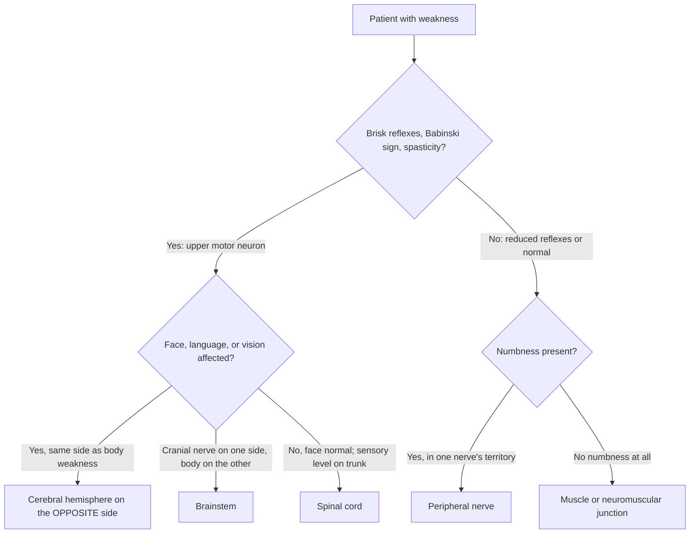

# Chapter 16: How Doctors Examine the Brain

## Summary

This capstone chapter puts you in the doctor's chair. You'll learn how a neurologist listens to a patient's story, runs the neurological exam from mental status to gait, and uses the findings to answer the most important question in neurology: *where is the problem?* Then you'll compare the tools that look inside the head (CT, MRI, fMRI, PET, and EEG), learn when a lumbar puncture helps, and see how doctors build a differential diagnosis. Finally, you'll follow one fictional patient from the ambulance to a diagnosis, using ideas from every earlier chapter.

## Concepts Covered

1. Neurological Exam
2. Mental Status Exam
3. Cranial Nerve Exam
4. Reflex Testing
5. Lesion Localization
6. Computed Tomography (CT)
7. Magnetic Resonance Imaging
8. Functional MRI
9. PET Scan
10. Lumbar Puncture
11. Differential Diagnosis

## Prerequisites

This chapter draws on the whole book. The most important earlier chapters are:

- [Chapter 1: Neurons, Glia, and the Nervous System](../01-neurons-and-glia/index.md) (myelin, motor neurons, multiple sclerosis)
- [Chapter 4: A Tour of the Brain](../04-neuroanatomy/index.md) (lobes, brainstem, spinal cord, cranial nerves, meninges, cerebrospinal fluid)
- [Chapter 6: Hearing, Touch, Taste, Smell, and Pain](../06-hearing-touch-taste-smell-pain/index.md) (dermatomes)
- [Chapter 7: Movement](../07-movement/index.md) (reflex arcs, the corticospinal tract, upper vs lower motor neurons, the cerebellum)
- [Chapter 10: Sleep and Brain States](../10-sleep-and-brain-states/index.md) (the EEG)
- [Chapter 12: Language, Attention, and Decision-Making](../12-language-attention-decisions/index.md) (aphasia and neglect)
- [Chapter 14: Brain Injury, Stroke, and Epilepsy](../14-injury-stroke-epilepsy/index.md) (stroke, BE-FAST, clot-busting treatment, seizures)

!!! mascot-welcome "You're the doctor now"
    { class="mascot-admonition-img" }
    I'm Ply, and I've been with you since your first neuron. In this last chapter, everything you've learned turns into a skill: figuring out what's wrong with a real nervous system using your questions, your hands, and a few clever machines. This is how neurologists think, and it's exactly what the patient-diagnosis round of the Brain Bee tests.

## 16.1 You're the Doctor Now

Maya, 16, has made it to her regional Brain Bee after months of studying between soccer practices. The round she fears most is patient diagnosis. On the screen, a man walks with a stiff, swinging leg, and a short written history sits beside the video. In the International Brain Bee format, students watch patient videos, read a written history, and pick three diagnostic tests before naming a diagnosis ([International Brain Bee](https://www.thebrainbee.org/competition/); rules change, so check your own competition's).

Maya knows dozens of diseases. But the real question isn't "Which disease do I remember?" It's "Where in the nervous system is this coming from?" Now imagine you're a doctor in an emergency room. A patient arrives with weakness on one side of the body. What do you do first? Order a scan? Grab a reflex hammer? This chapter answers that question step by step.

## 16.2 Where Before What: The Detective's Rule

Before any vocabulary, picture an electrician called to an apartment building with a power problem.

- If **one lamp** in one room is dark, the problem is probably that lamp's bulb or cord.
- If **every outlet on the left side of the 5th floor** is dead, the problem is in that floor's left-side circuit panel.
- If **every floor below the 3rd floor** is dark, the problem is in the main cable that runs down through the building, at about the 3rd floor.

The electrician first asks **where** the fault must be to explain the *pattern* of what's broken. Only then does she ask **what** broke: a blown fuse, a chewed wire, water damage.

Neurologists work the same way. The nervous system is wired in a very orderly way ([Chapter 4](../04-neuroanatomy/index.md), [Chapter 7](../07-movement/index.md)), so the pattern of symptoms points to a location. This skill is called **lesion localization**: using symptoms and exam findings to figure out where in the nervous system the damage (the *lesion*) must be. A lesion is any area of damaged or abnormal tissue, from a stroke, tumor, infection, or injury. Once the "where" is clear, the doctor asks "what," building a list of possible causes called the differential diagnosis (Section 16.8).

!!! mascot-thinking "Where, then what"
    { class="mascot-admonition-img" }
    Here's the big idea of this whole chapter: localize first, then name the disease. A blocked artery and a tumor can sit in the same spot and cause the same signs. The *pattern* tells you where; the *timing* and tests tell you what.

## 16.3 The History: Listening to the Patient's Story

The first tool a neurologist uses isn't a machine. It's a conversation. The **history** is the patient's story: what happened, when it started, how it changed, and what else is going on in their health. The exam begins during the history, because the doctor is already watching how the patient talks, moves, and walks ([Merck Manual](https://www.merckmanuals.com/professional/neurologic-disorders/neurologic-examination/introduction-to-the-neurologic-examination)). A good history answers a few questions:

- **What exactly is the problem?** "Weak" might mean loss of strength, clumsiness, numbness, or tiredness.
- **When did it start, and how fast?** This is often the best clue to *what* the lesion is.
- **Is it getting better, worse, or staying the same?**
- **What else is going on?** Headache, fever, a recent seizure, past strokes, medicines, or family history.

### Timing tells a story

How fast symptoms appear hints at their cause. The table below summarizes a common rule of thumb. It's a guide, not a law.

| How symptoms began | Often suggests | Example from this book |
|---|---|---|
| Seconds to minutes | A blood vessel problem or a seizure | Stroke ([Chapter 14](../14-injury-stroke-epilepsy/index.md)) |
| Hours to days | Infection or inflammation | Meningitis; a multiple sclerosis flare ([Chapter 1](../01-neurons-and-glia/index.md)) |
| Weeks to months | Something growing or pressing | A tumor pressing on a nerve or the spinal cord |
| Months to years | Slow nerve-cell loss (neurodegeneration) | Alzheimer's or Parkinson's disease ([Chapters 7](../07-movement/index.md) and [13](../13-aging-and-neurodegeneration/index.md)) |

For a suspected stroke, the key question is *when was the patient last known to be normal?* Clot-busting treatment only helps within a limited time window, so doctors ask right away ([NINDS](https://www.ninds.nih.gov/health-information/stroke/assess-and-treat)).

## 16.4 The Neurological Exam: A Head-to-Toe Tour

The **neurological exam** is a set of hands-on tests that checks each major part of the nervous system: thinking, cranial nerves, movement, reflexes, feeling, coordination, and walking. Its purpose is to decide whether the nervous system works normally and, if not, to connect each abnormal finding to a structure ([Merck Manual](https://www.merckmanuals.com/professional/neurologic-disorders/neurologic-examination/introduction-to-the-neurologic-examination)). The basics take only a few minutes. Here's a map of the tour; we'll visit each stop below.

| Part of the exam | What it checks | Example test |
|---|---|---|
| Mental status | Alertness, orientation, attention, memory, language | "What's today's date? Where are we?" |
| Cranial nerves | The 12 nerves of the head and face | Follow my finger with your eyes |
| Motor | Muscle bulk, tone, strength | Push against my hand |
| Reflexes | Stretch reflexes and the plantar (sole) response | Tap the knee with a reflex hammer |
| Sensation | Touch, pain, temperature, vibration, position sense | Is this sharp or dull? |
| Coordination | Smooth, accurate movement (cerebellum and its connections) | Touch your nose, then my finger |
| Gait | Walking and balance | Walk heel-to-toe in a straight line |

### Mental status: is the "boss" online?

The **mental status exam** checks the brain's highest functions. The doctor first notes the level of consciousness (alert, drowsy, or hard to wake), then checks ([Merck Manual](https://www.merckmanuals.com/professional/neurologic-disorders/neurologic-examination/how-to-assess-mental-status)):

- **Orientation:** Does the patient know who they are, where they are, and the date?
- **Attention:** Can they spell a word forward and backward?
- **Memory:** Can they remember three words after a few minutes? Do they recall recent events?
- **Language:** Can they speak fluently, understand commands, name objects, and repeat a sentence?
- **Other abilities:** calculation, judgment, mood, and copying a drawing.

These findings are powerful localizing clues. Trouble with language or calculation points to the dominant hemisphere, the left one in most people (recall the aphasias from [Chapter 12](../12-language-attention-decisions/index.md)). Ignoring one side of space (neglect) usually points to the right hemisphere. Screening tests such as the Mini-Mental State Examination and the Montreal Cognitive Assessment (MoCA) score these abilities, for example when checking for Alzheimer's disease.

### The cranial nerve exam: twelve nerves, quick checks

You met the 12 **cranial nerves** in [Chapter 4](../04-neuroanatomy/index.md). They leave the brain and brainstem directly, not through the spinal cord. The **cranial nerve exam** tests each one with a quick task. Because most of them start in the brainstem, an abnormal finding hints that the problem is in the brainstem or in that nerve. The table summarizes the bedside tests ([Merck Manual](https://www.merckmanuals.com/professional/neurologic-disorders/neurologic-examination/how-to-assess-the-cranial-nerves)).

| Nerve | Main job | Quick bedside test |
|---|---|---|
| I (olfactory) | Smell | Identify a familiar smell, one nostril at a time |
| II (optic) | Vision | Read an eye chart; check side vision; shine a light in the pupils |
| III, IV, VI (oculomotor, trochlear, abducens) | Eye movements, eyelid, pupil size | Follow a finger in all directions; look for a droopy lid |
| V (trigeminal) | Feeling in the face; chewing muscles | Light touch and pinprick on the face; clench the jaw |
| VII (facial) | Facial expression; taste on the front of the tongue | Raise eyebrows, close eyes tight, smile |
| VIII (vestibulocochlear) | Hearing and balance | Whisper a word; look for jerky eye movements (nystagmus) |
| IX, X (glossopharyngeal, vagus) | Swallowing, voice, gag | Say "ah" and watch the palate rise |
| XI (accessory) | Neck and shoulder muscles | Shrug the shoulders and turn the head against resistance |
| XII (hypoglossal) | Tongue movement | Stick out the tongue; a weak side makes it point toward that side |

One finding deserves a spotlight: the **forehead rule**. When a stroke in the cortex weakens the face, the lower face droops but the forehead still wrinkles. When the facial nerve itself (cranial nerve VII) is damaged, the *whole* half of the face is weak, forehead included ([Merck Manual](https://www.merckmanuals.com/professional/neurologic-disorders/neurologic-examination/how-to-assess-the-cranial-nerves)). Why? The nerve cells for the forehead get signals from *both* hemispheres, while those for the lower face get signals mainly from the *opposite* one ([Wikipedia: Central facial palsy](https://en.wikipedia.org/wiki/Central_facial_palsy)). If one hemisphere is damaged, the other still runs the forehead. If the nerve is cut off, nothing gets through.

!!! mascot-tip "Check the forehead"
    { class="mascot-admonition-img" }
    Whenever you see a droopy face, ask the patient to raise their eyebrows. A forehead that still wrinkles points to the brain (a central pattern). A forehead that stays flat points to the facial nerve (a peripheral pattern).

### The motor exam: strength, bulk, and tone

The motor exam starts by looking. Are any muscles wasted (shrunken)? Are there **fasciculations**, tiny twitches under the skin? Then the doctor checks **tone**, the resistance a relaxed limb gives when moved, and tests **strength** muscle by muscle, comparing sides. Strength is graded 0 to 5 on the UK Medical Research Council scale ([Merck Manual](https://www.merckmanuals.com/professional/neurologic-disorders/neurologic-examination/how-to-assess-muscle-strength)):

| Grade | What the doctor sees |
|---|---|
| 0 | No muscle contraction at all |
| 1 | A flicker of contraction, but no real movement |
| 2 | Movement only when gravity is taken away (for example, sliding the arm across a bed) |
| 3 | Movement against gravity, but not against the examiner's push |
| 4 | Movement against some resistance |
| 5 | Full, normal strength |

A sensitive test for mild arm weakness is **pronator drift**: with both arms held straight out, palms up, eyes closed, a weak arm slowly drifts down and turns inward.

### Reflex testing: the knee-jerk and its cousins

In [Chapter 7](../07-movement/index.md) you learned that tapping a tendon stretches the muscle, and a quick loop through the spinal cord makes it contract: the stretch reflex. **Reflex testing** means triggering these reflexes with a rubber hammer, grading the response, and checking the sole of the foot for an abnormal toe response. Reflexes are graded 0 to 4+ ([Wikipedia: Stretch reflex](https://en.wikipedia.org/wiki/Stretch_reflex)):

| Grade | Response | Meaning |
|---|---|---|
| 0 | No response | Always abnormal |
| 1+ | Slight but present | May or may not be normal |
| 2+ | Brisk, ordinary response | Normal |
| 3+ | Very brisk | May or may not be normal |
| 4+ | Clonus (repeated rhythmic beats) | Always abnormal |

Each reflex tests particular spinal cord segments, so reflexes form a built-in map of the cord: biceps (C5 and C6), triceps (C7), knee jerk (mainly L3 and L4), and ankle jerk (S1) ([Merck Manual](https://www.merckmanuals.com/professional/neurologic-disorders/neurologic-examination/how-to-assess-reflexes); [Wikipedia: Patellar reflex](https://en.wikipedia.org/wiki/Patellar_reflex)). C, L, and S mean cervical (neck), lumbar (lower back), and sacral (base of the spine).

The most famous reflex test isn't a tendon tap. When the doctor strokes the outer sole, a healthy adult's big toe curls *down*. If it goes *up* and the other toes fan out, that's the **Babinski sign**, described by the French neurologist Joseph Babinski in 1896 ([Wikipedia: Babinski sign](https://en.wikipedia.org/wiki/Babinski_sign)). In adults, it means damage along the corticospinal tract, the main motor pathway from cortex to spinal cord. In babies, an upgoing toe is normal; it usually switches to downgoing by about 12 months.

Why would damage *above* the spinal cord make reflexes *stronger*? The brain normally sends calming signals down to the reflex loops. Cut that brake, and the reflexes run hot. So brisk reflexes, sustained clonus, and a Babinski sign all signal upper motor neuron damage ([Merck Manual](https://www.merckmanuals.com/professional/neurologic-disorders/neurologic-examination/how-to-assess-reflexes)).

### The sensory exam: mapping what the patient feels

The sensory exam checks light touch, pinprick (sharp versus dull), temperature, vibration (with a tuning fork), and **position sense**, the ability to tell which way a toe is being moved with eyes closed. These feelings travel up the cord in different pathways, so the pattern of loss is another clue.

The doctor also maps the edge of any numb area. Recall **dermatomes** from [Chapter 6](../06-hearing-touch-taste-smell-pain/index.md): each spinal nerve supplies a band of skin. Two landmarks: the nipple line is about T4, and the belly button is about T10 ([Wikipedia: Dermatome](https://en.wikipedia.org/wiki/Dermatome_%28anatomy%29)). Numbness below a horizontal line on *both* sides is called a **sensory level**, a classic sign of spinal cord damage at or above that level.

In the **Romberg test**, the patient stands with feet together, eyes open, then closed. Falling once the eyes close is a positive test: the patient was using vision to make up for lost position sense, often from damage to the spinal cord's dorsal columns or the sensory nerves. It is not a test of the cerebellum ([Wikipedia: Romberg's test](https://en.wikipedia.org/wiki/Romberg%27s_test)).

### Coordination and gait: the cerebellum's report card

In **finger-to-nose**, the patient touches their nose, then the doctor's finger, back and forth. In **heel-to-shin**, they slide one heel down the other shin. A side-to-side wobble as the hand moves (an intention tremor) suggests a problem in the cerebellum, which you met in [Chapter 7](../07-movement/index.md). But weakness can also spoil these tests, so they're read alongside strength ([Merck Manual](https://www.merckmanuals.com/professional/neurologic-disorders/neurologic-examination/how-to-assess-gait-stance-and-coordination)).

Walking tests almost everything at once. A wide, unsteady gait suggests cerebellar trouble. A stiff gait with scraping toes suggests upper motor neuron damage to the legs. Small, shuffling steps suggest Parkinson's disease ([NINDS](https://www.ninds.nih.gov/health-information/disorders/parkinsons-disease)).

!!! mascot-encourage "So many tests!"
    { class="mascot-admonition-img" }
    That's a lot of hammers and tuning forks, I know. For now, just remember the seven stops from the top down: mental status, cranial nerves, motor, reflexes, sensation, coordination, gait.

## 16.5 Lesion Localization: Putting the Clues Together

Now comes the detective work. Neurologists localize by asking three questions in order:

1. **Is it the central or the peripheral nervous system?** (Upper or lower motor neuron?)
2. **Which side?**
3. **What level?** (Cortex, brainstem, spinal cord, nerve, or muscle?)

### Question 1: Upper or lower motor neuron?

Recall from [Chapter 7](../07-movement/index.md) that movement uses a two-neuron chain. An **upper motor neuron** runs from the motor cortex down the corticospinal tract. A **lower motor neuron** runs from the brainstem or spinal cord out through a nerve to the muscle. Damage to each causes weakness with a different signature ([Wikipedia: UMN lesion](https://en.wikipedia.org/wiki/Upper_motor_neuron_lesion); [Wikipedia: LMN lesion](https://en.wikipedia.org/wiki/Lower_motor_neuron_lesion); [Merck Manual](https://www.merckmanuals.com/professional/neurologic-disorders/neurologic-examination/how-to-assess-the-motor-system)). The table compares the signs you just learned to test.

| Finding | Upper motor neuron lesion (brain or spinal cord) | Lower motor neuron lesion (nerve root or nerve) |
|---|---|---|
| Tone | Increased (spastic) | Decreased (floppy, or flaccid) |
| Reflexes | Brisk (hyperreflexia), sometimes clonus | Reduced or absent |
| Babinski sign | Present (big toe goes up) | Absent |
| Muscle wasting | Little, at least early on | Often marked over time |
| Fasciculations | Absent | Often present |
| Facial weakness | Lower face only (forehead spared) | Whole half of the face |

Real patients don't always match the table. ALS ([Chapter 13](../13-aging-and-neurodegeneration/index.md)) damages both kinds of motor neuron and mixes the two sets of signs. So doctors use the whole pattern, never one sign alone.

### Question 2: Which side?

About 90% of the fibers in the corticospinal tract cross to the other side at the bottom of the medulla, in a spot called the pyramidal decussation ([Wikipedia: Pyramidal decussation](https://en.wikipedia.org/wiki/Pyramidal_decussation)). This crossing creates the most useful rule in localization:

- A lesion **above** the crossing (cortex, deep white matter, most of the brainstem) causes weakness on the **opposite** side of the body.
- A lesion **below** the crossing (spinal cord) causes weakness on the **same** side, below the level of the lesion.

So right-sided weakness plus language trouble shouts "left hemisphere." Most cranial nerves, though, don't cross before reaching their muscles. That creates a famous brainstem clue, **crossed signs**: one brainstem lesion damages a cranial nerve on one side *and* the not-yet-crossed corticospinal tract, causing a cranial nerve problem on one side and arm and leg weakness on the other ([Wikipedia: Alternating hemiplegia](https://en.wikipedia.org/wiki/Alternating_hemiplegia)).

### Question 3: What level?

Each level of the nervous system leaves its own fingerprint:

- **Cerebral hemisphere:** weakness and numbness on the opposite side, plus "cortical" signs such as aphasia, neglect, or loss of half the visual field, which can only come from the brain.
- **Brainstem:** crossed signs, double vision, trouble swallowing, slurred speech, or dizziness.
- **Spinal cord:** normal face, normal thinking, a sensory level across the trunk, upper motor neuron signs below the lesion, and often bladder problems.
- **Peripheral nerve:** weakness and numbness in the territory of a nerve, with reduced reflexes.
- **Muscle:** weakness without any numbness, often on both sides and often in the larger muscles close to the trunk, such as those of the hips and shoulders.

The flowchart below turns the three questions into a simplified decision path, the same logic you'll use in the MicroSim.

Notice the last box includes the **neuromuscular junction**, the synapse between nerve and muscle. Myasthenia gravis from [Chapter 3](../03-synapses-and-neurotransmitters/index.md) lives there, which is why it causes weakness without numbness.

#### Diagram: Neuro Exam Decision Tree

<iframe src="../../sims/ch16-neuro-exam/main.html" height="827px" width="100%" scrolling="no"></iframe>

[Open the Neuro Exam Decision Tree fullscreen](../../sims/ch16-neuro-exam/main.html){ .md-button .md-button--primary }

MicroSim specification: Neuro Exam Decision Tree

Type: microsim
**sim-id:** ch16-neuro-exam 
**Library:** p5.js 
**Status:** Implemented 
**Bloom Level:** Analyze 
**Bloom Verb:** differentiate 
**Learning Objective:** The learner will differentiate lesion locations (left or right cerebral hemisphere, brainstem, spinal cord, peripheral nerve, muscle) by analyzing a pattern of exam findings in three fictional cases.

**Canvas:** width-responsive; fixed height 825 px (640 drawing area + 185 control area).

**Controls:** case menu (3 cases) and Reset; nine exam-step buttons (Mental status, Cranial nerves, Strength, Reflexes, Sensation, Coordination, Gait, Order CT, Order MRI); location menu (6 choices) and Check.

**Cases (fictional composites):** (1) sudden right-sided weakness with aphasia and forehead-sparing facial droop; answer: left cerebral hemisphere. (2) whole right half-face weakness including the forehead, everything else normal; answer: peripheral nerve (facial nerve, CN VII). (3) three weeks of stiff, weak legs, brisk leg reflexes with Babinski signs, a sensory level near the belly button (T10), and bladder urgency; answer: spinal cord.

**Behavior:** each exam step adds a short finding to a findings list and shows a longer explanation. Checking requires at least 3 steps. Correct and incorrect answers get case-specific feedback naming the reasoning (or the misconception behind a wrong choice). After two wrong attempts the correct location is revealed. Feedback boxes use both color and a text label.

Try Case 1 first. Before pressing any button, predict which hemisphere is damaged from the summary alone, then watch whether each finding supports your guess. Next, compare Case 1 with Case 2: both patients have a droopy face, but the forehead behaves differently, and that one difference moves the lesion from the brain to a nerve. In Case 3, notice what a head CT *can't* tell you.

Then try the challenge: can you localize each case with only 3 exam steps? That's the kind of choice the Brain Bee patient-diagnosis round asks you to make.

## 16.6 Looking Inside: Brain Imaging and Recording

Once the exam points to a location, doctors often want to see it. Think of the tools as different cameras: an X-ray camera, a magnetic camera, a "blood flow" camera, a "fuel use" camera, and a microphone for electricity.

### Computed tomography (CT)

**Computed tomography (CT)** uses X-rays. An X-ray source spins around the head, detectors measure how much passes through, and a computer builds thin cross-sectional "slices" ([NIBIB](https://www.nibib.nih.gov/science-education/science-topics/computed-tomography-ct)). Dense bone looks white, and fresh blood shows up bright too, so CT is very good at spotting bleeding in the brain. CT is fast and widely available. Its downsides: it uses ionizing radiation (the cancer risk from one scan is generally small, but exposure adds up over a lifetime), and it shows soft brain tissue in less detail than MRI. Godfrey Hounsfield and Allan Cormack shared the 1979 Nobel Prize in Physiology or Medicine for developing it ([NobelPrize.org](https://www.nobelprize.org/prizes/medicine/1979/summary/)).

**Why CT often comes first in a suspected stroke.** A stroke is either a blocked artery (ischemic) or a burst one (hemorrhagic), and most are ischemic ([Chapter 14](../14-injury-stroke-epilepsy/index.md); [CDC](https://www.cdc.gov/stroke/about/index.html)). Clot-busting medicine can save brain tissue in an ischemic stroke but would make a bleed worse, so bleeding must be ruled out first. A plain head CT is the most widely used test for that job, and with an injected dye, CT can also show a blocked artery (CT angiography) ([NINDS](https://www.ninds.nih.gov/health-information/stroke/assess-and-treat)). Speed matters: one widely cited estimate found that a typical large-vessel ischemic stroke destroys about 1.9 million neurons each minute it goes untreated ([Saver, 2006](https://pubmed.ncbi.nlm.nih.gov/16339467/)). Doctors sum this up as "time is brain."

!!! mascot-warning "A normal CT isn't the all-clear"
    { class="mascot-admonition-img" }
    In the first hours of an ischemic stroke, the CT often looks completely normal. The CT's job in that moment is to look for blood, not to prove there's no stroke. The exam and the history still drive the decision.

### Magnetic resonance imaging (MRI)

**Magnetic resonance imaging (MRI)** uses a powerful magnet and radio waves instead of X-rays. The magnet lines up protons in the body's water; radio pulses knock them out of line, and the scanner detects the energy they release as they realign. Different tissues do this at different speeds, so MRI can tell them apart ([NIBIB](https://www.nibib.nih.gov/science-education/science-topics/magnetic-resonance-imaging-mri)).

MRI shows the brain and spinal cord in finer detail than CT, clearly separates gray from white matter, and uses no ionizing radiation. A method called diffusion-weighted imaging can show an ischemic stroke earlier than plain CT, especially a small one ([NINDS](https://www.ninds.nih.gov/health-information/stroke/assess-and-treat)). MRI also reveals the plaques of multiple sclerosis ([Chapter 1](../01-neurons-and-glia/index.md); [NINDS](https://www.ninds.nih.gov/health-information/disorders/multiple-sclerosis)). But it costs more, takes longer, is loud, and means lying still in a narrow tube. Because the magnet pulls on iron-containing metal, some implants, such as certain pacemakers and cochlear implants, can make it unsafe. Paul Lauterbur and Peter Mansfield shared the 2003 Nobel Prize in Physiology or Medicine for discoveries about MRI ([NobelPrize.org](https://www.nobelprize.org/prizes/medicine/2003/summary/)).

### Functional MRI (fMRI)

Regular MRI shows structure. **Functional MRI (fMRI)** shows which areas become more active during a task, but it doesn't record neurons firing. When an area works harder, extra oxygen-rich blood rushes in, more than the area uses. Oxygen-rich and oxygen-poor blood behave differently in a magnetic field, and fMRI detects the change: the **BOLD signal** (blood-oxygen-level dependent), discovered by Seiji Ogawa and colleagues in 1990 ([Wikipedia: fMRI](https://en.wikipedia.org/wiki/Functional_magnetic_resonance_imaging)). Blood flow is slow, so the BOLD response peaks about 4 to 6 seconds after the activity. fMRI shows *where* (to within millimeters) far better than *when*, and it is used mostly in research.

### PET scans

A **PET scan** (positron emission tomography) tracks chemistry. The patient receives a small amount of a radioactive tracer, which gives off particles that produce pairs of gamma rays; detectors map where the tracer collects ([NIBIB](https://www.nibib.nih.gov/science-education/science-topics/nuclear-medicine)). The common tracer FDG is a slightly modified glucose molecule, so FDG-PET shows which areas are burning fuel and which have gone quiet. Other tracers bind specific targets: florbetapir, approved in the United States in 2012, binds the beta-amyloid plaques of Alzheimer's disease ([Chapter 13](../13-aging-and-neurodegeneration/index.md); [Wikipedia: Florbetapir](https://en.wikipedia.org/wiki/Florbetapir_%2818F%29)). PET involves a small radiation dose, and its pictures are less detailed than MRI.

### EEG: listening to the brain's electricity

You met the **EEG** (electroencephalogram) in [Chapter 10](../10-sleep-and-brain-states/index.md): scalp electrodes record the summed electrical activity of many cortical neurons. Hans Berger recorded the first human EEG in 1924 and published in 1929 ([Wikipedia: Hans Berger](https://en.wikipedia.org/wiki/Hans_Berger)). EEG follows changes millisecond by millisecond but is poor at pinpointing where a signal comes from. Its main clinical job is diagnosing epilepsy ([Wikipedia: EEG](https://en.wikipedia.org/wiki/Electroencephalography)).

### Choosing the right tool

The table below compares all five side by side.

| Tool | What it measures | Biggest strength | Main limits | Typical use |
|---|---|---|---|---|
| CT | X-ray density (structure) | Fast, widely available, great for blood and bone | Radiation; less soft-tissue detail | Suspected stroke or head injury in the emergency room |
| MRI | Behavior of water protons in a magnet (structure) | Fine detail of brain and spinal cord; no radiation | Slow, loud, costly; some metal implants unsafe | Small strokes, MS, tumors, spinal cord problems |
| fMRI | Blood oxygen changes (BOLD) linked to activity | Shows where activity happens, to millimeters | Indirect; lags by a few seconds | Mostly research on brain function |
| PET | Where a radioactive tracer collects (chemistry) | Shows fuel use or specific molecules like amyloid | Radiation; less detailed images | Dementia workups, such as amyloid PET |
| EEG | Electrical activity at the scalp | Millisecond timing; cheap; portable | Poor at locating deep sources | Seizures and sleep |

## 16.7 Lumbar Puncture: Sampling the Brain's Fluid

Sometimes the answer is floating in the fluid around the brain. Recall from [Chapter 4](../04-neuroanatomy/index.md) that cerebrospinal fluid (CSF) bathes the brain and spinal cord inside the meninges. A **lumbar puncture** (spinal tap) is a procedure in which a doctor inserts a thin needle between two vertebrae in the lower back, usually at the L3-L4 or L4-L5 space, to collect a small sample of CSF ([Merck Manual](https://www.merckmanuals.com/professional/neurologic-disorders/neurologic-tests-and-procedures/lumbar-puncture)).

A needle near the spine sounds scary, but there's a clever reason this spot is used. In adults, the spinal cord usually ends around the first lumbar vertebra (L1). Below that, the sac holds only loose nerve roots floating in fluid, which tend to slide out of the needle's way ([Wikipedia: Lumbar puncture](https://en.wikipedia.org/wiki/Lumbar_puncture)). Heinrich Quincke introduced the needle technique in 1891.

The lab checks the fluid's pressure, cells, protein, and glucose, and looks for germs. This helps diagnose:

- **Meningitis**, an infection of the meninges: the fluid may contain white blood cells and bacteria.
- **Bleeding around the brain** (subarachnoid hemorrhage): the fluid may be bloody.
- **Multiple sclerosis**: special proteins called oligoclonal bands can support the diagnosis.

About 1 in 10 patients gets a headache afterward. More seriously, if a mass in the brain is raising the pressure inside the skull, removing fluid from below could make brain tissue shift dangerously. So when there are warning signs, such as swelling of the optic nerve or new focal deficits, doctors get a CT or MRI first ([Merck Manual](https://www.merckmanuals.com/professional/neurologic-disorders/neurologic-tests-and-procedures/lumbar-puncture)).

## 16.8 Differential Diagnosis: Ranking the Suspects

Now you build the **differential diagnosis**: a ranked list of the conditions that could explain the patient's findings, from most to least likely, keeping dangerous ones in mind even when they're unlikely. Then tests cross suspects off the list. For sudden one-sided weakness, stroke is the top suspect, but several **stroke mimics** can look like one:

- **Low blood sugar (hypoglycemia)** can cause stroke-like symptoms ([Wikipedia: Stroke](https://en.wikipedia.org/wiki/Stroke)). A finger-stick test takes seconds, so it's checked early.
- **A seizure** can leave temporary weakness, called Todd's paresis, that usually fades within 48 hours ([Wikipedia: Todd's paresis](https://en.wikipedia.org/wiki/Todd%27s_paresis)). Witnesses can say whether the patient shook or stared first.
- **Migraine with aura** can cause temporary changes in vision, pins-and-needles feelings, or trouble speaking ([NINDS: Migraine](https://www.ninds.nih.gov/health-information/disorders/migraine)).
- **A brain tumor** can cause similar signs, but they usually build up over weeks, not seconds.

The *pattern* narrows the location, and the *timing* ranks the causes. A sudden left-hemisphere deficit is most likely vascular; the same deficit creeping in over two months points toward something growing. Here's a differential for a 68-year-old with sudden right arm weakness and aphasia that began 50 minutes ago:

| Possibility | For it | Against it | Test that decides |
|---|---|---|---|
| Ischemic stroke (left hemisphere) | Sudden onset; pattern fits one artery | None so far | CT (no blood), then CT angiography or MRI |
| Hemorrhagic stroke | Sudden onset | Can't tell without a scan | CT shows bright blood |
| Hypoglycemia | Can mimic anything | Patient isn't diabetic | Finger-stick blood sugar |
| Todd's paresis after a seizure | Causes one-sided weakness | No shaking or staring seen | History from witnesses; EEG if unclear |
| Brain tumor | Can cause the same signs | Onset was sudden, not gradual | MRI |

That one table uses the crossing motor pathway ([Chapter 7](../07-movement/index.md)), aphasia ([Chapter 12](../12-language-attention-decisions/index.md)), and seizures and stroke ([Chapter 14](../14-injury-stroke-epilepsy/index.md)). A differential diagnosis is where everything you've learned works together.

## At the Bedside: Sudden Weakness on One Side

!!! note "Meet the patient"
    Mr. Harold Jensen, 71, was watching TV when his wife saw his left arm slide off the armrest. His speech was slurred, and he didn't seem to notice anything was wrong. She called 911. He was last seen normal 35 minutes earlier. He has high blood pressure and an irregular heartbeat. (Mr. Jensen is a fictional composite.)

**What the doctor checks:** His finger-stick blood sugar is normal. A focused neurological exam, scored with the NIH Stroke Scale ([NINDS](https://www.ninds.nih.gov/health-information/stroke/assess-and-treat)), finds:

- *Mental status:* awake, but he ignores people on his left and insists his arm is fine (left-sided neglect). Speech is slurred, but language is normal: he names objects and follows commands.
- *Cranial nerves:* eyes prefer to look right; left lower face droops, but the forehead wrinkles evenly; he misses fingers held up on his left.
- *Motor:* left arm 1/5, left leg 3/5; right side 5/5.
- *Reflexes:* 2+ on both sides at first, with a Babinski sign on the left.
- *Sensation:* he barely notices touch on his left arm.
- *Coordination and gait:* right side normal; he can't stand safely.

A non-contrast head CT shows **no bleeding**. CT angiography shows a **blocked right middle cerebral artery**.

**Where is the problem? (localization):** (1) A Babinski sign and forehead-sparing facial weakness are upper motor neuron signs: central nervous system. (2) The weakness is on the *left*, and the motor pathway crosses: *right* hemisphere. (3) Neglect, eyes deviating toward the lesion side, and loss of the left half of vision are cortical signs, and neglect points to the non-dominant (usually right) hemisphere ([Wikipedia: Middle cerebral artery](https://en.wikipedia.org/wiki/Middle_cerebral_artery)). Face and arm weaker than leg fits the middle cerebral artery territory ([RCEMLearning](https://www.rcemlearning.co.uk/modules/stroke-in-the-ed/lessons/basic-science-and-pathophysiology-6/topic/circulation-territories/)). Normal language fits, since language usually lives on the left.

**Diagnosis:** Acute ischemic stroke caused by a blockage of the right middle cerebral artery.

**Why it happens:** His irregular heartbeat (atrial fibrillation) raises stroke risk, because blood clots can form in the heart and travel to the brain ([Wikipedia: Atrial fibrillation](https://en.wikipedia.org/wiki/Atrial_fibrillation)). When a clot lodges in an artery, the neurons it feeds lose oxygen and glucose. Without fuel, their ion pumps fail (recall the sodium-potassium pump from [Chapter 2](../02-action-potential/index.md)), and the cells begin to die, including the upper motor neurons and cortical areas for the left side of the body.

**Treatment today:** With no bleeding and an early arrival, he is a candidate for clot-dissolving medicine (thrombolysis). NINDS notes that t-PA can be effective within three hours of symptom onset and that most clinicians now treat within a four-and-a-half-hour window. Because a large artery is blocked, doctors also consider thrombectomy: a catheter threaded from an artery in the leg up into the brain pulls the clot out. Perfusion imaging can identify some patients who still benefit from clot removal up to 24 hours after symptoms start ([NINDS](https://www.ninds.nih.gov/health-information/stroke/assess-and-treat)). Afterward, care turns to preventing another stroke and to rehabilitation.

**What's new in research:** Alteplase, the standard clot-busting drug, is given as an injection followed by an hour-long drip. A large Canadian trial called AcT found that tenecteplase, given as a single quick injection, worked about as well as alteplase for acute ischemic stroke ([Menon et al., 2022, *The Lancet*](https://pubmed.ncbi.nlm.nih.gov/35779553/)). Based on that trial, the FDA approved tenecteplase (TNKase) for acute ischemic stroke in adults in early 2025; the drug's maker announced the approval on March 3, 2025 ([NeurologyLive](https://www.neurologylive.com/view/fda-approves-tenecteplase-acute-ischemic-stroke)). In January 2026, the American Heart Association and American Stroke Association stroke guideline recommended either tenecteplase or alteplase for eligible adults treated within 4.5 hours of symptom onset ([Prabhakaran et al., 2026, *Stroke*](https://pubmed.ncbi.nlm.nih.gov/41582814/)). A single injection can save minutes when every minute counts.

??? question "Your turn: diagnose a variation"
    Same patient, same exam, same timing. But this time the non-contrast head CT shows a bright white area deep in the right hemisphere. What changed, and should he get clot-busting medicine?

    **Answer:** The bright area is fresh blood: a **hemorrhagic stroke** in the right hemisphere. The localization is the same, but the cause is different. Clot-busting medicine must **not** be given, because it could make the bleeding worse. Care instead focuses on finding and controlling the cause of the bleeding ([NINDS](https://www.ninds.nih.gov/health-information/stroke/assess-and-treat)). This is exactly why the CT comes first.

*This is a fictional teaching case. It is not medical advice. If you or someone you know has symptoms like these, talk to a doctor.*

## Common Misconceptions

**Myth:** A brain scan can read your thoughts.  
**Reality:** Scans measure physical things: X-ray density (CT), water protons (MRI), blood oxygen (fMRI), tracer chemistry (PET), or scalp electricity (EEG). An fMRI can show that a language area got busier, not the sentence you were thinking. Doctors use scans to find damage, not to read minds.

**Myth:** fMRI shows neurons firing directly.  
**Reality:** fMRI detects blood-oxygen changes that *follow* neural activity by a few seconds, an indirect, delayed signal. EEG records electrical activity far more directly and quickly, but it's poor at locating sources.

**Myth:** If the CT scan is normal, it can't be a stroke.  
**Reality:** In the first hours of an ischemic stroke, the CT is often normal. In an emergency, the CT's main job is to rule out bleeding. MRI with diffusion imaging can show a fresh ischemic stroke earlier.

**Myth:** Damage to the left side of the brain weakens the left side of the body.  
**Reality:** Most motor fibers cross at the bottom of the medulla, so a lesion in the left hemisphere weakens the *right* side. Only below the crossing, in the spinal cord, does weakness appear on the same side as the lesion.

**Myth:** Any drooping face means a stroke.  
**Reality:** A stroke usually spares the forehead, but facial nerve damage, as in Bell's palsy, weakens the whole half of the face ([NINDS: Bell's Palsy](https://www.ninds.nih.gov/health-information/disorders/bells-palsy)). Any sudden face droop still needs an urgent medical check, because only a doctor can safely tell the difference.

## Brain Bee Practice

??? question "1. What is the Babinski sign, and what does it mean in an adult?"
    When the outer sole of the foot is stroked, the big toe goes up and the other toes fan out. In an adult, it indicates damage to the corticospinal tract (an upper motor neuron lesion). It's normal in infants up to about 12 months.

??? question "2. A patient's left lower face droops, but she can wrinkle her forehead normally. Is the lesion more likely in the brain or in the facial nerve?"
    In the brain (a central lesion), most likely in the right hemisphere. The forehead gets signals from both hemispheres, so it is spared when only one hemisphere is damaged. Facial nerve damage would weaken the whole half of the face, forehead included.

??? question "3. Why is a non-contrast CT usually done first when a stroke is suspected?"
    It's fast and widely available, and it's very good at showing fresh blood. Doctors must rule out bleeding before giving clot-busting medicine, which would make a hemorrhage worse.

??? question "4. What does fMRI actually measure?"
    The BOLD (blood-oxygen-level dependent) signal: changes in blood oxygen that follow increases in neural activity. It measures activity indirectly and with a delay of a few seconds.

??? question "5. Why is a lumbar puncture done below the second lumbar vertebra?"
    In adults, the spinal cord usually ends around L1. Below that, only loose nerve roots float in the fluid, so the needle can collect CSF without hitting the cord.

## Exercises

### Remember

1. List the seven main parts of the neurological exam in the order used in this chapter.
2. Name the imaging tool that uses X-rays and the one that uses a strong magnet and radio waves.

??? note "Answer"
    1. Mental status, cranial nerves, motor (strength), reflexes, sensation, coordination, gait.
    2. CT uses X-rays; MRI uses a magnet and radio waves.

### Understand

3. Explain why damage to upper motor neurons makes reflexes brisker instead of weaker.
4. Explain why a lesion in the spinal cord causes weakness on the same side, while a lesion in the cortex causes weakness on the opposite side.

??? note "Answer"
    3. The brain normally sends signals that calm the reflex loops in the spinal cord. Upper motor neuron damage removes that brake, so the reflexes become exaggerated.
    4. Most corticospinal fibers cross at the bottom of the medulla. A cortical lesion is above the crossing, so it affects the opposite side. A spinal cord lesion is below it, so the fibers there already serve the same side.

### Apply

5. A 30-year-old has weakness and numbness in both legs, brisk knee and ankle reflexes, upgoing toes, normal arms, and numbness from the nipple line down. Where is the lesion, and about what level? Which imaging test would you order?
6. A patient arrives 40 minutes after sudden right arm weakness and trouble finding words. Put these steps in a sensible order and explain why: MRI of the brain, finger-stick blood sugar, non-contrast head CT, history from the family.

### Analyze

7. Compare a patient with an upper motor neuron lesion to one with a lower motor neuron lesion in the same leg. Make a table of at least four exam findings that would differ.
8. A patient has a weak, droopy left eyelid and an eye that can't move inward on the left, plus weakness of the right arm and leg. Using the idea of crossed signs, localize the lesion as precisely as you can.

### Evaluate

9. A hospital can buy either a second CT scanner or a second MRI scanner for its emergency department. Using the strengths and limits of each tool, argue which would help stroke patients more, and why.
10. A website claims that a company can use fMRI to tell whether someone is lying. Using what you know about how fMRI works, evaluate this claim.

### Create

11. Write your own fictional patient case for a classmate to localize. Include a short history, findings from at least five parts of the neurological exam, and an imaging result. Make sure every finding fits one lesion location, and write an answer key.
12. Design a one-page "pocket card" for a Brain Bee competitor that summarizes how to tell cortex, brainstem, spinal cord, nerve, and muscle lesions apart.

## Key Takeaways

- Neurologists localize first ("where?") and name the disease second ("what?"). The timing of symptoms is one of the best clues to the cause.
- The **neurological exam** checks mental status, cranial nerves, strength, reflexes, sensation, coordination, and gait, and connects each abnormal finding to a part of the nervous system.
- Upper motor neuron lesions cause spasticity, brisk reflexes, and a Babinski sign. Lower motor neuron lesions cause floppy weakness, reduced reflexes, wasting, and fasciculations.
- Because most motor fibers cross at the bottom of the medulla, brain lesions weaken the opposite side, while spinal cord lesions weaken the same side. A forehead-sparing face droop points to the brain; whole-face weakness points to the facial nerve.
- CT is fast and good at finding blood, so it usually comes first in a suspected stroke. MRI shows more detail without radiation. fMRI tracks blood oxygen, PET tracks chemistry, and EEG tracks electricity in real time.
- A **lumbar puncture** samples cerebrospinal fluid below the end of the spinal cord to help diagnose infections, bleeding, and multiple sclerosis.
- A **differential diagnosis** ranks every condition that could explain the findings, including stroke mimics such as low blood sugar and seizures, and uses tests to narrow the list.

!!! mascot-celebration "From neuron to bedside!"
    { class="mascot-admonition-img" }
    You did it: you started with a single neuron and finished at the bedside, reasoning like a neurologist. Every big idea really does start at a single synapse! Next, the appendices will help you plan for the Brain Bee and explore careers in neuroscience and medicine.
