# MicroSims

MicroSims are small interactive simulations. Each one focuses on a single idea. Click a card to open it. Teachers: every MicroSim page has an embed code you can paste into your own site.

-   **[Neuron Explorer](ch01-neuron-explorer/index.md)**

    ---

    [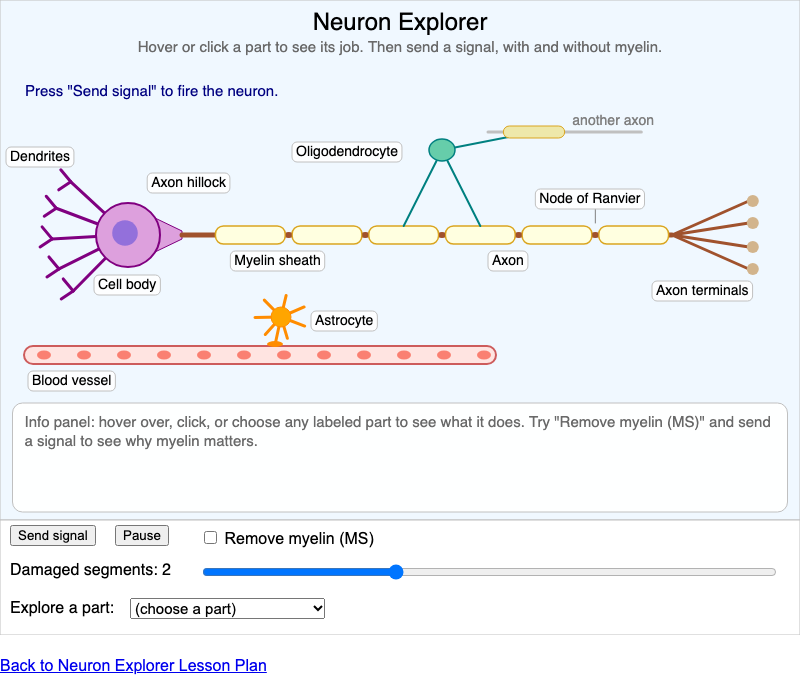](ch01-neuron-explorer/index.md)

    Explore the parts of a neuron and two glial cells, then send a signal down the axon with and without myelin to see why multiple sclerosis slows or blocks signals.

    *Chapter 1*

-   **[Action Potential Simulator](ch02-action-potential/index.md)**

    ---

    [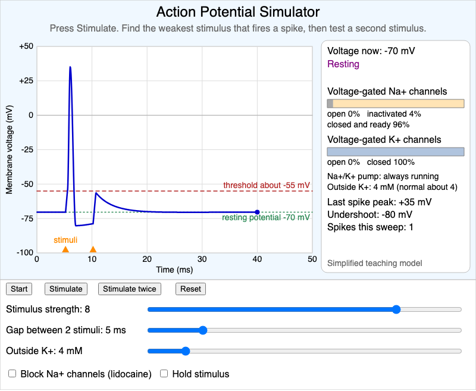](ch02-action-potential/index.md)

    Interactive membrane-voltage plot showing threshold, the all-or-none spike, refractory periods, firing rate coding, lidocaine block, and the effect of outside potassium.

    *Chapter 2*

-   **[Synapse Simulator](ch03-synapse/index.md)**

    ---

    [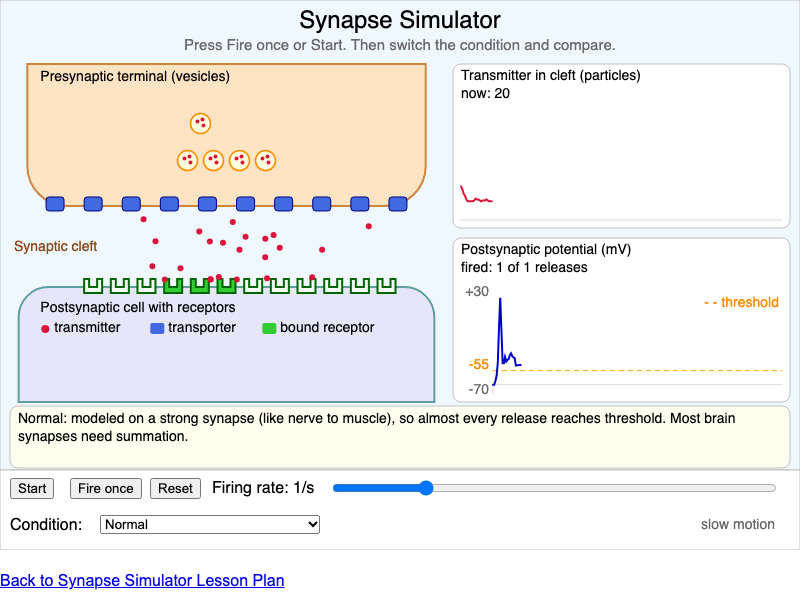](ch03-synapse/index.md)

    A close-up of a chemical synapse. Fire the presynaptic neuron and see how a reuptake blocker, a receptor antagonist, or fewer receptors change cleft transmitter and the postsynaptic potential.

    *Chapter 3*

-   **[Clickable Brain Atlas](ch04-brain-atlas/index.md)**

    ---

    [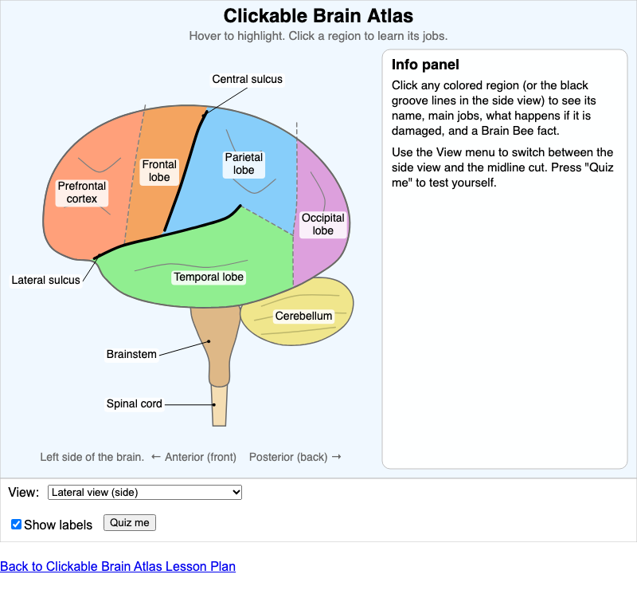](ch04-brain-atlas/index.md)

    A clickable lateral and midsagittal brain atlas with region info panels and a quiz mode for learning neuroanatomy.

    *Chapter 4*

-   **[Visual Pathway Lesion Simulator](ch05-visual-pathway/index.md)**

    ---

    [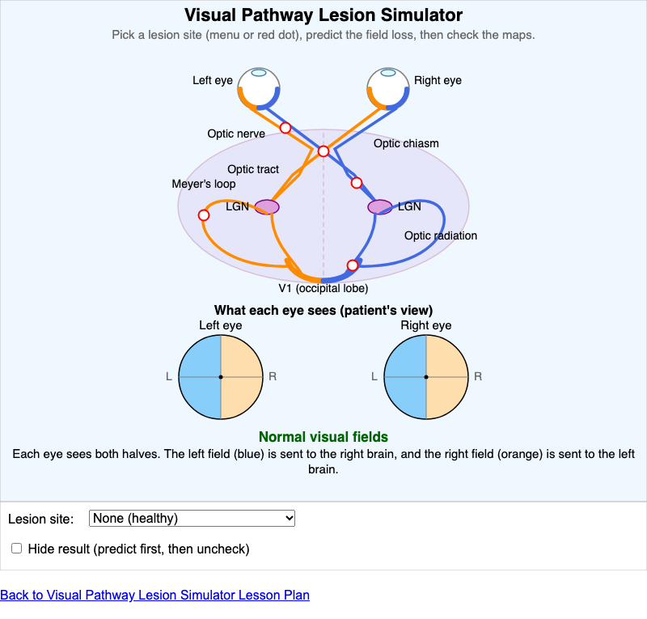](ch05-visual-pathway/index.md)

    Place a lesion along the visual pathway, from optic nerve to occipital cortex, and see the matching visual field loss in each eye.

    *Chapter 5*

-   **[Homunculus and Dermatome Map](ch06-homunculus-dermatomes/index.md)**

    ---

    [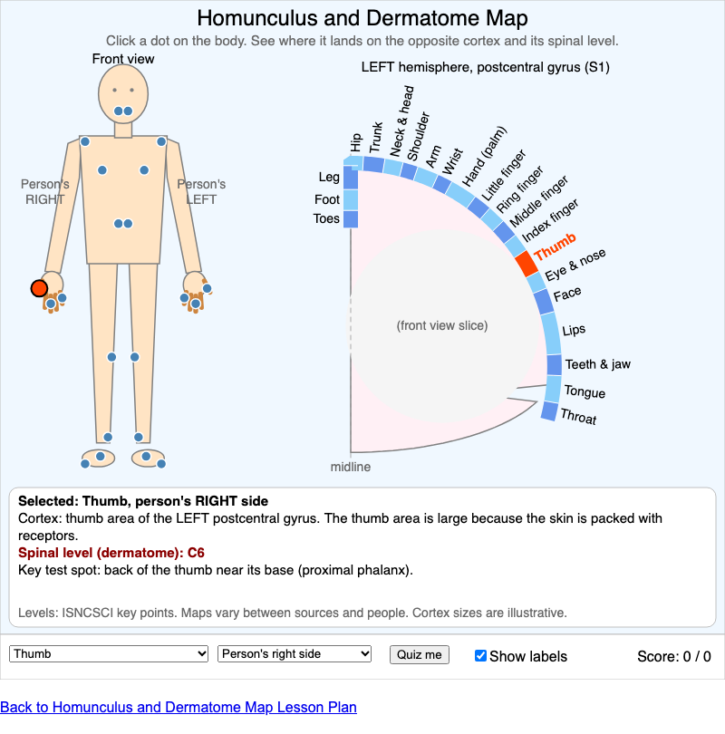](ch06-homunculus-dermatomes/index.md)

    Click a body region to see where it lands on the opposite primary somatosensory cortex and which spinal level (dermatome) or cranial nerve carries it.

    *Chapter 6*

-   **[Basal Ganglia Gas and Brake](ch07-basal-ganglia/index.md)**

    ---

    [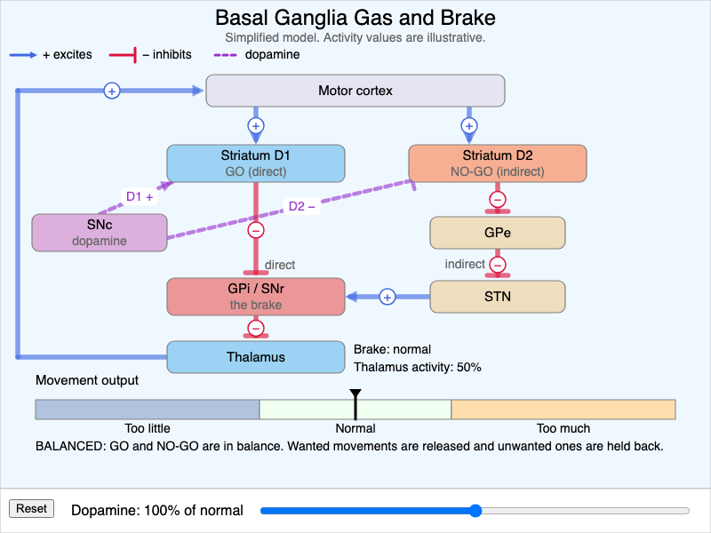](ch07-basal-ganglia/index.md)

    A simplified basal ganglia circuit. Slide dopamine from low to high and watch the direct (GO) and indirect (NO-GO) pathways change movement output.

    *Chapter 7*

-   **[Synaptic Pruning Over a Lifetime](ch08-synaptic-pruning/index.md)**

    ---

    [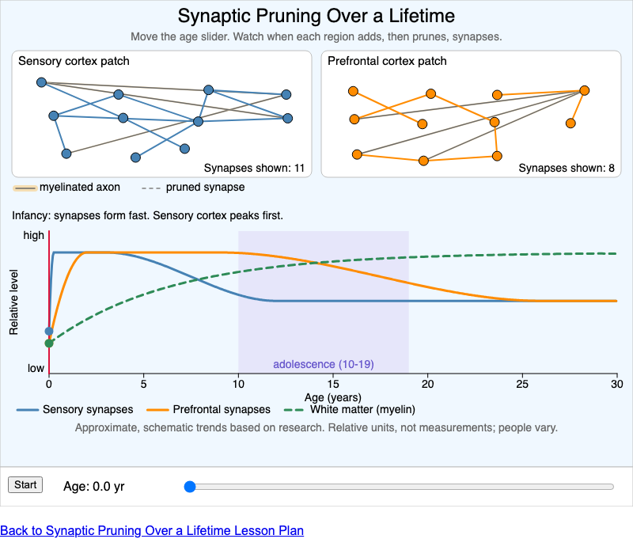](ch08-synaptic-pruning/index.md)

    An age slider from birth to 30 shows synapses being overproduced and then pruned, earlier in sensory cortex and later in prefrontal cortex, while white matter keeps growing.

    *Chapter 8*

-   **[Aplysia Habituation and Sensitization](ch09-aplysia-learning/index.md)**

    ---

    [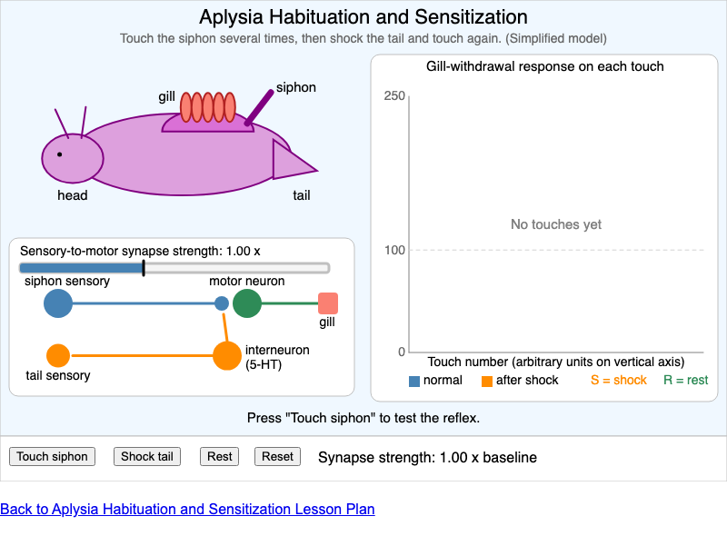](ch09-aplysia-learning/index.md)

    Touch a simplified sea slug's siphon and shock its tail to see how one synapse weakens with habituation and strengthens with sensitization.

    *Chapter 9*

-   **[Hypnogram Builder](ch10-hypnogram/index.md)**

    ---

    [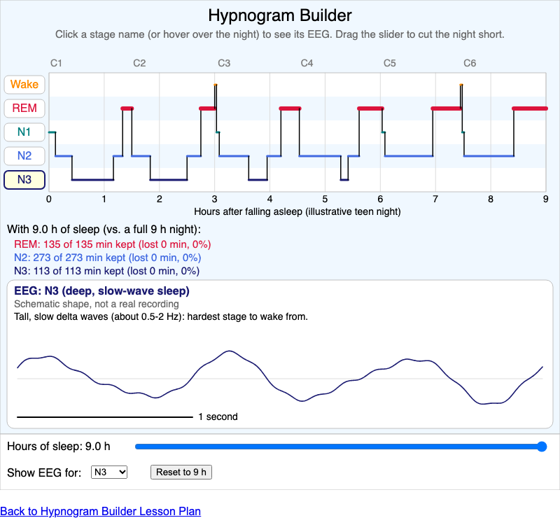](ch10-hypnogram/index.md)

    An interactive hypnogram of an illustrative 9-hour teen night with schematic EEG waves for each sleep stage and a slider that shows which stages are lost when sleep is cut short.

    *Chapter 10*

-   **[HPA Axis Feedback Loop](ch11-hpa-axis/index.md)**

    ---

    [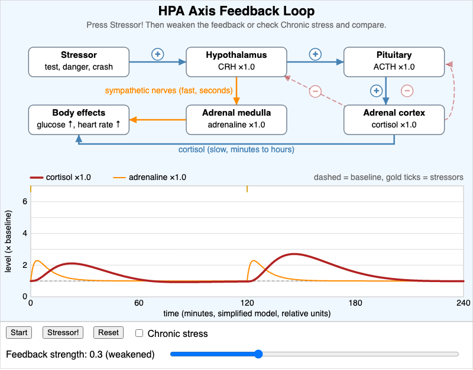](ch11-hpa-axis/index.md)

    Trigger a stressor and watch cortisol rise and fall through the HPA axis, then weaken its negative feedback or repeat the stress to see cortisol stay high.

    *Chapter 11*

-   **[Aphasia Sorter](ch12-aphasia-sorter/index.md)**

    ---

    [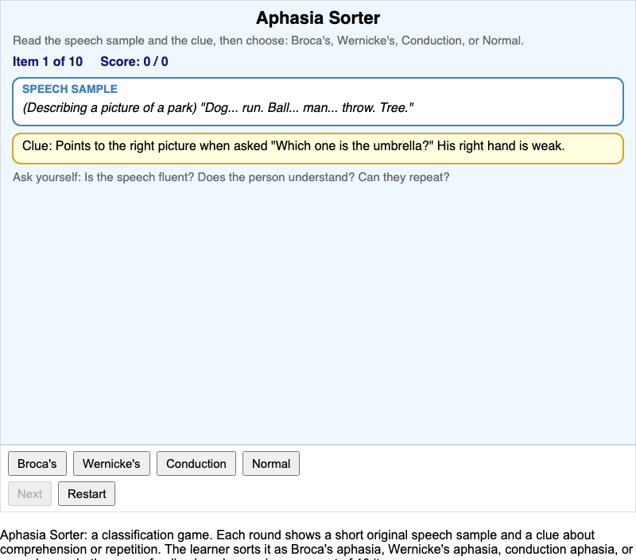](ch12-aphasia-sorter/index.md)

    A classification game: read short original speech samples with a clue, then sort each as Broca's, Wernicke's, conduction aphasia, or normal speech.

    *Chapter 12*

-   **[Amyloid and Tau Cascade](ch13-amyloid-tau-cascade/index.md)**

    ---

    [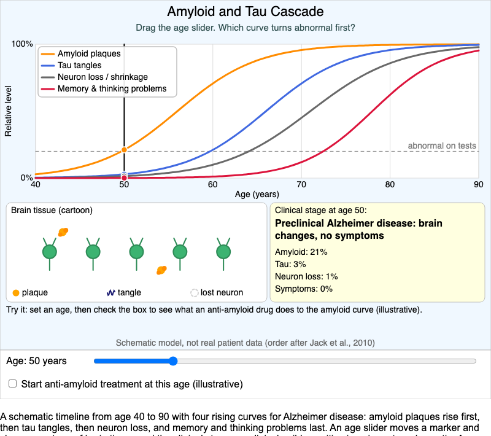](ch13-amyloid-tau-cascade/index.md)

    A schematic timeline of Alzheimer's disease showing amyloid, tau, neuron loss, and symptoms rising in order, with an illustrative anti-amyloid treatment.

    *Chapter 13*

-   **[Stroke Territory Map](ch14-stroke-territories/index.md)**

    ---

    [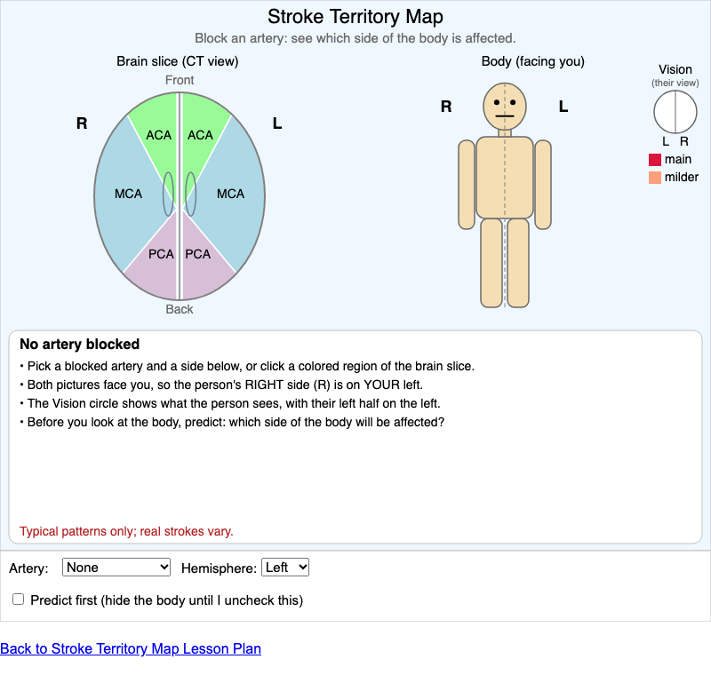](ch14-stroke-territories/index.md)

    Block the anterior, middle, or posterior cerebral artery on either side and see which side of the body and which functions are typically affected.

    *Chapter 14*

-   **[Reward Pathway and Tolerance](ch15-reward-tolerance/index.md)**

    ---

    [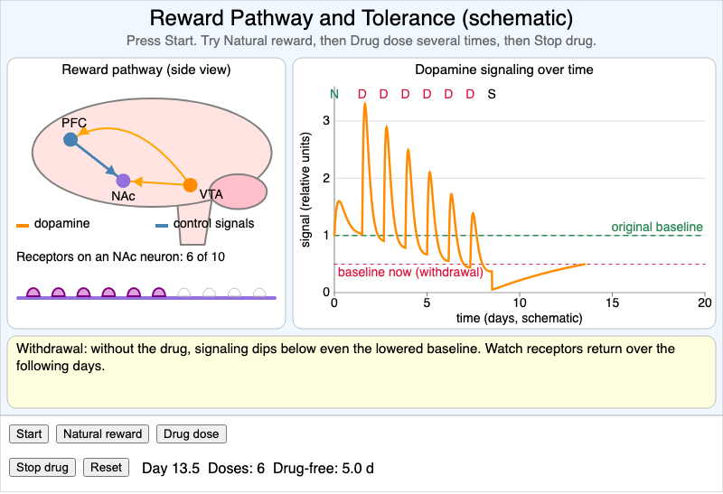](ch15-reward-tolerance/index.md)

    A schematic MicroSim of the dopamine reward pathway showing natural rewards, drug spikes, tolerance from receptor downregulation, and withdrawal.

    *Chapter 15*

-   **[Neuro Exam Decision Tree](ch16-neuro-exam/index.md)**

    ---

    [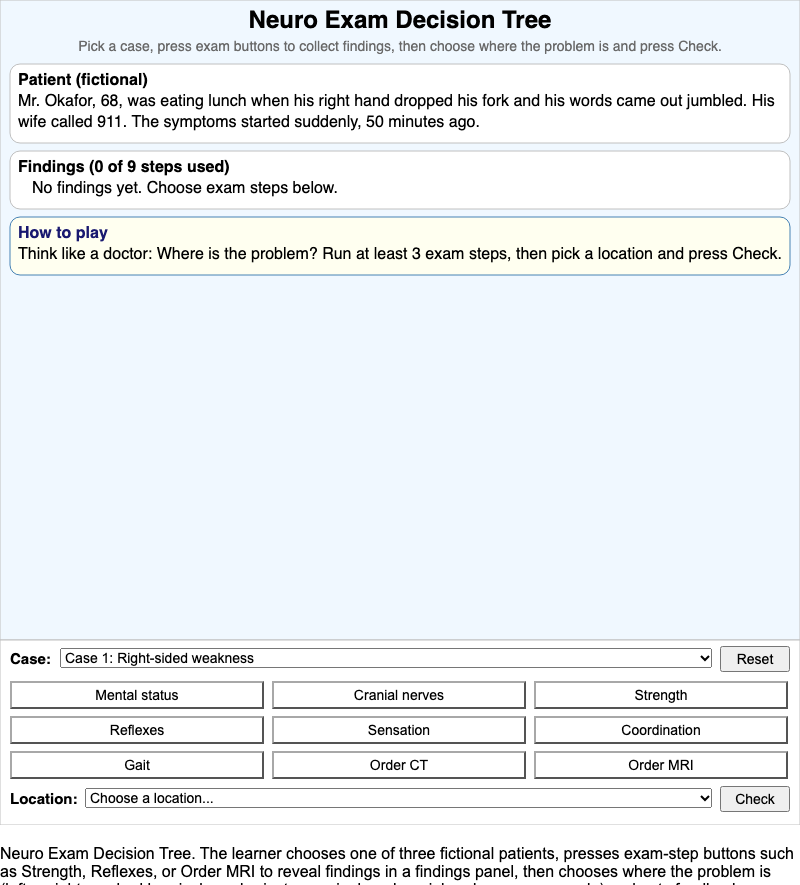](ch16-neuro-exam/index.md)

    Interactive case-based MicroSim: run neurological exam steps on three fictional patients, collect findings, and localize the lesion.

    *Chapter 16*

-   **[Learning Graph Viewer](graph-viewer/index.md)**

    ---

    [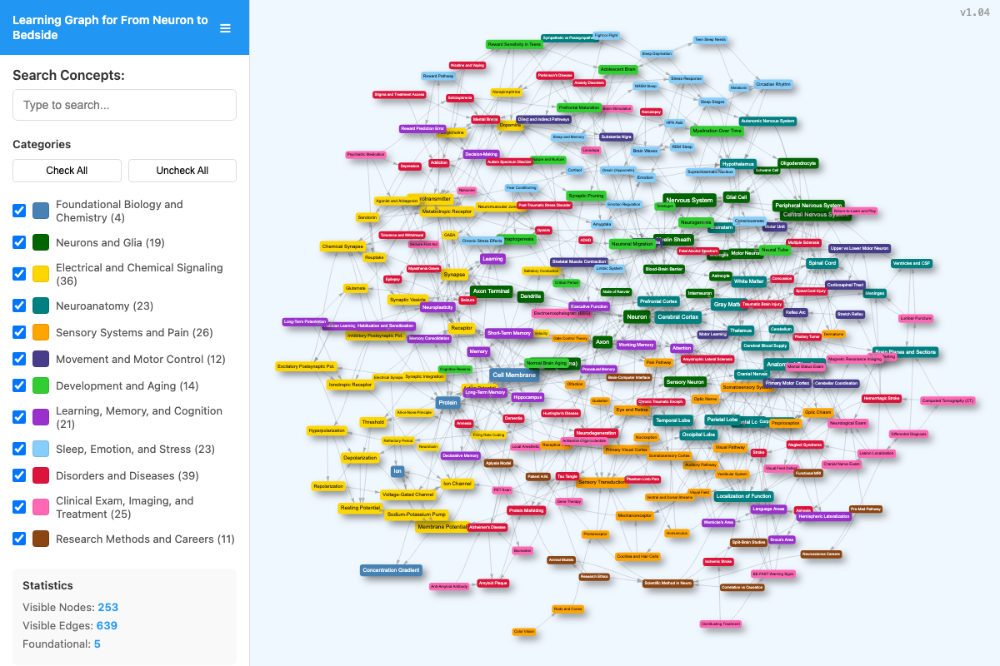](graph-viewer/index.md)

    Explore all 253 concepts in this book and how they depend on each other.

